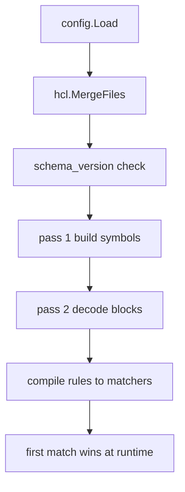
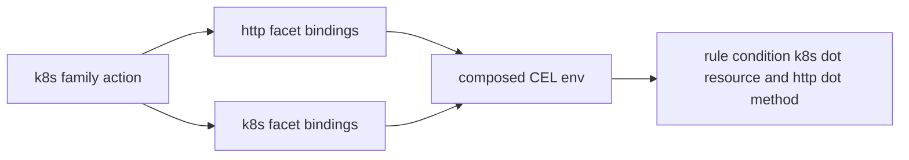

# 03 -- The HCL rule language and facets: CEL, composition, and three-valued match

Policy is written in HCL (HashiCorp Configuration Language), the same
configuration language Terraform uses. The entry point is `config.Load`, which
accepts either a single file or a directory.

```go
// Source: internal/config/config.go, lines 877-898
func Load(path string) (*Gateway, hcl.Diagnostics) {
	info, err := os.Stat(path)
	if err != nil {
		return nil, hcl.Diagnostics{{
			Severity: hcl.DiagError,
			Summary:  "Cannot read config path",
			Detail:   err.Error(),
		}}
	}
	if info.IsDir() {
		return LoadDir(path)
	}
	src, err := os.ReadFile(path)
	if err != nil {
		return nil, hcl.Diagnostics{{
			Severity: hcl.DiagError,
			Summary:  "Cannot read config file",
			Detail:   err.Error(),
		}}
	}
	return LoadBytes(src, path)
}
```

Directory mode reads every `*.hcl` file (non-recursive), merges them in
lexicographic order with `hcl.MergeFiles`, and resolves references against the
merged symbol table. The load pipeline is then a two-pass decode: pass 1
extracts policy blocks and builds the symbol table; pass 2 decodes each block
against its plugin's schema.

```go
// Source: internal/config/config.go, lines 1049-1076
	// Spawn external plugins before we look at policy blocks so the
	// types they declare are visible to pass-1 symbol building. The
	// loader is package-global; see SetPluginLoader.
	if len(gw.Plugins) > 0 {
		d := pluginLoader.LoadPlugins(gw.Plugins, gw.ResolvedStateDir())
		if d.HasErrors() {
			return gw, append(diags, d...)
		}
		diags = append(diags, d...)
	}

	diags = append(diags, validateOperational(gw)...)

	// Pass 1: extract the policy blocks from the remainder body. With
	// a merged body, gw.Remain is itself a merged body whose Content
	// fans out to each file's leftover — so cross-file policy blocks
	// surface here as a single flat block list with original-file
	// ranges intact.
	policyBlocks, polDiags := extractPolicyBlocks(gw.Remain)
	diags = append(diags, polDiags...)

	table, symDiags := buildSymbols(policyBlocks)
	diags = append(diags, symDiags...)

	// Pass 2: build the eval context with every name → string, then
	// decode each policy block against its plugin's schema.
	evalCtx := buildEvalContext(table)
	resolveDiags := decodePolicyBlocks(gw.Policy, table, evalCtx, configDir)
```

A rule block is the policy unit. Its schema is small: a condition, a priority,
an optional credential pin, and exactly one outcome (verdict or approve list).

```go
// Source: internal/config/plugins/rules/rules.go, lines 31-68
type RuleBody struct {
	// Endpoint is the single endpoint this rule attaches to. Use
	// endpoint or endpoints, not both.
	Endpoint string `hcl:"endpoint,optional"`
	// Endpoints is the list of endpoints this rule attaches to. All
	// referenced endpoints must share one protocol family.
	Endpoints []string `hcl:"endpoints,optional"`
	// Priority orders matching rules. Higher values run first; equal
	// priorities preserve declaration order.
	Priority int `hcl:"priority,optional"`
	// Disabled keeps the rule in config while excluding it from
	// runtime evaluation.
	Disabled bool `hcl:"disabled,optional"`

	// Condition is a CEL expression evaluated against the
	// family-specific variable set. An absent / empty condition
	// matches everything — the catch-all pattern (`rule
	// "X-default" { priority = -100; verdict = "deny" }`) relies
	// on this.
	Condition string `hcl:"condition,optional"`

	// Credential, if set, is a bare-name reference to a credential
	// block. The runtime treats it as an extra match predicate
	// (request must have been dispatched against this credential)
	// evaluated before the CEL expression.
	Credential string `hcl:"credential,optional"`

	// Verdict is the outcome when the rule matches. Set exactly one
	// of `verdict` (`"allow"` / `"deny"`) or `approve`.
	Verdict string `hcl:"verdict,optional"`
	// Reason is the operator-facing explanation recorded when the rule
	// matches.
	Reason string `hcl:"reason,optional"`
	// Approve is a list of bare-name approver references. The
	// approvers run in order; the request is allowed only if every
	// stage approves. Set this *or* `verdict`, not both.
	Approve cty.Value `hcl:"approve,optional"`
}
```

A rule's condition is a CEL (Common Expression Language) expression. Which
variables exist is owned by a facet: a protocol-family plugin that declares the
CEL environment. Built-in facets are `http`, `sql`, `k8s`, and `ssh`. The composition
table decides which facets a family's actions carry:

```go
// Source: internal/config/facet/composition.go, lines 77-82
var families = map[string][]string{
	"http": {"http"},
	"sql":  {"sql"},
	"k8s":  {"http", "k8s"},
	"ssh":  {"ssh"},
}
```

There is no inheritance. `k8s` composes `http` because a Kubernetes API call is
an HTTPS request underneath and carries `http.method`, `http.path`, and
`http.body` in addition to `k8s.resource` and friends. An `http` rule cannot
read `k8s.*` because the `http` family does not compose the `k8s` facet. SQL
does not compose `http` because the PostgreSQL wire is binary, not HTTPS.

Compiling a condition produces a matcher with three possible results: `Matched`,
`NoMatch`, and `Unevaluable`. The third value is the fail-closed escape hatch
for truncated or unparseable requests, which [04-action-gating-approval.md](./04-action-gating-approval.md)
explains in detail.





## The Aha Moment

**Aha:** facets are plugins, not switch statements. A rule does not name its
protocol; it names its endpoint, and the endpoint's family selects the facet
that owns the CEL environment. Adding a new protocol is one new package that
registers a facet, with no edits to the rule engine, the matcher, or the
gateway runtime.

See [02-wire-traffic-parsing.md](./02-wire-traffic-parsing.md) for the parsers
that populate these variables, and [05-plugin-sdk.md](./05-plugin-sdk.md) for
the registration mechanism that makes a facet discoverable.

Continue to [04-action-gating-approval.md](./04-action-gating-approval.md).
