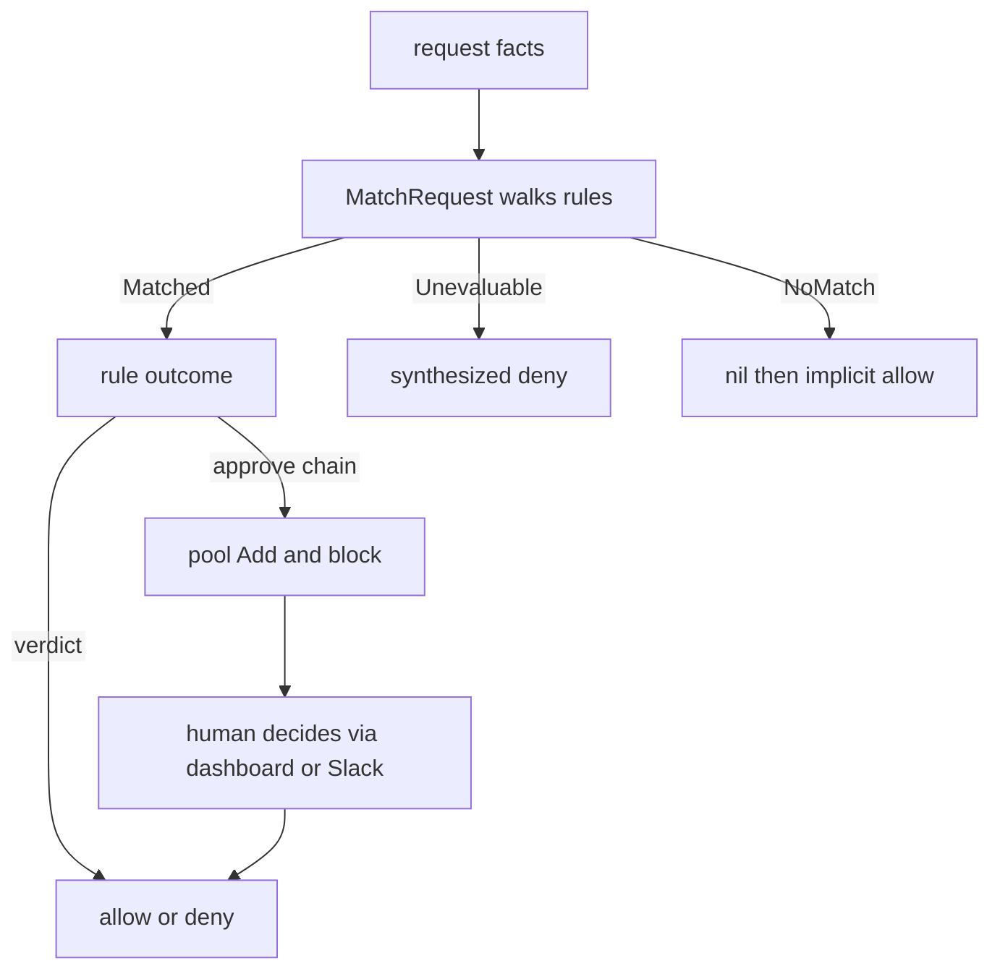
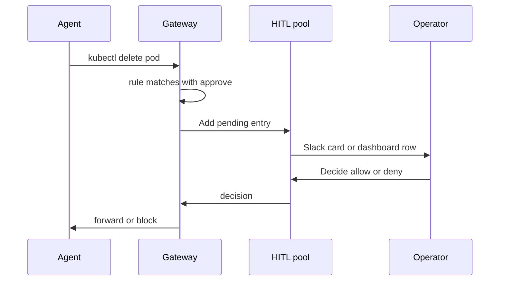

# 04 -- Action gating and human approval: dispatch and the approve chain

Once a request's facts are extracted and a rule's condition compiled, the
gateway gates the action. The dispatcher walks an endpoint's rules in priority
order and fires the first whose matcher accepts the request.

```go
// Source: internal/config/runtime/dispatch.go, lines 81-114
func MatchRequest(ep *config.CompiledEndpoint, req *match.Request) *config.CompiledRule {
	if ep == nil {
		return nil
	}
	for _, r := range ep.Rules {
		if r.Disabled {
			continue
		}
		// Credential predicate: rule applies only when the
		// dispatching credential matches. Checked before the CEL
		// program so an empty condition + a credential pin still
		// behaves as expected.
		if r.Credential != "" {
			if req == nil || req.Credential != r.Credential {
				continue
			}
		}
		if r.Matcher == nil {
			// Empty match = match-everything; produced by Compile
			// for catch-all rules without a condition. A catch-all
			// reads no facets, so it can't be poisoned by
			// truncation — fire it as written even when
			// req.Truncated.
			return r
		}
		switch d := r.Matcher.Match(req); d.Result {
		case match.Matched:
			return r
		case match.Unevaluable:
			return synthesizeUnevaluableDeny(r, req, d.Detail)
		}
	}
	return nil
}
```

The three-valued matcher is the core safety property. A matcher returns
`Matched`, `NoMatch`, or `Unevaluable`. When a condition cannot be evaluated
honestly — its outcome depends on a facet value the gateway does not have,
because bytes were truncated at the inspection buffer or a parser refused the
SQL — the rule is fired with a synthesized deny instead of being skipped.
Skipping would let a deny rule fail open.

```go
// Source: internal/config/runtime/dispatch.go, lines 171-180
func synthesizeUnevaluableDeny(r *config.CompiledRule, req *match.Request, detail string) *config.CompiledRule {
	reason := "rule \"" + r.Name + "\" could not be evaluated against this request (" + unevaluableCause(req) + "); failing closed"
	log.Printf("rule %q unevaluable: %s", r.Name, detail)
	synth := *r
	synth.Outcome = config.Outcome{
		Verdict: "deny",
		Reason:  reason,
	}
	return &synth
}
```

The agent-visible reason names only the rule and the coarse cause. The full
detail (the unknown facet paths, or the CEL (Common Expression Language) error text) is kept out of the deny
reason deliberately, because a CEL error like "no such key" would let an agent
probe which fields a rule inspects by varying payloads and reading reasons.

A rule's outcome is either a verdict or an approve chain. `ApproveStage` is one
node in an `approve = [...]` list; each stage is a bare-name reference to an
approver block.

```go
// Source: internal/config/compile.go, lines 265-280
// Outcome captures a rule's verdict + (when applicable) approve chain.
// Exactly one of Verdict and Approve is set after Build's validation.
type Outcome struct {
	Verdict string // "allow" | "deny"
	Reason  string
	Approve []ApproveStage
}

// ApproveStage is one node in an approve = [...] chain — a bare-name
// reference to an approver block. LLM policy text and cache TTL ride on
// the approver block itself (see LLMApprover), so the use site stays a
// single bare name. Lives here so runtime callers don't need to import
// the rules plugin package.
type ApproveStage struct {
	Name string `json:"name"`
}
```

Approvers implement the same interface regardless of whether they are a human
channel, the dashboard, or an LLM (large language model) judge. The human
approver publishes a pending entry to the shared pool and blocks until a
decision arrives, a timeout fires, or the client disconnects.

```go
// Source: internal/config/plugins/approvers/human.go, lines 137-146
func (h *HumanApprover) Approve(ctx context.Context, req runtime.ApproveRequest) (runtime.ApproveVerdict, error) {
	if req.Pool == nil {
		return runtime.ApproveVerdict{}, fmt.Errorf("human approver %q: no pool", req.ApproverName)
	}
	timeout := h.approvalTimeout(req.Policy)
	pending := buildPending(req)
	pending.ExpiresAt = pending.CreatedAt.Add(timeout)
	id, ch := req.Pool.Add(pending)
	discardOnReturn := true
	defer func() {
		if discardOnReturn {
			req.Pool.Discard(id)
		}
	}()
```

The pool contract is declared in the runtime package so approver plugins do not
depend on the gateway main package.

```go
// Source: internal/config/runtime/runtime.go, lines 614-630
type HITLPool interface {
	// Add publishes a pending entry. Returns the assigned id (used
	// by Decide) and a channel that fires exactly once when the
	// pool gets a verdict. Caller must select on ctx.Done() too;
	// when ctx fires first, prefer HITLPoolCanceler.Cancel so stale
	// prompts can explain why the upstream request was not sent.
	Add(p HITLPending) (id string, decision <-chan HITLDecision)
	// Discard drops a pending entry without recording terminal state.
	// Use only for compatibility or best-effort cleanup after resolve.
	Discard(id string)
	// Decide resolves a pending entry — used by webhook handlers
	// (Slack interactive callback, future Discord etc.) to forward
	// a side-channel verdict into the same pool the dashboard's
	// /api/hitl/decide writes to. Returns false when the id is
	// unknown (already resolved or expired).
	Decide(id string, d HITLDecision) bool
}
```

An approver verdict carries an empty `Decision` when the approver could not
decide, and the caller falls back to the configured fail mode.

```go
// Source: internal/config/runtime/runtime.go, lines 597-603
type ApproveVerdict struct {
	Decision     string // "allow" | "deny" | "async_pending" | ""
	Reason       string
	By           string // who decided ("dashboard:<user>" / "slack:#chan" / "llm:<model>")
	ApproverName string // HCL block name, e.g. "pg-staging-secret-columns-judge"
	ApproverType string // plugin type, e.g. "llm_approver" / "human_approver" / "dashboard"
}
```

Beyond synchronous approval there is an async retry-grant path. When an
approver is configured with a sync wait timeout and the request body is small
enough to fingerprint, the gateway can return HTTP 202 and record a durable
operation, then match a later retry by an HMAC (hash-based message
authentication code) fingerprint of the request. This keeps slow approvals from
holding an HTTP connection open.





## The Aha Moment

**Aha:** approval is just another outcome a rule can produce, and every
approver — human channel, dashboard, LLM judge — is the same `Approve` call
against the same pool. The dispatcher never learns which kind of approver it
ran; it only sees a final verdict. That is what lets a Slack bot and an
operator clicking in a web page race to the same decision.

See [03-hcl-rule-language-facets.md](./03-hcl-rule-language-facets.md) for how
the matcher is built, and [07-dashboard.md](./07-dashboard.md) for the
`/api/hitl/decide` endpoint that feeds the pool.

Continue to [05-plugin-sdk.md](./05-plugin-sdk.md).
