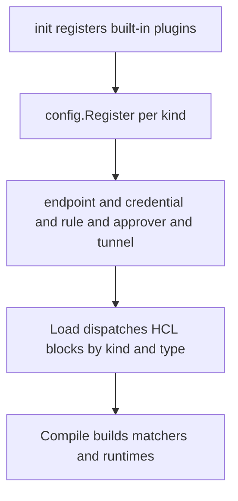
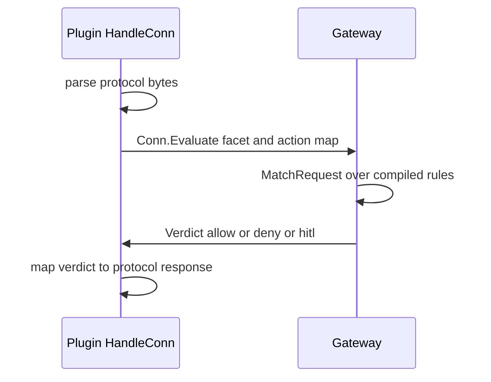

# 05 -- The plugin SDK: kinds and runtimes

Everything policy-shaped in clawpatrol is a plugin. Endpoints, credentials,
rules, approvers, profiles, and tunnels are all registered into one global
registry. The registry entry is `config.Plugin`, and registration is a panic on
any build-time mistake.

```go
// Source: internal/config/registry.go, lines 24-46
// Register installs a plugin. Called from each plugin package's
// init(). Duplicate (Kind, Type) pairs panic — they always indicate
// a build-time mistake.
func Register(p *Plugin) {
	if p == nil {
		panic("config.Register: nil plugin")
	}
	if p.Kind == "" {
		panic("config.Register: plugin Kind is empty")
	}
	if p.New == nil {
		panic(fmt.Sprintf("config.Register(%s/%s): New is nil", p.Kind, p.Type))
	}
	if p.Build == nil {
		panic(fmt.Sprintf("config.Register(%s/%s): Build is nil", p.Kind, p.Type))
	}
	if p.Kind.LabelCount() == 2 && p.Type == "" {
		panic(fmt.Sprintf("config.Register(%s): Type is required for two-label kinds", p.Kind))
	}
	// One-label kinds (KindRule today) carry Type="" — the block has
	// no type label to dispatch on. Allowed; nothing to check.
	registry.Lock()
	defer registry.Unlock()
```

Built-in plugins live in-process and register at init time through a blank
import chain. External plugins are separate binaries that use the same kind
model but talk over gRPC (Google Remote Procedure Call); [06-external-plugins.md](./06-external-plugins.md)
covers them. This document focuses on the author-facing SDK in `pluginsdk/`.

A plugin is a Go program whose `main` builds a `*Plugin` and hands it to `Run`.
`Run` serves the plugin's gRPC services until the gateway disconnects.

```go
// Source: pluginsdk/server.go, lines 29-56
func Run(p *Plugin) {
	if p == nil {
		panic("pluginsdk.Run: nil *Plugin")
	}
	if p.Name == "" {
		panic("pluginsdk.Run: Plugin.Name is required")
	}
	srv := newServer(p)
	// `<plugin> --print-manifest` prints the plugin's manifest (the same
	// one served over gRPC) as JSON and exits, without starting the gRPC
	// server. A release publishes this as a static asset so the gateway
	// can show a plugin's metadata and required privileges before it
	// downloads or runs the binary.
	if printManifestRequested() {
		if err := printManifest(os.Stdout, srv); err != nil {
			fmt.Fprintln(os.Stderr, "print-manifest:", err)
			os.Exit(1)
		}
		os.Exit(0)
	}
	plugin.Serve(&plugin.ServeConfig{
		HandshakeConfig: wire.HandshakeConfig,
		Plugins: map[string]plugin.Plugin{
			wire.PluginName: &grpcServer{srv: srv},
		},
		GRPCServer: plugin.DefaultGRPCServer,
	})
}
```

A plugin declares credentials, tunnels, endpoints, facets, and a capability
set. `Plugin.Facets` is the schema list for protocol families the plugin's
endpoints emit actions against; the gateway registers one facet runtime per
`FacetDef` so rules can compile CEL (Common Expression Language) conditions like `smtp.verb == "MAIL"`.

The per-connection handle is `Conn`. An endpoint plugin's `HandleConn` receives
it, and the plugin asks the gateway to rule on structured actions through
`Conn.Evaluate`, or reports an outcome with `Conn.SetResult`.

```go
// Source: pluginsdk/sdk.go, lines 601-619
// Evaluate asks the gateway to rule on one structured action against
// the endpoint's compiled rule list, walking any approve = [...]
// chain along the way. The gateway also logs the action onto its
// event stream with the action map as the facet payload, so plugin
// authors don't need to call Emit separately.
//
// facet is the short facet name as declared in Plugin.Facets (the
// SDK auto-namespaces it). action is a JSON-serializable map whose
// keys match the facet's declared fields. summary is the one-liner
// rendered on dashboard / HITL prompts.
//
// Safe to call concurrently from multiple goroutines on the same
// Conn — the SDK matches verdicts to in-flight calls by call_id.
func (c *Conn) Evaluate(ctx context.Context, facet string, action map[string]any, summary string) (Verdict, error) {
	if c.evaluate == nil {
		return Verdict{}, errors.New("pluginsdk: Conn.Evaluate not wired (running without a gateway?)")
	}
	return c.evaluate(ctx, facet, action, summary)
}
```

The `Conn.Evaluate` path is where the plugin's own protocol knowledge meets the
gateway's rule engine. A plugin that speaks, for example, the SMTP protocol
extracts a verb like `MAIL` from its wire, fills an action map, and asks the
gateway to apply the operator's rules. The plugin then maps the verdict onto a
protocol-level response code.





## The Aha Moment

**Aha:** a plugin author never writes policy, and an operator never writes
protocol code. The seam is `Conn.Evaluate`: the plugin reduces its wire protocol
to a small structured action map, and the gateway reduces that map to a verdict
through HCL (HashiCorp Configuration Language) rules. Each side owns exactly its own concern.

See [06-external-plugins.md](./06-external-plugins.md) for how these plugins
run out-of-process under a sandbox, and [08-aws-credential.md](./08-aws-credential.md)
for a concrete built-in credential that implements a runtime interface.

Continue to [06-external-plugins.md](./06-external-plugins.md).
