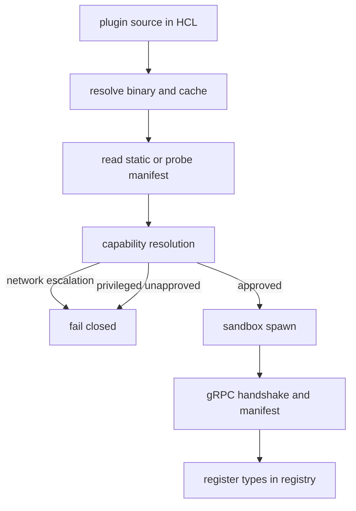
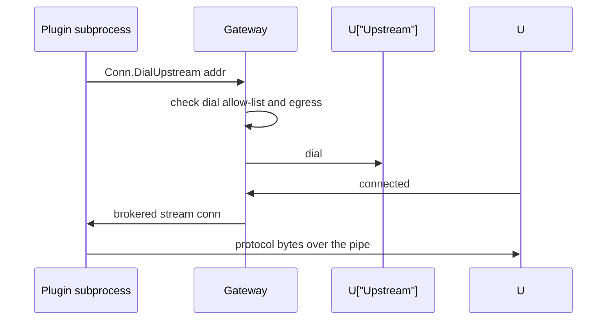

# 06 -- External plugins: sandboxed and out of process

External plugins are separate binaries the gateway spawns under a sandbox and
talks to over gRPC (Google Remote Procedure Call) using hashicorp/go-plugin. They are how integrations with a
specific third-party service ship without entering core, per `CONTRIBUTING.md`.

The gateway-side manager (`internal/config/extplugin/manager.go`) supervises
one subprocess per declared plugin source. It resolves a GitHub source to a
local binary, reads the plugin's manifest, and applies a permission model based
on a lockfile. The key property is trust-on-first-use with fail-closed
escalation: a plugin upgrade that asks for more than was approved is refused.

```go
// Source: internal/config/extplugin/manager.go, lines 534-540
	if networkRank(declared) > networkRank(rec) {
		return "", "", fmt.Errorf(
			"plugin %q upgrade escalates permissions: it now requests network=%q but was approved for network=%q. "+
				"A compromised plugin update gaining an exfiltration path looks exactly like this. "+
				"If you trust this update, re-approve it: clawpatrol plugins approve %s",
			sp.Name, declared, rec, sp.Name)
	}
```

The sandbox and the gRPC transport are set up in `spawnClient`. Two details
matter: the plugin's environment is exactly what `sandbox.Command` set, and the
host-services broker is multiplexed over the plugin's main gRPC connection so a
sandboxed plugin can still reach host services.

```go
// Source: internal/config/extplugin/manager.go, lines 398-421
	cli := plugin.NewClient(&plugin.ClientConfig{
		HandshakeConfig: HandshakeConfig,
		Plugins: map[string]plugin.Plugin{
			PluginName: gc,
		},
		Cmd: cmd,
		// The plugin's environment is exactly what sandbox.Command
		// set (plus go-plugin's handshake vars): the gateway's own
		// environment — CLAWPATROL_SECRET_*, cloud credentials —
		// must never reach plugin code.
		SkipHostEnv:      true,
		AllowedProtocols: []plugin.Protocol{plugin.ProtocolGRPC},
		Logger:           m.logger,
		// Multiplex the host-services broker (HostState/HostControl/
		// HostTunnel) over the plugin's main gRPC connection instead of a
		// separate unix socket. The broker's own socket would land in the
		// gateway's temp dir, which the namespaces sandbox's private /tmp
		// hides from the plugin — so a sandboxed plugin could never reach
		// host services. Multiplexing reuses the main connection (already
		// sandbox-visible), so it works under the sandbox. Both sides run
		// the same go-plugin version, so the plugin negotiates support
		// automatically.
		GRPCBrokerMultiplex: true,
	})
```

The manifest's types are registered as virtual `config.Plugin` entries. Type
names are namespaced as `<plugin>.<type>` so two plugins cannot collide, and a
plugin cannot shadow a built-in type like `https`.

```go
// Source: internal/config/extplugin/register.go, lines 582-592
func registerOrCollide(plug *config.Plugin, pluginName, kindLabel string) hcl.Diagnostics {
	if existing := config.Lookup(plug.Kind, plug.Type); existing != nil {
		return hcl.Diagnostics{{
			Severity: hcl.DiagError,
			Summary:  fmt.Sprintf("Plugin %q %s type %q collides with an already-registered type", pluginName, kindLabel, plug.Type),
			Detail:   "Type names live in one global registry — pick a different name (the convention is to prefix with the plugin slug, e.g. \"example_magic_token\"), or remove the conflicting registration.",
		}}
	}
	config.Register(plug)
	return nil
}
```

Capabilities are three-tiered. `Network` (none or outbound) and `Egress` (a set
of upstream targets) are low-risk and trust-on-first-use: the gateway records
them in its lockfile and blocks an upgrade that broadens them. `Privileged`
(run unsandboxed, full host access) is never granted silently; it requires an
explicit `clawpatrol plugins approve` or a dashboard approval.

A sandboxed plugin that runs with no network of its own still needs to reach
its upstream. The SDK exposes `Conn.DialUpstream`, and the gateway dials only
targets the operator's HCL (HashiCorp Configuration Language) sanctions for that endpoint: the agent's original
target, the endpoint's `hosts`, or its `dial` allow-list. Every attempt is
audited.





## The Aha Moment

**Aha:** the permission system is shaped around the failure mode of a
compromised plugin update. Because network and egress are trust-on-first-use
and fail closed on any broadening, an attacker who takes over a plugin's
release channel cannot silently gain an exfiltration path — the gateway stops
and tells the operator to re-approve, naming exactly what changed.

See [05-plugin-sdk.md](./05-plugin-sdk.md) for the author-facing side of the
same protocol, and [08-aws-credential.md](./08-aws-credential.md) for a
built-in credential that does its own token exchange in-process.

Continue to [07-dashboard.md](./07-dashboard.md).
