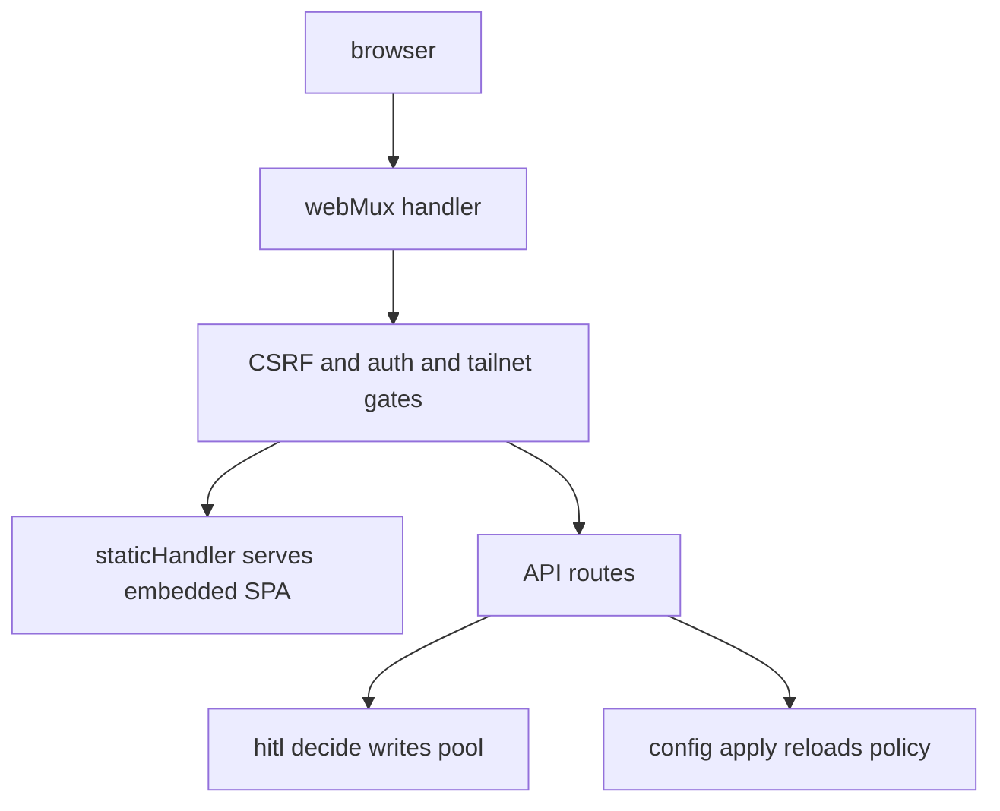
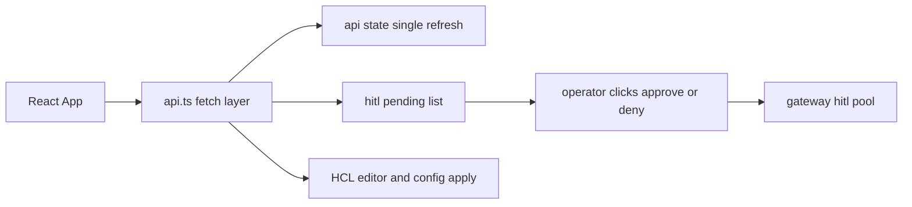

# 07 -- The dashboard: an embedded TypeScript single-page app

The dashboard is a TypeScript single-page application (SPA) built with React
and Vite, compiled to static files, and embedded into the Go binary with
`go:embed`. The gateway's HTTP server serves it.

```go
// Source: dashboard/embed.go, lines 11-22
// DistFS is the built SPA bundle (`dashboard/dist`) embedded at
// compile time. The gateway serves these assets from the dashboard
// HTTP handler.
//
//go:embed all:dist
var DistFS embed.FS

// LoginHTML is the standalone login page served before a dashboard
// session cookie is established.
//
//go:embed login.html
var LoginHTML string
```

The HTTP server is a Go `net/http` mux with a route table. Every route names
its method, path, and an auth gate. The mux is then wrapped by three gates:
CSRF (cross-site request forgery) protection, a dashboard session auth gate,
and a Tailscale peer-address gate.

```go
// Source: cmd/clawpatrol/web.go, lines 211-228
func (w *webMux) handler() http.Handler {
	mux := http.NewServeMux()
	routes := w.routes()
	w.routeAuth = routeAuthIndex(routes)
	for _, route := range routes {
		if route.Method == "" {
			panic("web route missing method: " + route.Path)
		}
		mux.HandleFunc(route.Path, route.Handler)
	}
	w.mountCredentialWebhooks(mux)
	mux.Handle("/", w.staticHandler())
	// csrfProtect wraps the gates rather than sitting inside them:
	// dashboardAuthGate hands cookieless requests to tailnetGate,
	// which authenticates from the peer address, and that is exactly
	// the path a cross-site request takes once SameSite=Lax withholds
	// the cp_session cookie.
	return w.csrfProtect(w.dashboardAuthGate(w.tailnetGate(mux)))
}
```

The static handler serves the embedded SPA bundle. If the bundle was not built,
it fails with an explicit message.

```go
// Source: cmd/clawpatrol/web.go, lines 995-1003
func (w *webMux) staticHandler() http.Handler {
	sub, err := fs.Sub(dashboard.DistFS, "dist")
	if err != nil {
		return http.HandlerFunc(func(rw http.ResponseWriter, _ *http.Request) {
			http.Error(rw, "dashboard not built (cd dashboard && npm run build)", 500)
		})
	}
	return http.FileServer(http.FS(sub))
}
```

The API surface is the dashboard's real function: `/api/state` for the
single-call refresh, `/api/rules` and `/api/config` plus `/api/config/apply` for
config editing, `/api/credentials/set` and `/api/credentials/clear` for secret slots, `/api/plugins` for the
plugin page, and `/api/hitl/pending` plus `/api/hitl/decide` for human approval.
The HITL (human-in-the-loop) decide endpoint is the dashboard's write path into the shared approval
pool described in [04-action-gating-approval.md](./04-action-gating-approval.md).

Local development uses a Vite dev server that proxies API calls to the gateway
on `localhost:8080`, injecting a `Tailscale-User-Login: dev@local` header. The
gateway does not trust that header: `tailnetGate` authenticates only from a whois of the direct peer address, so forwarded `Tailscale-User-Login` and `X-Forwarded-For` headers are ignored as indistinguishable from attacker-set ones, and in WireGuard mode the gate is skipped (only the password gate applies). The `vite.config.ts` comment claiming the header is trusted from loopback is therefore stale.

```ts
// Source: dashboard/vite.config.ts, lines 21-31
    host: "127.0.0.1",
    proxy: {
      "/api": {
        target: "http://localhost:8080",
        headers: {
          // Local dev only: the gateway's tailnet gate trusts this
          // header when the request comes from loopback, which lets
          // `npm run dev` talk to the gateway without onboarding a
          // real wg/tailnet device.
          "Tailscale-User-Login": "dev@local",
        },
      },
```

One source-of-truth correction is worth noting. The vocabulary document
`doc/code-vocabulary.md` says the interception bridge uses `node:tls`'s
"loopback bridge" pattern. That is stale. The current `dashboard/` tree is a
React plus Vite plus Tailwind SPA with no `node:tls` code anywhere; the
man-in-the-middle TLS (Transport Layer Security) termination happens in the Go gateway, not in Node. When
a doc and the code disagree, this exploration follows the code.





## The Aha Moment

**Aha:** the dashboard is not a separate service with its own database. It is a
static bundle plus a set of HTTP handlers over the same `Gateway` struct the
proxy uses, so the approval button and the Slack bot both write into the same
in-memory HITL pool through the same `Decide` call.

See [04-action-gating-approval.md](./04-action-gating-approval.md) for the pool
the dashboard writes, and [06-external-plugins.md](./06-external-plugins.md) for
the plugin page that approves privileged plugins.

Continue to [08-aws-credential.md](./08-aws-credential.md).
