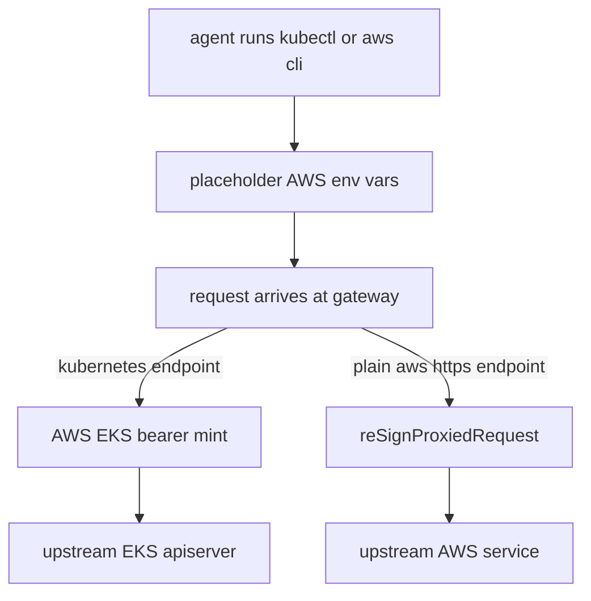
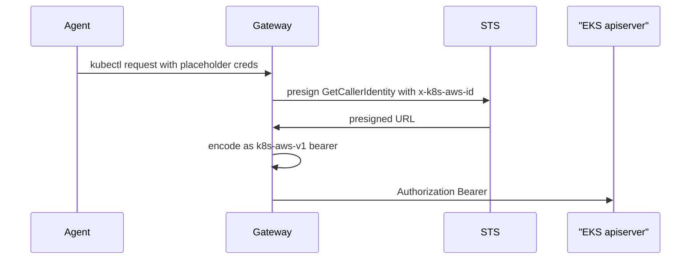

# 08 -- The AWS credential and Kubernetes endpoint plugins: SigV4 bearer

This final document shows the plugin model end to end with one concrete pair:
the built-in `aws_credential` credential and the built-in `kubernetes` endpoint.
The credential's own header comment states its two jobs.

```go
// Source: internal/config/plugins/credentials/aws.go, lines 3-17
// aws_credential: static AWS API credentials (access key + secret +
// optional session token). Two jobs:
//
//  1. EKS bearer: when bound to a kubernetes endpoint the gateway calls
//     STS GetCallerIdentity via aws-sdk-go-v2's presigner with the
//     `x-k8s-aws-id` header carrying the cluster name; the presigned URL
//     is base64url-encoded as `k8s-aws-v1.<url>` and stamped as the
//     upstream Authorization.
//
//  2. SigV4 re-signing: when bound to a plain `("https" "aws")` endpoint
//     the agent's aws-cli signs the request with injected placeholder
//     creds (see EnvVars); the gateway strips that signature and re-signs
//     with the operator's real stored creds (see reSignProxiedRequest).
//
// Either way the agent never sees real credentials.
```

The dispatch is the same `SignHTTPRequest` runtime hook every HTTP credential
implements. When the bound endpoint satisfies a small interface for EKS (Amazon Elastic Kubernetes Service)
parameters, the credential mints a bearer token; otherwise it re-signs an
existing SigV4 (AWS Signature Version 4) signature.

```go
// Source: internal/config/plugins/credentials/aws.go, lines 72-90
func (c *AWSCredential) SignHTTPRequest(ctx context.Context, req *http.Request, sec runtime.Secret, endpoint any) error {
	params, ok := endpoint.(awsEKSParams)
	if !ok {
		// Non-EKS endpoint (a plain `("https" "aws")` upstream): the
		// agent already produced a SigV4 signature with placeholder
		// creds — replace it with one minted from the real stored creds.
		return c.reSignProxiedRequest(ctx, req, sec)
	}
	cluster, region := params.AWSEKSAuthParams()
	if cluster == "" || region == "" {
		return errors.New("aws_credential: kubernetes endpoint missing cluster_name / region")
	}
	bearer, err := c.MintEKSBearer(ctx, sec, region, cluster)
	if err != nil {
		return err
	}
	req.Header.Set("Authorization", "Bearer "+bearer)
	return nil
}
```

The Kubernetes endpoint satisfies that interface with a two-field contract.
The comment explains why the interface is narrow: a future alternative
Kubernetes-on-AWS endpoint can satisfy the same shape without leaking the
endpoint's internals.

```go
// Source: internal/config/plugins/endpoints/kubernetes.go, lines 89-96
// AWSEKSAuthParams is the contract the aws_credential plugin reads at
// request time to mint an EKS bearer token. Kept narrow so a future
// alternative k8s-on-AWS endpoint (e.g. one that wraps a different
// auth flow) can satisfy the same shape without leaking
// KubernetesEndpoint internals.
func (e *KubernetesEndpoint) AWSEKSAuthParams() (cluster, region string) {
	return e.ClusterName, e.Region
}
```

The EKS bearer token itself is an AWS (Amazon Web Services) STS (Security Token Service)
`GetCallerIdentity` presigned URL, with the cluster name carried in the
`x-k8s-aws-id` header. The token expires after 60 seconds, which matches how
kubectl and the AWS CLI authenticate to EKS. The placeholder side works by
pushing placeholder environment variables to the agent process; the agent's
AWS CLI signs requests with them, and the gateway swaps the placeholder
signature for one over the real stored credentials.





## The Aha Moment

**Aha:** the AWS integration does not teach the gateway about AWS at all. It
uses two already-generic seams: the `SignHTTPRequest` credential hook and a
two-field interface on the endpoint. A credential plugin and an endpoint plugin
cooperate through a narrow Go interface, which is the same pattern any
third-party integration follows in `pluginsdk/`.

See [05-plugin-sdk.md](./05-plugin-sdk.md) for the runtime interfaces these
hooks implement, and [02-wire-traffic-parsing.md](./02-wire-traffic-parsing.md)
for how the request bytes these hooks rewrite are parsed first.

Continue to [README.md](./README.md).
