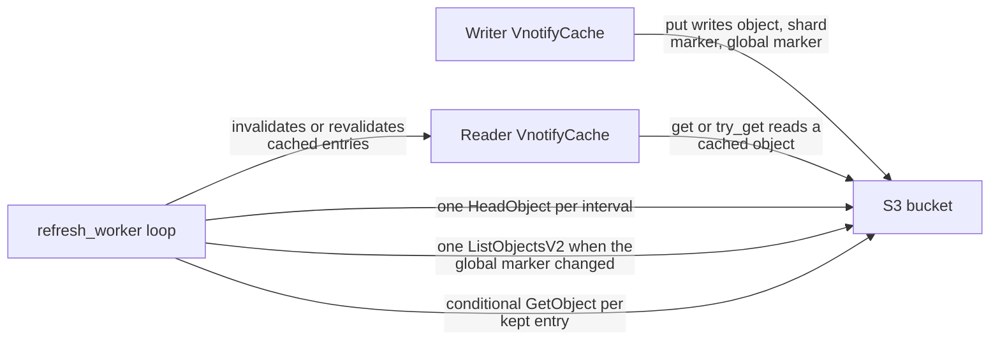
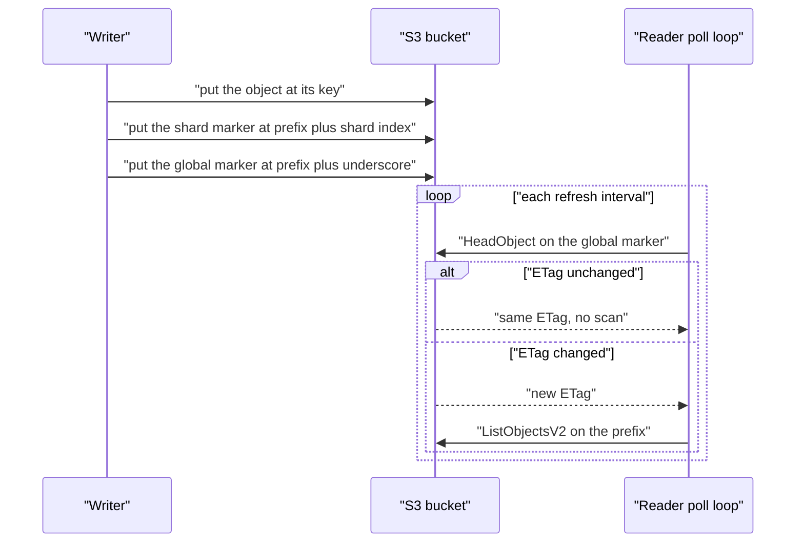

# 00 -- vnotify: a cache invalidation signal over S3

`vnotify` is a small Rust library by the Deno authors. It is a read-through cache for objects in Amazon Simple Storage Service (S3), plus a change signal that tells every reader when to re-check its cache. The crate is version 0.1.0, released under the MIT license, with the repository `https://github.com/denoland/vnotify`. The whole library is one source file, `src/lib.rs`, 571 lines.

The library needs no extra infrastructure. It does not use a database, a message queue, or a notification service. It uses the S3 bucket itself as the signal channel. The crate does have Rust library dependencies, listed in `Cargo.toml`: `aws-sdk-s3`, `blake3`, `bytes`, `futures`, `moka`, `rand`, `tokio`, and others. Those are code libraries, not services. "No external dependencies" in the README means no extra service beyond S3.

## The problem it solves

Many clients may cache the same S3 objects. When an object changes, every client that cached it must notice. Polling every object is too slow when there are millions of objects. A publish/subscribe service would need a new piece of infrastructure, and its own consistency rules.

`vnotify` solves this with two small marker objects per write. A writer updates one global marker object after every write. A reader polls that one object with one `HeadObject` call. If the marker changed, the reader makes one `ListObjectsV2` call to see which shards changed. The reader then re-checks only the entries in those shards. Detection is cheap; only revalidation touches real objects.

## The core idea

The library keeps a fixed-size keyspace in the S3 bucket. That keyspace is a set of marker objects under a prefix. The prefix holds a global marker named `_` and up to 1000 shard markers named `0` through `999`. Each shard marker is one slot of a hash map. A real object key is hashed into one slot. When a writer changes a real object, it also writes a fresh random body to that object's shard marker and to the global marker. A reader polls the global marker and re-checks the shards whose markers changed. See [01-one-headobject-signal.md](./01-one-headobject-signal.md) for the detection idea and [02-keyspace-as-hashmap.md](./02-keyspace-as-hashmap.md) for the keyspace.



The write path and the read path are separate. A writer only needs the `put` method. A reader uses `get` and `try_get`. The `refresh_worker` runs inside the reader and drives detection and revalidation.



## The public surface

The library exposes one cache type and its configuration. `VnotifyCache` holds the S3 client, one shard per slot, and a channel to the refresh worker. `Config` sets the bucket, the prefix, the refresh interval, the shard count, and the revalidate limit.

```rust
// Source: src/lib.rs, lines 38-63
#[derive(Clone, Debug)]
pub struct Config {
  /// S3 bucket name
  pub bucket: String,

  /// S3 bucket prefix
  pub prefix: String,

  /// Cache revalidation interval. Defaults to 1s.
  pub refresh_interval: Duration,

  /// Number of shards. This defaults to 1000, and normally should not be changed.
  /// All `VnotifyCache` instances that share the same S3 bucket and prefix must
  /// use the same `shards` value.
  ///
  /// Must be between 1 and `LIST_OBJECT_LIMIT` (1000), inclusively.
  pub shards: u32,

  /// Max number of stale-while-revalidate entries per shard after invalidation.
  /// Sorted by last access time, descending. Entries exceeding this limit will be dropped from cache.
  ///
  /// Defaults to 3.
  pub revalidate_limit: usize,

  time_base: Instant,
}
```

The constructor fills the defaults. The refresh interval is 1 second. The shard count is 1000. The revalidate limit is 3 entries per shard.

```rust
// Source: src/lib.rs, lines 90-101
impl Config {
  pub fn with_bucket_and_prefix(bucket: String, prefix: String) -> Self {
    Self {
      bucket,
      prefix,
      refresh_interval: Duration::from_secs(1),
      shards: LIST_OBJECT_LIMIT,
      revalidate_limit: 3,
      time_base: Instant::now(),
    }
  }
}
```

A cache entry holds the object body and its entity tag (ETag), the S3 fingerprint of the object. The value stored in a shard is an `Option`: `None` means the key was seen missing from S3, and the miss is cached too.

```rust
// Source: src/lib.rs, lines 65-79
struct Shard {
  entries: moka::future::Cache<Box<str>, Option<Arc<Entry>>>,
}

struct Entry {
  body: Bytes,
  object_etag: String,
  last_used_ms: AtomicU64,
}

#[derive(Debug, Clone)]
pub struct Item {
  pub body: Bytes,
  pub object_etag: String,
}
```

`VnotifyCache` has five public associated functions. `new` is the only constructor; it builds the shards and spawns the refresh worker. `get` loads through the cache and waits for a fence. `try_get` reads the cache only. `put` writes an object and its two markers. `evict` drops one entry. The next documents walk through each part.

## The map of this exploration

- [01-one-headobject-signal.md](./01-one-headobject-signal.md) — the one `HeadObject` detection idea and the global marker.
- [02-keyspace-as-hashmap.md](./02-keyspace-as-hashmap.md) — the fixed-size keyspace as a hash map of shard markers.
- [03-refresh-worker-flow.md](./03-refresh-worker-flow.md) — the full `HeadObject`, `ListObjectsV2`, revalidate loop and the fence.
- [04-detection-math.md](./04-detection-math.md) — the hashing, sharding, and false-eviction math.

## The Aha Moment

**Aha:** The change signal is not a separate service. It is two small objects in the same S3 bucket. The library turns the bucket into its own broadcast channel. One global marker object is the dirty bit for the whole bucket, and 1000 shard marker objects are the dirty bits for groups of keys. Because the signal lives in S3, it inherits S3's read-after-write consistency, so the signal and the data it describes never disagree about order.

Continue to [01-one-headobject-signal.md](./01-one-headobject-signal.md).
