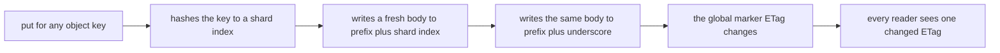
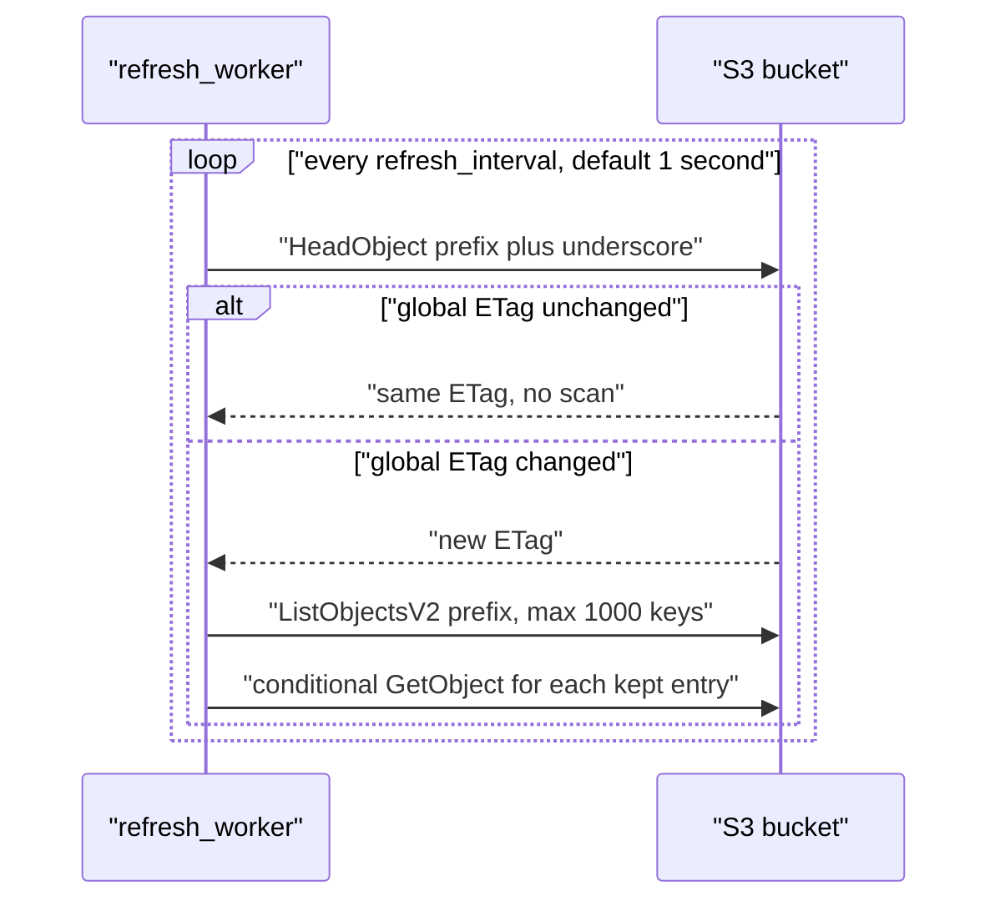

# 01 -- The one-HeadObject idea: a global marker flags any change

The library's headline behavior is that a client can detect changes across millions of objects with one `HeadObject` call, and sometimes one `ListObjectsV2` call. This document explains the first half: how one metadata read on a single marker object reports whether any protocol-following write changed anything in the bucket.

## A dirty bit made of an S3 object

The library reserves one object under the configured prefix, named `_`. Its full key is the prefix plus an underscore. The README example uses prefix `/vnotify/`, so the global marker is `/vnotify/_`. Every write updates this object with a fresh body, so its entity tag (ETag) changes. A reader polls this one object. If the ETag is the same as the last time, nothing has changed since then. If it differs, something changed, and the reader must look further.

The marker is only a bit of information: changed or not changed. It does not say what changed. That is why the second call, `ListObjectsV2`, is sometimes needed. It narrows the change down to shards. The one `HeadObject` call is the cheap steady-state path; it runs every refresh interval even when nothing changed.

The key fact is that the number of objects does not affect the cost. Whether the bucket holds 10 objects or 10 million, the poll is still one metadata read of one marker object.

## How a write flips the global marker

The `put` method writes the real object first, then the shard marker, then the global marker. The global marker is last. This ordering matters: by the time a reader sees the global ETag change, the object write that caused it has already finished in S3. The marker body is a fresh value each time, so the ETag is almost surely new. The body is built from a wall-clock timestamp and a random hex string; see [04-detection-math.md](./04-detection-math.md) for why that makes the ETag unique.

```rust
// Source: src/lib.rs, lines 246-254
    self
      .client
      .put_object()
      .bucket(&self.config.bucket)
      .key(format!("{}_", self.config.prefix))
      .body(ByteStream::from(body))
      .send()
      .await?;
    Ok(())
```

The write is cooperative. Only a writer that follows this protocol updates the marker. A plain `PutObject` from outside the library, without a marker write, is invisible to vnotify. The library detects changes made through `put`, or by any other writer that updates the markers the same way.

## The steady-state poll

The `refresh_worker` loop runs forever. Each iteration makes exactly one `HeadObject` call on the global marker. The call is the first S3 operation of the iteration. Two cases follow.

The constant that caps the shard count is also the S3 page limit:

```rust
// Source: src/lib.rs, lines 19-20
/// Max number of keys returned in an S3 ListObjectsV2 response
pub const LIST_OBJECT_LIMIT: u32 = 1000;
```

The worker compares the returned ETag with the stored one. If they match, it skips the scan entirely and finishes the iteration. If they differ, it stores the new ETag and issues one `ListObjectsV2` call over the prefix.

```rust
// Source: src/lib.rs, lines 349-394
    let new_global_etag = match client
      .head_object()
      .bucket(&config.bucket)
      .key(format!("{}_", config.prefix))
      .send()
      .await
    {
      Ok(x) => x.e_tag.unwrap_or_default(),
      Err(aws_sdk_s3::error::SdkError::ServiceError(x))
        if matches!(
          x.err(),
          aws_sdk_s3::operation::head_object::HeadObjectError::NotFound(_),
        ) =>
      {
        String::new()
      }
      Err(error) => {
        tracing::error!(?error, "head_object failed");
        continue;
      }
    };
    let objects = if new_global_etag == global_etag {
      vec![]
    } else {
      tracing::info!(
        old_global_etag = global_etag,
        new_global_etag,
        "global etag changed, scanning prefix"
      );
      global_etag = new_global_etag;
      let res = client
        .list_objects_v2()
        .bucket(&config.bucket)
        .prefix(&config.prefix)
        .max_keys(LIST_OBJECT_LIMIT as i32)
        .send()
        .await;
      let res = match res {
        Ok(x) => x,
        Err(error) => {
          tracing::error!(?error, "refresh failed");
          continue;
        }
      };
      res.contents.unwrap_or_default()
    };
```

Notice the error handling. If the global marker does not exist, the ETag becomes the empty string. That happens when no write has ever touched the prefix. If the `HeadObject` call itself fails, the worker logs the error and retries the loop, keeping the old state.

## One call, two paths

The flow is a branch, not a pipeline. The common case is one call. The rare case is two calls plus revalidation.



The poll side mirrors that:



## The cost in the two paths

When nothing changes, the total S3 traffic per client is one `HeadObject` call per refresh interval, or one per second at the default. When something changes, the client adds one `ListObjectsV2` call and a bounded number of conditional `GetObject` calls. The conditional calls revalidate only the most recent entries per changed shard, capped by `revalidate_limit`. The rest of a changed shard is evicted, not revalidated. That bound is the subject of [03-refresh-worker-flow.md](./03-refresh-worker-flow.md).

## The Aha Moment

**Aha:** The library does not watch objects. It watches one marker object that behaves like a dirty bit. Detecting "something changed" is reduced to comparing two strings, the old ETag and the new ETag. Millions of objects collapse into a single equality check because every writer has already collapsed its own change into the same marker.

Continue to [02-keyspace-as-hashmap.md](./02-keyspace-as-hashmap.md).
