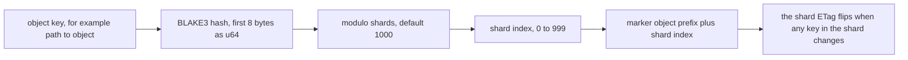
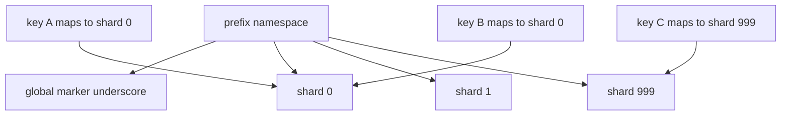

# 02 -- The fixed-size keyspace: S3 objects as a hash map

The global marker from [01-one-headobject-signal.md](./01-one-headobject-signal.md) only says that something changed. To find out what, the library keeps a second, fixed-size set of objects under the same prefix. This document explains that set: a hash map whose slots are S3 objects.

## The keyspace layout

Under the prefix, the library keeps one marker object per slot, named by the slot number, plus the global marker. The README shows the layout with prefix `/vnotify/`:

```
// Illustrative namespace layout (not verbatim source).
/vnotify/_
/vnotify/0
/vnotify/1
/vnotify/2
/vnotify/3
...
/vnotify/999
```

There are at most 1001 marker objects: the global marker `_` and 1000 shard markers `0` through `999`. The real objects being cached live at their own keys, outside this prefix. The prefix namespace is only the signal; it never holds the cached data.

Each shard marker is a slot in a hash map. The slot holds no list of keys. It holds a single entity tag (ETag). When any key that hashes into the slot changes, the writer updates that slot's marker, and its ETag changes. The slot is therefore a coarse dirty bit for a group of keys.

## How a key maps into a slot

The mapping is a standard hash-then-modulo. The key is hashed with BLAKE3, a cryptographic hash function. The first 8 bytes of the 32-byte digest are read as a little-endian unsigned 64-bit integer (u64). That integer is reduced modulo the shard count.

```rust
// Source: src/lib.rs, lines 304-307
fn get_shard_index_for_key(key: &str, shards: u32) -> usize {
  (u64::from_le_bytes(<[u8; 8]>::try_from(&blake3::hash(key.as_bytes()).as_bytes()[..8]).unwrap())
    % shards as u64) as usize
}
```

The same function is used everywhere a key must find its shard: in `get`, `try_get`, `put`, and `evict`. So an object key and its shard marker always stay together.

## The shard marker write

When `put` writes an object, it computes the shard index and writes a fresh marker to the slot. The marker key is the prefix plus the index. The global marker gets the same body right after.

```rust
// Source: src/lib.rs, lines 238-245
    self
      .client
      .put_object()
      .bucket(&self.config.bucket)
      .key(format!("{}{}", self.config.prefix, shard_index))
      .body(ByteStream::from(body.clone()))
      .send()
      .await?;
```

This is the random string written into the hash map slot. The body is not purely random: it is a timestamp plus a random hex string, which together make the ETag unique. See [04-detection-math.md](./04-detection-math.md).

## The shard on the reader side

On the reader side, each slot has a cache. The cache holds entries for the keys that hash into that slot. The cache is a `moka` future cache, built with an idle timeout of 600 seconds (10 minutes) and support for invalidation closures.

```rust
// Source: src/lib.rs, lines 113-120
    let shards = (0..config.shards)
      .map(|_| Shard {
        entries: moka::future::Cache::builder()
          .time_to_idle(Duration::from_secs(600))
          .support_invalidation_closures()
          .build(),
      })
      .collect::<Arc<[Shard]>>();
```

The shard count is fixed at construction, and all instances that share a bucket and prefix must agree on it. The default is 1000. The invariant is written in the `Config` doc comment: shards must be between 1 and `LIST_OBJECT_LIMIT` inclusive, and instances sharing a prefix must use the same value.



## Why 1000 slots

The slot count equals the maximum number of keys one `ListObjectsV2` response can return. The Amazon Web Services (AWS) S3 `ListObjectsV2` operation returns at most 1000 keys per call. If the keyspace has 1000 shards, one call lists all of them. That is the arithmetic that ties the keyspace size to the API: the fixed size is chosen so a single scan covers the whole hash map. The full scan flow is in [03-refresh-worker-flow.md](./03-refresh-worker-flow.md).

There is one more key in the namespace, the global `_`. It does not matter for the scan, because the scan skips it. With 1000 shard markers, the single `ListObjectsV2` call with `max_keys` set to 1000 returns the shard markers; the `_` key sorts after the digits and is simply not reached.

## Collisions and false eviction

A hash map slot groups keys. Two different keys can map to the same slot. The probability is about 1 in 1000 with the default shard count, because the hash output is spread evenly. This is the cost the design accepts: when one object changes, every cached key in its slot is affected. The library revalidates only the most recently used few and evicts the rest. Evicted entries are re-fetched on their next use, so correctness holds; only cache efficiency drops. The math behind this is the subject of [04-detection-math.md](./04-detection-math.md).



## The Aha Moment

**Aha:** The hash map is not a data structure in memory. It is a set of 1000 S3 objects whose ETags are the map's values. The hashing exists only to assign every real object key to one of those 1000 objects. Because the map is fixed-size and the size matches S3's page limit, one API call can read the whole map, and one marker write can dirty a whole slot.

Continue to [03-refresh-worker-flow.md](./03-refresh-worker-flow.md).
