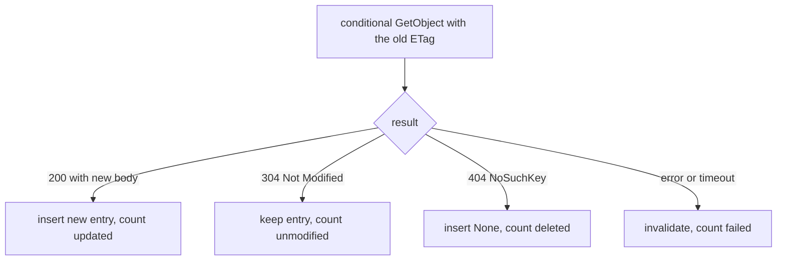
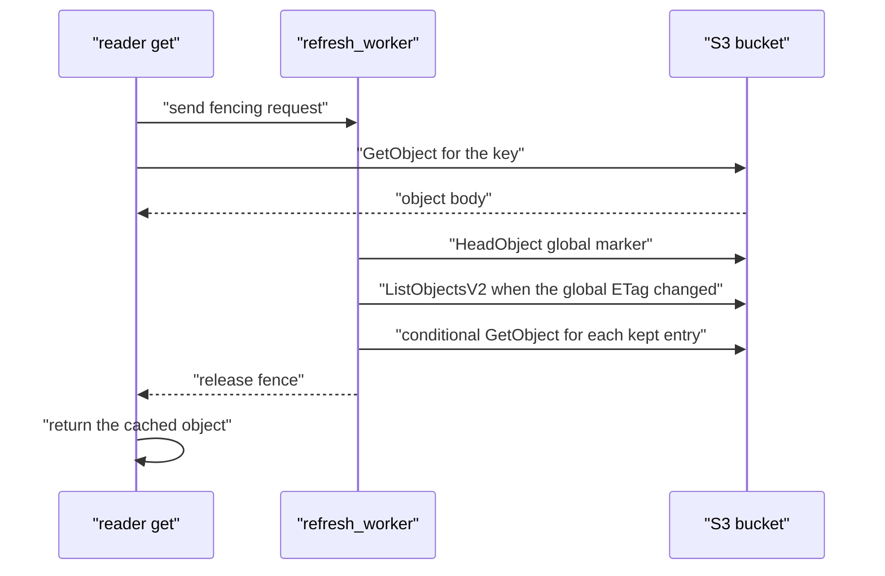

# 03 -- The refresh flow: HeadObject, then ListObjectsV2, then revalidate

The `refresh_worker` is the loop that turns the two markers from [01-one-headobject-signal.md](./01-one-headobject-signal.md) and the keyspace from [02-keyspace-as-hashmap.md](./02-keyspace-as-hashmap.md) into cache maintenance. This document walks the loop in order: collect fence requests, poll the global marker, scan changed shards, revalidate, release the fence.

## The worker's shape

The worker runs as a spawned Tokio task for the lifetime of the `VnotifyCache`. It owns a clone of the S3 client, the configuration, the shards, and the receive half of a fencing channel. It also spawns one helper task that, every 5 seconds, runs the pending invalidation closures of every shard.

The helper task is needed because invalidation in the `moka` cache is deferred. A call to `invalidate_entries_if` only registers a closure; the closure runs when `run_pending_tasks` is called. Without the helper, invalidations would never execute.

```rust
// Source: src/lib.rs, lines 327-335
  let shards_clone = shards.clone();
  background.spawn(async move {
    loop {
      tokio::time::sleep(Duration::from_secs(5)).await;
      for shard in &*shards_clone {
        shard.entries.run_pending_tasks().await;
      }
    }
  });
```

## Step 1: collect fence requests

A reader that loads an object through `get` sends a one-shot sender into the fencing channel before it fetches from S3, then waits on the receiver after the fetch succeeds. The worker collects all such senders at the start of an iteration. The collect step waits up to the refresh interval, then drains anything else that arrived.

```rust
// Source: src/lib.rs, lines 337-348
  loop {
    let mut fencing_requests: Vec<oneshot::Sender<()>> = vec![];
    match tokio::time::timeout(config.refresh_interval, fencing_queue_rx.recv()).await {
      Ok(Some(x)) => {
        fencing_requests.push(x);
        while let Ok(x) = fencing_queue_rx.try_recv() {
          fencing_requests.push(x);
        }
      }
      Ok(None) => return,
      Err(_) => {}
    }
```

The fence is the causal-consistency mechanism: a reader sees a value at least as fresh as any write it has already observed. A reader that just loaded a new object does not return it until the worker has finished a full pass, so any older cached objects the new object depends on have been revalidated in the same pass. The source comment describes this as fencing "to ensure that any potential dependency of the newly seen object is fresh" (src/lib.rs:158).

## Step 2: poll the global marker, scan if changed

This step is covered in [01-one-headobject-signal.md](./01-one-headobject-signal.md): one `HeadObject` call on the global marker, and a `ListObjectsV2` scan only when the entity tag (ETag) changed. The result is a list of marker objects from the prefix. Each marker's key is stripped of the prefix and parsed as a shard index.

## Step 3: pick the entries to revalidate

For each changed shard, the worker does not revalidate everything. It keeps a bounded set of the most recently used entries and evicts the rest. The window is 30 seconds: entries not used in the last 30 seconds are not even considered for revalidation. The keep set is capped by `revalidate_limit`, default 3.

```rust
// Source: src/lib.rs, lines 417-455
      let num_entries = shard.entries.entry_count();
      if num_entries != 0 {
        #[allow(clippy::type_complexity)]
        let mut most_recent_entries: BinaryHeap<Reverse<(u64, Arc<Box<str>>, String)>> =
          BinaryHeap::new();
        let now_ms = config.time_base.elapsed().as_millis() as u64;
        for (k, v) in shard.entries.iter() {
          let Some(v) = v else {
            continue;
          };
          let last_used_ms = v.last_used_ms.load(Ordering::Relaxed);
          if now_ms.saturating_sub(last_used_ms) > 30_000 {
            continue;
          }
          most_recent_entries.push(Reverse((
            v.last_used_ms.load(Ordering::Relaxed),
            k,
            v.object_etag.clone(),
          )));
          if most_recent_entries.len() > config.revalidate_limit {
            most_recent_entries.pop();
          }
        }
        for entry in &most_recent_entries {
          revalidate_queue.push(Revalidation {
            shard_index,
            key: entry.0 .1.clone(),
            object_etag: entry.0 .2.clone(),
          });
        }
        let num_most_recent_entries = most_recent_entries.len();
        let most_recent_keys = most_recent_entries
          .into_iter()
          .map(|x| x.0 .1)
          .collect::<HashSet<_>>();
        shard
          .entries
          .invalidate_entries_if(move |k, _| !most_recent_keys.contains(k))
          .unwrap();
      }
```

The `BinaryHeap` wrapped in `Reverse` is a min-heap keyed by last-used time, so `pop` removes the oldest entry. When the heap exceeds `revalidate_limit`, the oldest drops out. The survivors are revalidated; everyone else is invalidated. This is the stale-while-revalidate limit named in the `Config` doc comment.

## Step 4: revalidate concurrently

Each survivor is revalidated with a conditional `GetObject` carrying the entry's stored ETag as `If-None-Match`. The call has a 5-second timeout. The outcome branches four ways: a 200 response with a new body, a 304 Not Modified response, a missing key, or an error or timeout.

```rust
// Source: src/lib.rs, lines 480-515
        match tokio::time::timeout(
          Duration::from_secs(5),
          get_from_origin(
            client,
            config,
            &revalidation.key,
            Some(revalidation.object_etag),
          ),
        )
        .await
        {
          Ok(Ok(x)) => match x {
            OriginResponse::Success(x) => {
              tracing::info!(
                shard_index = revalidation.shard_index,
                key = &**revalidation.key,
                "revalidation updated object"
              );
              shards[revalidation.shard_index]
                .entries
                .insert((*revalidation.key).clone(), Some(x))
                .await;
              num_updated.fetch_add(1, Ordering::Relaxed);
            }
            OriginResponse::Missing => {
              tracing::info!(
                shard_index = revalidation.shard_index,
                key = &**revalidation.key,
                "revalidation deleted object"
              );
              shards[revalidation.shard_index]
                .entries
                .insert((*revalidation.key).clone(), None)
                .await;
              num_deleted.fetch_add(1, Ordering::Relaxed);
            }
```

The two remaining branches follow the same shape. `NotModified` keeps the entry and counts it unmodified. An error or a timeout invalidates the entry and counts it failed, so a broken object never stays cached.

All revalidations run together through a `FuturesUnordered` stream, so many shards are rechecked in parallel. There is no concurrency cap beyond what the async runtime allows; if all 1000 shards changed, the pass could issue up to `revalidate_limit` times 1000 conditional reads.



## Step 5: release the fence

After all revalidations finish, the worker sends the unit value into every collected one-shot sender. That unblocks any reader waiting in `get`. This is only the success path: on a `HeadObject` or `ListObjectsV2` error the worker `continue`s (src/lib.rs:367, 390), dropping the collected senders, so a waiting `get`'s `rx.await` (src/lib.rs:168) returns `Err`.

```rust
// Source: src/lib.rs, lines 567-569
    for fencing_request in fencing_requests {
      let _ = fencing_request.send(());
    }
```

The full pass, end to end, is one fence-collect, one `HeadObject`, maybe one `ListObjectsV2`, a bounded set of conditional reads, and a fence release. In the steady state `fencing_requests` is empty, so the release loop (src/lib.rs:567-569) is a no-op; only the `HeadObject` and the refresh-interval wait run.



## The Aha Moment

**Aha:** The worker is a single gate. Every read that loads from S3 passes through the fencing channel, and the channel is drained only after a complete detection-and-revalidation pass. That one ordering guarantee is what gives causal consistency: a reader cannot observe a new object before the worker has re-checked everything that was stale before it. The expensive work is bounded, but the ordering is total.

Continue to [04-detection-math.md](./04-detection-math.md).
