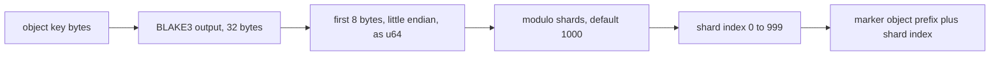
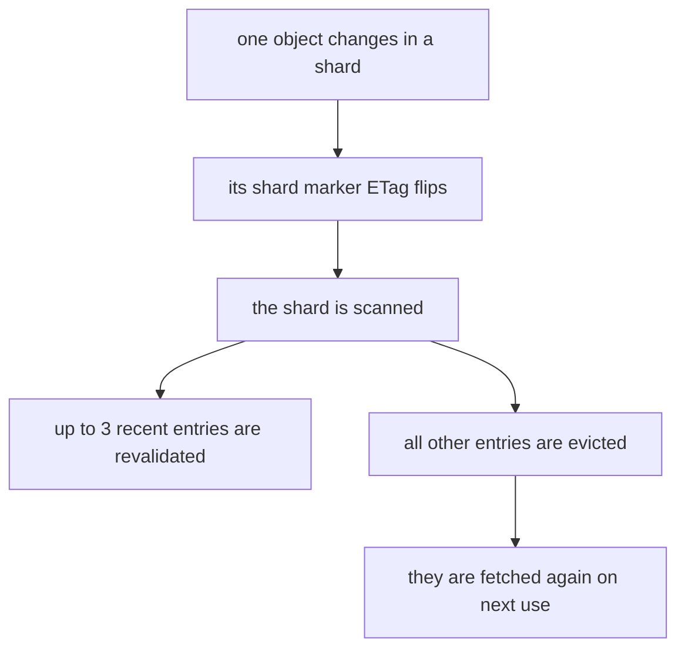

# 04 -- The detection math: hash to shard, evict the shard

This document covers the arithmetic behind the design: the hash-to-shard mapping, why the shard count is 1000, how marker entity tags (ETags) stay unique, and what a change costs in false evictions. Every number here follows from the source shown in [01-one-headobject-signal.md](./01-one-headobject-signal.md) and [02-keyspace-as-hashmap.md](./02-keyspace-as-hashmap.md).

## The hash-to-shard mapping

An object key is a byte string. The library hashes it with BLAKE3, a cryptographic hash function, whose output is 32 bytes. It takes the first 8 bytes and reads them as a little-endian unsigned 64-bit integer (u64), then takes that integer modulo the shard count.

The mapping aims to spread keys evenly over the slots. BLAKE3 output is effectively uniform, so each slot receives about one 1000th of the keys. The modulo reduction is not perfectly uniform, because 2 to the power 64 is not a multiple of 1000. The remainder of 2 to the power 64 modulo 1000 is 616, so 616 slots get one extra input value out of 2 to the power 64. That bias is one part in about 10 to the power 19, which is far below any real effect.

The mapping function is the one shown in the keyspace document; the same function is used for `get`, `try_get`, `put`, and `evict`.

## Why the shard count is 1000

The Amazon Web Services (AWS) S3 `ListObjectsV2` operation returns at most 1000 keys per response. The constant is written in the source as `LIST_OBJECT_LIMIT`. The shard count defaults to the same value, and `Config` forbids a larger value.

The namespace holds 1001 keys: the global marker `_` and shard markers `0` through `999`. The digits sort before the underscore in the byte order S3 uses for listing, so one `ListObjectsV2` call with `max_keys` set to 1000 returns all 1000 shard markers. The global marker is skipped anyway. So one call reads the whole hash map. This is the reason "sometimes one ListObjectsV2 call" is enough: the map was sized to one page.

## Marker ETag uniqueness

Every marker write must change the ETag, or a change would be missed. The marker body is a wall-clock timestamp in milliseconds plus a comma plus the hex encoding of 16 random bytes:

```rust
// Source: src/lib.rs, lines 227-237
    let body = Bytes::from(
      format!(
        "{},{}",
        SystemTime::now()
          .duration_since(SystemTime::UNIX_EPOCH)
          .unwrap()
          .as_millis(),
        faster_hex::hex_string(&rand::thread_rng().gen::<[u8; 16]>())
      )
      .into_bytes(),
    );
```

For a small object uploaded in one part, S3 sets the ETag to the Message-Digest 5 (MD5) checksum of the body. The 16 random bytes are 128 bits of entropy, so two marker writes collide with probability about 2 to the power minus 128, which is negligible. The timestamp adds no entropy of its own, but because it is part of the body, a collision needs the same millisecond and the same 128-bit random value, so it lowers the collision probability below 2 to the power minus 128. It also makes the body human-readable for debugging. The practical guarantee is: every marker write has a distinct ETag.

## What a change costs in evictions

When one object changes, only its slot's marker changes. The worker then treats every cached key in that slot as suspect. It revalidates at most `revalidate_limit` entries, default 3, and evicts the rest.

With millions of keys spread over 1000 slots, one slot holds about the total divided by 1000 keys. If the cache holds 1 million entries, a slot holds about 1000, and a single-object change evicts about 997 unrelated entries from that slot. This is the design's trade: detection is one metadata read, but invalidation is coarse. The 30-second recent-use window and the `revalidate_limit` bound only the revalidation work; they do not reduce the evictions of cold entries.

The probability side is simple. For any two distinct keys, the chance they share a slot is about 1 in 1000, because the hash is uniform. That is the pairwise chance. An update actually dirties its whole slot and evicts every other cached key there, about total/1000 of them, as the paragraph above states. The cost is paid only in cache misses later: an evicted entry is re-fetched on its next use, which is correct but slow for that one read.

## Conditional reads cost less than full reads

The revalidation step does not download every kept entry's body. It sends the stored ETag as `If-None-Match`. If the object is unchanged, S3 returns a HyperText Transfer Protocol (HTTP) 304 Not Modified response with no body, and the entry stays. If it changed, S3 returns the new body. If it was deleted, S3 reports the missing key.

The outcome mapping is in the origin fetch:

```rust
// Source: src/lib.rs, lines 290-300
    Err(aws_sdk_s3::error::SdkError::ServiceError(x)) if x.raw().status().as_u16() == 304 => {
      Ok(OriginResponse::NotModified)
    }
    Err(aws_sdk_s3::error::SdkError::ServiceError(x))
      if matches!(
        x.err(),
        aws_sdk_s3::operation::get_object::GetObjectError::NoSuchKey(_),
      ) =>
    {
      Ok(OriginResponse::Missing)
    }
```

So the steady cost of a false eviction is zero if the entry is never read again, and one full re-fetch if it is read again. The revalidation itself is cheap for entries that did not change: a 304 costs no body transfer.

## Write conditions reuse the same ETag

The write path also leans on ETags. The `put` method accepts a `WriteCondition`: unconditional, if not present, or if matching a given ETag. The condition maps onto the S3 conditional-write headers `If-None-Match` and `If-Match`.

```rust
// Source: src/lib.rs, lines 201-214
  pub async fn put(&self, key: &str, body: Bytes, cond: WriteCondition) -> anyhow::Result<()> {
    let shard_index = get_shard_index_for_key(key, self.config.shards);
    let shard = &self.shards[shard_index];
    let res = self
      .client
      .put_object()
      .bucket(&self.config.bucket)
      .key(key);
    let res = match cond {
      WriteCondition::Unconditional => res,
      WriteCondition::IfNotPresent => res.if_none_match("*"),
      WriteCondition::IfMatchEtag(etag) => res.if_match(etag),
    };
    let res = res.body(ByteStream::from(body.clone())).send().await?;
```

This closes the loop. ETags are the one fingerprint used on both sides: writes set them, the marker poll compares them, and revalidation re-checks them with conditional reads.





## The Aha Moment

**Aha:** The entire detection scheme is an exercise in choosing constants so that S3's own limits do the work. The hash is chosen for uniformity, the slot count is chosen to equal one S3 page, and the marker body is chosen for 128-bit ETag uniqueness. The coarse invalidation cost of one slot per change is the price paid to keep detection at one metadata read, and it is paid in future cache misses, never in correctness.

Continue to [README.md](./README.md).
