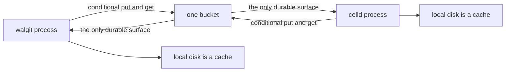
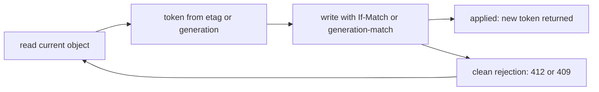

# 00 -- One bucket, no database, no leader: the shared substrate

walgit and celld start from the same premise: a single object-storage bucket
is the only place that must survive. Neither runs a database as the source of
truth, neither elects a leader, and neither keeps local state that matters.
Each tree is a Rust daemon in front of one bucket, and the bucket does the
arbitration.

walgit says it in one sentence. Its goal file reads: "A share-nothing git
host, fast for monorepos, with an object store as the *only* source of
truth." Its invariants add: "No database, no Redis, no gossip, no leader, no
node identity. Wipe every instance and lose nothing but warmth." celld says
the same for a different workload: "It needs no serving control plane or
consensus service" and "The fleet needs no membership protocol, failure
detector, or consensus service." Both collapse a control plane into one
primitive: a conditional write.

walgit models that primitive as a put mode. The mode carries either a create
that succeeds only on an absent object, or an update guarded by a version.

```rust
// Source: walgit/crates/walgit-store/src/lib.rs, lines 108-117
#[derive(Clone, Debug, PartialEq, Eq, Default)]
pub enum PutMode {
    /// Unconditional overwrite.
    #[default]
    Overwrite,
    /// Only if the object does not exist (if-generation-match: 0 / If-None-Match: *).
    Create,
    /// Only if the current version equals the given one (CAS).
    Update(Version),
}
```

celld models the same primitive as a single client with two dialects. The
compare-and-swap token is the entity tag (ETag) on Amazon S3 (Simple Storage Service) and
on Azure Blob Storage, and the generation on Google Cloud Storage (GCS). The S3 dialect signs requests with AWS Signature Version 4 (SigV4); the GCS dialect authenticates with OAuth (Open Authorization).

```rust
// Source: celld/crates/celld/bucket.rs, lines 7-16
//! Two conditional-write dialects share the surface. An `s3://` (or
//! bare) spec speaks the S3 dialect: the CAS token is the etag, sent as
//! If-Match / If-None-Match with SigV4 credentials. An `az://` spec
//! speaks the same etag dialect on Azure Blob Storage: Put Blob honors
//! both headers, so only the client and the credentials differ. A
//! `gs://` spec speaks the Cloud Storage XML API dialect: the CAS token
//! is the object generation, sent as x-goog-if-generation-match with
//! OAuth credentials. The distinction is the dialect, not the endpoint —
//! GCS accepts S3-style requests on the same host but does not apply
//! If-Match to a PUT, so only the generation dialect can fence there.
```

The shared surface is small, but it is not just get, head, put, and delete.
walgit's object store trait also declares list, list_prefixes, signed_get_url,
accel_target, supports_compose, compose_is_native, and compose
(walgit/crates/walgit-store/src/lib.rs:198-277). The conditional get is the
read path; the conditional put is the write path.

```rust
// Source: walgit/crates/walgit-store/src/lib.rs, lines 198-217
#[async_trait::async_trait]
pub trait ObjectStore: Send + Sync + 'static {
    /// Human-readable backend id for logs/metrics ("gcs", "s3", "memory").
    fn backend(&self) -> &'static str;
    /// Whether this store is a prefixing wrapper. Used to avoid duplicate
    /// operation spans when prefixes are nested.
    fn is_prefixed(&self) -> bool {
        false
    }

    async fn get(&self, key: &str, opts: GetOptions) -> Result<GetResult>;

    /// Metadata only. `Ok(None)` if absent.
    async fn head(&self, key: &str) -> Result<Option<ObjectMeta>>;

    async fn put(&self, key: &str, body: PutBody, opts: PutOptions) -> Result<ObjectMeta>;

    /// Delete. `if_version` = CAS delete. Deleting an absent object is `Ok(())`
    /// when unconditional and `NotFound` when conditional.
    async fn delete(&self, key: &str, if_version: Option<Version>) -> Result<()>;
```

celld's conditional write is the same shape, expressed as a token that is
`None` for an absent-only create and `Some` for an update guarded by the
current token.

```rust
// Source: celld/crates/celld/bucket.rs, lines 1028-1053
    /// Conditional write. `token: None` requires the key to be absent;
    /// `Some` requires the current CAS token — the etag on S3 and on
    /// Azure Blob Storage (If-Match), the generation on GCS
    /// (x-goog-if-generation-match).
    /// `Ok(Some(new_token))` applied, `Ok(None)` cleanly rejected; any
    /// other failure is ambiguous and stays an error.
    pub async fn put_cas(
        &self,
        key: &str,
        body: impl Into<PutPayload>,
        token: Option<&str>,
    ) -> anyhow::Result<Option<String>> {
        let key = self.key(key);
        let mode = match token {
            None => PutMode::Create,
            Some(token) => PutMode::Update(self.backend.update(token)),
        };
```

Both treat local disk as a cache, not a home. The deployment shape is the
same picture drawn twice.



The arbiter in both systems is the conditional write itself: read a token,
then write guarded by that token, and let the store decide who wins.



The two systems do not ask the same of the bucket, though. walgit needs a
conditional write, a conditional get that returns a small "not modified"
answer, and ranged reads; it can use server-side compose for large packs,
and falls back to a single PUT otherwise. celld needs all of the above plus
read-after-write consistency, ranged reads, and, only for its epoch garbage
collector, list-after-write consistency (celld/docs/guarantees.md:8-24).
celld is the stricter customer: it refuses to run on stores whose
conditional writes are missing or silently ignored. Its documentation names
Backblaze B2, Hetzner Object Storage, and DigitalOcean Spaces as stores
where two nodes could own one cell, and it runs a storage test before a node
serves that must observe two of four conditional writes fail
(celld/crates/celld/bucket.rs:1679-1746, "Steps 2 and 4 must be rejected").

So the shared substrate is not "any object store". It is "a store whose
conditional write is real". The difference sits above that line: walgit uses
the conditional write as the commit itself, celld uses it as a fence around a
commit that happens elsewhere. That split is the subject of the rest of this
exploration.

## The Aha Moment

**Aha:** Both systems remove the distributed-consensus layer by moving the
arbiter into the object store itself. A conditional write is not storage
plumbing; it is the single point of serialization. walgit and celld agree on
that premise and disagree on almost everything above it.

## Cross-References

- [01-unit-of-state.md](01-unit-of-state.md) — the state each system hangs off this substrate.
- [03-consistency-fencing.md](03-consistency-fencing.md) — the two ways the conditional write is used: as commit or as fence.

Continue to [01-unit-of-state.md](01-unit-of-state.md).
