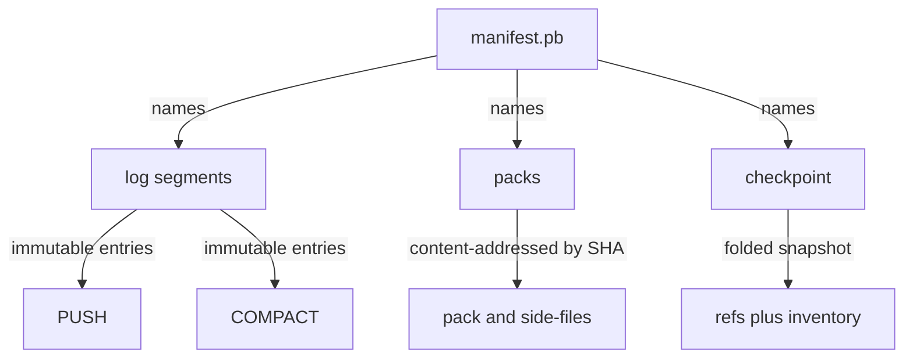
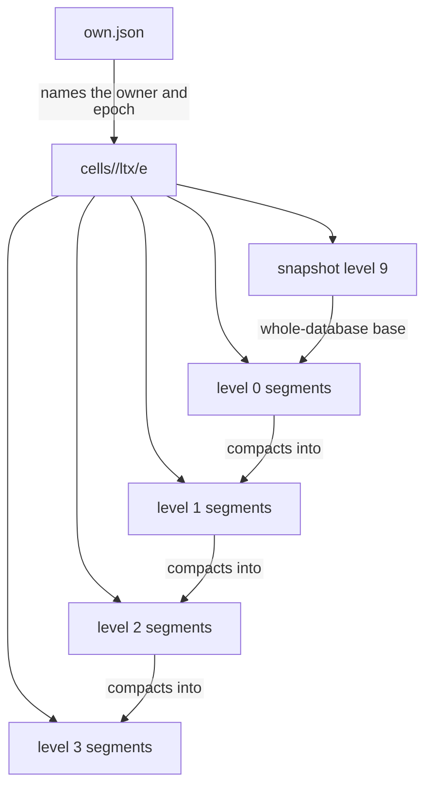

# 01 -- The unit of state: git packs and a WAL versus per-cell SQLite and LTX

walgit's unit of state is the repository, and the repository is a write-ahead
log (WAL) in the bucket. Under one key prefix it keeps a tiny manifest that is
rewritten by compare-and-swap (CAS), immutable log entries, immutable
content-addressed packs, a folded checkpoint, and CAS leases. The manifest
carries the whole live inventory in one small message.

```protobuf
// Source: walgit/crates/walgit-proto/proto/walgit/v1/wal.proto, lines 29-62
message Manifest {
  // Format marker. New readers reject unknown values; deployed older readers
  // do not enforce this gate and must be excluded during authority cutovers.
  uint32 format_version = 1;
  // "<owner>/<repo>"
  string repo = 2;
  // "sha1" | "sha256"
  string object_format = 3;
  // Sequence number of the last committed entry (0 = empty repo).
  uint64 head_seq = 4;
  // Oldest entry still present in `log_segments` (entries below are folded
  // into `checkpoint`). min_seq == checkpoint.seq + 1 unless no checkpoint.
  uint64 min_seq = 5;
  // Latest checkpoint (may be absent for a young repo).
  CheckpointRef checkpoint = 6;
  // Log segments covering [min_seq, head_seq], ascending, contiguous,
  // non-overlapping. Kept short by merging segments during compaction.
  repeated LogSegmentRef log_segments = 7;
  // Denormalized live pack set after applying every entry <= `head_seq`
  // (checkpoint packs + packs of later PUSH entries − superseded). Sorted by
  // seq. Materialize = these packs + checkpoint refs + replay log > checkpoint.
  repeated PackRef packs = 8;
  google.protobuf.Timestamp updated_at = 9;
  // Instance id of the writer that produced this generation (diagnostics).
  string writer = 10;
  // Monotonic counter of successful manifest writes.
  uint64 revision = 11;
  // D24: per-repository settings (latest). Inline (not a pointer): every
  // refs-level sync must see the effective config without another GET; the
  // document is small (validated <= 16 KiB). History = SETTINGS log entries.
  RepoSettings settings = 12;
  // Exact committed download history; no time or count expiry.
  repeated RetiredPack retired_packs = 13;
}
```

`D24` (a key-type identifier) marks the settings field. The objects it names are content-addressed: a pack is stored under its SHA
(Secure Hash Algorithm) checksum, so two pushes of the same bytes share one
object. The manifest is the one mutable pointer; everything else is immutable.

celld's unit of state is a cell, and a cell is one SQLite database (the
embedded SQL database engine). The replicable unit is an LTX
segment (the LTX file format): a file that holds the pages a SQLite commit changed, with the
transaction range and the database checksum that the segment sits between.

```rust
// Source: celld/crates/ltx/src/ltx.rs, lines 107-124
/// LTX file header (100 bytes). Ported from ltx@v0.5.1 ltx.go:179-326.
#[derive(Debug, Clone, Copy, PartialEq, Eq, Default)]
pub struct Header {
    pub version: i32,
    pub flags: u32,
    pub page_size: u32,
    pub commit: u32,
    pub min_txid: TXID,
    pub max_txid: TXID,
    pub timestamp: i64,
    pub pre_apply_checksum: Checksum,
    pub wal_offset: i64,
    pub wal_size: i64,
    pub wal_salt1: u32,
    pub wal_salt2: u32,
    pub node_id: u64,
}
```

The format is fixed and versioned. The header sits at the front of every
segment, followed by page headers and page data, then a trailer with a
checksum.

```rust
// Source: celld/crates/ltx/src/ltx.rs, lines 18-25
/// First 4 bytes of every LTX file.
pub const MAGIC: &[u8; 4] = b"LTX1";
/// Current LTX file format version.
pub const VERSION: i32 = 3;
pub const HEADER_SIZE: usize = 100;
pub const PAGE_HEADER_SIZE: usize = 6;
pub const TRAILER_SIZE: usize = 16;
pub const CHECKSUM_SIZE: usize = 8;
```

The two layouts look nothing alike, and that is the point.





The contrast is sharpest in what each unit answers. walgit's manifest answers
"what is the repository right now" and its packs answer "here are the bytes".
They can be recomputed or re-downloaded on any host, in any order, because
they are immutable and content-addressed. celld's segments answer "what
changed, in what order, between which checksums". They must be replayed in
order; the `min_txid`, `max_txid`, and `pre_apply_checksum` chain one segment
to the next, so a gap or a reorder is a corruption.

The unit also sets the granularity of the system. walgit's unit is a whole
repository: one manifest, one sequence, one live pack set, shared by every
push. celld's unit is one cell: thousands of independent SQLite databases,
each with its own ownership record and its own segment lineage. The next two
documents follow the consequences through the write path and the fence.

## The Aha Moment

**Aha:** walgit's state is a set of immutable, content-addressed values plus
one small mutable pointer; celld's state is one mutable database plus an
immutable page-level journal. One is designed to be recomputed anywhere; the
other to be replayed in order.

## Cross-References

- [00-shared-substrate.md](00-shared-substrate.md) — the bucket primitive both units are stored on.
- [02-write-path.md](02-write-path.md) — how each unit is produced and published.

Continue to [02-write-path.md](02-write-path.md).
