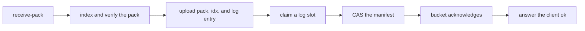
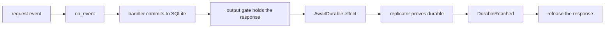

# 02 -- The write path: claim_log_slot and one CAS versus on_event and the output gate

A push into walgit and a write into a celld cell both end in the bucket, but
the order of operations is inverted.

walgit's push writes the durable objects first, then publishes them with one
compare-and-swap (CAS). The first step claims a place in the log. A fresh
nonce makes each attempt distinguishable, and a slot whose claimant died is
burned so the sequence stays contiguous.

```rust
// Source: walgit/crates/walgit-wal/src/publish.rs, lines 238-262
pub(crate) async fn claim_log_slot(
    store: &Prefixed,
    head_seq: u64,
    mut encode: impl FnMut(u64) -> bytes::Bytes,
) -> Result<ClaimOutcome, WalError> {
    let mut seq = head_seq + 1;
    let mut burned: Vec<(String, walgit_store::Version)> = Vec::new();
    loop {
        let key = keys::log_segment_key(seq);
        let encoded = encode(seq);
        let (mut entries, consumed) = frame::decode_entries(&encoded)
            .map_err(|error| WalError::Corrupt(format!("candidate log: {error}")))?;
        if consumed != encoded.len() || entries.is_empty() {
            return Err(WalError::Corrupt("incomplete candidate log".into()));
        }
        // Content-based version tokens can repeat after delete/recreate. A
        // fresh nonce prevents a delayed delete from matching a later attempt.
        if let Some(first) = entries.first_mut() {
            first.meta.insert(
                "walgit.publication_nonce".into(),
                uuid::Uuid::new_v4().to_string(),
            );
        }
        let bytes = frame::encode_entries(&entries);
        match store
```

The log slot is only the claim. The push becomes visible when the manifest is
rewritten, and that rewrite is guarded by the version read earlier. The mode
is Create when no manifest was seen and Update when one was.

```rust
// Source: walgit/crates/walgit-wal/src/publish.rs, lines 731-746
        // CAS manifest
        let buf = updated.encode_to_vec();
        let mode = match &known_version {
            Some(v) => PutMode::Update(v.clone()),
            None => PutMode::Create,
        };

        let cas = handle
            .store
            .put(
                keys::MANIFEST,
                PutBody::Bytes(bytes::Bytes::from(buf)),
                mode.into(),
            )
            .instrument(span.clone())
            .await;
```

celld's write runs the other way around. The decision core is a pure function:
one entry point, no input or output except events in and effects out. Every
state change in the system goes through it, and the production executor and
the deterministic simulator both feed it the same events.

```rust
// Source: celld/crates/logic/lib.rs, lines 6729-6737
pub fn on_event(state: &mut State, event: Event) -> Vec<Effect> {
    let mut effects = Vec::new();
    if let Some(now_mono_ms) = event_mono_ms(&event) {
        state.now_mono_ms = state.now_mono_ms.max(now_mono_ms);
    }
    if let Some(now_ms) = event_now_ms(&event) {
        state.now_ms = state.now_ms.max(now_ms);
    }
    match event {
```

The write commits into the cell's own SQLite database (the embedded SQL
database engine) before any bucket request. Then the output gate intercepts
the response. It re-checks authority at release time, so a handler that
started under a live lease cannot release after that lease expired.

```rust
// Source: celld/crates/logic/output_gate.rs, lines 92-113
    pub(crate) fn output(
        &mut self,
        request: RequestId,
        channel: Channel,
        position: Option<u64>,
        observed: Option<u64>,
        epoch: Option<Epoch>,
        effects: &mut Vec<Effect>,
    ) {
        let held = Held { request, channel };
        // Authority is checked here, not only at request start: a handler can
        // start under a live node lease and reach its output after that lease
        // expired. Releasing then would reveal work a successor owner can
        // already have replaced.
        if !self.node_authoritative() {
            effects.push(Effect::Release {
                request,
                channel,
                result: Err(RequestError::NodeFenced),
            });
            return;
        }
```

A write with a committed position opens a barrier; the gate then emits the
effect that asks the replicator for a durability proof. A bucket proof needs
a follow-up ownership check; a fleet proof does not.

```rust
// Source: celld/crates/logic/types.rs, lines 1180-1195
    AwaitDurable {
        op: OpId,
        cell: CellId,
        epoch: Epoch,
        position: u64,
    },
    /// For bucket-proof acknowledgements, read `own.json` and answer whether it
    /// still names this node at this epoch. The core holds the gated write
    /// until `Event::OwnershipVerified` returns. Fleet-proof acks never
    /// emit this — the ensemble seal is their fence.
    VerifyOwnership {
        op: OpId,
        cell: CellId,
        epoch: Epoch,
    },
    StopRuntime {
```

The two write paths, drawn as flows.





The acknowledgements certify opposite things. walgit's client sees `ok` only
after the bucket accepts the manifest CAS: the acknowledgement says "the
world can see this". celld's client sees `ok` only after a durability proof
covers the write: the acknowledgement says "a crash cannot lose this". The
two orderings are a consequence of the unit of state: walgit must publish
before anyone can read, so publish is the ack; celld already holds the write
locally, so the ack is about survival, not visibility. That difference is
what the fencing document explains, and what the durability document
measures.

## The Aha Moment

**Aha:** walgit publishes into the shared log first and acknowledges on the
CAS — "the world can see it". celld commits into a private SQLite first and
acknowledges on the proof — "a crash cannot lose it". The two
acknowledgements certify opposite things.

## Cross-References

- [01-unit-of-state.md](01-unit-of-state.md) — the unit each write path produces.
- [03-consistency-fencing.md](03-consistency-fencing.md) — why the manifest CAS and the ownership CAS are different tools.
- [04-durability-rpo-rto.md](04-durability-rpo-rto.md) — what the proof actually proves.

Continue to [03-consistency-fencing.md](03-consistency-fencing.md).
