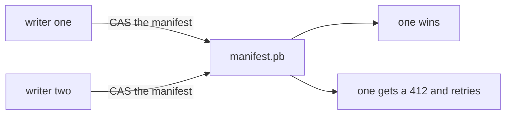
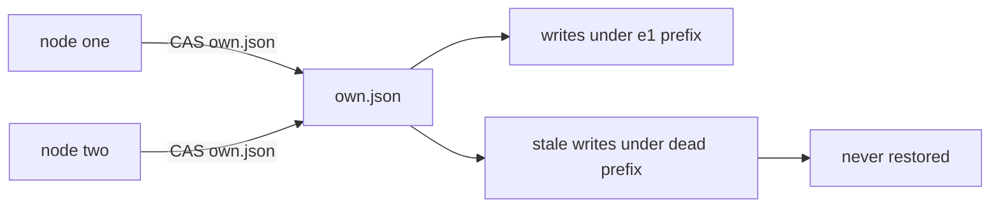

# 03 -- Consistency and fencing: a CAS on the manifest versus a CAS on own.json

Both systems serialize with a compare-and-swap (CAS). The object they swap is
different, and so is the guarantee.

walgit's CAS is the commit. The read-modify-write loop reads the current
value, lets a caller compute a new one, and writes it back guarded by the
version just read.

```rust
// Source: walgit/crates/walgit-store/src/coord.rs, lines 53-77
pub async fn cas_update<T, F>(
    store: &dyn ObjectStore,
    key: &str,
    max_retries: u32,
    mut f: F,
) -> Result<Option<(ObjectMeta, T)>, CoordError>
where
    T: prost::Message + Default,
    F: FnMut(Option<&T>) -> Result<Option<T>, CoordError>,
{
    let mut attempts: u32 = 0;
    loop {
        let current = get_message::<T>(store, key).await?;
        let new = match f(current.as_ref().map(|(_, t)| t)) {
            Ok(None) => return Ok(None),
            Ok(Some(new)) => new,
            Err(e) => return Err(e),
        };
        let mode = match &current {
            Some((meta, _)) => PutMode::Update(meta.version.clone()),
            None => PutMode::Create,
        };
        let encoded = new.encode_to_vec();
        match store.put_bytes(key, encoded, mode).await {
            Ok(meta) => return Ok(Some((meta, new))),
```

Because the key is the manifest, a successful CAS means the repository moved
forward. Two racing pushes both claim log slots, but only one manifest write
wins; the loser re-reads, re-validates, and retries. There is no leader and
no election. Leases exist only as a cross-instance mutex for maintenance work
such as compaction, not for the correctness of pushes.

```rust
// Source: walgit/crates/walgit-store/src/coord.rs, lines 301-360
pub async fn try_acquire(
    store: DynStore,
    key: &str,
    holder: &str,
    purpose: &str,
    ttl: Duration,
) -> Result<Option<LeaseGuard>, CoordError> {
    let now = SystemTime::now();
    let current = get_message::<Lease>(store.as_ref(), key).await?;
    match current {
        None => {
            let lease = make_lease(holder, purpose, now, ttl, 0);
            let encoded = lease.encode_to_vec();
            match store.put_bytes(key, encoded, PutMode::Create).await {
                Ok(meta) => Ok(Some(LeaseGuard::new(
                    store,
                    key,
                    holder,
                    purpose,
                    meta.version,
                    now,
                    ttl,
                    0,
                ))),
                Err(StoreError::PreconditionFailed { .. }) => Ok(None),
                Err(e) => Err(CoordError::Store(e)),
            }
        }
        Some((meta, existing)) => {
            let expires_at = existing
                .expires_at
                .as_ref()
                .map_or(UNIX_EPOCH, time::to_system);
            if now >= expires_at + LEASE_SKEW_TOLERANCE {
                let epoch = existing.epoch + 1;
                let lease = make_lease(holder, purpose, now, ttl, epoch);
                let encoded = lease.encode_to_vec();
                match store
                    .put_bytes(key, encoded, PutMode::Update(meta.version.clone()))
                    .await
                {
                    Ok(new_meta) => Ok(Some(LeaseGuard::new(
                        store,
                        key,
                        holder,
                        purpose,
                        new_meta.version,
                        now,
                        ttl,
                        epoch,
                    ))),
                    Err(StoreError::PreconditionFailed { .. }) => Ok(None),
                    Err(e) => Err(CoordError::Store(e)),
                }
            } else {
                Ok(None)
            }
        }
    }
}
```

celld's CAS is a fence, not a commit. Each cell has an ownership record,
`own.json`, that names the owning node and a fencing epoch. Acquiring the
cell is a conditional write to that record: an absent-only create for a fresh
cell, or an update guarded by the etag just read.

```rust
// Source: celld/crates/celld/ownership_store.rs, lines 949-968
    pub async fn cas_owner(
        &self,
        cell: &str,
        guard: CasGuard,
        epoch: u64,
    ) -> anyhow::Result<CasOutcome> {
        let key = format!("cells/{cell}/own.json");
        let body = serde_json::to_vec(&OwnerWire {
            node: &self.node,
            epoch,
        })?;
        let etag = match &guard {
            CasGuard::Absent => None,
            CasGuard::Match(etag) => Some(etag.as_str()),
        };
        match self.bucket.put_cas(&key, body, etag).await? {
            Some(_) => Ok(CasOutcome::Applied),
            None => Ok(CasOutcome::Rejected),
        }
    }
```

Releasing is the same shape: read the current record, verify it still names
this node at this epoch, and only then write a record that names no node.

```rust
// Source: celld/crates/celld/ownership_store.rs, lines 934-947
    pub async fn release_owner(&self, cell: &str, epoch: u64) -> anyhow::Result<CasOutcome> {
        let Some(current) = self.read_owner(cell).await? else {
            return Ok(CasOutcome::Rejected);
        };
        if current.node.as_deref() != Some(self.node.as_str()) || current.epoch != epoch {
            return Ok(CasOutcome::Rejected);
        }
        let key = format!("cells/{cell}/own.json");
        let body = serde_json::to_vec(&OwnerWire { node: "", epoch })?;
        match self.bucket.put_cas(&key, body, Some(&current.etag)).await? {
            Some(_) => Ok(CasOutcome::Applied),
            None => Ok(CasOutcome::Rejected),
        }
    }
```

The fence is not enough on its own, because a partitioned node can keep
committing locally. The data path adds a second fence: segments are written
under an epoch prefix (celld/crates/celld/replication.rs:5-7), so a stale
owner writes only into a superseded prefix that no restore reads. And when a
write is proved durable by the bucket, the
core re-reads `own.json` before it acknowledges, so a node that lost
ownership cannot confirm a write.

```rust
// Source: celld/crates/logic/output_gate.rs, lines 300-306
        if proven && source == ProofSource::Bucket {
            let (cell, epoch) = (gate.cell.clone(), gate.epoch);
            effects.push(Effect::VerifyOwnership { op, cell, epoch });
            return;
        }
        self.settle_gate(op, proven, effects);
```





The contrast is the inversion noted in the substrate document. walgit has
many writers to one shared history; the CAS on the manifest is the commit
point, so the object being swapped is the data itself. celld has exactly one
writer per cell at a time; the CAS on `own.json` fences access, and the data
itself is written with unconditional puts into a prefix the fence already
decided. walgit's single mutation point is a key; celld's single mutation
point is a function, `on_event`, whose effect stream the ownership record
guards. Both get "exactly one winner" out of a conditional write, but one
winner is a version of a repository and the other is a version of a cell's
owner.

## The Aha Moment

**Aha:** walgit linearizes every write through one shared object, so history
is one line with many writers; celld fences a cell to one writer and uses
epochs so a stale writer's bytes land in a dead prefix. A CAS is the commit
in walgit and the fence in celld.

## Cross-References

- [00-shared-substrate.md](00-shared-substrate.md) — the conditional write both fences and commits.
- [02-write-path.md](02-write-path.md) — where each CAS sits in the write path.
- [04-durability-rpo-rto.md](04-durability-rpo-rto.md) — why celld re-reads own.json after a bucket proof.

Continue to [04-durability-rpo-rto.md](04-durability-rpo-rto.md).
