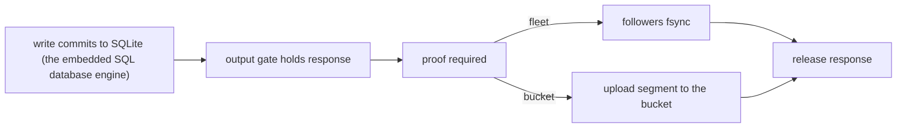

# 04 -- Durability and RPO/RTO: a disposable cache versus the RPO=0 ticket

Both systems claim a Recovery Point Objective (RPO) of zero: an acknowledged
write is never lost. They reach it from opposite directions.

walgit's durability is a side effect of its write path. The client is told
`ok` only after the bucket accepts the manifest compare-and-swap (CAS), so an
acknowledged push is already in the shared log (the write-ahead log, WAL). The local apply that follows
is a cache repair, not the commit.

```rust
// Source: walgit/crates/walgit-wal/src/publish.rs, lines 774-786
        if let Some((committed, version)) = committed {
            // The local commit — ref txns applied, then the new manifest version advertised — happens
            // under `sync_mutex`, the lock the refs phase of every sync holds: a sync that already read
            // the committed manifest would otherwise replay the same entry concurrently (two
            // `git update-ref` on one ref → a lock collision: rig round 2447 of 2450, 2026-08-23) and a
            // reader between the two steps would see one without the other. Refs first: the
            // advertisement/ls-refs caches are keyed by the manifest version, and the reverse order let
            // a reader cache the OLD refs under the NEW version (1 round in 6 on the rig).
            //
            // The WAL commit already happened (CAS ok) and is the truth: whatever the local apply does,
            // every waiter is answered `ok`. A failed apply leaves the version unadvertised, so the next
            // sync sees a change and replays the entry — the copy repairs itself. (Answering an error
            // here produced a durable push that git reported as failed — "0 winners", commit fetchable.)
```

Recovery time objective (RTO) is a matter of re-warming a disposable cache: a
fresh instance reads the manifest, then snapshot plus tail, and serves refs
in under a second while packs arrive. Local disk and memory are caches; wipe
them and nothing is lost but warmth.

celld's durability is the product. A gate holds every egress until a proof
covers every write the egress can reveal. The proof has two sources.

```rust
// Source: celld/crates/logic/types.rs, lines 474-478
#[derive(Clone, Copy, Debug, PartialEq, Eq)]
pub enum ProofSource {
    Fleet,
    Bucket,
}
```

A fleet proof means one or two follower nodes have written the bytes to their
own disks with an fsync (which flushes the file to disk); a bucket proof means the segment is in the object
store. A single-node fleet has no follower, so every write takes the slower
bucket proof. The replicator turns the effect into a ticket and waits.

```rust
// Source: celld/crates/celld/ltx_repl.rs, lines 2984-3008
    pub async fn await_durable(
        &self,
        cell: &str,
        epoch: u64,
        position: u64,
    ) -> anyhow::Result<(u64, celld_logic::ProofSource)> {
        let Some(handle) = self
            .cells
            .lock()
            .unwrap()
            .get(&(cell.to_string(), epoch))
            .cloned()
        else {
            anyhow::bail!("ltx cell not resident: {cell} epoch {epoch}");
        };
        let ticket = handle.req_seq.fetch_add(1, Ordering::SeqCst) + 1;
        #[cfg(all(test, celld_internal_tests))]
        handle.record_durability_ticket_for_world(position, ticket);
        self.dirty.notify_one();
        self.dirty_ship.notify_one();
        let source = self
            .wait_for_durability_ticket(&handle, cell, epoch, ticket)
            .await?;
        Ok((position, source))
    }
```

The wait is budgeted, and the budget depends on whether the write is queued
or already in flight.

```rust
// Source: celld/crates/logic/durability.rs, lines 55-76
pub const QUEUED_BUDGETS: u64 = 6;

/// The monotonic ms at which this wait gives up, given what the node has done
/// so far. Recomputed on every wake, so a proof landing elsewhere on the node
/// or the cell's own capture beginning moves the deadline forward.
pub fn proof_deadline(wait: &ProofWait, progress: &ProofProgress) -> u64 {
    if progress.capture_seq >= wait.ticket {
        // In flight: the fixed budget, from the capture that covers this
        // write. A capture cannot cover a ticket taken after it, so the
        // `max` only guards a clock read that raced the ticket.
        return progress
            .capture_started_ms
            .max(wait.started_ms)
            .saturating_add(wait.budget_ms);
    }
    // Queued: one budget after the node's last proof, bounded in total.
    let anchor = progress.node_proof_ms.max(wait.started_ms);
    let cap = wait
        .started_ms
        .saturating_add(wait.budget_ms.saturating_mul(QUEUED_BUDGETS));
    anchor.saturating_add(wait.budget_ms).min(cap)
}
```

The gate is exhaustive. Every channel that can leave the process takes a
ticket, from an HTTP response to a queue batch leaving its broker to the
`storage.sync()` promise. One channel covers an operation that changes an application R2 (Cloudflare's object storage) bucket.

```rust
// Source: celld/crates/logic/types.rs, lines 417-449
pub enum Channel {
    /// The answer to the cell event itself: an HTTP response, a cell RPC
    /// reply, or a peer-served reply. A response whose body streams takes one
    /// ticket for its head and one more for each chunk, because a chunk the
    /// producer makes after the release can reveal a later write.
    Response,
    /// `fetch()` from a handler to a third party.
    Fetch,
    /// A frame from a `webSocketMessage` handler, captured by the host and
    /// released from the cell's barrier queue.
    WsHibernatable,
    /// A frame on a socket the isolate opened and polls itself. It cannot be
    /// captured, because the handler may be awaiting the reply to the very
    /// frame being held, so it waits on a durability ticket instead.
    WsSelf,
    /// A service-binding call, `env.NAME.fetch()` or its RPC form.
    Service,
    /// A call to another cell: its `fetch` or one of its RPC methods.
    CellRpc,
    /// An operation that changes an application R2 bucket.
    R2,
    /// A connection, write, TLS upgrade, or shutdown on a raw TCP socket.
    Tcp,
    /// A leased Queue batch leaving its broker for a consumer Worker.
    Queue,
    /// The promise `storage.sync()` returns to the handler. Nothing leaves
    /// the process on this route, but the application treats the settled
    /// promise as a durability statement and acts on it through routes the
    /// gate cannot hold: a log line, local work, or the next checkpoint. A
    /// promise that settles before the proof lets the application discard a
    /// recovery path it still needs. So the promise takes the same ticket an
    /// egress takes, and its release is the promise settling.
    Sync,
```




RPO=0 therefore means different things in the two systems. walgit's
acknowledgement is "the write is in the shared log before the client is
told", so visibility and durability are the same event and the bucket round
trip is paid on every push. celld's acknowledgement is "the write is on at
least one other durable surface before the client is told"; that surface can
be a follower disk, and the bucket upload can happen later, so a fleet dodges
the round trip while a single node cannot. celld's RTO is a takeover: a new
owner chains the epoch prefixes down to a snapshot, pages large cells in on
demand, and first recovers the prior owner's open log so an acknowledged
write outside the per-cell prefix is not lost.

## The Aha Moment

**Aha:** Both promise RPO=0, but walgit's acknowledgement says "the write is
in the shared log before the client is told" while celld's says "the write is
on at least one other durable surface before the client is told". walgit pays
the bucket round trip on every push; celld dodges it only when a follower
exists.

## Cross-References

- [02-write-path.md](02-write-path.md) — where the acknowledgement lands in each write path.
- [03-consistency-fencing.md](03-consistency-fencing.md) — the ownership re-read a bucket proof requires.
- [05-efficiency.md](05-efficiency.md) — what each system spends to keep the durable tail small.

Continue to [05-efficiency.md](05-efficiency.md).
