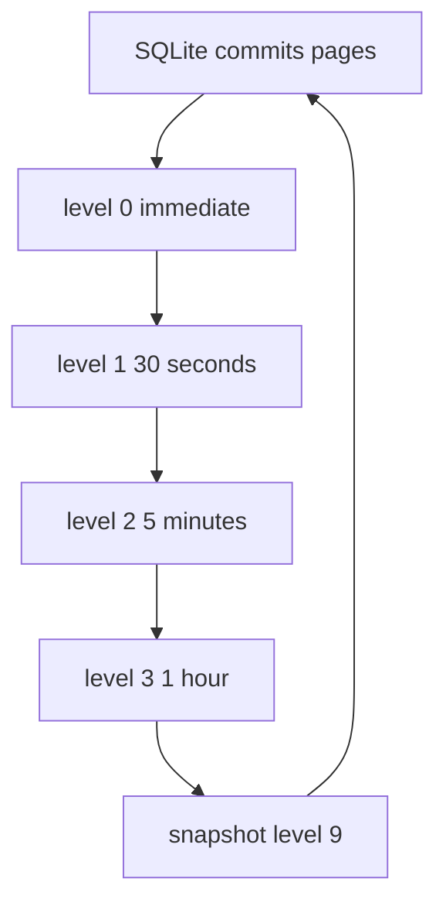

# 05 -- Efficiency: content addressing and single flight versus LTX compaction and paging

Both systems know the bucket is slow, so both keep the moving part small. They
choose opposite axes: walgit buys immutability with bytes, celld buys small
deltas with compaction work. Single-flight coalesces concurrent identical requests into one underlying call.

walgit's packs are immutable and content-addressed, so the same bytes are
stored once no matter how many pushes produce them, and they can sit behind a
content-delivery network. A small pack goes up as one create; a pack above
256 MiB (mebibytes) is striped into eight parts and reassembled server-side.

```rust
// Source: walgit/crates/walgit-wal/src/publish.rs, lines 130-158
/// Above this size a pack upload is striped (`put_file_parallel`).
const PARALLEL_PUT_MIN_BYTES: u64 = 256 * 1024 * 1024;
const PARALLEL_PUT_STRIPES: usize = 8;

pub(crate) async fn put_immutable_create(
    store: &Prefixed,
    key: String,
    path: std::path::PathBuf,
) -> Result<(), WalError> {
    let opts = || PutOptions {
        mode: PutMode::Create,
        immutable: true,
        ..Default::default()
    };
    // Big packs go up striped (parts + server-side compose, ~8 × 100 MB/s):
    // a large repository's rebuilt base (32.4 GB) took 431 s single-stream at 75 MB/s in the
    // weekly dry run of 2026-08-21. Small packs (every push) stay one PUT.
    let size = tokio::fs::metadata(&path).await.map_or(0, |m| m.len());
    let put = if size >= PARALLEL_PUT_MIN_BYTES && store.supports_compose() {
        walgit_store::util::put_file_parallel(store, &key, &path, opts(), PARALLEL_PUT_STRIPES)
            .await
            .map(|_| ())
    } else {
        store
            .put(&key, PutBody::File(path.clone()), opts())
            .await
            .map(|_| ())
    };
    match put {
```

The read side is budgeted against the host's cache, not the repository's
size. A sync plan decides whether a pack is downloaded locally, linked from
storage already present, or served remotely, so a tens-of-gigabytes base does
not have to fit in a small tmpfs (in-memory filesystem).

```rust
// Source: walgit/crates/walgit-wal/src/handle.rs, lines 756-768
    pub fn serve_plan(&self, manifest: &Manifest, level: SyncLevel) -> Vec<(PackRef, PackPlan)> {
        let max = self.cfg.cache_budget_bytes();
        let full: u64 = manifest
            .packs
            .iter()
            .map(|p| p.pack_size + p.idx_size)
            .sum();
        if level != SyncLevel::Serve || max == 0 || full <= max {
            return manifest
                .packs
                .iter()
                .map(|p| (p.clone(), PackPlan::Local))
                .collect();
```

The log itself is folded so a cold start is not a replay of every push. A
checkpoint triggers on entry count, tail bytes, or age.

```rust
// Source: walgit/crates/walgit-wal/src/checkpoint.rs, lines 39-54
pub fn checkpoint_due(
    manifest: &Manifest,
    cfg: &walgit_config::WalConfig,
) -> Option<CheckpointTrigger> {
    let head = manifest.head_seq;
    if head == 0 {
        return None;
    }
    let cp_seq = manifest.checkpoint.as_ref().map_or(0, |c| c.seq);
    if cp_seq >= head {
        return None;
    }
    let entries = head - cp_seq;
    if cfg.snapshot_every_entries > 0 && entries >= cfg.snapshot_every_entries {
        return Some(CheckpointTrigger::Entries);
    }
```

celld's efficiency is page-level. SQLite (the embedded SQL database engine)
commits into a write-ahead log (WAL), and celld copies only the pages a
commit changed into an LTX segment, compressed per page.
Segments then fold on a schedule: level 0 immediately, level 1 after 30
seconds, level 2 after 5 minutes, level 3 after an hour, and a whole-database
snapshot at level 9.

```rust
// Source: celld/crates/ltx/src/compaction_level.rs, lines 37-54
pub const DEFAULT_COMPACTION_LEVELS: [CompactionLevel; 4] = [
    CompactionLevel {
        level: 0,
        interval: Duration::ZERO,
    },
    CompactionLevel {
        level: 1,
        interval: Duration::from_secs(30),
    },
    CompactionLevel {
        level: 2,
        interval: Duration::from_secs(5 * 60),
    },
    CompactionLevel {
        level: 3,
        interval: Duration::from_secs(60 * 60),
    },
];
```

The sharpest efficiency trick is the bundle loop. Many small cells each
produce a tiny level-0 segment; uploading each as its own object would
multiply the request cost by the number of cells. Instead, every dirty cell's
captured segments go up as one object per flush interval — the Class A collapse (a Cloudflare R2 billing term; the bundle loop collapses many small objects into one to cut Class A operations).

```rust
// Source: celld/crates/celld/ltx_repl.rs, lines 4689-4696
/// The bundle loop: paced like the per-cell tiering it replaces, but the
/// unit is the node, not the cell. Every dirty cell's captured L0 segments
/// go up as ONE object per flush interval — the Class A collapse — and the
/// per-cell prefixes stay untouched until a drain point needs them. The
/// crediting mirrors sync_cell: `durable_txid` means bucket-covered,
/// whether by a per-cell object or a bundle row; the replica's own
/// position deliberately does NOT advance, so the direct sync_wait drain
/// still knows exactly which frames lack per-cell objects.
```




Both trees also share an unusual test discipline: a deterministic simulator.
walgit runs a TigerBeetle-style simulation (TigerBeetle is a database whose
VOPR deterministic-simulation approach walgit's sim follows) where a fault
store injects errors and a truth bucket is the oracle, fuzzing seeds until a
property fails (walgit/crates/walgit-server/tests/sim.rs:1-22). celld keeps
its decision core pure and sans input or output so a deterministic simulator
can feed it events and compare against an oracle without a real bucket
(celld/crates/logic/lib.rs:5-6; conformance_o3_oracle at
celld/crates/celld/lib.rs:132). The same trick appears in both because the
hard part is not the happy path; it is the interleaving.

The trade-offs differ. walgit spends bytes to buy cacheability: an object
stored once can be served to every reader, and history is kept exact for a
provenance replay. celld spends compaction work to buy small deltas and a
bounded restore: only changed pages travel, and a restore reads a few folded
segments instead of every write. walgit is optimized for many readers of one
large history; celld for many small independent databases with a
write-latency budget.

## The Aha Moment

**Aha:** walgit spends bytes to buy immutability and cacheability; celld
spends compaction work to buy small deltas and a bounded restore. The same
problem — "the bucket is slow, keep the moving part small" — gets two
opposite answers: a stable object set plus a tiny pointer, or a page-level
journal folded on a schedule.

## Cross-References

- [01-unit-of-state.md](01-unit-of-state.md) — the unit each efficiency trick compacts or deduplicates.
- [04-durability-rpo-rto.md](04-durability-rpo-rto.md) — how the bundle loop and the proof interact.
- [06-when-each-wins.md](06-when-each-wins.md) — which workload each efficiency profile serves.

Continue to [06-when-each-wins.md](06-when-each-wins.md).
