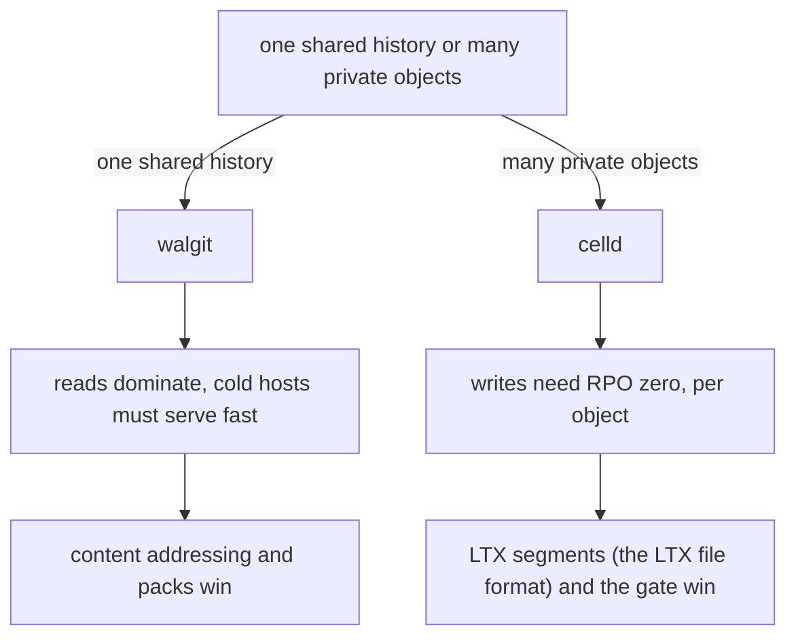
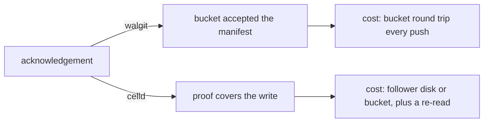

# 06 -- When each wins: the trade-offs

The two systems are the same bet placed at two different granularities: "the
bucket is the only durable thing". The bet pays off differently depending on
the object.

walgit wins when the object is one large, shared, mostly-read history. A
repository is content-addressed and immutable, so every reader can be served
the same bytes from any host, and a fresh instance is useful in seconds. The
sync levels name the tiers of that trade: refs only, refs plus what serving
needs, or the full pack set.

```rust
// Source: walgit/crates/walgit-wal/src/sync.rs, lines 43-48
#[derive(Debug, Clone, Copy, PartialEq, Eq, PartialOrd, Ord)]
pub enum SyncLevel {
    Refs,
    Serve,
    Full,
}
```

Its store requirement is also the smallest. On Amazon S3 (Simple Storage
Service), the compare-and-swap (CAS) is just the etag mapped to two headers:
an absent-only create and a version-guarded update.

```rust
// Source: walgit/crates/walgit-store/src/s3.rs, lines 390-398
        match &opts.mode {
            PutMode::Overwrite => {}
            PutMode::Create => {
                builder = builder.if_none_match("*");
            }
            PutMode::Update(v) => {
                builder = builder.if_match(v.as_str());
            }
        }
```

celld wins when the object is many small, private, mutating state holders.
Each cell is its own SQLite database (the embedded SQL database engine), so
the unit of concurrency is a cell, not a whole history. The gate makes a
Recovery Point Objective (RPO) of zero into a product property, not an
incidental one. And the store contract is stricter, because celld's fence
depends on a clean answer when a conditional write loses.

```rust
// Source: celld/crates/celld/bucket.rs, lines 20-26
//! Error contract, relied on by the self-fence: `put_cas` answers
//! `Ok(None)` only for a clean 412/409 rejection; every other failure
//! surfaces as `Err`. An `Err` is ambiguous — the write may have
//! committed — unless `cas_write_did_not_commit` recognizes an answer
//! that proves the store wrote no object. In the same spirit a response
//! that carries no CAS token is an error, never an empty token a later
//! conditional write would trust.
```

The decision tree.





The concrete differences that decide the choice:

- Write latency. walgit pays one bucket round trip on every push, always.
  celld pays it only when a single node has no follower; a fleet proves
  durable to a follower disk and uploads later.
- Unit of concurrency. walgit linearizes a whole repository on one manifest,
  so many pushers to one repository contend on one key. celld linearizes each
  cell on its own `own.json`, so contention is per cell.
- State model. walgit's objects are immutable and cacheable; the same pack
  can be served to everyone and replayed for provenance. celld's state is a
  live SQLite database; restore means replaying a page-level journal in
  order.
- Failure each fears. walgit fears CAS contention and orphan log slots on a
  busy repository. celld fears a store whose conditional write is fake, a
  lost `own.json`, or a stale owner that acknowledges after a takeover.
- Migration. Moving a walgit repository is pointing a new host at the bucket.
  Moving a celld cell is a takeover: release the record, let the next node
  acquire at a new epoch, and restore from the bucket.
- Platform. walgit is a git host: smart HTTP, Large File Storage (LFS),
  webhooks, and a JSON API. celld is a Workers platform: key-value (KV),
  Cloudflare D1 (SQL), Queues, Workflows, and R2 (object storage), each a
  cell.

Neither is a general answer. walgit deliberately does not tune for millions
of tiny repositories, and it does not acknowledge until the bucket does.
celld deliberately refuses to run on stores without working conditional
writes, and a single node pays the bucket for every write. The choice is
about the shape of the object: shared and immutable favors walgit; private
and mutating favors celld.

## The Aha Moment

**Aha:** They are the same bet — "the bucket is the only durable thing" —
applied at two granularities. walgit makes the durable state a cacheable,
content-addressed value anyone can read; celld makes it a fenced,
single-writer database anyone can take over. Pick walgit when the object is
shared and immutable; pick celld when it is private and mutating.

## Cross-References

- [00-shared-substrate.md](00-shared-substrate.md) — the premise both systems share.
- [04-durability-rpo-rto.md](04-durability-rpo-rto.md) — the latency difference behind the choice.
- [05-efficiency.md](05-efficiency.md) — the efficiency profile each workload needs.

Continue to [README.md](README.md).
