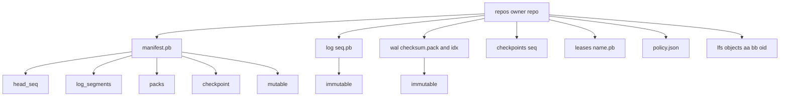
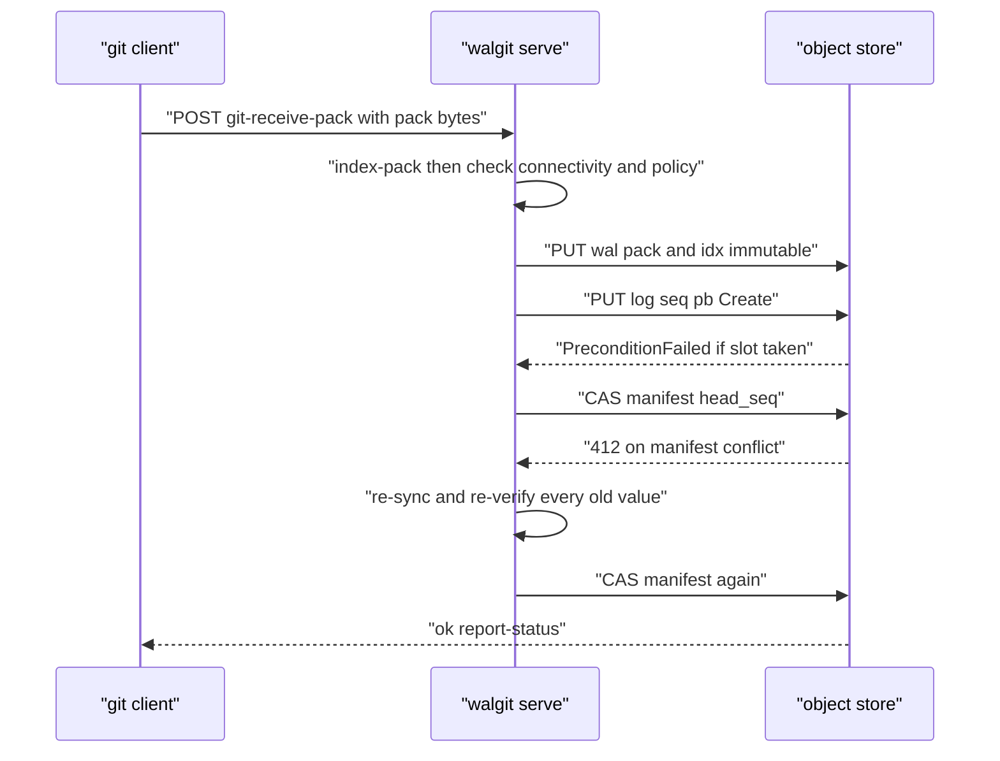

# 00 -- Object Store as Repository: the WAL and the Manifest CAS

walgit turns a plain object-store bucket into a git server. There is no database to hold refs, no leader to elect, and no local disk that matters. The bucket IS the repository, and the single linearization point (a system is linearizable when every operation appears to happen atomically at one instant, the linearization point) in the whole system is a tiny protobuf (protocol buffers) file called `manifest.pb` that is rewritten with a compare-and-swap (CAS). This document explains that model: the object layout, the write path, the read path, and the invariants that keep every instance consistent.

## The shape of the system

The README states the premise directly:

```text
# Source: README.md (source repo), lines 3-6
walgit hosts git repositories with **no database, no leader and no local state that matters**. You run a
single binary, point it at an S3 or GCS bucket, and you have: smart HTTP (v0/v2) fetch and push, Git LFS, a browsing web UI, a JSON API with an SDK, per-repository push policy,
webhooks — and a server that scales to repositories **larger than the machine it runs on**. Every machine that
runs walgit is a disposable cache; the bucket is the repository.
```

The acronyms here expand to Simple Storage Service (S3), Google Cloud Storage (GCS), Hypertext Transfer Protocol (HTTP), Git Large File Storage (LFS), and JavaScript Object Notation (JSON); TTL is time to live.

Everything for one repository lives under `repos/<owner>/<repo>/`. The proto crate fixes those keys as constants, so every instance agrees on where objects are without any coordination:

```rust
// Source: crates/walgit-proto/src/lib.rs, lines 23-34
pub mod keys {
    /// Prefix for a repository, always with trailing slash.
    pub fn repo_prefix(owner: &str, name: &str) -> String {
        format!("repos/{owner}/{name}/")
    }
    pub const MANIFEST: &str = "manifest.pb";
    pub const LOG_DIR: &str = "log/";
    pub const WAL_DIR: &str = "wal/";
    pub const CHECKPOINTS_DIR: &str = "checkpoints/";
    pub const LEASES_DIR: &str = "leases/";
    pub const BUNDLES_DIR: &str = "bundles/";
    pub const BUNDLE_LIST: &str = "bundles/list.pb";
```



Three things stand out. First, `wal/<checksum>.pack`, `.idx`, `.rev`, `.bitmap`, and `.commit-graph` are immutable and content-addressed: their names are their checksums, so a write can never corrupt an existing object. Second, the log segments under `log/<seq>.pb` are also immutable once a later entry commits. Third, the only mutable control objects are `manifest.pb` and the leases (plus the policy and settings objects, which are CAS'd independently). The README compresses this into the layout that matters:

```text
# Source: README.md (source repo), lines 89-94
**The repository is a WAL in the bucket.** Under `repos/<owner>/<repo>/`: `manifest.pb` (tiny, CAS-rewritten:
head sequence, the live pack set, checkpoint pointer, settings — *the linearization point*), `log/<seq>.pb`
(immutable entries: PUSH, COMPACT, CHECKPOINT, SETTINGS), `wal/<checksum>.pack|.idx|.rev|.bitmap|.commit-graph`
(immutable, content-addressed packs with their side-files), `checkpoints/<seq>/` (folded ref snapshot + pack
inventory so a cold start is snapshot + tail), `leases/` (CAS with TTL — the only cross-instance
mutex), `policy.json`, `lfs/objects/`, `events/cursor.json`.
```

## The write path: claim, upload, CAS

A push is not visible until the manifest moves. The writer first ingests the pack, checks connectivity and policy, uploads the immutable pack and its index, then claims a log slot with a conditional create and finally CASes the manifest. The slot claim is where the "log entry is immutable once committed" property is enforced. A slot at `head_seq + 1` is claimed by a `Create` (fail if present); if another writer already put a file there but never moved the manifest, the slot is an orphan and can be burned after a short grace:

```rust
// Source: crates/walgit-wal/src/publish.rs, lines 243-277
    let mut seq = head_seq + 1;
    let mut burned: Vec<(String, walgit_store::Version)> = Vec::new();
    loop {
        let key = keys::log_segment_key(seq);
        let encoded = encode(seq);
        let (mut entries, consumed) = frame::decode_entries(&encoded)
            .map_err(|error| WalError::Corrupt(format!("candidate log: {error}")))?;
        if consumed != encoded.len() || entries.is_empty() {
            return Err(WalError::Corrupt("incomplete candidate log".into()));
        }
        // Content-based version tokens can repeat after delete/recreate. A
        // fresh nonce prevents a delayed delete from matching a later attempt.
        if let Some(first) = entries.first_mut() {
            first.meta.insert(
                "walgit.publication_nonce".into(),
                uuid::Uuid::new_v4().to_string(),
            );
        }
        let bytes = frame::encode_entries(&entries);
        match store
            .put(&key, PutBody::Bytes(bytes.clone()), PutMode::Create.into())
            .await
        {
            Ok(meta) => {
                return Ok(ClaimOutcome::Claimed(LogSlot {
                    key,
                    version: meta.version,
                    first_seq: seq,
                    bytes,
                    burned,
                }));
            }
            Err(StoreError::PreconditionFailed { .. }) => {}
            Err(e) => return Err(WalError::Store(e)),
        }
```



The key property: a crash between the log PUT and the manifest CAS leaves an orphan slot, never a visible half-commit. The manifest CAS is the commit. A 412 (precondition failed) means another writer won; the loser re-reads the manifest, re-validates every ref's old value, and retries. This is documented in the README as the push contract.

## The read path: revalidate first, then apply what changed

Every read starts with a conditional GET on `manifest.pb`. If the version is unchanged the server serves from its local cache with no further work. If it changed, the server applies the new log entries. The freshness check lives in the WAL (write-ahead log) crate:

```rust
// Source: crates/walgit-wal/src/sync.rs, lines 90-114
pub(crate) async fn freshness_check(
    store: &Prefixed,
    known: Option<&Version>,
) -> Result<SyncOutcome, WalError> {
    let outcome = match known {
        Some(v) => match get_message_if_changed::<Manifest>(store, keys::MANIFEST, v).await? {
            None => Ok(SyncOutcome::Unchanged),
            Some((meta, manifest)) => Ok(SyncOutcome::Changed {
                meta_version: meta.version,
                manifest: std::sync::Arc::new(manifest),
            }),
        },
        None => match get_message::<Manifest>(store, keys::MANIFEST).await? {
            None => Err(WalError::NotFound),
            Some((meta, manifest)) => Ok(SyncOutcome::Changed {
                meta_version: meta.version,
                manifest: std::sync::Arc::new(manifest),
            }),
        },
    }?;
    if let SyncOutcome::Changed { manifest, .. } = &outcome {
        crate::validate_manifest(manifest)?;
    }
    Ok(outcome)
}
```

The conditional GET (usually a 304 Not Modified answer from the object store) is why reads are consistent without coordination: there is no "eventually". A replica that has never seen a repository reads the log and has it; a replica that has seen it revalidates on every read.

## The invariants

The README closes with the invariants worth memorising:

```text
# Source: README.md (source repo), lines 183-194
* The manifest CAS is the only commit point; everything before it is invisible, everything after it is
  idempotent and replayable.
* Immutable objects are content-addressed; mutable control objects are explicitly named in `AGENTS.md` (manifest, leases, settings-related control and caches).
* Every read revalidates against the bucket first; there is no "eventually".
* Local disk is a cache. Memory is a cache. The bucket is the repository.
* Placement is configured, never inferred; refs-level reads work everywhere, object work only where placed.
* The maintainer's output is a pure function of (config, WAL); missing is just "not built yet".
* Cost must not scale with ref count on any hot path, nor with pack size on a machine too small for the pack.
* Long work is a task: discoverable, attachable, narrated.
* Correct is not sufficient: every protocol change is judged on round trips to the bucket (`docs/ROUNDTRIPS.md`).
```

## The Aha Moment

**Aha:** A git server is usually a consistency problem — three-phase commit, a database mapping repos to machines, a fixed replica set. walgit deletes the problem by noticing that a git push is already an append to a log, and that an object store already gives you an atomic compare-and-swap. One conditional write on `manifest.pb` becomes the consensus. Everything else — packs, indexes, refs, caches — is either an immutable content-addressed object that can be replayed, or a local cache that can be thrown away. The whole server is just the machinery that keeps that one write correct and everything else re-derivable from it.

The proto types that the manifest and log entries serialize to are the subject of [01-proto-keys.md](./01-proto-keys.md), and the store primitives that make the CAS real are in [02-store-crate.md](./02-store-crate.md).

Continue to [01-proto-keys.md](./01-proto-keys.md).
