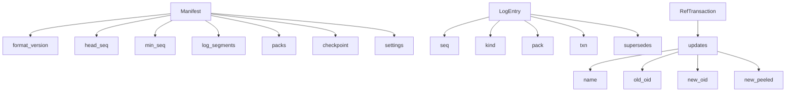
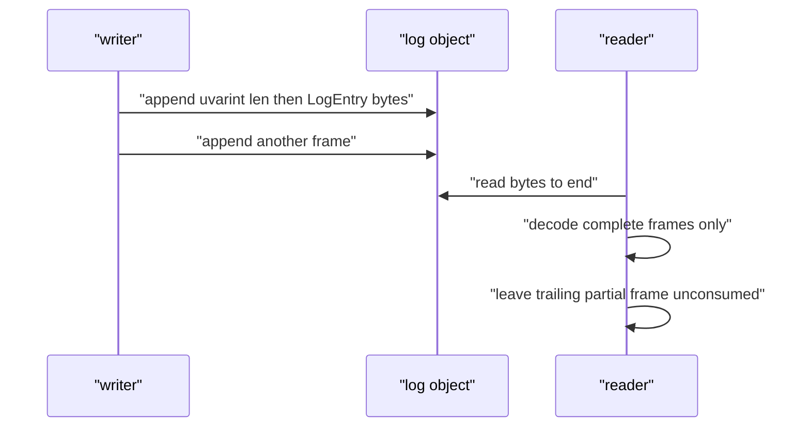

# 01 -- The Proto Contract: Manifest, Log Entries, and Bucket Keys

Everything walgit persists is a protobuf (protocol buffer) message. The schema lives at `crates/walgit-proto/proto/walgit/v1/wal.proto` and is compiled by prost into Rust types re-exported from `walgit_proto::v1`. The schema is a contract between every walgit instance, so it must only evolve backward-compatibly. This document covers the three messages that define the commit point and the log, the length-prefixed framing that lets one object hold many log entries, and the key layout that names objects in the bucket.

## The Manifest is the commit point

`Manifest` is the object that the CAS rewrites. It denormalizes everything a reader needs to decide what to fetch in one object: the head sequence, the oldest still-readable sequence, the live pack set, the checkpoint pointer, and the per-repo settings.

```protobuf
// Source: crates/walgit-proto/proto/walgit/v1/wal.proto, lines 29-53
message Manifest {
  // Format marker. New readers reject unknown values; deployed older readers
  // do not enforce this gate and must be excluded during authority cutovers.
  uint32 format_version = 1;
  // "<owner>/<repo>"
  string repo = 2;
  // "sha1" | "sha256"
  string object_format = 3;
  // Sequence number of the last committed entry (0 = empty repo).
  uint64 head_seq = 4;
  // Oldest entry still present in `log_segments` (entries below are folded
  // into `checkpoint`). min_seq == checkpoint.seq + 1 unless no checkpoint.
  uint64 min_seq = 5;
  // Latest checkpoint (may be absent for a young repo).
  CheckpointRef checkpoint = 6;
  // Log segments covering [min_seq, head_seq], ascending, contiguous,
  // non-overlapping. Kept short by merging segments during compaction.
  repeated LogSegmentRef log_segments = 7;
  // Denormalized live pack set after applying every entry <= `head_seq`
  // (checkpoint packs + packs of later PUSH entries − superseded). Sorted by
  // seq. Materialize = these packs + checkpoint refs + replay log > checkpoint.
  repeated PackRef packs = 8;
  google.protobuf.Timestamp updated_at = 9;
  // Instance id of the writer that produced this generation (diagnostics).
  string writer = 10;
```

The manifest carries `packs` (the live pack set) and `settings` inline, rather than as pointers, so a refs-level sync needs no extra GET. That is a deliberate round-trip decision: the manifest is small, and every read of it must reveal the effective state without chasing more objects.

## The log entries

A `LogEntry` is one of five kinds: a push (a pack plus a ref transaction), a compaction (a new pack that supersedes old ones), a ref-only update, a checkpoint, or a settings change. The kinds are a closed enum, and the fields present depend on the kind:

```protobuf
// Source: crates/walgit-proto/proto/walgit/v1/wal.proto, lines 162-193
enum EntryKind {
  ENTRY_KIND_UNSPECIFIED = 0;
  // A push: zero or one pack + a ref transaction.
  ENTRY_KIND_PUSH = 1;
  // A repack: one new pack superseding `supersedes`; refs unchanged.
  ENTRY_KIND_COMPACT = 2;
  // A ref-only change (deletes, force-updates to existing objects, admin ops).
  ENTRY_KIND_REF_UPDATE = 3;
  // A checkpoint was written; `checkpoint` points at it. Packs unchanged.
  ENTRY_KIND_CHECKPOINT = 4;
  // D24: `settings` changed (the manifest carries the latest; this is history).
  ENTRY_KIND_SETTINGS = 5;
}

message LogEntry {
  uint64 seq = 1;
  EntryKind kind = 2;
  // Present for PUSH (when objects were pushed) and COMPACT.
  PackRef pack = 3;
  // Present for PUSH and `REF_UPDATE`.
  RefTransaction txn = 4;
  // COMPACT only: pack checksums removed from the live set by this entry.
  repeated string supersedes = 5;
  // CHECKPOINT only.
  CheckpointRef checkpoint = 6;
  google.protobuf.Timestamp created_at = 7;
  string writer = 8;
  // Free-form provenance (push-options, client agent, principal). Small.
  map<string, string> meta = 9;
  // `ENTRY_KIND_SETTINGS`: the settings as published at this seq.
  RepoSettings settings = 10;
}
```

A `RefUpdate` carries the old and new object identifier (OID), with the all-zero OID meaning "does not exist". Tag updates may carry a pre-peeled commit so replicas can advertise `^{}` (a git revision peel) without reading the tag object.



## Framing: many entries in one appendable object

A log object can grow by appending. Each entry is written as a length-prefixed frame: a uvarint (unsigned variable-length integer) length followed by the encoded `LogEntry`. The decoder stops at the first incomplete trailing frame, so a crash mid-append is not an error — the partial frame is simply not yet visible.

```rust
// Source: crates/walgit-proto/src/lib.rs, lines 106-148
pub mod frame {
    use bytes::{Bytes, BytesMut};
    use prost::Message;

    use crate::v1::LogEntry;

    pub fn encode_entry(e: &LogEntry, out: &mut BytesMut) {
        let len = e.encoded_len();
        prost::encoding::encode_varint(len as u64, out);
        out.reserve(len);
        // BytesMut grows as needed; encode_raw has no fallible capacity check.
        e.encode_raw(out);
    }

    pub fn encode_entries<'a>(entries: impl IntoIterator<Item = &'a LogEntry>) -> Bytes {
        let mut b = BytesMut::new();
        for e in entries {
            encode_entry(e, &mut b);
        }
        b.freeze()
    }

    /// Decode all complete frames. Returns entries and the number of bytes
    /// consumed (a trailing partial frame is left unconsumed, not an error).
    pub fn decode_entries(buf: &[u8]) -> Result<(Vec<LogEntry>, usize), prost::DecodeError> {
        let mut out = Vec::new();
        let mut pos = 0usize;
        while let Some(mut probe) = buf.get(pos..) {
            let Ok(len) = prost::encoding::decode_varint(&mut probe) else {
                break;
            };
            let Ok(len) = usize::try_from(len) else {
                break;
            };
            let Some(frame) = probe.get(..len) else {
                break;
            };
            out.push(LogEntry::decode(frame)?);
            pos = buf.len() - probe.len() + len;
        }
        Ok((out, pos))
    }
}
```



The regional-bucket case uses one immutable object per publish batch, and compaction later merges frames into longer sealed segments. In the zonal-bucket case, one object is appended to until it is sealed. Both share the same framing, so the reader never has to know which it is reading.

## The key layout

The key module in the proto crate is the single source of truth for where objects live. All keys are relative to the repo prefix, and every instance derives them from the same functions.

```rust
// Source: crates/walgit-proto/src/lib.rs, lines 51-82
    /// `log/<first_seq:016x>.pb`
    pub fn log_segment_key(first_seq: u64) -> String {
        format!("{LOG_DIR}{first_seq:016x}.pb")
    }
    pub fn pack_key(checksum_hex: &str) -> String {
        format!("{WAL_DIR}{checksum_hex}.pack")
    }
    pub fn idx_key(checksum_hex: &str) -> String {
        format!("{WAL_DIR}{checksum_hex}.idx")
    }
    pub fn rev_key(checksum_hex: &str) -> String {
        format!("{WAL_DIR}{checksum_hex}.rev")
    }
    pub fn bitmap_key(checksum_hex: &str) -> String {
        format!("{WAL_DIR}{checksum_hex}.bitmap")
    }
    pub fn commit_graph_key(checksum_hex: &str) -> String {
        format!("{WAL_DIR}{checksum_hex}.commit-graph")
    }
    pub fn checkpoint_dir(seq: u64) -> String {
        format!("{CHECKPOINTS_DIR}{seq:016x}/")
    }
    pub fn checkpoint_key(seq: u64) -> String {
        format!("{CHECKPOINTS_DIR}{seq:016x}/checkpoint.pb")
    }
    /// Unique candidate metadata; attempt must be a caller-generated safe identifier.
    pub fn checkpoint_attempt_key(seq: u64, attempt: &str) -> String {
        format!("{CHECKPOINTS_DIR}{seq:016x}/attempts/{attempt}/checkpoint.pb")
    }
    pub fn checkpoint_refs_key(seq: u64) -> String {
        format!("{CHECKPOINTS_DIR}{seq:016x}/refs.pb")
    }
```

The pack side-files all share the pack's checksum as their basename, differing only in extension. That is what makes packs content-addressed and immutable: you can always compute the name, and a write to the same name is the same bytes.

## The Aha Moment

**Aha:** The manifest is not a summary that a database maintains; it is the database. By denormalizing the live pack set, the checkpoint pointer, the settings, and the log window into one small object, walgit makes "read the current state" a single conditional GET and "change the state" a single CAS. The log is then only history — a sequence of immutable, framed, replayable entries — not the live index. That inversion (state in the manifest, history in the log) is what keeps the hot read path at one round trip.

The primitives that actually perform those conditional reads and writes live in the store crate, covered next in [02-store-crate.md](./02-store-crate.md). The WAL crate consumes these messages and the manifest in [03-wal-crate.md](./03-wal-crate.md).

Continue to [02-store-crate.md](./02-store-crate.md).
