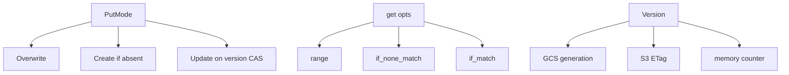
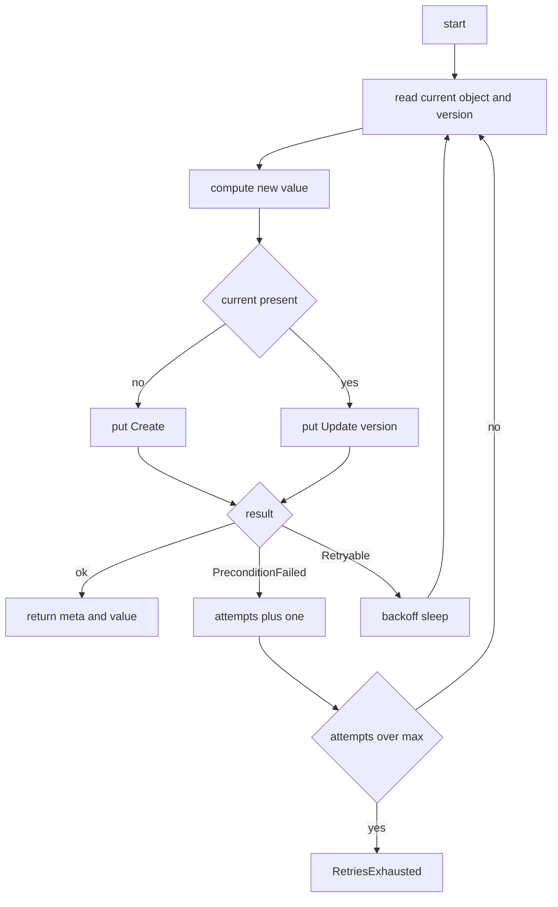
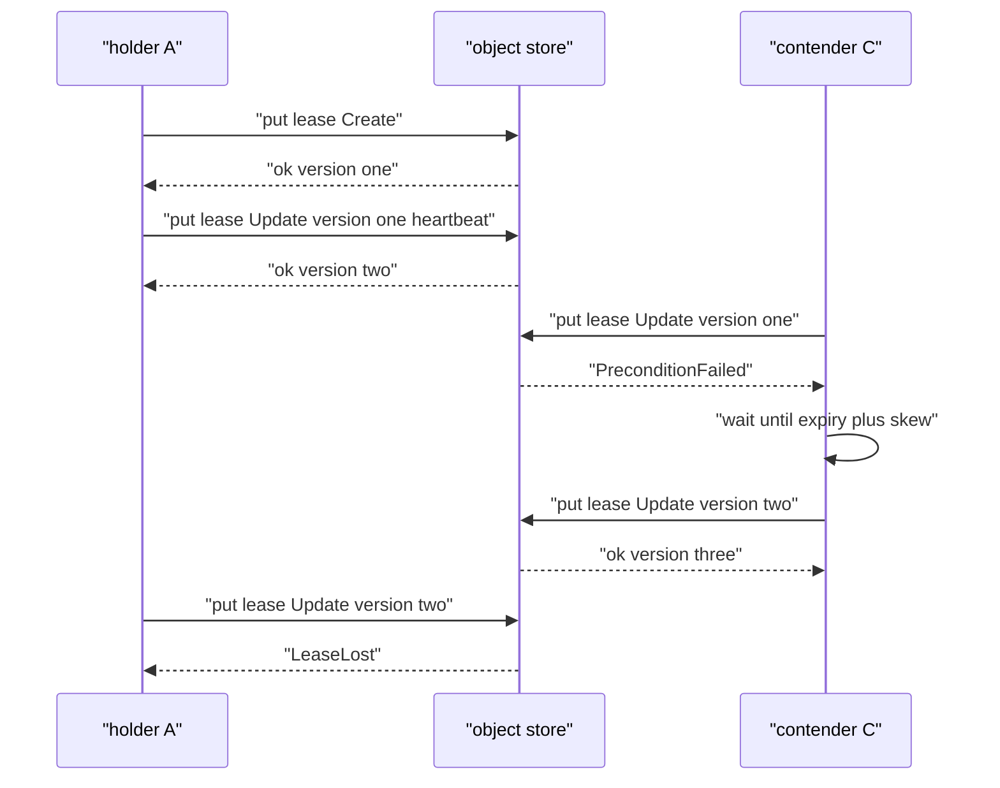

# 02 -- The Store Crate: Object Layout, Opaque Versions, CAS, and Leases

`walgit-store` is the only crate that talks to a bucket. It defines an `ObjectStore` trait with exactly the primitives walgit needs to build linearizable coordination (a system is linearizable when every operation appears to happen atomically at one instant, the linearization point) on top of Amazon S3, Google Cloud Storage (GCS), or an in-memory store for tests: versioned reads, conditional writes, conditional deletes, range reads, streaming bodies, and prefix listing. Everything above this crate treats object versions as opaque tokens and never parses them.

## The trait

The store trait is deliberately small. A backend implements `get`, `head`, `put`, `delete`, `list`, `list_prefixes`, and a few optional acceleration hooks:

```rust
// Source: crates/walgit-store/src/lib.rs, lines 198-217
#[async_trait::async_trait]
pub trait ObjectStore: Send + Sync + 'static {
    /// Human-readable backend id for logs/metrics ("gcs", "s3", "memory").
    fn backend(&self) -> &'static str;
    /// Whether this store is a prefixing wrapper. Used to avoid duplicate
    /// operation spans when prefixes are nested.
    fn is_prefixed(&self) -> bool {
        false
    }

    async fn get(&self, key: &str, opts: GetOptions) -> Result<GetResult>;

    /// Metadata only. `Ok(None)` if absent.
    async fn head(&self, key: &str) -> Result<Option<ObjectMeta>>;

    async fn put(&self, key: &str, body: PutBody, opts: PutOptions) -> Result<ObjectMeta>;

    /// Delete. `if_version` = CAS delete. Deleting an absent object is `Ok(())`
    /// when unconditional and `NotFound` when conditional.
    async fn delete(&self, key: &str, if_version: Option<Version>) -> Result<()>;
```

The `Version` type is an opaque string wrapper. It is a GCS generation, an S3 or rustfs (an S3-compatible store for local dev and CI) `ETag` (entity tag), or a counter in the memory backend, and callers only ever compare it for equality. `PutMode` encodes the three write forms:

```rust
// Source: crates/walgit-store/src/lib.rs, lines 108-117
#[derive(Clone, Debug, PartialEq, Eq, Default)]
pub enum PutMode {
    /// Unconditional overwrite.
    #[default]
    Overwrite,
    /// Only if the object does not exist (if-generation-match: 0 / If-None-Match: *).
    Create,
    /// Only if the current version equals the given one (CAS).
    Update(Version),
}
```

A `Create` maps to the object store's if-absent semantics; an `Update(version)` maps to a conditional write whose failure surfaces as `StoreError::PreconditionFailed`. That single error type is what the whole CAS machinery keys off.



## The CAS loop

The generic compare-and-swap lives in `coord.rs` as `cas_update`: a read-modify-write loop that re-reads on `PreconditionFailed` and backs off with jitter on `Retryable`.

```rust
// Source: crates/walgit-store/src/coord.rs, lines 63-105
    let mut attempts: u32 = 0;
    loop {
        let current = get_message::<T>(store, key).await?;
        let new = match f(current.as_ref().map(|(_, t)| t)) {
            Ok(None) => return Ok(None),
            Ok(Some(new)) => new,
            Err(e) => return Err(e),
        };
        let mode = match &current {
            Some((meta, _)) => PutMode::Update(meta.version.clone()),
            None => PutMode::Create,
        };
        let encoded = new.encode_to_vec();
        match store.put_bytes(key, encoded, mode).await {
            Ok(meta) => return Ok(Some((meta, new))),
            Err(StoreError::PreconditionFailed { .. }) => {
                attempts += 1;
                if attempts > max_retries {
                    return Err(CoordError::RetriesExhausted {
                        key: key.to_string(),
                        attempts,
                    });
                }
                // re-read on next iteration
            }
            Err(StoreError::Retryable(_)) => {
                attempts += 1;
                if attempts > max_retries {
                    return Err(CoordError::RetriesExhausted {
                        key: key.to_string(),
                        attempts,
                    });
                }
                let d = crate::util::backoff(
                    attempts - 1,
                    Duration::from_millis(5),
                    Duration::from_millis(100),
                );
                tokio::time::sleep(d).await;
            }
            Err(e) => return Err(CoordError::Store(e)),
        }
    }
```



The manifest CAS in the WAL crate is a specialization of this loop with extra verification between re-reads; the generic form is what makes the semantics testable in isolation.

## Leases

The only cross-instance mutex is a lease: a protobuf object under `leases/<name>.pb` acquired by `Create`, or by `Update` over an expired lease, and renewed by a CAS heartbeat. The heartbeat increments the epoch and CAS-extends the expiry; a `PreconditionFailed` means someone stole it.

```rust
// Source: crates/walgit-store/src/coord.rs, lines 203-221
    pub async fn heartbeat(&mut self, ttl: Duration) -> Result<(), CoordError> {
        let now = SystemTime::now();
        self.epoch += 1;
        let lease = make_lease(&self.holder, &self.purpose, now, ttl, self.epoch);
        let encoded = lease.encode_to_vec();
        match self
            .store
            .put_bytes(&self.key, encoded, PutMode::Update(self.version.clone()))
            .await
        {
            Ok(meta) => {
                self.version = meta.version;
                self.expires_at = now + ttl;
                Ok(())
            }
            Err(StoreError::PreconditionFailed { .. }) => Err(CoordError::LeaseLost),
            Err(e) => Err(CoordError::Store(e)),
        }
    }
```

There is a small clock-skew grace: `LEASE_SKEW_TOLERANCE` is two seconds (`crates/walgit-store/src/coord.rs:23`), so a holder whose clock is slightly ahead does not have its lease ripped away while still active. A background heartbeat task calls this every interval until the guard is released or the lease is lost. On drop, the guard performs a best-effort CAS delete inside a Tokio runtime.



The heartbeat task notices `LeaseLost`, marks the guard released, and stops. This is exactly the machinery the maintainer uses to ensure only one host runs compaction for a repository at a time.

## The Aha Moment

**Aha:** The store crate is where the "no leader" claim actually lands. Everything walgit needs for coordination is three store primitives — conditional write, conditional read, conditional delete — plus an opaque version token. The object store already provides those as native, strongly-consistent operations (S3 `ETag` preconditions, GCS generations). walgit does not build a consensus layer; it just names the object-store primitive precisely and puts the burden of linearizability (a system is linearizable when every operation appears to happen atomically at one instant, the linearization point) on a service that already guarantees it for one key at a time.

The WAL crate turns these primitives into publishing, sync levels, and the single-flight group commit, covered next in [03-wal-crate.md](./03-wal-crate.md). The manifest messages those loops serialize are in [01-proto-keys.md](./01-proto-keys.md).

Continue to [03-wal-crate.md](./03-wal-crate.md).
