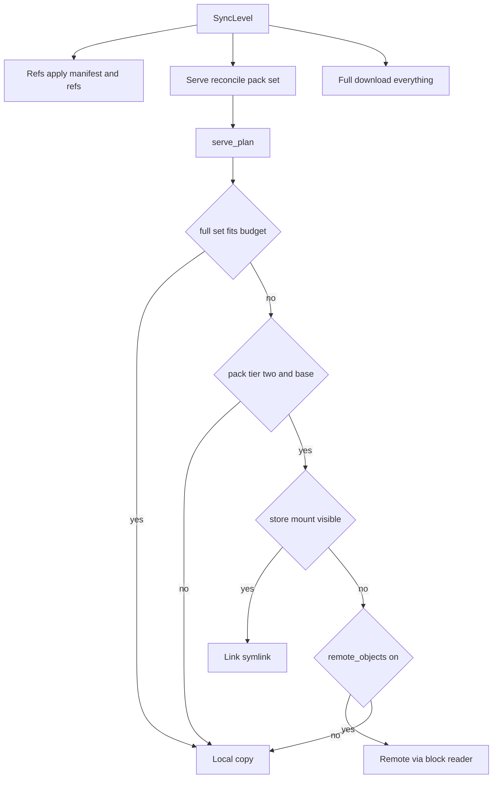
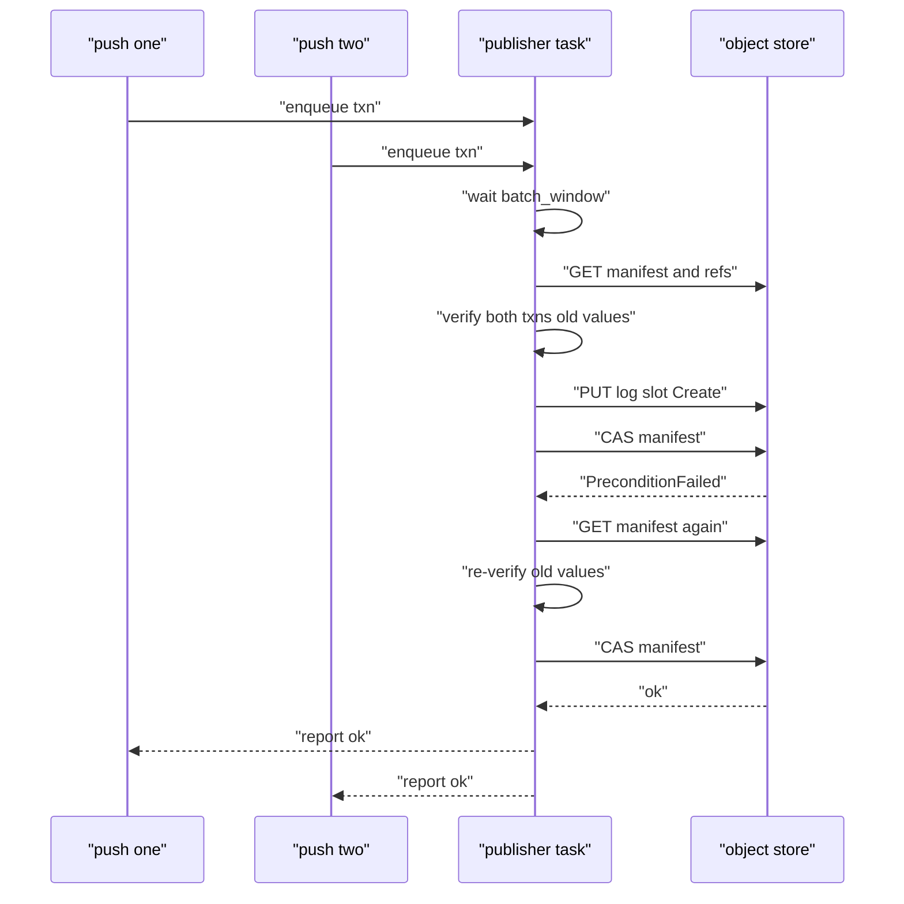

# 03 -- The WAL Crate: Sync Levels, Group Commit, and the Single-Flight Publisher

`walgit-wal` is the heart of the system. Its `RepoHandle` reconciles the local disk against the manifest, and its publisher turns push requests into one manifest CAS. This document covers the three sync levels, the per-pack serve plan, the group commit that coalesces concurrent pushes, and the orphan-burning claim that keeps the head clean after a crash.

## Sync levels and the serve plan

A `RepoHandle` can be synced to three levels. `Refs` applies only the manifest and ref state; `Serve` also reconciles the pack set the way this machine can hold it; `Full` downloads everything for repacks. The enum and the per-pack plan are explicit:

```rust
// Source: crates/walgit-wal/src/sync.rs, lines 43-77
#[derive(Debug, Clone, Copy, PartialEq, Eq, PartialOrd, Ord)]
pub enum SyncLevel {
    Refs,
    Serve,
    Full,
}

impl SyncLevel {
    /// Whether this level reconciles the local pack set.
    pub fn wants_packs(self) -> bool {
        self >= SyncLevel::Serve
    }
}

/// How one live pack is served on this instance (see `RepoHandle::serve_plan`).
#[derive(Debug, Clone, PartialEq, Eq)]
pub enum PackPlan {
    /// Real local copy of `.pack` + side-files.
    Local,
    /// Side-files local, `.pack` a symlink to this path in the store mount.
    Link(std::path::PathBuf),
    /// Only the commit-graph layer local; data via the remote reader.
    Remote,
}

impl PackPlan {
    /// Bytes this plan puts on tmpfs for `p`.
    pub fn tmpfs_bytes(&self, p: &PackRef) -> u64 {
        match self {
            PackPlan::Local => p.pack_size + p.idx_size,
            PackPlan::Link(_) => p.idx_size,
            PackPlan::Remote => 0,
        }
    }
}
```

The decision function is `serve_plan`. If the whole pack set fits the cache budget (or the level is `Full`, or the cache is a disk with unlimited budget), everything is `Local`. Otherwise tier-2 base packs are `Link` (side-files on tmpfs — an in-memory filesystem — with the `.pack` symlinked from a read-only store mount) or `Remote` (indexes local, data read by range), while newer packs stay local.

```rust
// Source: crates/walgit-wal/src/handle.rs, lines 763-769
        if level != SyncLevel::Serve || max == 0 || full <= max {
            return manifest
                .packs
                .iter()
                .map(|p| (p.clone(), PackPlan::Local))
                .collect();
        }
```



The two-phase sync is deliberate. Phase one (refs) runs under `sync_mutex` and is sub-second; phase two (packs) runs under `pack_mutex` and downloads on a separate bulk runtime so it never blocks a refs request. The write lock is only ever `try_write`n so a superseded pack is not unlinked under an active reader.

## Group commit: the single-flight publisher

Concurrent pushes to one repository on one instance are coalesced into one CAS by a single publisher task. The task pulls the first request, then waits a short `batch_window` (only if another push is queued or waiting) to gather more, up to `max_batch`.

```rust
// Source: crates/walgit-wal/src/publish.rs, lines 450-492
    loop {
        let Some(first) = rx.recv().await else { break };

        let mut batch = Vec::with_capacity(max_batch.min(64));
        batch.push(first);

        // Do not unconditionally sleep for the batching window: a lone push
        // should enter the CAS immediately. If another request is queued or
        // still waiting to enqueue, wait briefly for concurrent pushes.
        if batch.len() < max_batch {
            let first_queued = rx.try_recv().ok();
            let concurrent = handle.publish_waiters.load(Ordering::Relaxed) > 1;
            if first_queued.is_some() || concurrent {
                if let Some(r) = first_queued {
                    batch.push(r);
                }
                if batch.len() < max_batch && batch_window > std::time::Duration::ZERO {
                    let deadline = tokio::time::sleep(batch_window);
                    tokio::pin!(deadline);
                    loop {
                        tokio::select! {
                            () = &mut deadline => break,
                            maybe_req = rx.recv() => {
                                match maybe_req {
                                    Some(r) => {
                                        batch.push(r);
                                        if batch.len() >= max_batch {
                                            break;
                                        }
                                    }
                                    None => break,
                                }
                            }
                        }
                    }
                }
            }
        }

        if let Err(e) = process_batch(&handle, batch).await {
            tracing::error!("publisher batch failed: {e}");
        }
    }
```

`process_batch` then runs the full CAS loop: sync to the current manifest and ref view, verify every transaction's old values against the working ref map, encode the log slot, claim it, and CAS the manifest. On a 412 it re-syncs and re-verifies, so a racing winner invalidates the loser's stale basis.

```rust
// Source: crates/walgit-wal/src/publish.rs, lines 524-543
    loop {
        // 1. Sync to get current manifest + refs. CAS retries must re-sync;
        // the first attempt may reuse receive-pack's request sync.
        if (attempts > 0 || needs_initial_sync)
            && let Err(e) = handle.sync_impl().instrument(span.clone()).await
        {
            return finish_all_errors(batch, e);
        }
        // Pair the O(1) cached ref view with the CAS basis under the same
        // lock that applies refs. Release it before any store or bulk work.
        let (manifest, known_version, mut working_refs) = {
            let _sync = handle.sync_mutex.lock().await;
            let (manifest, version) = handle.manifest_pair();
            let refs = match handle.local.ref_view() {
                Ok(v) => v,
                Err(e) => return finish_all_errors(batch, WalError::from(e)),
            };
            (manifest, version, refs)
        };
        let head_seq = manifest.head_seq;
```



## Orphan burning

A healthy writer CASes the manifest milliseconds after its log PUT, so a foreign `log/<seq>.pb` at `head_seq + 1` that stays uncommitted is a crash artifact. The claim loop probes it a few times over a short grace, and if the manifest head never moved, burns the sequence and tries the next one — but never more than eight in a row.

```rust
// Source: crates/walgit-wal/src/publish.rs, lines 216-220
const ORPHAN_GRACE_PROBES: u32 = 3;
const ORPHAN_GRACE_STEP: std::time::Duration = std::time::Duration::from_millis(100);
/// Never burn more than this many seqs in one claim (a pile of orphans means
/// something else is wrong).
const MAX_BURN: usize = 8;
```

Burned orphans are CAS-deleted after the winning commit; a losing writer CAS-deletes only its own slot version so it can never remove a later writer's object.

## The Aha Moment

**Aha:** The publisher is "single-flight" not because there is a lock, but because there is exactly one task per `RepoHandle` and every push is a message on its queue. Group commit falls out of that queue for free: the task can gather a batch without any cross-instance coordination, and the CAS is the only place where races are decided. The orphan-burning claim is the same idea applied to failure: an uncommitted log segment is just a message whose sender died, and the next sender cleans it up. Coordination shrinks to "one writer per process, one CAS per batch".

Where those packs actually live on disk and how git reads them is the next document, [04-git-storage.md](./04-git-storage.md). The manifest and log entries being verified here are defined in [01-proto-keys.md](./01-proto-keys.md).

Continue to [04-git-storage.md](./04-git-storage.md).
