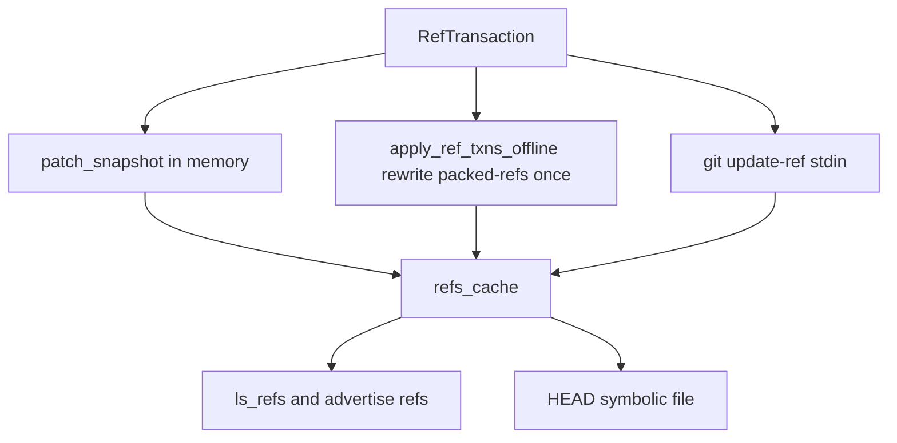
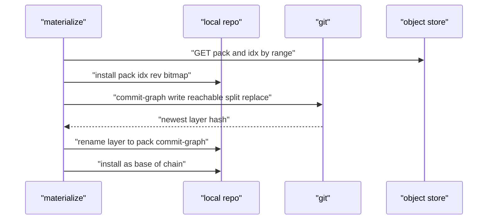

# 04 -- Git Object Storage: Packs, Indexes, Refs, and Commit Graphs

walgit does not reimplement git object storage; it drives git (the real `git` binary and the gix Rust library) over the layout the WAL defines. This document covers how refs are applied, how packs and their side-files are materialized, how loose objects are written for the remote reader, and how a commit-graph layer is produced so history can be walked without pack data.

## Refs: packed-refs as the working set

The ref state is a name-sorted snapshot plus a symbolic `HEAD`. After a push commits, the transaction is applied to the local repository with `git update-ref --stdin` for normal refs and a direct `HEAD` file write for symbolic refs. The cached snapshot is then patched in memory rather than rebuilt, so applying a small transaction is cheap:

```rust
// Source: crates/walgit-git/src/lib.rs, lines 1359-1416
    fn patch_snapshot(
        &self,
        base: &RefSnapshotData,
        txns: &[walgit_proto::v1::RefTransaction],
    ) -> Result<RefSnapshotData, GitError> {
        let mut refs = base.refs.clone();
        let mut head_target = base.head_target.clone();
        let mut repo: Option<gix::Repository> = None;
        for u in txns.iter().flat_map(|t| t.updates.iter()) {
            if !u.new_symbolic_target.is_empty() {
                if u.name == "HEAD" {
                    head_target.clone_from(&u.new_symbolic_target);
                }
                continue;
            }
            let delete = u.new_oid.is_empty() || u.new_oid.chars().all(|c| c == '0');
            let pos = refs.binary_search_by(|r| r.name.as_str().cmp(u.name.as_str()));
            match (pos, delete) {
                (Ok(i), true) => {
                    refs.remove(i);
                }
                (Err(_), true) => {}
                (pos, false) => {
                    let mut peeled = u.new_peeled.clone();
                    if peeled.is_empty() && u.name.starts_with("refs/tags/") {
                        if repo.is_none() {
                            repo = Some(gix::Repository::from(
                                &gix::ThreadSafeRepository::open(&self.inner.path).map_err(ge)?,
                            ));
                        }
                        let r = repo.as_ref().ok_or_else(|| {
                            GitError::InvalidInput(
                                "repository unavailable while peeling tag".into(),
                            )
                        })?;
                        if let Ok(oid) = gix_hash::ObjectId::from_hex(u.new_oid.as_bytes()) {
                            peeled = peel_tag(r, oid)
                                .map(|p| p.to_hex().to_string())
                                .unwrap_or_default();
                        }
                    }
                    let entry = Ref {
                        name: u.name.clone(),
                        oid: u.new_oid.clone(),
                        peeled,
                    };
                    match pos {
                        Ok(i) => {
                            *refs.get_mut(i).ok_or_else(|| {
                                GitError::InvalidInput("ref search index out of bounds".into())
                            })? = entry;
                        }
                        Err(i) => refs.insert(i, entry),
                    }
                }
            }
        }
        Ok(RefSnapshotData { refs, head_target })
    }
```

For a large ref set or a cold start, the cheaper path is to rewrite `packed-refs` once from an in-memory map and remove loose refs, rather than run many `git update-ref` commands. The offline apply is used on the refs-first sync where `git update-ref` would refuse missing objects:

```rust
// Source: crates/walgit-git/src/lib.rs, lines 1476-1529
    pub fn apply_ref_txns_offline(
        &self,
        txns: &[&walgit_proto::v1::RefTransaction],
    ) -> Result<(), GitError> {
        let span = tracing::info_span!(
            "git.apply_ref_txns_offline",
            repo = %self.inner.id,
            n_txns = txns.len(),
        );
        let _enter = span.enter();
        let snap = self.refs()?;
        let mut head_target = snap.head_target;
        let mut map: BTreeMap<String, Ref> =
            snap.refs.into_iter().map(|r| (r.name.clone(), r)).collect();
        let repo = self.gix();
        for txn in txns {
            for u in &txn.updates {
                validate_ref_update(u)?;
                if !u.new_symbolic_target.is_empty() {
                    if u.name == "HEAD" {
                        head_target.clone_from(&u.new_symbolic_target);
                    }
                    continue;
                }
                let new_zero = u.new_oid.is_empty() || u.new_oid.chars().all(|c| c == '0');
                if new_zero {
                    map.remove(&u.name);
                    continue;
                }
                let peeled = if !u.new_peeled.is_empty() {
                    u.new_peeled.clone()
                } else if u.name.starts_with("refs/tags/") {
                    gix_hash::ObjectId::from_hex(u.new_oid.as_bytes())
                        .ok()
                        .and_then(|oid| peel_tag(&repo, oid))
                        .map(|p| p.to_hex().to_string())
                        .unwrap_or_default()
                } else {
                    String::new()
                };
                map.insert(
                    u.name.clone(),
                    Ref {
                        name: u.name.clone(),
                        oid: u.new_oid.clone(),
                        peeled,
                    },
                );
            }
        }
        let data = RefSnapshotData {
            refs: map.into_values().collect(),
            head_target,
        };
```



## Packs and side-files

A pack in the bucket is `wal/<checksum>.pack` plus side-files that share the checksum: `.idx` (the index), `.rev` (reverse index), `.bitmap` (for reachability), and `.commit-graph` (a commit-graph layer). When a manifest advertises a new side-file for a pack already installed locally, the sync downloads only the missing side-file. Materialization on a fresh instance downloads pack and index via striped range reads (the subject of [10-scaling.md](./10-scaling.md)).

The commit-graph side-file is produced by running real git and copying the newest split layer to the pack's name:

```rust
// Source: crates/walgit-git/src/lib.rs, lines 2357-2386
    pub async fn write_pack_commit_graph(
        &self,
        checksum: &gix_hash::oid,
        changed_paths: bool,
    ) -> Result<u64, GitError> {
        let mut args = vec!["commit-graph", "write", "--reachable", "--split=replace"];
        if changed_paths {
            args.push("--changed-paths");
        }
        let out = self.git(&args).await?;
        if !out.status.success() {
            return Err(GitError::Subprocess {
                cmd: "git commit-graph write".into(),
                status: out.status.code(),
                stderr: String::from_utf8_lossy(&out.stderr).into_owned(),
            });
        }
        let layers = self.commit_graph_chain()?;
        let Some(hash) = layers.last() else {
            return Err(GitError::InvalidInput(
                "commit-graph write produced no layer".into(),
            ));
        };
        let src = self.commit_graphs_dir().join(format!("graph-{hash}.graph"));
        let dst = self.pack_path(checksum).with_extension("commit-graph");
        let tmp = dst.with_extension("commit-graph.tmp");
        std::fs::copy(&src, &tmp).map_err(GitError::Io)?;
        rename_atomic(&tmp, &dst)?;
        Ok(std::fs::metadata(&dst).map_or(0, |m| m.len()))
    }
```

The side-file is then installed as the base layer of the repository's split commit-graph chain, so `git log` walks commits without touching pack data.



## Loose objects for the remote reader

When a repository is served remotely (packs too large for the machine), the gix engine asks for the base objects a tree diff needs. Those objects are read by range and written into the local loose store so the rest of the engine and stock git tooling see them:

```rust
// Source: crates/walgit-git/src/lib.rs, lines 1550-1584
    pub fn write_loose_object(
        &self,
        kind: gix_object::Kind,
        oid: &gix_hash::oid,
        data: &[u8],
    ) -> Result<(), GitError> {
        use gix_object::Write as _;
        let hex = oid.to_hex().to_string();
        let path = self
            .inner
            .path
            .join("objects")
            .join(
                hex.get(..2)
                    .ok_or_else(|| GitError::InvalidInput("short object ID".into()))?,
            )
            .join(
                hex.get(2..)
                    .ok_or_else(|| GitError::InvalidInput("short object ID".into()))?,
            );
        if path.exists() {
            return Ok(());
        }
        let store = gix_odb::loose::Store::at(
            self.inner.path.join("objects"),
            gix_odb::loose::Options {
                object_hash: oid.kind(),
                ..Default::default()
            },
        );
        store
            .write_buf_with_known_id(kind, data, oid.to_owned())
            .map_err(GitError::Gix)?;
        Ok(())
    }
```

This is idempotent: an existing object is left alone. The object is written with its known identity, so a corrupt write would be detected by the hash.

## The Aha Moment

**Aha:** walgit keeps the two git implementations honest by making the on-disk repository a plain bare git repository. The WAL is the source of truth, but the local cache is a real `.git` directory with `packed-refs`, loose objects, and a commit-graph chain. That is why upstream `git` can do upload-pack and repack unchanged, and why the gix remote reader can fault objects into the loose store and then let stock tooling read them. The clever part is not replacing git; it is choosing which parts git is allowed to run locally and which must go through the object store.

The smart HTTP endpoints that dispatch to those two engines are the next document, [05-smart-http.md](./05-smart-http.md). The sync levels that decide which packs are local versus remote are in [03-wal-crate.md](./03-wal-crate.md).

Continue to [05-smart-http.md](./05-smart-http.md).
