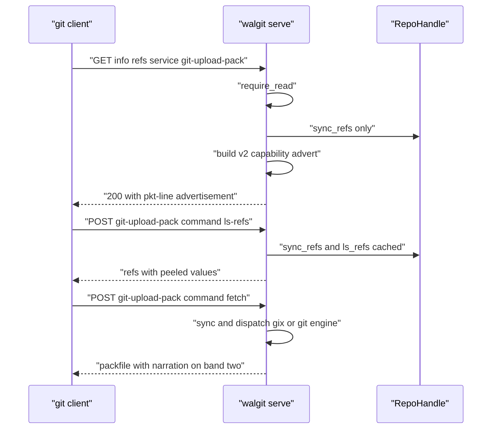
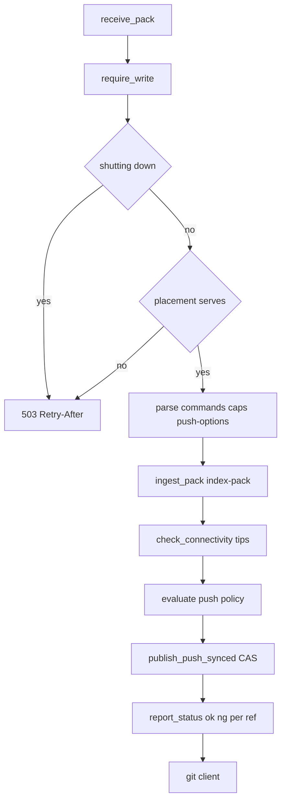

# 05 -- Smart HTTP: info/refs, upload-pack v0/v2, and receive-pack

The git wire protocol arrives over HTTP as three routes: `info/refs` (the advertisement), `git-upload-pack` (fetch), and `git-receive-pack` (push). walgit implements protocol v0 and v2, splits the work between the gix in-process engine and the upstream `git` binary, and narrates slow work on sideband band 2 so the client sees progress. This document follows each route through the code.

## The advertisement

`info/refs` first authenticates: upload-pack advertisements need read, receive-pack advertisements need write. The auth error handling is careful about what a git client can display, and deliberately returns a real 401 for invalid or expired credentials so git erases them from its credential helper. A source comment (`crates/walgit-server/src/smart.rs:55`) records the incident that motivated this — a 2026-08-22 rig where every clone failed for 50 minutes:

```rust
// Source: crates/walgit-server/src/smart.rs, lines 39-68
    let service_param = parse_query(query, "service").unwrap_or_default();
    // Auth: read for upload-pack, write for receive-pack advertisement.
    let is_receive = service_param == "git-receive-pack";
    let auth_result = if is_receive {
        st.auth.require_write(headers).await
    } else {
        st.auth.require_read(headers).await
    };
    if let Err(e) = auth_result {
        // Git clients do not display 401/403 bodies, but they do print a pkt-line `ERR` message
        // ("fatal: remote error: ..."). Tell humans how to authenticate instead of leaving them
        // with "error 401" — but ONLY where a retry cannot help (the account is not allowed, the
        // verifier is down). A credential that is merely invalid/expired MUST be a real 401: that is
        // what makes git `erase` it from its credential helpers (the in-memory cache the installer
        // puts in front of ours), ask them again (gcloud refreshes an expired token) and retry. The
        // 200 + ERR answer made git keep — and re-`store` — a dead cached token for the cache's
        // whole lifetime (rig, 2026-08-22: every clone failed for 50 minutes).
        let has_creds = headers.contains_key(axum::http::header::AUTHORIZATION);
        let retry_cannot_help = matches!(
            e,
            crate::auth::AuthError::Forbidden | crate::auth::AuthError::Unavailable
        );
        if is_git_client(headers) && !service_param.is_empty() && has_creds && retry_cannot_help {
            return Ok(git_err_response(
                &service_param,
                &auth_help_message(st, headers, &e),
            ));
        }
        return Err(auth_err(e));
    }
```

The advertisement needs refs only, never the pack set, so it takes a refs-level sync. Protocol v2 upload-pack gets a capability advertisement; v0 (and receive-pack always) gets the classic advertisement, cached by manifest version.

```rust
// Source: crates/walgit-server/src/smart.rs, lines 141-161
    let ver = env!("CARGO_PKG_VERSION");
    pktline::encode_text(buf, "version 2\n");
    pktline::encode_text(buf, &format!("agent=walgit/{ver}\n"));
    pktline::encode_text(buf, "ls-refs=unborn\n");
    let mut fetch = String::from("fetch=shallow wait-for-done");
    if st.cfg.git.allow_filter {
        fetch.push_str(" filter");
    }
    // With sideband-all every response line is sideband-framed, which lets us
    // narrate what the server is doing (band 2 → "remote: * …") *before* the
    // packfile section: auth, WAL sync, materialization progress. Both engines frame their sections that way.
    fetch.push_str(" sideband-all packfile-uris packfile-indexes");
    pktline::encode_text(buf, &format!("{fetch}\n"));
    pktline::encode_text(buf, "server-option\n");
    let fmt = match handle.local().object_format() {
        walgit_git::ObjectFormat::Sha1 => "sha1",
        walgit_git::ObjectFormat::Sha256 => "sha256",
    };
    pktline::encode_text(buf, &format!("object-format={fmt}\n"));
    pktline::encode_flush(buf);
    Ok(())
```



## Fetch: ls-refs and fetch

`upload_pack` reads the protocol, then dispatches v0 or v2. The v2 handler reads the command: `ls-refs` is served from the cached ref advertisement, and `fetch` chooses the engine. A remote-served repository (base packs read by range) uses the gix engine with an object faulter; otherwise the default `Auto` engine sends blob wants to upstream git, and everything else to gix. The response frames its sections for sideband-all so the client sees `remote: *` progress before the pack.

## Push: receive-pack

`receive_pack` is the write path. It authenticates for write, refuses pushes that would not survive a drain, enforces placement (a host that does not serve the repo refuses with 503 and Retry-After, naming the host that does), and can forward to a push broker (the component that relays a push between the HTTP endpoint and the store/WAL).

```rust
// Source: crates/walgit-server/src/smart.rs, lines 746-762
    let principal = st.auth.require_write(headers).await.map_err(auth_err)?;
    if let Some(msg) = push_url_must_be_git(st, route, headers) {
        return refuse_push(body, headers, msg).await;
    }

    // Draining after SIGTERM: a push that starts now could not finish its
    // publish inside the grace; refuse it with Retry-After (git: rerun).
    if walgit_wal::tasks::shutting_down() {
        metrics::counter!("walgit_push_refused_total", "reason" => "draining").increment(1);
        return refuse_push(
            body,
            headers,
            "walgit: this host is restarting; retry in a few seconds".into(),
        )
        .await
        .map(|r| with_retry_after(r, StatusCode::SERVICE_UNAVAILABLE));
    }
```

The core of the push is `receive_pack_process`. It ingests the pack with `git index-pack --fix-thin --rev-index` semantics, then checks that every pushed tip exists before anything is published — a ref-only push with a zero-object pack must still not point at an object nobody has:

```rust
// Source: crates/walgit-server/src/smart.rs, lines 1043-1089
    let unpack_err: Option<String> = match &ingest {
        Ok(_) => None,
        Err(e) => Some(format!("unpack failed: {e}")),
    };

    // Every pushed tip must exist before anything is published, pack or no
    // pack: a ref-only push carries a zero-object pack (`ingest` is `Ok(None)`)
    // and this block used to be skipped for it, so a ref could be published
    // pointing at an object nobody has (#37). With `wal.check_connectivity`
    // the walk covers the tips and everything new under them; without it the
    // tips themselves are still looked up.
    if unpack_err.is_none() {
        let tips: Vec<gix_hash::ObjectId> = txn
            .updates
            .iter()
            .filter(|u| !u.new_oid.is_empty() && !is_zero_oid(&u.new_oid))
            .filter_map(|u| gix_hash::ObjectId::from_hex(u.new_oid.as_bytes()).ok())
            .collect();
        if !tips.is_empty() {
            let verdict: Result<(), String> = if st.cfg.wal.check_connectivity {
                local
                    .check_connectivity_async(&tips, true)
                    .instrument(tracing::info_span!(
                        "receive.connectivity",
                        tips = tips.len()
                    ))
                    .await
                    .map_err(|e| format!("connectivity: {e}"))
            } else {
                let repo = local.clone();
                let tips = tips.clone();
                tokio::task::spawn_blocking(move || {
                    tips.iter()
                        .find(|t| !repo.has_object(t))
                        .map_or(Ok(()), |t| Err(format!("missing object {t}")))
                })
                .await
                .map_err(|e| ApiError::Internal(format!("tip check: {e}")))?
            };
            if let Err(msg) = verdict {
                // Every refusal names the reason on each ref: `unpack ng`
                // alone makes git print "remote failed to report status".
                tracing::warn!(repo = %route_id, error = %msg, "receive-pack: tip check failed");
                metrics::counter!("walgit_push_refused_total", "reason" => "connectivity")
                    .increment(1);
                return Ok(refusal_report(&caps, &txn, &msg).await);
            }
```

The receive-pack request parsing is a separate module in `walgit-git`. It parses the command pkt-lines, the capability string on the first command, shallow announcements, and the optional push-options section, then positions a `PrefixedReader` at the pack bytes. The report-status response frames `unpack ok`/`unpack ng` and per-ref `ok`/`ng` lines, optionally sideband-framed.



## The Aha Moment

**Aha:** Smart HTTP is where the "receive-pack is walgit, upload-pack is git" split becomes concrete. Walgit owns the push because a push is a state change that must pass through the manifest CAS; it uses git only to index the incoming pack and check connectivity. It delegates fetch to git or gix because fetch is a read that either engine can serve from the local bare repository. The protocol details — capability strings, sideband framing, atomic transactions, push options — are all just the edges of that one ownership rule.

The LFS routes, which reuse the same auth and static-object serving, are next in [06-lfs.md](./06-lfs.md). The JSON API that the web UI and SDK build on is in [07-json-api-sdk.md](./07-json-api-sdk.md).

Continue to [06-lfs.md](./06-lfs.md).
