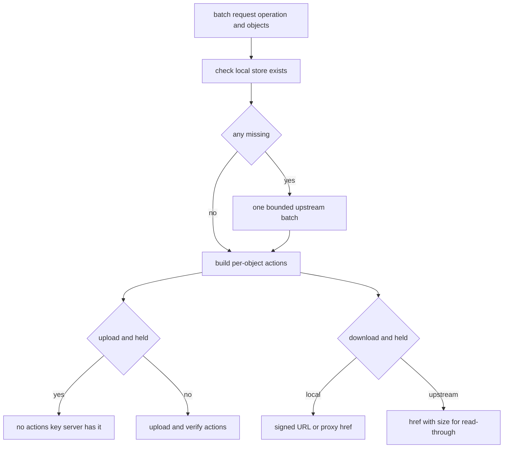
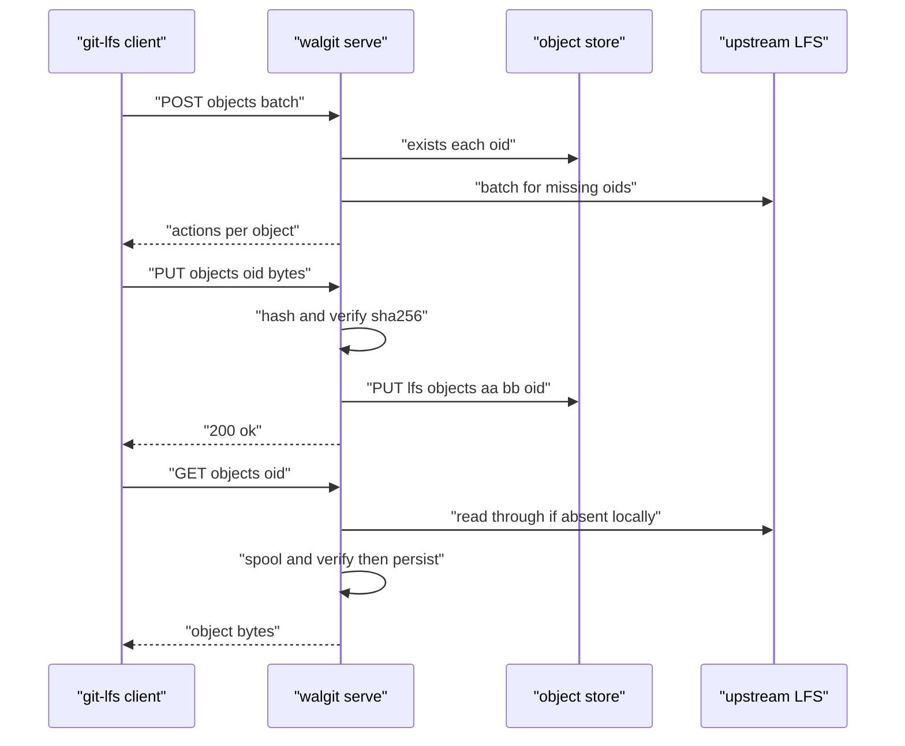

# 06 -- LFS: Batch API, Transfer, Verification, and Upstream Read-Through

Git LFS (Large File Storage) replaces large binary blobs with small pointer files in git, and transfers the real bytes through a separate API. walgit implements the LFS batch API and the basic transfer endpoints (`objects/batch`, `objects/<oid>`, and `verify`), stores objects in the bucket under `lfs/objects/aa/bb/<oid>`, and can read through to an upstream LFS server for imported repositories.

## The batch API

`batch` is the negotiation endpoint. The client POSTs an operation (`upload` or `download`) and a list of objects; the server answers with per-object `actions` (upload, download, verify) or no actions at all, which means "the server already has it".

```rust
// Source: crates/walgit-server/src/lfs.rs, lines 94-142
    let is_upload = body.operation == "upload";
    for o in &body.objects {
        require_lfs_oid(&o.oid)?;
    }
    // Local presence first; then one bounded upstream batch for the misses.
    let mut local = Vec::with_capacity(body.objects.len());
    let mut missing = Vec::new();
    for o in &body.objects {
        let exists = store.exists(&keys::lfs_key(&o.oid)).await.unwrap_or(false);
        local.push(exists);
        if !exists {
            missing.push((o.oid.clone(), o.size));
        }
    }
    let upstream_has = match (&cfg.upstream.lfs, missing.is_empty()) {
        (Some(upstream), false) => {
            st.lfs_upstream
                .batch(upstream, cfg.upstream.token_env.as_deref(), &missing)
                .await
        }
        _ => HashMap::default(),
    };

    let mut objs = Vec::with_capacity(body.objects.len());
    for (o, exists) in body.objects.iter().zip(local) {
        let key = keys::lfs_key(&o.oid);
        let at_upstream = !exists && upstream_has.contains_key(&o.oid);
        let mut actions = Actions {
            download: None,
            upload: None,
            verify: None,
        };
        if is_upload && (exists || at_upstream) {
            // We (or the upstream) already hold it: NO `actions` key at all =
            // "server has it", the push proceeds without bytes. A verify-only
            // object is read by git-lfs's transfer queue as "upload needed,
            // then verify" and, with no local bytes (a pointer from history),
            // fails the whole push: "object … missing locally and on remote"
            //. `verify` only ever accompanies
            // an `upload` action.
            objs.push(BatchRespObject {
                oid: o.oid.clone(),
                size: o.size,
                authenticated: Some(true),
                actions: None,
                error: None,
            });
            continue;
        }
```



The LFS object identifier is a 64-hex-character SHA-256 (Secure Hash Algorithm) digest, validated by `keys::lfs_oid_ok`, and the storage key fans out to `lfs/objects/aa/bb/<oid>` using the first four hex characters.

## Transfer: get and put

Downloading (`get_object`) serves the object through the static-object handler, with a read-through path when the object is missing locally but present upstream:

```rust
// Source: crates/walgit-server/src/lfs.rs, lines 235-256
    if let Some(upstream) = &cfg.upstream.lfs
        && !store.exists(&key).await.unwrap_or(false)
    {
        let size = query
            .split('&')
            .find_map(|kv| kv.strip_prefix("size="))
            .and_then(|v| v.parse::<u64>().ok())
            .unwrap_or(0);
        return read_through(st, &cfg, upstream, store, oid, size, key, method).await;
    }
    match crate::static_object::serve(
        &store,
        &key,
        method,
        headers,
        crate::static_object::ServeOptions {
            accel: st.cfg.server.accel_redirect,
            peer,
            ..Default::default()
        },
    )
    .await
```

Uploading (`put_object`) streams the body to a temporary file while hashing it, enforces the configured maximum object size, and refuses on a SHA-256 mismatch:

```rust
// Source: crates/walgit-server/src/lfs.rs, lines 408-440
    let tmp = tempfile::NamedTempFile::new().map_err(|e| ApiError::Internal(e.to_string()))?;
    let mut file = tokio::fs::File::from_std(
        tmp.reopen()
            .map_err(|e| ApiError::Internal(e.to_string()))?,
    );
    let mut reader = body_to_async_read(body);
    let mut hasher = Sha256::new();
    let mut n = 0u64;
    let mut buf = vec![0u8; 64 * 1024];
    loop {
        let k = reader
            .read(&mut buf)
            .await
            .map_err(|e| ApiError::Internal(e.to_string()))?;
        if k == 0 {
            break;
        }
        n += k as u64;
        if n > max {
            return Err(ApiError::PayloadTooLarge);
        }
        hasher.update(&buf[..k]);
        file.write_all(&buf[..k])
            .await
            .map_err(|e| ApiError::Internal(e.to_string()))?;
    }
    file.flush()
        .await
        .map_err(|e| ApiError::Internal(e.to_string()))?;
    drop(file);
    if hex::encode(hasher.finalize()) != oid {
        return Err(ApiError::BadRequest("lfs object sha256 mismatch".into()));
    }
```



## Read-through and spooling

The read-through path streams an upstream object to the client while tee-ing into a spool file; only after a complete, SHA-256-verified read is the spool persisted into the store. A short or mismatching read never lands in the bucket. Local serving uses the same `static_object` module as the rest of the server, so LFS downloads get `ETag`, `Range`, conditional requests, and the optional `X-Accel-Redirect` edge offload.

## The Aha Moment

**Aha:** LFS is a smaller copy of the same architecture as git: the batch API is the "manifest" that negotiates what the client must send, the object is content-addressed by its SHA-256, and a write is verified before it is persisted. The read-through path is the one genuinely new idea — it lets an imported repository serve objects it has not yet copied by streaming from the old upstream once, verifying, and caching. That turns an LFS migration from "copy everything first" into "copy on first demand".

The JSON API that the web UI and SDK build on, including its caching of immutable answers, is next in [07-json-api-sdk.md](./07-json-api-sdk.md). The static-object serving contract reused here is part of the disposable-cache story in [10-scaling.md](./10-scaling.md).

Continue to [07-json-api-sdk.md](./07-json-api-sdk.md).
