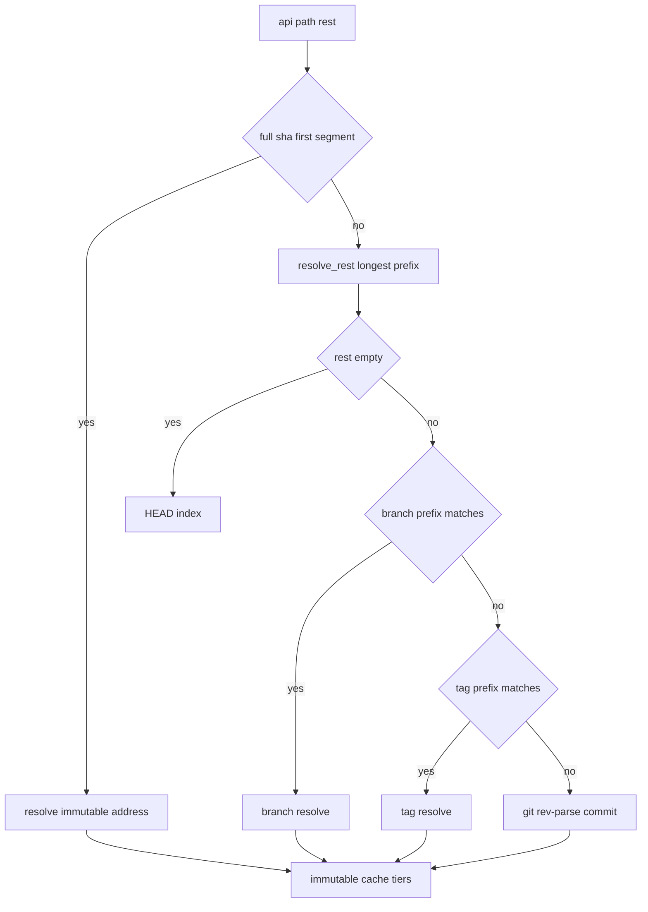
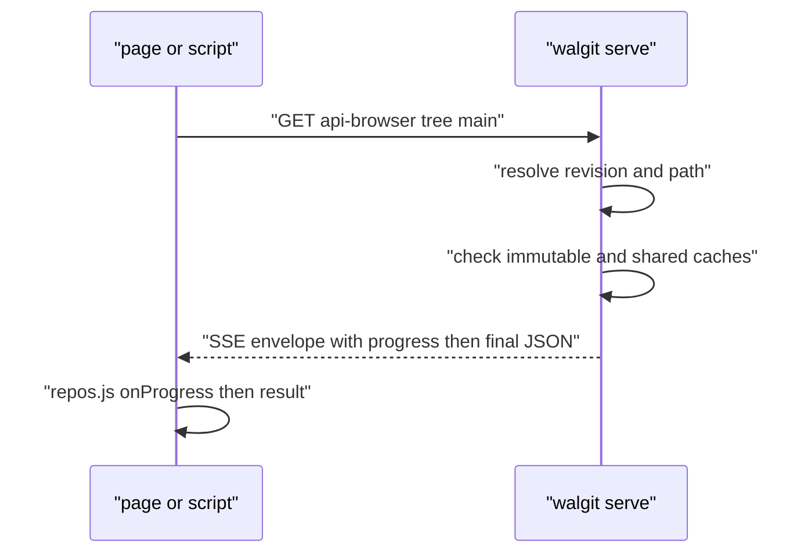

# 07 -- The JSON API and SDK: the read path and the generated client

The web UI, the CLI's read commands, and scripts all share one read-mostly JSON (JavaScript Object Notation) API under `/{owner}/{repo}/api/*`. The design goal is that sha-addressed answers are immutable and cached everywhere, while long answers stream progress as Server-Sent Events (SSE). This document covers the request pipeline, revision resolution, and the two-lane CORS (cross-origin resource sharing) shape that the dependency-free `repos.js` SDK (software development kit) relies on.

## The request pipeline

Every API route funnels through `run`, which opens the repository, applies the required sync level, and checks two cache tiers before doing work — the in-memory immutable cache (`api_immutable`) and the shared store-tier render cache — after which the work function runs. Slow object reads that the client accepts as SSE are wrapped in an envelope that streams progress.

```rust
// Source: crates/walgit-server/src/web/api.rs, lines 362-407
pub(crate) async fn run<F, Fut>(
    st: &Arc<AppState>,
    headers: &HeaderMap,
    owner: &str,
    name: &str,
    need: Need,
    immutable_key: Option<String>,
    work: F,
) -> Result<Response, ApiError>
where
    F: FnOnce(Repo) -> Fut + Send + 'static,
    Fut: Future<Output = Result<Rendered, ApiError>> + Send + 'static,
{
    let handle = open(st, headers, owner, name).await?;
    let slow = need == Need::Objects && !handle.packs_ready();
    if let Some(key) = &immutable_key {
        if let Some(hit) = st.caches.api_immutable.get(key) {
            metrics::counter!("walgit_api_immutable_hit", "tier" => "memory").increment(1);
            return Ok(Rendered::json(hit, IMMUTABLE, None).into_response(headers));
        }
        if slow
            && st.cfg.cache.shared_render_cache
            && let Ok(walgit_store::GetResult::Object { body, meta }) = handle
                .store()
                .get(&shared_key(key), GetOptions::default())
                .await
            && let Ok(b) = walgit_store::util::collect(body, meta.size as usize).await
        {
            metrics::counter!("walgit_api_immutable_hit", "tier" => "store").increment(1);
            st.caches.api_immutable.insert(key.clone(), b.clone());
            return Ok(Rendered::json(b, IMMUTABLE, None).into_response(headers));
        }
    }
    if slow && crate::sse::wants_sse(headers) {
        let (tx, rx) = tokio::sync::broadcast::channel(256);
        let sources = vec![handle.subscribe_progress(), rx];
        let st2 = st.clone();
        let fut = async move {
            let repo = view(&st2, handle, need, Reporter::for_repo(tx)).await?;
            work(repo).await
        };
        return Ok(crate::sse::envelope(sources, fut));
    }
    let repo = view(st, handle, need, Reporter::none()).await?;
    Ok(work(repo).await?.into_response(headers))
}
```

The immutable cache key is a full SHA (Secure Hash Algorithm) object identifier. A full sha means the answer can never change, so it is safe to cache with an immutable `Cache-Control` and share across instances through the store.

## Revision resolution

A path like `/acme/app/api/tree/main/src` must be split into a revision and a path. `resolve_rest` tries the longest branch or tag prefix first, so a branch named `release` wins over a shorter one, and a branch beats a tag of the same name:

```rust
// Source: crates/walgit-server/src/web/api.rs, lines 603-648
async fn resolve_rest(r: &Repo, rest: &str) -> Result<Resolved, ApiError> {
    let rest = rest.trim_matches('/');
    if rest.is_empty() {
        let (name, sha) = r.index.head().ok_or_else(|| not_found("unborn HEAD"))?;
        return Ok(Resolved {
            ref_name: name,
            sha,
            path: String::new(),
            kind: "branch",
        });
    }
    // Candidate prefixes, longest first.
    let mut cut_points: Vec<usize> = rest.match_indices('/').map(|(i, _)| i).collect();
    cut_points.push(rest.len());
    for &cut in cut_points.iter().rev() {
        let name = &rest[..cut];
        let path = rest[cut..].trim_start_matches('/').to_string();
        if let Some(sha) = r.index.branch(name) {
            return Ok(Resolved {
                ref_name: name.to_string(),
                sha: sha.to_string(),
                path,
                kind: "branch",
            });
        }
        if let Some(sha) = r.index.tag(name) {
            return Ok(Resolved {
                ref_name: name.to_string(),
                sha: sha.to_string(),
                path,
                kind: "tag",
            });
        }
    }
    let (first, path) = match rest.split_once('/') {
        Some((f, p)) => (f, p.to_string()),
        None => (rest, String::new()),
    };
    let sha = rev_parse_commit(r, first).await?;
    Ok(Resolved {
        ref_name: first.to_string(),
        sha,
        path,
        kind: "commit",
    })
}
```

An empty path resolves to `HEAD`; a repository with no commits yet has an unborn HEAD (a repo with no commits yet).

A full-sha address is resolved separately and marked immutable, so the immutable cache path is taken for it:

```rust
// Source: crates/walgit-server/src/web/api.rs, lines 757-774
fn split_addr(rest: &str) -> Option<(Resolved, bool)> {
    let rest = rest.trim_matches('/');
    let (first, path) = match rest.split_once('/') {
        Some((f, p)) => (f, p.trim_matches('/').to_string()),
        None => (rest, String::new()),
    };
    is_full_sha(first).then(|| {
        (
            Resolved {
                ref_name: first.to_string(),
                sha: first.to_string(),
                path,
                kind: "commit",
            },
            true,
        )
    })
}
```



## The two lanes and the SDK

The API is served under two bases: `/{owner}/{repo}/api` (bearer or session auth) and `/{owner}/{repo}/api-browser` (cross-origin cookies). A separate `/api/v1` tree holds non-repo discovery, `me`, and `authenticate`. The v1 router wires the discovery endpoint and repo-admin routes:

```rust
// Source: crates/walgit-server/src/web/v1.rs, lines 38-50
pub fn router(state: Arc<AppState>) -> Router {
    let mut r = Router::new()
        .route(API_V1, get(discovery))
        .route(&format!("{API_V1}/"), get(discovery))
        .route(&format!("{API_V1}/me"), get(me))
        .route(&format!("{API_V1}/authenticate"), get(authenticate))
        .route(&format!("{API_BROWSER}/v1/me"), get(me))
        .route(&format!("{API_BROWSER}/v1/authenticate"), get(authenticate))
        .route(&format!("{API_V1}/owners"), get(crate::web::api::owners))
        .route(
            &format!("{API_V1}/owners/{{owner}}/repos"),
            get(crate::web::api::owner_repos),
        );
```

The `repos.js` SDK (served as `repos.js` and `repos.mjs`) is dependency-free. It picks the bearer lane or the browser lane by what credentials are present, and consumes the SSE envelope transparently through an `onProgress` callback, so a caller that does not care about progress still gets the final JSON. The wire contract is normative in `web/API.md`.



## The Aha Moment

**Aha:** The API's cache key is not a URL; it is a content identity. The moment a request can be resolved to a full SHA, the answer becomes immutable, which means it can be cached in memory, shared through the object store, and served with an infinite cache lifetime — without any invalidation logic, because the identity itself is the invalidation. The SSE envelope is the same idea for the slow path: instead of blocking or polling, the server streams progress and the final JSON in one response, and the SDK hides that from callers that do not want it.

Push policy, which gates the state changes behind this read API, is next in [08-push-policy.md](./08-push-policy.md). The immutable caching tier relies on the store layout from [01-proto-keys.md](./01-proto-keys.md).

Continue to [08-push-policy.md](./08-push-policy.md).
