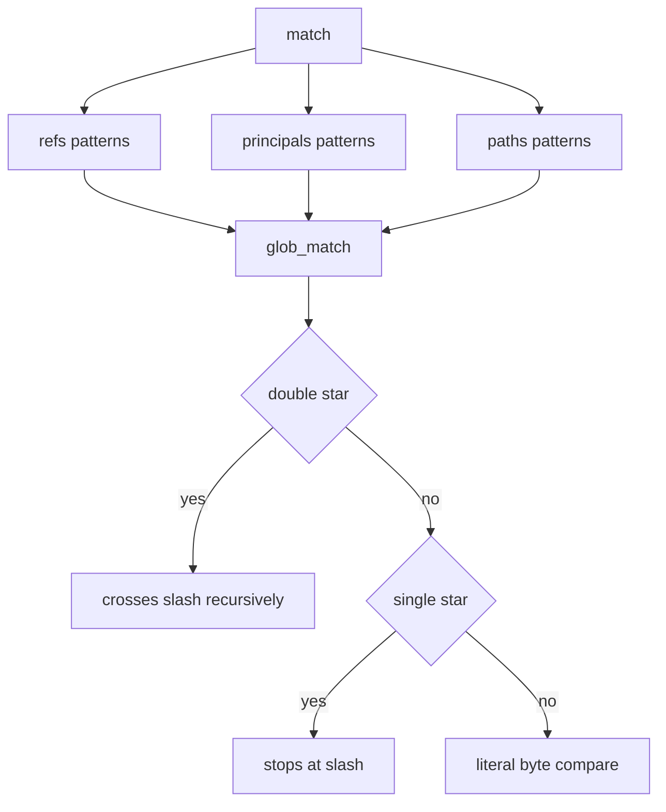
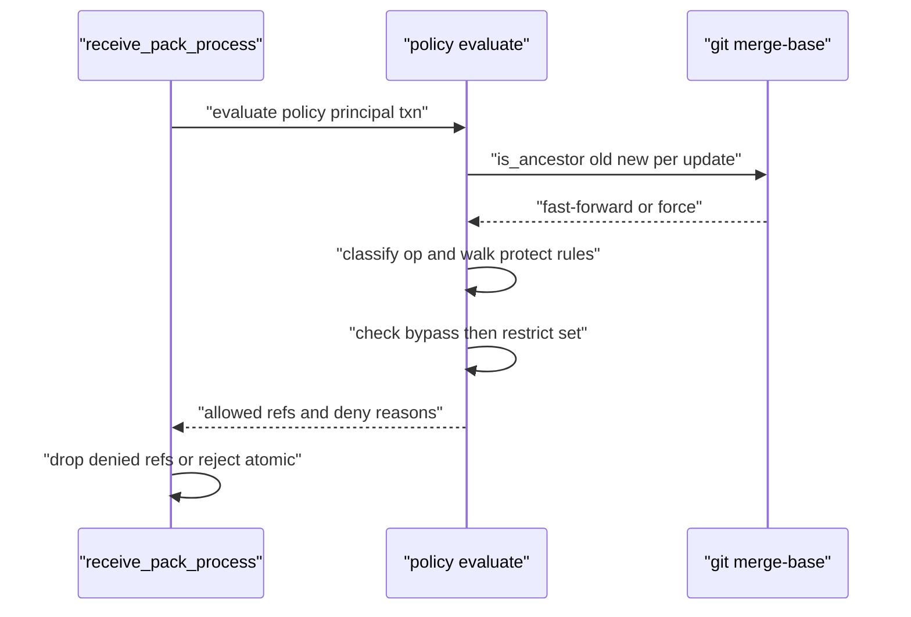

# 08 -- Push Policy: the policy.json Rule Language

A per-repository push policy answers one question at push time: given the principal, the ref transaction, and the object state, is this publish allowed, and if not, which named rule said so? The policy lives at `repos/<owner>/<repo>/policy.json`, is not on the WAL, and is managed over the admin API or the CLI. This document covers the rule shape, the matcher, and the evaluation law.

## The rule shape and validation

The envelope has `version`, `groups` (rosters), and `rules` (ordered, named decisions). Each rule has a `match` (refs, principals, paths) and an `effect` that is a tagged union with exactly one of `protect`, `history`, or `size`. `protect` is enforced; `history` and `size` are parsed and stored but not enforced. Validation fails closed on a half-wired file:

```rust
// Source: crates/walgit-server/src/policy.rs, lines 165-215
    pub fn validate(&self) -> Result<(), String> {
        if self.version != 1 {
            return Err(format!("unsupported policy version {}", self.version));
        }
        let mut group_names = HashSet::new();
        for g in &self.groups {
            if !valid_name(&g.name) {
                return Err(format!("groups: bad name {:?}", g.name));
            }
            if !group_names.insert(&g.name) {
                return Err(format!("groups: duplicate name {:?}", g.name));
            }
        }
        let mut rule_names = HashSet::new();
        for r in &self.rules {
            if !valid_name(&r.name) {
                return Err(format!("rules: bad name {:?}", r.name));
            }
            if !rule_names.insert(&r.name) {
                return Err(format!("rules: duplicate name {:?}", r.name));
            }
            let n = u8::from(r.effect.protect.is_some())
                + u8::from(r.effect.history.is_some())
                + u8::from(r.effect.size.is_some());
            if n != 1 {
                return Err(format!(
                    "rule {:?}: effect must have exactly one of protect, history, size",
                    r.name
                ));
            }
            if let Some(m) = &r.mode
                && m != "enforce"
                && m != "audit"
            {
                return Err(format!("rule {:?}: mode must be enforce|audit", r.name));
            }
            // ^ exclusions forbidden on first-match (union-like) families.
            if r.effect.history.is_some() || r.effect.size.is_some() {
                for pats in [&r.match_.refs, &r.match_.principals, &r.match_.paths] {
                    if pats.iter().any(|p| p.starts_with('^')) {
                        return Err(format!(
                            "rule {:?}: ^ exclusions are illegal on history/size (first-match)",
                            r.name
                        ));
                    }
                }
            }
        }
        check_overlap_bypass(self)?;
        Ok(())
    }
```

The `^` exclusion is legal only on `protect`, whose combination law is "most restrictive" (AND). On `history` and `size`, which combine by first-match (union-like), a `^` carve-out would be defeated by a broader admitting rule, so it is refused at load.

## The matcher

The matcher is one doublestar (a glob-matching crate) glob dialect for refs, paths, and principal names: `*` and `?` stop at `/`, `**` crosses slashes, and `^` is an exclusion within a pattern list. The core is a byte-wise matcher:

```rust
// Source: crates/walgit-server/src/policy.rs, lines 324-373
fn glob_bytes(pat: &[u8], text: &[u8]) -> bool {
    let mut pi = 0;
    let mut ti = 0;
    while pi < pat.len() {
        if pat[pi] == b'*' && pi + 1 < pat.len() && pat[pi + 1] == b'*' {
            let mut rest = &pat[pi + 2..];
            if rest.first() == Some(&b'/') {
                rest = &rest[1..];
            }
            if rest.is_empty() {
                return true;
            }
            let mut i = ti;
            loop {
                if glob_bytes(rest, &text[i..]) {
                    return true;
                }
                if i >= text.len() {
                    return false;
                }
                i += 1;
            }
        } else if pat[pi] == b'*' {
            let rest = &pat[pi + 1..];
            if glob_bytes(rest, &text[ti..]) {
                return true;
            }
            while ti < text.len() && text[ti] != b'/' {
                ti += 1;
                if glob_bytes(rest, &text[ti..]) {
                    return true;
                }
            }
            return false;
        } else if pat[pi] == b'?' {
            if ti >= text.len() || text[ti] == b'/' {
                return false;
            }
            ti += 1;
            pi += 1;
        } else {
            if ti >= text.len() || text[ti] != pat[pi] {
                return false;
            }
            ti += 1;
            pi += 1;
        }
    }
    ti == text.len()
}
```

Pattern lists combine as inclusion OR, then minus any `^` exclusion, with an empty inclusion list matching everything.



## Evaluation

Evaluation walks each update, classifies the operation (create, delete, update, no-op), and asks every matching protect rule. A rule's bypass list is checked before its restrict set; if a matching rule is not bypassed and its restrict set covers the operation, the ref is denied with the rule's name.

```rust
// Source: crates/walgit-server/src/policy.rs, lines 531-566
fn deny_reason(
    policy: &RepoPolicy,
    groups: &HashMap<&str, &Group>,
    principal: &str,
    u: &RefUpdate,
    is_force: &impl Fn(&RefUpdate) -> bool,
) -> Option<String> {
    let op = classify(&u.old_oid, &u.new_oid);
    if op == RefOp::NoOp {
        return None;
    }
    let force = is_force(u) || u.name.starts_with("refs/tags/");
    for rule in &policy.rules {
        let Some(protect) = &rule.effect.protect else {
            continue; // history/size: specified, not enforced
        };
        if !rule_matches(&rule.match_, &u.name, principal, groups) {
            continue;
        }
        if bypasses(protect, principal, groups) {
            continue;
        }
        let set = restrict_set(protect);
        let hit = match op {
            RefOp::Create => set.contains(&Restrict::Create),
            RefOp::Delete => set.contains(&Restrict::Delete),
            RefOp::Update if force => {
                set.contains(&Restrict::ForcePush) || set.contains(&Restrict::Update)
            }
            RefOp::Update => set.contains(&Restrict::Update),
            RefOp::NoOp => false,
        };
        if hit {
            return Some(format!("rejected by rule '{}'", rule.name));
        }
    }
```

A force push and a fast-forward have the same wire triple, so `force` is derived by running `merge-base --is-ancestor` after ingest; a tag retarget is always a force push. The atomic transaction is all-or-nothing: if the transaction is atomic and any ref is denied, the whole transaction is rejected.



## The Aha Moment

**Aha:** The policy file is not a permission list; it is a small rule language whose combination law is fixed by the effect type and never declared in the file. `protect` is AND (most restrictive wins), `history` and `size` are first-match. A file that could change its own combining rule would be a programming language, and the maintainers explicitly refuse that. This is why the `^` exclusion is legal only on `protect`: on a union-like family it would be a no-op that looks like a revoke, and the validator rejects it instead of letting an operator be fooled.

The events produced when a policy-allowed push commits are the subject of [09-webhooks.md](./09-webhooks.md). The policy is enforced inside the receive-pack pipeline described in [05-smart-http.md](./05-smart-http.md).

Continue to [09-webhooks.md](./09-webhooks.md).
