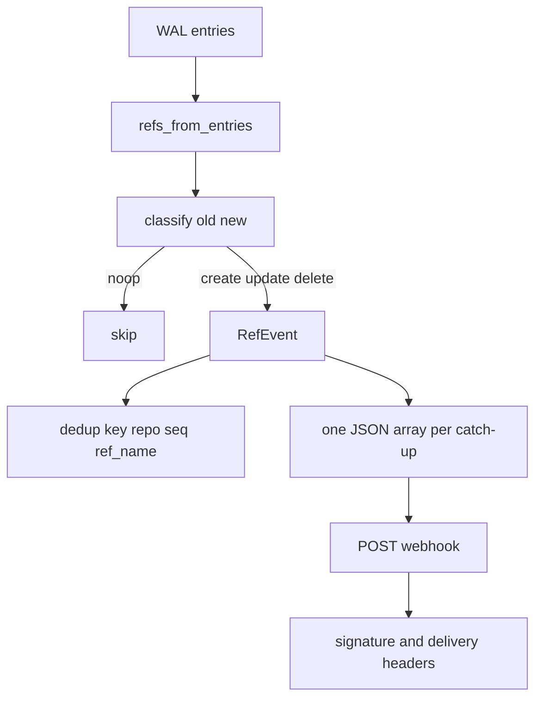
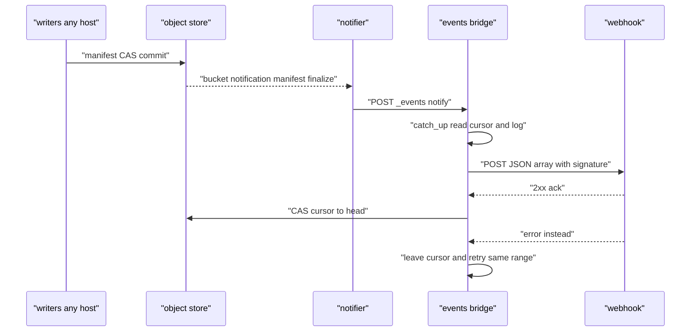

# 09 -- Webhooks: the WAL-to-Event Bridge

Events are produced from the WAL by one small service — the bridge, run by a host with the `events` role — never by the push path. It tails each repository's log from a durable per-repo cursor, converts committed entries into ref events, POSTs them to a webhook, and advances the cursor. This document covers event classification, delivery, and the bridge's durable cursor.

## Event classification

An event describes a ref change: `create`, `update`, or `delete`. A no-op (`old == new`, or both absent) emits nothing. The classifier is a pure function of the old and new object identifier (OID) pair:

```rust
// Source: crates/walgit-server/src/events.rs, lines 40-48
pub fn classify(old: &str, new: &str) -> Option<Action> {
    match (absent(old), absent(new)) {
        (true, true) => None,
        (true, false) => Some(Action::Create),
        (false, true) => Some(Action::Delete),
        (false, false) if old == new => None,
        (false, false) => Some(Action::Update),
    }
}
```

The event shape carries the repo, the ref, the old and new OIDs (always the full zero OID on create or delete, never an empty string), the pusher, the correlation id, and a `_walgit` extension with the WAL sequence and entry kind:

```rust
// Source: crates/walgit-server/src/events.rs, lines 80-92
#[derive(Debug, Clone, Serialize)]
pub struct RefEvent {
    pub action: Action,
    pub ref_type: &'static str,
    pub ref_name: String,
    pub old: String,
    pub new: String,
    pub pusher: String,
    pub correlation_id: String,
    pub repo: String,
    #[serde(rename = "_walgit")]
    pub walgit: WalgitExt,
}
```

The `WalgitExt` carries `schema_version`, `seq` (as a JSON string, the unsigned-64 convention), `entry_kind`, and `request_id`.



## Delivery

The webhook sink POSTs one JSON array of events per catch-up batch, with an `x-walgit-delivery` id (a SHA-1 hash of the body) and an `x-walgit-signature` HMAC (hash-based message authentication code) when a secret is configured:

```rust
// Source: crates/walgit-server/src/events.rs, lines 202-221
    async fn deliver(&self, batch: &[RefEvent]) -> anyhow::Result<()> {
        use sha1::Digest;
        let body = serde_json::to_vec(batch)?;
        let delivery = hex::encode(sha1::Sha1::digest(&body));
        let mut req = self
            .client
            .post(&self.url)
            .header(reqwest::header::CONTENT_TYPE, "application/json")
            .header("x-walgit-delivery", delivery);
        if let Some(secret) = &self.secret {
            req = req.header("x-walgit-signature", Self::signature(secret, &body));
        }
        let resp = req.body(body).send().await?;
        anyhow::ensure!(
            resp.status().is_success(),
            "webhook returned {}",
            resp.status()
        );
        Ok(())
    }
```

A 2xx answer acknowledges the batch and the cursor advances; anything else (or a ten-second timeout) leaves the cursor where it was, so the same range is retried on the next wake-up. A consumer therefore sees at-least-once delivery of whole batches, and must dedupe on the normative key `(repo, _walgit.seq, ref_name)`.

## The bridge's durable cursor

`catch_up` reads the cursor at `repos/<o>/<r>/events/cursor.json`, syncs to the fresh manifest, reads the log range `(cursor, head_seq]`, converts the entries, publishes, and CASes the cursor forward:

```rust
// Source: crates/walgit-server/src/bridge.rs, lines 120-159
        let mut from = cursor.unwrap_or(readable_from);
        let mut gap = None;
        if from < readable_from {
            gap = Some([from + 1, readable_from]);
            metrics::counter!("events_bridge_gap_total", "repo" => id.to_string())
                .increment(readable_from - from);
            tracing::warn!(repo = %id, first = from + 1, last = readable_from,
                "events bridge: entries folded into a checkpoint before they were published; consumers backfill from the WAL");
            from = readable_from;
        }
        metrics::gauge!("events_bridge_lag_entries", "repo" => id.to_string())
            .set((head - from) as f64);
        let mut report = CatchUp {
            repo: id.to_string(),
            from_seq: from,
            head_seq: head,
            emitted: 0,
            gap,
        };

        if head > from {
            let entries = handle.read_log(from + 1, Some(head)).await?;
            let mut batch = Vec::new();
            events::refs_from_entries(id, &entries, &mut batch);
            // A failing sink returns here: cursor untouched, retried on the
            // next wake-up.
            self.publish(&batch).await?;
            report.emitted = batch.len();
        }

        if cursor != Some(head) {
            let body = serde_json::to_vec(&Cursor {
                published_seq: head,
                updated_at: Utc::now().to_rfc3339(),
            })?;
            let mode = match version {
                Some(v) => PutMode::Update(v),
                None => PutMode::Create,
            };
            match store.put_bytes(CURSOR_KEY, body, mode).await {
                Ok(_) => {}
                // Another bridge instance advanced it: our emission was a
                // duplicate (dedup key), theirs stands.
                Err(StoreError::PreconditionFailed { .. }) => {
                    tracing::warn!(repo = %id, "events bridge: cursor CAS lost (two bridges?)");
                }
                Err(e) => return Err(e.into()),
            }
        }
```



A cold cursor starts at the oldest readable sequence (`min_seq - 1`), so everything still in the manifest's log window is published once; operators can pre-seed the cursor to skip history. If the bridge lags behind log retention, entries folded into a checkpoint before they were read become a gap — counted and warned, never silently repaired, because consumers are expected to backfill from the WAL.

## The Aha Moment

**Aha:** Nothing ever gates a push on webhook delivery. The bridge is another process reading the bucket; a down webhook adds zero milliseconds to receive-pack, it only adds lag, which is a metric. Correctness is moved entirely to the durable cursor: the cursor advances only after a 2xx, duplicates are possible but carry a deterministic dedup key, and gaps are reported rather than papered over. That is the whole reason the event contract is simple enough to state in one paragraph — the WAL is the source of truth, and the webhook is just a latency optimization over polling it.

The scaling story that makes the bridge and every other component run on a disposable cache is next in [10-scaling.md](./10-scaling.md). The WAL entries the bridge reads are defined in [01-proto-keys.md](./01-proto-keys.md).

Continue to [10-scaling.md](./10-scaling.md).
