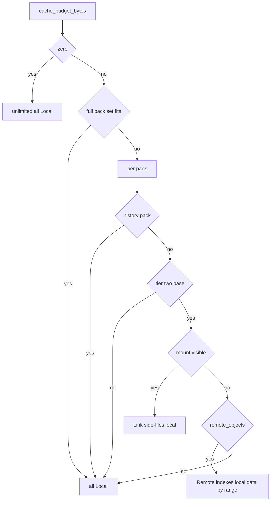
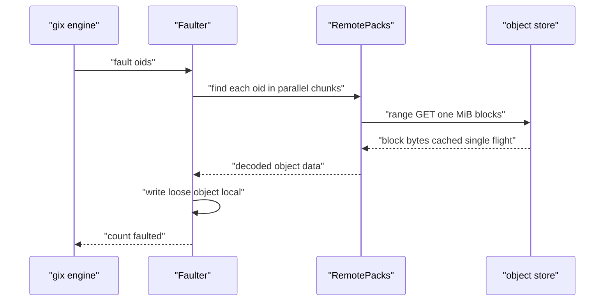

# 10 -- Disposable Cache: Sync Levels, Remote Reads, and Placement

The claim "scales to repositories larger than the machine it runs on" rests on three mechanisms: sync levels that decide how much of a pack set lands locally, a remote reader that serves pack data over range requests with a small block cache, and placement configuration that says which host does object work for which repository. This document covers all three.

## How much is local: the serve plan and the budget

The effective on-disk budget is the single decision point. In budget mode it is `cache.max_bytes`; in disk mode (a solid-state drive host) it is zero, meaning unlimited:

```rust
// Source: crates/walgit-config/src/lib.rs, lines 749-763
    pub fn cache_budget_bytes(&self) -> u64 {
        if self.cache_is_disk() {
            0
        } else {
            self.cache.max_bytes.as_u64()
        }
    }
    /// Whether the cache is a real disk (no budget; watermark eviction).
    pub fn cache_is_disk(&self) -> bool {
        match self.cache.mode {
            CacheMode::Disk => true,
            CacheMode::Budget => false,
            CacheMode::Auto => self.maintenance.disk == MaintainerDisk::Ssd,
        }
    }
```

The serve plan uses that budget. If the whole pack set fits (or the level is `Full`, or the budget is unlimited), everything is a local copy. Otherwise tier-2 base packs are linked from a read-only store mount (for example gcsfuse, a FUSE adapter for GCS) when one is visible, or served remotely (indexes local, data read by range), while newer packs stay local. History packs — commits and trees of a base — are always local, because that is their whole point:

```rust
// Source: crates/walgit-wal/src/handle.rs, lines 776-801
        manifest
            .packs
            .iter()
            .map(|p| {
                // History packs (commits + trees of a base) are always local:
                // that is the point of them.
                let redundant_history = p.kind == walgit_proto::v1::PackKind::History as i32
                    && p.pack_groups.is_empty() && !p.derived_from.is_empty();
                let how = if p.tier != 2 || redundant_history {
                    PackPlan::Local
                } else if let Some(m) = mount.as_ref() {
                    let target = crate::sync::mount_pack_path(m, &p.checksum);
                    if target.is_file() {
                        PackPlan::Link(target)
                    } else {
                        tracing::warn!(repo = %self.id, pack = %p.checksum, target = %target.display(), "base pack not readable through the store mount (gcsfuse not up yet?): serving it remotely until it is");
                        if self.cfg.wal.remote_objects { PackPlan::Remote } else { PackPlan::Local }
                    }
                } else if self.cfg.wal.remote_objects {
                    PackPlan::Remote
                } else {
                    PackPlan::Local
                };
                (p.clone(), how)
            })
            .collect()
```



## The remote reader and block cache

A remote-served pack keeps its index local and reads pack data in 1 MiB blocks through a process-wide cache. The cache is single-flight per block (`moka` future cache — moka is a Rust caching library), so two concurrent readers of the same block issue one range GET:

```rust
// Source: crates/walgit-wal/src/remote.rs, lines 27-49
pub const BLOCK_SIZE: u64 = 1024 * 1024;

/// Process-wide cache of pack data blocks (all repos, all packs). Misses are
/// single-flight per block (`moka::future::Cache::try_get_with`).
pub struct BlockCache {
    cache: moka::future::Cache<(Arc<str>, u64), Bytes>,
    pub range_reads: AtomicU64,
    pub bytes_read: AtomicU64,
}

impl BlockCache {
    pub fn new(max_bytes: u64) -> Arc<Self> {
        Arc::new(BlockCache {
            cache: moka::future::Cache::builder()
                .max_capacity(max_bytes.max(BLOCK_SIZE * 4))
                .weigher(|_k: &(Arc<str>, u64), v: &Bytes| {
                    u32::try_from(v.len().max(1)).unwrap_or(u32::MAX)
                })
                .build(),
            range_reads: AtomicU64::new(0),
            bytes_read: AtomicU64::new(0),
        })
    }
```

The block read does a range GET for `[n*BLOCK_SIZE, min((n+1)*BLOCK_SIZE, size))`, verifies the returned length, and records metrics. When the gix engine needs base objects for a tree diff, the `Faulter` reads the objects in parallel (32 at a time) and writes them into the local loose store:

```rust
// Source: crates/walgit-wal/src/remote.rs, lines 699-741
    fn fault<'a>(
        &'a self,
        oids: &'a [gix_hash::ObjectId],
    ) -> futures::future::BoxFuture<'a, Result<usize, walgit_git::GitError>> {
        let span = tracing::info_span!(
            "remote.fault",
            oids = oids.len(),
            found = tracing::field::Empty
        );
        Box::pin(
            async move {
                const PAR: usize = 32;

                self.rounds.fetch_add(1, Ordering::Relaxed);

                let mut n = 0usize;
                for chunk in oids.chunks(PAR) {
                    let results =
                        futures::future::join_all(chunk.iter().map(|oid| self.packs.find(oid)))
                            .await;
                    for (oid, r) in chunk.iter().zip(results) {
                        match r {
                            Ok(Some(obj)) => {
                                self.local.write_loose_object(obj.kind, oid, &obj.data)?;
                                n += 1;
                            }
                            Ok(None) => {}
                            Err(e) => {
                                return Err(walgit_git::GitError::Protocol(format!(
                                    "remote read of {oid}: {e}"
                                )));
                            }
                        }
                    }
                }
                self.faulted.fetch_add(n as u64, Ordering::Relaxed);
                tracing::Span::current().record("found", n as u64);
                metrics::counter!("walgit_remote_faulted_objects_total").increment(n as u64);
                Ok(n)
            }
            .instrument(span),
        )
    }
```



## Striped downloads and placement

Large pack downloads do not read one byte stream; they stripe the file as concurrent range reads written at their offsets. The constants are 32 MiB chunks and 16 in-flight stripes; a comment in the source (`crates/walgit-wal/src/sync.rs`, lines 377–379) notes that one gRPC (gRPC Remote Procedure Call) stream tops out around 10–20 MB/s from a serverless host while the NIC (network interface controller) is well beyond 100 MB/s, and that a large repository's 2.1 GB idx took 217 s on the push broker (the component that relays a push between the HTTP endpoint and the store/WAL) with 8 stripes:

```rust
// Source: crates/walgit-wal/src/sync.rs, lines 376-380
    const CHUNK: u64 = 32 * 1024 * 1024;
    // 16 stripes in flight: one gRPC stream tops out around 10–20 MB/s from
    // a serverless host, the NIC well beyond 100 MB/s (a large repository's 2.1 GB idx took 217 s
    // on the broker with 8).
    const PAR: usize = 16;
```

Placement is configuration, never inference. `[placement] serve` and `[placement] maintain` globs say which repositories a host does object work for; refs-level reads work everywhere:

```rust
// Source: crates/walgit-config/src/lib.rs, lines 503-512
impl PlacementConfig {
    /// Object work for `owner/name` happens on this host.
    pub fn serves(&self, owner: &str, name: &str) -> bool {
        repo_listed(&self.serve, owner, name) && !repo_listed(&self.serve_exclude, owner, name)
    }
    /// Maintenance units for `owner/name` run on this host (given the role).
    pub fn maintains(&self, owner: &str, name: &str) -> bool {
        repo_listed(&self.maintain, owner, name)
            && !repo_listed(&self.maintain_exclude, owner, name)
    }
}
```

## The Aha Moment

**Aha:** The scaling trick is not a smarter cache; it is an honest budget. The machine declares how much disk it can afford (`cache_budget_bytes`), and every pack is then assigned one of three plans — local, linked, or remote — by a pure function of that budget and the pack's tier. A repository that does not fit simply never lands on the machine; the parts that must be local (refs, indexes, commit graphs, history packs) are, and everything else is read on demand. There is no eviction of a "hot" pack, because the plan already knows which packs fit before any byte is downloaded.

Configuration, roles, and authentication — the knobs that set the budget and placement — are the final document, [11-config-auth-cli.md](./11-config-auth-cli.md). The sync levels and serve plan were introduced in [03-wal-crate.md](./03-wal-crate.md).

Continue to [11-config-auth-cli.md](./11-config-auth-cli.md).
