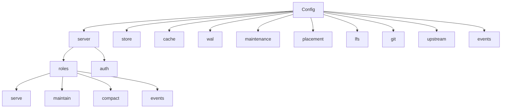
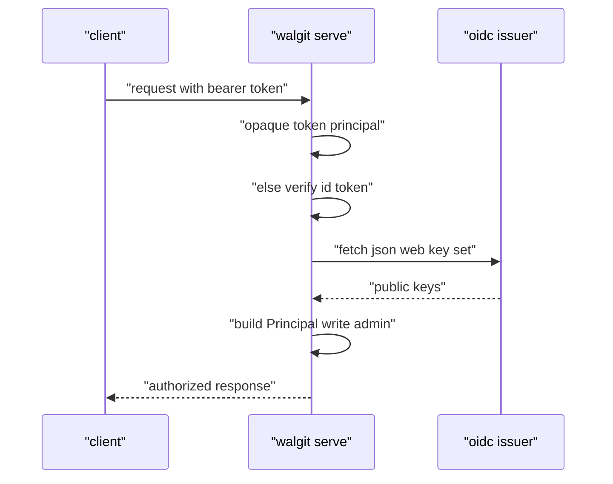

# 11 -- Config, Auth, Roles, and the CLI: how one binary is pointed at a bucket

The last piece is the operator surface: the `walgit.toml` config (with `WALGIT__` environment overrides), the three authentication modes, the four roles, and the `walgit` command-line interface (CLI). This document covers how those fit together and how the binary refuses to run against accidental defaults.

## The config shape

The top-level `Config` has one struct per subsystem, and `ServerConfig` holds the listen address, concurrency limits, drain behavior, roles, and the auth block:

```rust
// Source: crates/walgit-config/src/lib.rs, lines 20-37
pub struct Config {
    pub server: ServerConfig,
    pub store: StoreConfig,
    pub cache: CacheConfig,
    pub wal: WalConfig,
    pub packs: PacksConfig,
    pub refs: RefsConfig,
    pub packfile_uri: PackfileUriConfig,
    pub maintenance: MaintenanceConfig,
    pub placement: PlacementConfig,
    pub lfs: LfsConfig,
    pub git: GitConfig,
    pub upstream: UpstreamConfig,
    /// Links to the systems around a repository (per repo via settings).
    #[serde(default)]
    pub telemetry: TelemetryConfig,
    pub events: EventsConfig,
}
```

```rust
// Source: crates/walgit-config/src/lib.rs, lines 41-66
pub struct ServerConfig {
    pub listen: SocketAddr,
    pub http2: bool,
    pub max_concurrent_requests: usize,
    /// Per-repo cap on concurrent upload-pack/receive-pack processes.
    pub max_concurrent_per_repo: usize,
    #[serde(with = "humantime_serde")]
    pub request_timeout: Duration,
    /// Graceful drain after SIGTERM: new object work (fetch/push/LFS) is
    /// refused with 503 + Retry-After and `/readyz` turns 503 at once; in-flight
    /// requests and the running maintenance unit get this long to finish
    /// before they are interrupted. Keep it below the process supervisor's stop
    /// grace; longer SSD-host jobs should be resumable rather than relying on drain.
    #[serde(with = "humantime_serde")]
    pub drain_timeout: Duration,
    /// Max size of a single pushed pack accepted over HTTP.
    pub max_push_bytes: ByteSize,
    /// Roles this instance performs. a serverless host: fronts get `["serve"]`, the
    /// single maintenance instance `["maintain"]` (checkpoint / compact
    /// loops over every repo; `compact` is its sub-role). Empty = all.
    pub roles: Vec<Role>,
    pub auth: AuthConfig,
    /// Public base URL used when rendering absolute URIs (LFS, clone recipes).
    pub public_url: Option<String>,
    /// Create a repo on the first receive-pack push if it does not exist.
    pub auto_create_on_push: bool,
```



## Roles and placement

A role says what kind of work an instance performs; an empty `roles` list means all roles. `Maintain` implies `Compact`. The helper encodes that:

```rust
// Source: crates/walgit-config/src/lib.rs, lines 1296-1300
    pub fn has_role(&self, role: Role) -> bool {
        self.server.roles.is_empty()
            || self.server.roles.contains(&role)
            || (matches!(role, Role::Compact) && self.server.roles.contains(&Role::Maintain))
    }
```

Placement then says which repositories a role applies to, using the `serves` and `maintains` globs from [10-scaling.md](./10-scaling.md). One box leaves the defaults; several put the monorepo on the host with the solid-state drive and everything else on the small ones.

## Authentication

Auth has three modes: `none` (loopback only, everyone is `anon` with write and admin), `token` (static tokens), and `oidc` (any OpenID Connect issuer, plus walgit-issued access tokens). The resulting `Principal` is what `require_read` and `require_write` gate on in the smart HTTP routes of [05-smart-http.md](./05-smart-http.md). The enum and the dispatch:

```rust
// Source: crates/walgit-config/src/lib.rs, lines 199-211
#[derive(Debug, Clone, Copy, PartialEq, Eq, Serialize, Deserialize, Default)]
#[serde(rename_all = "snake_case")]
pub enum AuthMode {
    /// Everyone is `anon` with write **and admin**. `Config::validate` refuses this
    /// unless `server.listen` is loopback.
    #[default]
    None,
    /// Static tokens from the config (`tokens`), bearer or basic.
    Token,
    /// `OpenID` Connect: browser sign-in through the issuer, ID tokens as bearers, plus
    /// walgit-issued access tokens for git — and `tokens` for robots.
    Oidc,
}
```

```rust
// Source: crates/walgit-server/src/auth.rs, lines 670-705
    async fn authenticate_inner(&self, headers: &HeaderMap) -> Result<Principal, AuthError> {
        match self.mode {
            AuthMode::None => Ok(Principal {
                name: "anon".to_string(),
                write: true,
                admin: true,
                anonymous: false,
            }),
            AuthMode::Token => {
                let presented =
                    bearer_token(headers).or_else(|| basic_credentials(headers).map(|(_, p)| p));
                match presented {
                    Some(tok) => self
                        .opaque_token_principal(&tok)
                        .unwrap_or(Err(AuthError::Invalid)),
                    None => Ok(Principal::anonymous()),
                }
            }
            AuthMode::Oidc => {
                if let Some(tok) = bearer_token(headers) {
                    if let Some(r) = self.opaque_token_principal(&tok) {
                        return r;
                    }
                    return self.verify_id_token(&tok, &[]).await;
                }
                if let Some((_, pass)) = basic_credentials(headers) {
                    return self
                        .opaque_token_principal(&pass)
                        .unwrap_or(Err(AuthError::Invalid));
                }
                // No credentials at all → a browser session cookie may carry identity.
                self.authenticate_cookie(headers)
                    .ok_or(AuthError::Unauthorized)
            }
        }
    }
```

A `Principal` is just a name, a write bit, an admin bit, and an anonymous flag. Identity forwarding is only honoured when the caller is a trusted forwarder (or the mode is `none`), which is what lets a push broker carry the end user's identity.



## The CLI refuses accidental defaults

The `walgit` binary serves as the full CLI, and `walgit-server` is `walgit serve`. The config loader is deliberately strict: a typo'd `--config` must not open the default bucket with whatever credentials are around.

```rust
// Source: crates/walgit-cli/src/lib.rs, lines 403-425
fn load_config(path: &std::path::Path) -> Config {
    if path.exists() {
        match Config::load(path) {
            Ok(c) => c,
            Err(e) => {
                eprintln!(
                    "walgit: error loading config from {}: {e:#}",
                    path.display()
                );
                std::process::exit(1);
            }
        }
    } else {
        // Never run against defaults by accident: a typo'd --config would open the
        // default bucket with whatever credentials are around. Defaults + WALGIT__
        // env on purpose: `--config /dev/null`.
        eprintln!(
            "walgit: config file {} not found (pass --config PATH or WALGIT_CONFIG; `--config /dev/null` for defaults + WALGIT__ env)",
            path.display()
        );
        std::process::exit(2);
    }
}
```

Exit code 1 is a parse error; exit code 2 is a missing file, with the `/dev/null` hint for intentional defaults. The subcommands cover serving, compaction, repository management, WAL inspection, import, mirroring, synthetic repositories, and config checks.

## The Aha Moment

**Aha:** Every safety property in walgit is a refusal to be clever about defaults. `none` auth is refused unless the listener is loopback. A missing config file is an exit code, not a silent fallback to a default bucket. Roles are explicit, and placement is a glob you write, never a heuristic the server infers. The result is that the "one binary, no state" story stays true while still being safe to run: the machine that starts with the wrong config fails loudly at startup rather than serving the wrong bucket or the wrong users.

This is the end of the chain. The index that lists all twelve documents is [README.md](./README.md).

Continue to [README.md](./README.md).
