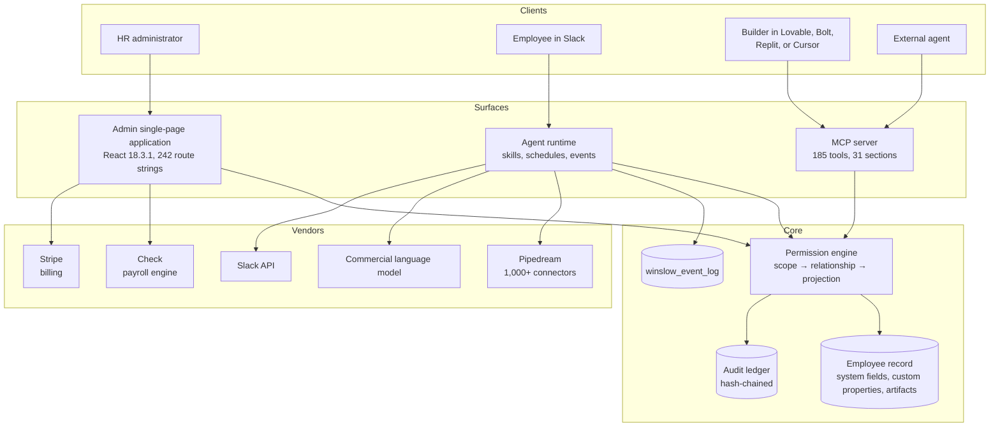
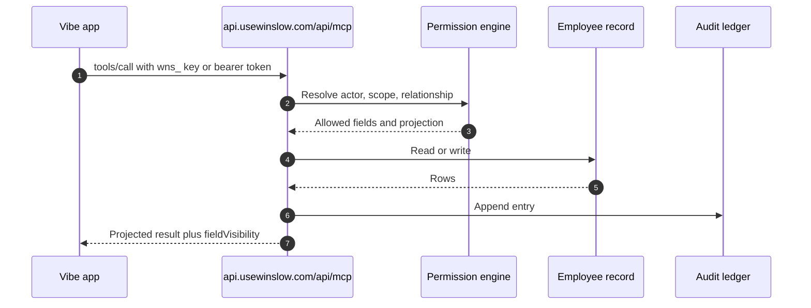

# Exploration: Winslow

Winslow is an artificial-intelligence-native Human Resources platform that sells payroll, benefits, a Human Resources Information System, and a Slack co-worker as one product. Its distinguishing claim is that the whole product is also a public Model Context Protocol server, so a customer can build an internal application and install it into Winslow's navigation.

This exploration documents the public website, the product behind it, and that claim. The website is the grandfather: there is no source code to read, so every fact traces to a page, to the machine-readable `/winslow.md`, to the compiled admin bundle, or to an observed Hypertext Transfer Protocol request.

## What the project is

| Property | Value |
|---|---|
| Product | Winslow |
| Legal name | NFTCO INC., doing business as Winslow |
| Category | Payroll, benefits, HRIS, and an artificial-intelligence co-worker |
| Market | United States startups and small companies with salaried employees |
| Website | `https://usewinslow.com` |
| Admin application | `https://app.usewinslow.com` |
| Public API | `https://api.usewinslow.com` |
| Interface | Model Context Protocol over Streamable HTTP, plus REST |
| Tool count | 185 tools in 31 sections |
| Price | $40 per month platform fee, $0 per seat, metered usage |
| Documentation date | 2026-11-06 |

## Architecture at a glance

Winslow has three surfaces over one record:

1. A React single-page application for administrators and employees.
2. A public MCP server with 185 tools, 102 of them writes.
3. A cloud agent runtime with skills, schedules, events, sequences, memory, personas, and connectors.

All three meet at one permission engine. The engine runs three checks in order: scope, relationship, and projection. That shared engine is the mechanism behind the "inherit permissions" promise.



The diagram is reconstructed from public evidence. Winslow does not publish a service diagram. The grouping into surfaces and core is a reader's model.

## Directory structure

This exploration follows the repository convention:

```
usewinslow/
├── exploration.md          ← this file
├── spec.md                 ← project tracker and quality rules
├── build.py                ← shared Markdown-to-HTML builder
├── styles.css              ← shared styles
├── markdown/
│   ├── README.md
│   ├── 00-overview.md
│   ├── 01-the-website.md
│   ├── 02-company-and-positioning.md
│   ├── 03-architecture.md
│   ├── 04-the-vibe-code-promise.md
│   ├── 05-building-and-installing-a-vibe-app.md
│   ├── 06-the-mcp-server.md
│   ├── 07-the-tool-catalog.md
│   ├── 08-the-ai-co-worker.md
│   ├── 09-payroll.md
│   ├── 10-payroll-reporting-and-compliance.md
│   ├── 11-benefits.md
│   ├── 12-hris.md
│   ├── 13-integrations-events-and-artifacts.md
│   ├── 14-permissions-security-and-audit.md
│   ├── 15-pricing-and-packaging.md
│   ├── 16-critical-assessment.md
│   └── 17-glossary.md
└── html/                   ← generated by build.py
```

## Entry points

| Entry point | Purpose | Evidence |
|---|---|---|
| `https://usewinslow.com/` | Marketing site; 22 pages; Next.js on Vercel | Response headers |
| `https://app.usewinslow.com/login` | Admin application login | Login shell HTML |
| `https://api.usewinslow.com/api/mcp` | Public MCP endpoint | Observed 401 JSON-RPC response |
| `https://api.usewinslow.com/.well-known/oauth-authorization-server` | OAuth discovery | Observed metadata |
| `https://api.usewinslow.com/oauth/authorize` | User consent | Metadata |
| `https://api.usewinslow.com/oauth/token` | Token exchange | Metadata |
| `https://api.usewinslow.com/api/employee-records/*` | REST employee data | `/winslow.md` §15 |
| `https://usewinslow.com/winslow.md` | Machine-readable product file | 64,755 bytes |
| `https://usewinslow.com/builders/mcp/` | Human MCP reference | 86,110 bytes of extracted text |

The missing entry points are also evidence:

- `/llms.txt` returns the 404 page.
- `/llms-full.txt` returns the same body.
- `/AGENTS.md` returns 404 on the marketing host and 401 on the API host.

## Data flow

A request from a vibe application follows this path:



The important property is that the application never receives a row or a field the actor cannot see. Filtering happens before the response leaves the server, not in the client.

A payroll request adds one external hop:

1. Winslow creates or refreshes a payroll.
2. Check calculates taxes and returns items.
3. Winslow projects the result to the actor.
4. Approval moves money through Check.
5. The event log fires `payroll-run.approve`.

## Components

| Component | Responsibility | Documented in |
|---|---|---|
| Marketing site | 22 pages, agent-readable Markdown, sitemap | [The website](markdown/01-the-website.md) |
| Admin single-page application | Payroll, benefits, HRIS, agents, custom apps | [Architecture](markdown/03-architecture.md) |
| MCP server | 185 tools, JSON-RPC, two auth paths | [The MCP server](markdown/06-the-mcp-server.md) |
| Tool catalog | Every tool, scope, and rule | [The tool catalog](markdown/07-the-tool-catalog.md) |
| Agent runtime | Skills, scheduler, events, sequences, memory | [The AI co-worker](markdown/08-the-ai-co-worker.md) |
| Payroll | Runs, approval, off-cycle, termination, global | [Payroll](markdown/09-payroll.md) |
| Reporting and compliance | Registers, tax centre, filings, notices | [Reporting](markdown/10-payroll-reporting-and-compliance.md) |
| Benefits | Plans, coverage, elections, life events | [Benefits](markdown/11-benefits.md) |
| HRIS | Record, properties, artifacts, documents, PTO | [HRIS](markdown/12-hris.md) |
| Integrations and events | Connectors, OAuth, REST, webhooks | [Integrations](markdown/13-integrations-events-and-artifacts.md) |
| Permission engine | Scope, relationship, projection | [Permissions](markdown/14-permissions-security-and-audit.md) |

## Dependencies and integrations

Winslow depends on five named external services:

| Dependency | Role |
|---|---|
| Check | Payroll engine: tax calculation, filings, payments |
| Stripe | Subscription billing |
| Pipedream | Connector directory |
| Slack | Employee and agent surface |
| A commercial language model | Agent reasoning |

The marketing site depends on Vercel, Next.js, Google Fonts, Ahrefs, and HelloBar. The admin application depends on Google Tag Manager, Stripe, Check, and New Relic.

The dependency on Check is the most consequential. Winslow is the interface, the record, and the agent. Check is the regulated payroll infrastructure. The public record does not include the Check contract or a contingency plan.

## Configuration

A builder needs one credential and one endpoint.

| Setting | Value |
|---|---|
| MCP endpoint | `https://api.usewinslow.com/api/mcp` |
| Transport | Streamable HTTP |
| API key header | `x-mcp-api-key: wns_...` |
| Alternative key header | `Authorization: Bearer <api-key>` |
| OAuth bearer | `Authorization: Bearer <access-token>` |
| Session header | `mcp-session-id` from `initialize` |
| REST extra header | `x-client-token: <UUID v4>` |
| REST response wrapper | `{"data": ...}` |

The two key headers are both documented, and their precedence is not. A builder should use one form consistently.

## Testing strategy

Winslow publishes no test suite, no status page, and no public sandbox. The verification method for this exploration was:

1. Download every page and extract the text with line numbers.
2. Read `/winslow.md` as the master feature list.
3. Read `/builders/mcp/` as the tool reference.
4. Probe the live endpoints: MCP, OAuth metadata, protected-resource metadata, and the missing agent files.
5. Extract route strings and third-party scripts from the compiled admin bundle.
6. Compare every claim across sources and record each conflict.

A reader can repeat the checks with `curl`:

```bash
curl -sS -i https://api.usewinslow.com/api/mcp \
  -H 'Content-Type: application/json' \
  -H 'Accept: application/json, text/event-stream' \
  --data '{"jsonrpc":"2.0","id":1,"method":"initialize","params":{"protocolVersion":"2025-06-18","capabilities":{},"clientInfo":{"name":"probe","version":"0.0.1"}}}'
```

```bash
curl -sS https://api.usewinslow.com/.well-known/oauth-authorization-server | python3 -m json.tool
```

```bash
curl -sS https://usewinslow.com/winslow.md | head -n 40
```

A live workspace cannot be tested without a credential. The next best check is the free plan, which gives $100 of credits and requires no card.

## Key insights

**The API is the product.** Winslow treats the admin interface as one client of the system of record. That inversion explains the $0 seats, the MCP-first documentation, and the "build, don't buy" message.

**Authorization is the boundary.** Scope, relationship, and projection run below every surface. A third-party application inherits permissions because the server filters before the response leaves.

**The record is a platform.** Custom properties and artifacts let an application keep its data on the employee record without a second database.

**The install layer is missing.** The promise says an application appears in the sidebar. The public record has a data-namespace registration tool and a custom route, but no install tool, hosting contract, or working example.

**The agent is an employee, not a service account.** The agent's tool calls resolve to the acting person's scopes and relationships. That is the only way the audit log can answer "who did this?" for an agent action.

**The marketing is ahead of the documentation.** Six plan names, a disputed onboarding fee, and a "whole product" claim with six documented exclusions.

## Open questions

1. Does the sidebar install exist, and how is a custom application hosted and authenticated?
2. Does surface replacement exist at all?
3. What is the mapping from the seven OAuth scopes to the 25 MCP scopes?
4. Which agent actions require human approval, and can an administrator change the list?
5. What defends the agent against prompt injection in documents, email, and Slack?
6. Which model does the agent use, where does it run, and what is retained?
7. Is the onboarding fee $0 or $100 per employee?
8. What are the Growth and Scale prices, and what does each include?
9. Is data residency United States only, or is the European Union available at Scale?
10. What are the Check contract, the service-level agreement, and the disaster recovery plan?
11. What is the subprocessor list, and where are the GDPR and HIPAA positions?
12. Does the audit hash chain have an independent verification method?

These questions are collected in [the critical assessment](markdown/16-critical-assessment.md), with the evidence for each.

## Where to start reading

Start with [the overview](markdown/00-overview.md), then [the Vibe Code promise](markdown/04-the-vibe-code-promise.md) and [the MCP server](markdown/06-the-mcp-server.md) together. Use [the tool catalog](markdown/07-the-tool-catalog.md) as a reference. End with [the critical assessment](markdown/16-critical-assessment.md).
