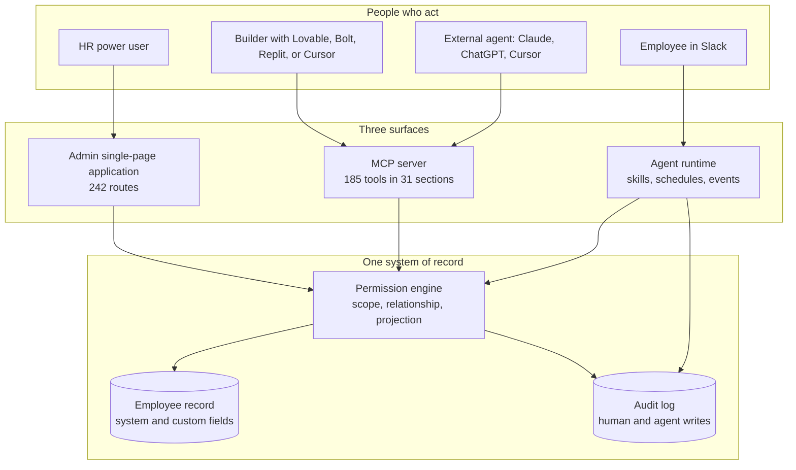
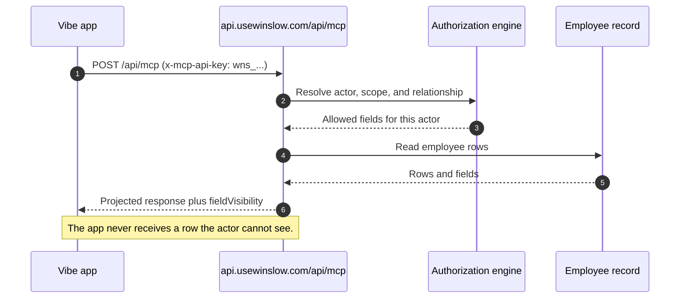

# Overview

Winslow is an artificial-intelligence (AI) native Human Resources (HR) platform. It sells payroll, benefits, a Human Resources Information System (HRIS), and a Slack-based AI co-worker as one product. Its unusual claim is that the whole product is also a public application programming interface (API). A customer can point an AI builder at Winslow, build an internal application, and install that application into Winslow's own navigation.

This page gives the shape of the company, the product, and that claim. The rest of this documentation tests each part against the public record.

## Terms used in this exploration

- **AI-native** describes software whose main interface assumes that an AI agent will do much of the work. Winslow's own essay gives a seven-point test; the short version is that the product is machine-readable and the agent can act on the data.
- **Model Context Protocol (MCP)** is an open protocol that lets an AI application discover and call tools on a server. A **tool** is one callable action, with a name, arguments, and a permission scope.
- **Scope** is a named permission string, such as `payroll:approve`.
- **Relationship check** asks whether the actor is the employee, the employee's manager, or an administrator.
- **Projection** is the field set that the server returns: `FULL`, `SELF`, `DIRECT_REPORT`, or `PUBLIC`.
- **Artifact** is a typed record that an application attaches to one employee record.
- **System of record** is the canonical store of employee data. "Writable" means that the interface can change the data, not only read it.
- **Employer of Record (EOR)** is a service that employs a worker on the customer's behalf in a country where the customer has no legal entity.
- **Connector** is an integration action that the agent can call, supplied through the Pipedream platform.
- **AI builder** is a tool that generates an application from a description, such as Lovable, Bolt, Replit, or Cursor.
- **Seat** is a named user licence. **Credit** is a prepaid unit of AI co-worker usage; the free plan includes $100 of credits.

Citations such as `about.txt:83` refer to text captures of the public Winslow pages, made on 2026-11-06. `main.26e32ed8.js` is the JavaScript bundle of the admin application. `winslow.md` is the site's own machine-readable product file.

## The company in one paragraph

Winslow is the product name of NFTCO INC., which does business as Winslow (`about.txt:83`). The chief executive officer (CEO) is Niel Robertson and the chief technology officer (CTO) is Dalton Wais (`about.txt:38-41`). The company describes itself as building "a modern HR platform for AI-native companies" (`product_overview.txt:41`). Its public investors and backers include Village Global, Link Ventures, Progression, Hannah Grey, Jeff Bezos, Bill Gates, and Reid Hoffman (`about.txt:42-49`). It also lists an HR advisory board of seven named practitioners (`about.txt:50-66`).

The company is small and its market is specific. It targets United States startups and small companies that move quickly and expect their software to be operable by agents. The pricing page says the product is "100% usage-based" and that seats cost $0 (`pricing.txt:36`, `pricing.txt:75`).

## The problem Winslow names

Winslow argues that HR software is a tax on a company. The tax has two parts. The first part is money: per-seat licenses charge for people who log in twice a year (`product_overview.txt:42`). The second part is effort: portals, tickets, and workarounds exist because the software was not built for the team that uses it (`product_overview.txt:42`).

The builder page makes a stronger argument. For twenty years, it says, HR teams were "the customer of someone else's opinions" (`builders.txt:46`). A company changed its own processes to fit a vendor's data model (`builders.txt:47`). Building an alternative used to mean six engineers and two years (`builders.txt:48`). Winslow claims that the cost of building has fallen, so the People team can become "the author of the system, not its customer" (`builders.txt:49`).

That argument is the reason the API matters. If the customer can build, then the product must expose its data and actions. Winslow turns that requirement into a marketing position.

## The three surfaces

Winslow describes three surfaces over one writable system of record (`builders.txt:72-86`):

1. **The admin user interface (UI).** A traditional web application for HR power users. It is a React single-page application (SPA), compiled to `/static/js/main.26e32ed8.js`, with 242 route strings in the public bundle, including 144 beginning with `/app`.
2. **The Model Context Protocol (MCP) server.** One server that exposes the product's capabilities to an agent stack. The public reference lists 185 tools in 31 sections.
3. **The agentic layer.** A cloud runtime for long-running, scheduled, and event-driven agents. A customer writes a skill, and Winslow runs it next to the data (`builders.txt:84-86`).



The diagram makes the central design choice visible. All three surfaces meet at the same permission engine and the same record. Winslow does not give agents a separate database or a separate authorization model. An agent is a principal, in the same way a manager is a principal.

## The product lines

| Product line | What Winslow says it does | Deep dive |
|---|---|---|
| AI co-worker | Lives in Slack, answers questions, runs payroll tasks, schedules reports, reacts to events, remembers context | [The AI co-worker](08-the-ai-co-worker.md) |
| Payroll | United States payroll in all 50 states, tax accounts, filings, notices, approvals, global payroll and Employer of Record (EOR) in over 100 countries | [Payroll](09-payroll.md) |
| Benefits | Medical, dental, and vision plans, AI-supported enrollment in Slack, life events, payroll deductions | [Benefits](11-benefits.md) |
| HRIS | Writable employee records, documents, onboarding, time off, custom fields, audit log | [HRIS](12-hris.md) |
| Integrations | More than 1,000 connectors, including any MCP server | [Integrations](13-integrations-events-and-artifacts.md) |
| Expertise | 50 hours a year of payroll and HR advisory, included | [Pricing](15-pricing-and-packaging.md) |

The company repeats a small set of numbers. They are worth knowing because later pages use them loosely:

| Claim | Value | Source |
|---|---|---|
| Payroll coverage | All 50 states, 10,000+ jurisdictions | `product_payroll.txt:45` |
| Global payroll | Over 100 countries | `product_payroll.txt:107` |
| Integrations | 1,000+, with 53 shown | `integrations.txt:36`, `integrations.txt:47` |
| MCP tools | 185 in 31 sections | `/builders/mcp/` |
| MCP OAuth scopes | 7 | OAuth metadata document |
| Admin route strings | 242, including 144 beginning with `/app` | `main.26e32ed8.js` |
| Free plan credits | $100 | `pricing.txt:41` |
| Team plan | $40 per month | `pricing.txt:54` |
| Included expertise | 50 hours per year | `pricing.txt:63` |

## The Vibe Code Ready promise

The page `/builders/vibe-code/` makes the claim in five steps. Each step is short, so the exact words matter:

1. "Build it with the tools you already use — Lovable · Bolt · Replit · Cursor · anything that speaks HTTP." The page adds: "Winslow's MCP server is the whole product — there is nothing the admin UI can do that your code can't."
2. "Install it right into the app — Your app, in Winslow's navigation." The application appears in the sidebar "next to payroll and benefits," with the same session, login, and look.
3. "Use the employee record as your source of truth — Read and write, system and custom fields."
4. "Inherit Winslow's permissions — Server-side, per actor, per field." A manager's view of the application is "a manager's view by construction."
5. "Replace parts of Winslow with your own — Override, don't work around." The page names the onboarding checklist, the organization chart, and the expense screen as candidates.

The page shows a request path:

> Your app `GET /employees?department=eng` → Winslow auth resolves the actor behind the key → Permissions drops rows and fields they can't see → Response only what that actor is allowed to read.

It concludes: "No permission logic in your code. None to get wrong."

[The Vibe Code promise](04-the-vibe-code-promise.md) checks this claim against the MCP reference. The short version is that steps 2 through 4 are substantially supported. Step 1 is true at the protocol level and false in its "whole product" sentence. The MCP reference lists six operations that are REST or interface only, and it says that no admin tool writes a qualifying life event (QLE) election. Step 5 is only partly supported: the admin bundle can replace the directory, organization chart, and calendar, but not the onboarding checklist or the expense screen.



## What the MCP server looks like

The public endpoint is `POST https://api.usewinslow.com/api/mcp`. It uses Streamable HTTP, the current transport for MCP. Authentication uses an API key in the `x-mcp-api-key` header, with the prefix `wns_`, or an OAuth 2.0 bearer token. A session identifier, `mcp-session-id`, is returned on initialization and echoed on later requests.

An unauthenticated request receives a JSON-RPC error, not an HTML login page. This observation is important: the endpoint is a real protocol endpoint.

```http
POST /api/mcp HTTP/1.1
Host: api.usewinslow.com
Content-Type: application/json
Accept: application/json, text/event-stream

{"jsonrpc":"2.0","id":1,"method":"initialize",
 "params":{"protocolVersion":"2025-06-18","capabilities":{},
           "clientInfo":{"name":"probe","version":"0.0.1"}}}
```

Observed response, with no credential:

```http
HTTP/1.1 401 Unauthorized

{"jsonrpc":"2.0","id":1,
 "error":{"code":-32001,
          "message":"Authentication required to call Winslow MCP tools."}}
```

With a credential, a tool call is ordinary MCP. The tool names are flat and verb-like, such as `list_employees`, `get_employee`, `create_employee`, and `run_payroll`. The full list is in [the tool catalog](07-the-tool-catalog.md).

```json
{
  "jsonrpc": "2.0",
  "id": 2,
  "method": "tools/call",
  "params": {
    "name": "list_employees",
    "arguments": {
      "department": "engineering",
      "limit": 25
    }
  }
}
```

The MCP server is also an OAuth 2.0 resource server. Its metadata document advertises the authorization server, the token endpoint, and seven scopes: `read:employees`, `write:employees`, `read:company`, `read:profile`, `read:time-off`, `write:time-off`, and `manage:artifacts`. This second path matters for applications that act on behalf of a person rather than a workspace.

```json
{
  "issuer": "https://api.usewinslow.com",
  "authorization_endpoint": "https://api.usewinslow.com/oauth/authorize",
  "token_endpoint": "https://api.usewinslow.com/oauth/token",
  "registration_endpoint": "https://api.usewinslow.com/oauth/register",
  "scopes_supported": [
    "read:employees", "write:employees", "read:company",
    "read:profile", "read:time-off", "write:time-off",
    "manage:artifacts"
  ],
  "code_challenge_methods_supported": ["S256"]
}
```

## The agent-readable website

Winslow practises what it sells. The marketing site publishes `/winslow.md` as `text/markdown`. The file is 510 lines and 64,755 bytes. It contains the full feature list, the MCP catalog, the OAuth description, events, notifications, pricing, and a "what we don't do" section. The page that links to it calls it the "Agent Dataroom" and says it is "regenerated on every build — never stale, never a summary" (`i-hate-demos.txt`, Agent Dataroom callout).

This is a marketing decision with a technical consequence. A language model can read the product's own description without parsing HyperText Markup Language (HTML). The site also omits some standard files: `/llms.txt` returns 404, and `/AGENTS.md` returns 404 on the marketing host and 401 on the API host. The full story is in [the website](01-the-website.md).

**Aha:** Winslow does not sell an API as an add-on. It sells the API as the product and treats the admin UI as one client of it. That inversion explains the pricing (seats are $0, usage is metered), the MCP-first documentation, and the "build, don't buy" message. It also explains the risk: if the UI is only a client, the public API must eventually cover every UI action. The MCP reference admits that it does not. That gap is the centre of [the critical assessment](16-critical-assessment.md).

## How to read this set

Start with [the website](01-the-website.md) for the surface, then [the architecture](03-architecture.md) for the structure. Read [the Vibe Code promise](04-the-vibe-code-promise.md) and [the MCP server](06-the-mcp-server.md) together; the first states the claim and the second states the mechanism. Use [the tool catalog](07-the-tool-catalog.md) as a reference, not as a narrative. The product chapters (payroll, benefits, HRIS) can be read in any order. End with [the critical assessment](16-critical-assessment.md).

## Where to go next

Read [the website](01-the-website.md) to see every page and how the site is built. Or go straight to [the Vibe Code promise](04-the-vibe-code-promise.md) for the claim this exploration exists to test.
