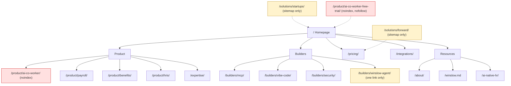
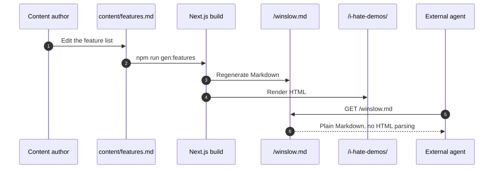

# The Website

Winslow is an artificial-intelligence (AI) native Human Resources (HR) platform. It sells payroll, benefits, a Human Resources Information System (HRIS), and a Slack-based AI co-worker as one product. This page examines its public website.

The findings come from a snapshot of the site captured on 2026-11-06: 22 HyperText Markup Language (HTML) pages, the Markdown file, and the responses to several probes. Citations such as `i-hate-demos.txt:44` refer to plain-text captures of those pages. `winslow.md:510` is a line number in the captured Markdown file. "Agent-readable" means that a page or file is written so that an AI agent can read and use it without a human interpreting a layout.

`usewinslow.com` is a 22-page Next.js marketing site hosted on Vercel, plus a separate React application at `app.usewinslow.com` and a machine-readable product file at `/winslow.md`. Next.js is a web framework, Vercel is a hosting platform, and React is a JavaScript library for building interfaces. The site is worth studying for two reasons. It is the public record of the product, and it is itself a demonstration of the "agent-readable" position the company sells.

This page inventories every page, describes the navigation and the technology, and then examines the agent-readable layer closely. That layer contains both the site's most original idea and its clearest broken promise.

## The page inventory

The snapshot contains 22 HyperText Markup Language (HTML) pages, one Markdown file, and two captured 404 bodies. The sitemap lists 20 URLs.

| Path | Title | Purpose | In sitemap |
|---|---|---|---|
| `/` | Your next hire should be AI. | Homepage: the whole pitch and a Slack mock | Yes |
| `/about/` | About | Founders, investors, advisory board | Yes |
| `/ai-native-hr/` | What Is AI-Native HR? | Essay and seven-point test | Yes |
| `/builders/` | You're in your builder era. | Builder positioning and three surfaces | Yes |
| `/builders/mcp/` | Winslow MCP — Builders Docs | Full MCP reference: 185 tools | Yes |
| `/builders/security/` | Security | Permission layer cake and compliance claims | Yes |
| `/builders/vibe-code/` | Vibe Code Ready | The five-step build-and-install promise | Yes |
| `/builders/winslow-agent/` | Winslow Agent | The cloud agent runtime | Yes |
| `/expertise/` | Expertise Included | 50 hours per year of HR advisory | Yes |
| `/i-hate-demos/` | I hate demos! | Dense list of 121 features plus limitations | Yes |
| `/integrations/` | Integrations | 54 tiles: 53 named applications and one "Any MCP" tile; "1,000+" connectors claimed | Yes |
| `/pricing/` | Pricing | Free and Team plans, three questions | Yes |
| `/privacy/` | Privacy Policy | Legal text, updated 2026-08-27 | Yes |
| `/product/ai-co-worker/` | AI co-worker | Employee-facing AI in Slack | **No**, and `noindex` |
| `/product/ai-co-worker-free-trial/` | Start your free trial | Four-question trial funnel | **No**, `noindex, nofollow` |
| `/product/benefits/` | Benefits | Enrollment, plans, payroll link | Yes |
| `/product/hris/` | HRIS | Record, audit, builder features | Yes |
| `/product/overview/` | Why we built Winslow | Founder letter | Yes |
| `/product/payroll/` | Payroll | Tax, approval, Slack, global | Yes |
| `/solutions/forward/` | Winslow Forward | Forward-deployed People Operations engineer | Yes |
| `/solutions/startups/` | Winslow for startups | Zero-to-one payroll and benefits | Yes |
| `/terms/` | Terms of Service | Legal text, updated 2026-08-27 | Yes |
| `/winslow.md` | (Markdown) | Agent Dataroom: full feature and tool list | **No** |

Two pages are reachable but not indexed: the flagship AI co-worker page and the primary conversion page. "noindex" and "nofollow" are page directives that tell a search engine not to index the page and not to follow its links. The sitemap omits both pages. A search engine can still follow a link to them, but it is told not to index them.

One link is broken. `/solutions/forward/` links twice to `/solutions/forward/maya-halberg/`, which has no captured page and no sitemap entry. It is probably an unpublished profile page.

## Navigation and information architecture

The header and footer are shared by all 22 pages.

```
Winslow
├─ Product ▾
│  ├─ Overview ............... / (homepage, not /product/overview/)
│  ├─ AI co-worker ........... /product/ai-co-worker/
│  ├─ Payroll ................ /product/payroll/
│  ├─ Benefits ............... /product/benefits/
│  ├─ HRIS ................... /product/hris/
│  └─ Expertise Included ..... /expertise/
├─ Integrations .............. /integrations/
├─ Builders ▾
│  ├─ Overview ............... /builders/
│  ├─ MCP .................... /builders/mcp/
│  ├─ Vibe Code Ready ........ /builders/vibe-code/
│  └─ Security ............... /builders/security/
├─ Pricing ................... /pricing/
├─ Resources ▾
│  ├─ About .................. /about/
│  └─ Agent Dataroom ......... /winslow.md
├─ Log in .................... https://app.usewinslow.com/login
├─ Try it for free ........... /product/ai-co-worker-free-trial/
└─ Book a demo ............... button with no URL
```

The tree has several defects.

- **The Product "Overview" points to the homepage.** The real overview page, `/product/overview/`, is nearly unreachable. Only the AI-native essay links to it.
- **The Builders menu omits the agent page.** `/builders/winslow-agent/` is linked only from `/builders/`.
- **There is no Solutions menu.** `/solutions/forward/` and `/solutions/startups/` are orphaned. They appear only in the sitemap.
- **The footer omits major pages.** It omits Pricing, Expertise, the Builders overview, the agent page, and the anti-demo page.
- **"Book a demo" is not a link.** It is a JavaScript button on 21 pages, with no crawlable URL.

The navigation treats the site as a product catalogue. The orphaned solution pages and the noindexed AI co-worker page suggest that the information architecture changed faster than the menu did.



The red nodes are pages that are deliberately excluded from search. The yellow nodes are pages with weak or no menu links. A dotted edge marks a page that is reachable through the sitemap but not through the menu shown. The diagram shows menu paths only. The legal pages, `/i-hate-demos/`, `/product/overview/`, and `/winslow.md` have no menu entry or a different entry, so the diagram omits them.

## The site technology

The marketing site is a Next.js App Router application. The evidence is in the asset paths and the response headers:

- `/_next/static/chunks/app/page-c04b15e10ceee088.js`
- `/_next/static/chunks/app/layout-e6af59cc21c08a92.js`
- `data-precedence="next"` on stylesheets
- a React Server Components flight payload containing `"children":["i-hate-demos",{"children":["__PAGE__",{}]}]`

The response headers confirm Vercel and prerendering:

```http
HTTP/1.1 200 OK
server: Vercel
x-vercel-cache: HIT
x-vercel-id: hkg1::nj64v-1793899582055-a995ade522d8
x-nextjs-prerender: 1
x-nextjs-stale-time: 4294967294
vary: RSC, Next-Router-State-Tree, Next-Router-Prefetch, Next-Router-Segment-Prefetch
cache-control: public, max-age=0, must-revalidate
content-type: text/html; charset=utf-8
```

The page is prerendered, cached at the edge, and revalidated. Prerendering means that the HTML was built ahead of time, not rendered for each request. `x-vercel-cache: HIT` means that the edge cache served the response, and the `Age` header counts the seconds since that cache stored it. `RSC` in the `vary` header means React Server Components, the format that Next.js uses for server-rendered parts. The `age` header on the captured homepage was 139,872 seconds, or about 39 hours, which shows a long-lived edge cache.

The fonts are Geist, Geist Mono, and Instrument Serif, loaded from Google Fonts. Each page loads four or five hashed style sheets. A hashed style sheet is a file whose name contains a content hash, so a new build produces a new name. The site declares `<html lang="en" data-theme="light">`; the theme is static, and there is no dark-mode toggle.

The third-party scripts are minimal. Marketing pages load Ahrefs analytics and HelloBar, both with `strategy="afterInteractive"`. There is no Stripe or Check script on the marketing pages.

The security headers are partial. Strict Transport Security tells a browser to use HTTPS for later visits, and it is present with a two-year max age. `access-control-allow-origin: *` lets any origin read the response; it is an access-control header, not a protection. Content Security Policy, `x-content-type-options`, `x-frame-options`, `referrer-policy`, and `permissions-policy` are absent. Each of those headers limits a class of browser attack, such as script injection or framing. For a marketing site, that is common but not ideal. For a company that sells security, it is a visible detail.

### The application subdomain

`app.usewinslow.com` is a separate React 18.3.1 single-page application. A single-page application loads one document and then changes its own content; its routes are not separate HTML pages. The login shell is the HTML document served at `/login`, before the JavaScript bundle loads; it is 61,037 bytes. Its JavaScript bundle is 10,006,564 bytes, and it contains 144 routes beginning with `/app`, including payroll, benefits, employee records, agents, and the custom app route.

The application shell loads more third-party code than the marketing site:

| Script or service | Purpose |
|---|---|
| Google Tag Manager `G-G0MXJ4R053` | Product analytics |
| `https://js.stripe.com/v3/pricing-table.js` | Subscription pricing table |
| `https://cdn.checkhq.com/component-initialize.js` | Payroll components |
| New Relic Browser 1.267.0 | Application performance monitoring |

The application manifest has two small defects. It declares `winslow_logo.svg` with the media type `image/png`, and `favicon.png` with the media type `image/x-icon`. The login shell also points its Open Graph image at `https://staging.usewinslow.com/favicon.png`, which exposes a staging host.

## The agent-readable layer

Winslow's most original web decision is to publish the product description as Markdown. The file `/winslow.md` is 64,755 bytes and 510 lines. It contains:

- a one-paragraph product summary and a pricing paragraph;
- 17 numbered feature sections;
- a YAML block that describes the company, the MCP endpoint, the OAuth scopes, and the limitations to an agent;
- the full MCP catalog: 31 sections and 185 tools, with scopes and write markers;
- an OAuth section, an events section, and a notifications section;
- an honest "what we don't do" list.

The page that links to it calls it the "Agent Dataroom" (`i-hate-demos.txt`). The file says it is "regenerated on every build" and tells the reader to trust it "over older third-party listings (FlexOS, AppSource)" (`winslow.md:510`).

The generation is real. Two HTML comments mark generated regions:

```html
<!-- FEATURES:START — generated from content/features.md by scripts/gen-winslow-md.mjs.
     Do not edit between these markers; edit content/features.md and run `npm run gen:features`. -->
```

```html
<!-- MCP:START — generated from content/mcp/ by scripts/gen-mcp-md.mjs.
     Do not edit between these markers; edit content/mcp/ and run `npm run gen:mcp`. -->
```

This is a build pipeline, not a hand-maintained duplicate. The Markdown and the anti-demo page share one source, so they cannot drift from each other.



### The broken parts

The same file tells agents to fetch three other sources:

```yaml
mcp:
  docs: GET /llms.txt · GET /AGENTS.md · MCP tool get_api_docs
```

`llms.txt` is a proposed convention for a short Markdown guide that describes a site to a language model. `AGENTS.md` is a similar convention for instructions to a coding agent. `get_api_docs` is an MCP tool that returns the API reference. Two of the three are broken.

- `https://usewinslow.com/llms.txt` returns the site's 404 page, not a text file. `/llms-full.txt` returns the same 404 body. The two captures are byte-identical at 16,684 bytes.
- `https://usewinslow.com/AGENTS.md` returns 404.
- `https://api.usewinslow.com/AGENTS.md` returns 401, according to the protected-resource metadata, so it may exist but require authentication.

The 404 page has its own defect. It contains two `<title>` elements and two conflicting robots tags:

```html
<meta name="robots" content="noindex"/>
<meta name="robots" content="index, follow"/>
```

A 404 page that says both "do not index" and "index, follow" is a small symptom of a larger issue. The agent-readable layer was added quickly, and its edges were not tested.

### What does work

The site does publish a protected-resource metadata document for the MCP server. It names the resource, the authorization server, and the seven scopes. The `robots.txt` is clean and points to the sitemap:

```
User-Agent: *
Allow: /

Host: https://usewinslow.com
Sitemap: https://usewinslow.com/sitemap.xml
```

The sitemap lists 20 URLs with a single `lastmod` value, `2026-11-04T02:34:38.752Z`. Priorities range from 1.0 for the homepage to 0.3 for the legal pages. The consistency of `lastmod` suggests a generated sitemap, not per-page dates.

Only one page has structured data. `/ai-native-hr/` carries a `BlogPosting` and a `BreadcrumbList`. The homepage, pricing page, and product pages have no Organization, Product, or FAQ schema. For a company that wants agents to understand its product, the lack of `Product` and `FAQPage` markup is a missed opportunity. The Markdown file compensates, but search engines do not read it as structured data.

## Content architecture and duplication

The site has five content layers:

1. **Product pages.** Nine pages cover the homepage, the five product pages, expertise, pricing, and integrations.
2. **Builder pages.** Five pages explain the MCP, the agent, security, and the vibe-code promise.
3. **Solutions.** Two pages target startups and transforming companies. Both are orphaned from navigation.
4. **Company and resources.** About, the AI-native essay, and the anti-demo page.
5. **Legal and agent-readable.** Privacy, terms, and `/winslow.md`.

The duplication is deliberate in one case and accidental in another.

Open Graph is the metadata that social networks use for a link preview.

- **Deliberate:** `/winslow.md` mirrors `/i-hate-demos/`. Both come from the same feature source. The Markdown groups the features into 17 numbered sections; the page presents the full list of 121. The Markdown is the parseable form of the HTML.
- **Accidental:** the homepage repeats its full Slack mockup twice on the same page, including the same "are we clear to run payroll on Friday?" exchange. The integration and AI co-worker pages share an identical "Installs in 2 mins" block. Every subpage inherits the homepage Open Graph title and description; only the AI-native essay overrides them.

The shared Open Graph metadata means a link to `/pricing/` on a social network shows the homepage title. For a company that cares about agent readability, this is a basic search-engine optimization (SEO) defect.

## Aha: the anti-demo page is the real product page

Most software companies treat the demo as the moment of truth. Winslow inverts that. The anti-demo page is a single dense scroll with 121 features, 12 screenshots, pricing, eight limitations, and a link to a Markdown file. It is designed to be read, not watched.

That choice fits the product. A buyer who can read the MCP reference does not need a sales engineer to explain the API. A buyer who can read `/winslow.md` can hand it to an agent and ask for an evaluation. The site is built for a reader who wants evidence, not a performance.

The broken `llms.txt` and `AGENTS.md` links weaken the effect. A company that says "trust this file over older listings" should make every file it names reachable. The idea is strong; the execution is incomplete.

## What the site reveals about the company

- **The product is the marketing.** The MCP reference is the largest page by far. It is 616,165 bytes of raw HTML in the capture, against 212,578 bytes for the next largest page (`/product/payroll/`). The company expects technical readers.
- **The site is young and changing.** Orphan pages, noindexed flagship pages, a staging host in the Open Graph image, and broken agent files all suggest rapid iteration.
- **The legal pages have small defects.** The capture tool masks email addresses, so the visible text shows `[email protected]` eight times. The raw HTML contains a real address, `mailto:support@usewinslow.com`, but the link target ends with a period. The privacy page also links to two URLs with trailing periods.
- **The design is consistent.** Geist and Instrument Serif, a light theme, and the same header and footer on every page. The Slack mockups carry most of the visual storytelling.

## Where to go next

Read [Company and positioning](02-company-and-positioning.md) for the argument behind the pages, or [Architecture](03-architecture.md) for the product structure the site describes.
