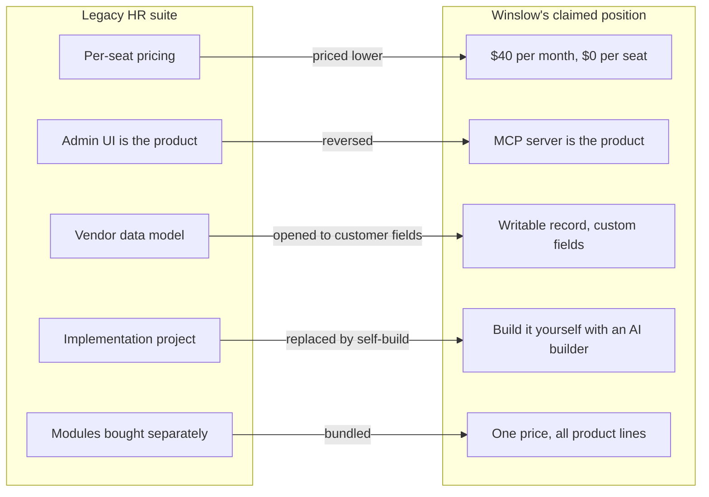
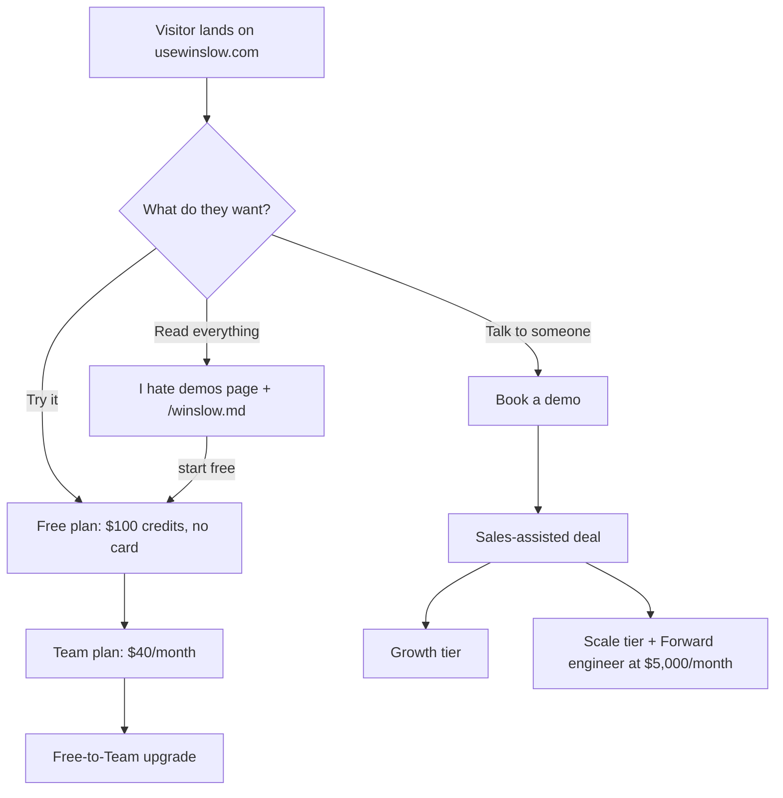

# Company and Positioning

Winslow is an artificial-intelligence (AI) native Human Resources (HR) platform. It sells payroll, benefits, a Human Resources Information System (HRIS), and a Slack-based AI co-worker as one product. "AI-native" describes software that assumes an AI agent will do much of the work, rather than adding a chatbot to a traditional product. The People team means the HR department.

Three terms recur. The Model Context Protocol (MCP) is an open protocol that lets an AI application call external tools; Winslow's MCP server exposes 185 tools. An agent is an AI program that can act, not only answer. An artifact is a typed record that an application attaches to one employee. The "three surfaces" are the admin web application, the MCP server, and the cloud agent runtime.

Citations such as `about.txt:36` refer to text captures of the public Winslow pages, made on 2026-11-06. A **cap table** is the record of who owns equity in a company.

The company is small, founder-led, and sells one large idea: the People team should own its software, not rent a vendor's opinion. Every page on the site argues some part of that idea. This page describes the company, the audience, the competitive frame, and the sales motion.

## The company

| Property | Value | Source |
|---|---|---|
| Product name | Winslow | `about.txt:36` |
| Legal name | NFTCO INC., doing business as Winslow | `about.txt:83` |
| Chief executive officer (CEO) | Niel Robertson | `about.txt:38-39` |
| Chief technology officer (CTO) | Dalton Wais | `about.txt:40-41` |
| Headquarters | Not stated on the public site | — |
| Founded | Date not stated; the two named officers are the founders | `product_overview.txt:40-41` |
| Investors named | Village Global, Link Ventures, Progression, Hannah Grey, Jeff Bezos, Bill Gates, Reid Hoffman | `about.txt:42-49` |
| Advisory board | Seven named HR practitioners | `about.txt:50-66` |
| Copyright line | © 2026 NFTCo, Inc. | `about.txt:83` |

The site gives no funding amount, no founding date, and no headcount. It names individual investors but does not say whether their investment is personal or institutional. The list mixes firms and individuals, and the page does not label which is which. A reader should treat the investor list as a credibility signal, not as a cap table.

The advisory board is more specific. It lists seven people with operating titles (`about.txt:53-66`). The first three are Elliott Dykes (Head of People Operations), Elaine Davis (Chief Human Resources Officer), and Steve Thomas (Vice President of Human Resources). The next two are Danielle Morton (Total Rewards Specialist) and Sarah Innocenzi (Global Vice President of Human Resources). The last two are Dana Whiteaker (Change Management Specialist) and Courtney Seard (Learning and Development and Diversity and Inclusion Expert). The titles cover payroll operations, total rewards, global HR, change management, and learning and development. They do not map one-to-one to the product lines, which are payroll, benefits, HRIS, and the AI co-worker.

## The founding argument

The product overview is a note from the two founders, Niel Robertson (CEO) and Dalton Wais (CTO). It states the mission in one sentence: "a modern HR platform for AI-native companies — one that helps every employee succeed" (`product_overview.txt:41`).

The argument has three steps.

1. **HR software is a tax.** Per-seat licenses charge for people who do not use the software. Employee self-service portals and support tickets also consume the time of the people who do use it (`product_overview.txt:42-43`).
2. **The tax grows with headcount.** Every new hire adds cost and effort (`product_overview.txt:43`).
3. **The fix is a rebuild, not a feature.** Winslow started from scratch, "AI-native from the foundation rather than bolted onto an HCM" (`product_overview.txt:44`). HCM means human capital management, the legacy category name.

The pricing page turns the argument into a number. Winslow says usage-based pricing "come[s] in at 25% of the cost of legacy payroll and HRIS vendors" (`pricing.txt:76`). Usage-based pricing means that the customer pays for consumption of the agent, not for named seats. The page gives no study, sample, or methodology for the 25% figure.

## The audience

Winslow names several audiences, and they are not identical. "Zero to one" means before product-market fit. A People Operations engineer builds and runs HR systems and processes. Lovable, Bolt, Replit, and Cursor are AI builders: tools that generate an application from a description.

| Audience | What the site says | Where |
|---|---|---|
| AI-native startups | Smaller than legacy org charts, faster than an annual cycle, expect every person and agent to do the work themselves | `product_overview.txt:45` |
| Startups at zero to one | Payroll and benefits "out of the box," tax accounts opened, an HR expert in Slack | `solutions_startups.txt:36-49` |
| Transforming companies | Companies that need a People Operations engineer but do not have one | `solutions_forward.txt:38` |
| HR power users | People who want or need to live in an admin UI all day | `builders.txt:77-78` |
| Builders | HR teams that want to build, plus anyone who can use Lovable, Bolt, Replit, or Cursor | `builders.txt:36-37` |
| Employees | People who should never log into HR software and can ask in Slack | `ai-native-hr.txt:53` |

The last row is the strategic one. Winslow says the conversational surface serves "the 95% of your company who should never have to log into HR software again" (`ai-native-hr.txt:53`). The product is therefore not only for the People team. It is for every employee, with the People team as the administrator.

## The seven-point test

The best statement of the company's position is not a product page. It is the essay "What is AI-native HR software?" (`ai-native-hr.txt`). The essay defines AI-native HR as software "built from the ground up around AI — not a traditional HR platform with a chatbot bolted on" (`ai-native-hr.txt:38`). It then gives a seven-question test (`ai-native-hr.txt:73-80`):

| # | Question | Winslow's claimed answer |
|---|---|---|
| 1 | Can you do the real work inside the conversation? | Slack is the primary surface for employees |
| 2 | Does it know your company, not HR in general? | Policies, plans, and context are read from the customer's own data |
| 3 | Can you tell it what you want and have it done? | The agent executes or pulls the right screen into the conversation |
| 4 | Can the AI write to your data, not just read it? | The system of record is writable through MCP |
| 5 | Does it meet your team where they already work? | Slack, plus Claude and other agent clients |
| 6 | Can you build the processes you are missing yourself? | MCP, custom fields, artifacts, and the agent runtime |
| 7 | Are you paying for what you use, not for who you hired? | $40 per month, $0 per seat |

The scoring bands are 0–2 ("AI-flavored"), 3–5 ("in transition"), and 6–7 ("actually AI-native") (`ai-native-hr.txt:81-86`). The bands read as a count of "yes" answers from 0 to 7. The essay does not say who performs the scoring. The essay is dated July 27, 2026, and its JSON-LD markup marks it as a blog post by the organization Winslow (`ai-native-hr.txt:115-116`). JSON-LD is a JSON format that search engines read as structured data.

**Aha:** The seven-point test is also the sales script. A buyer who accepts the test has already accepted that a legacy platform fails it. The essay does not need to name a competitor, because the test does the comparative work. This is content marketing with a decision framework built in.

## The competitive frame

Winslow names incumbents directly on the builder page: "Workday, Rippling, Gusto, Justworks, ADP" (`builders.txt:47`). The argument is not that those products lack features. It is that their implementation model makes the customer adapt:

> You sat in a kickoff. Someone from implementation walked you through their data model, their fields, their workflows, their idea of what an onboarding looks like. You adjusted your company to fit their software. Then you paid them for the privilege. (`builders.txt:47`)

Winslow positions against that model on five contrasts, not three. The incumbents are named without description: Workday and Rippling are broad HR suites, Gusto and Justworks sell payroll and benefits to small companies, and ADP is a large payroll processor.



The arrows read as follows. Winslow prices lower than per-seat suites. It reverses the admin interface and the API: the API is the product, and the interface is one client. It opens the vendor data model through custom properties. It replaces an implementation project with customer-built applications. It bundles the modules into one price.

The contrasts are qualitative. Winslow does not publish a feature comparison, a migration guide, or a total-cost study. The claim is structural: the architecture, not the feature list, is the differentiator. That architecture is described in [the architecture](03-architecture.md).

## The sales motion

Winslow runs three motions at once.

### 1. Self-serve

The free plan gives $100 of co-worker credits, no credit card, and unlimited Slack users (`pricing.txt:40-50`). A co-worker credit is a prepaid unit of the AI co-worker's usage. The Team plan is $40 per month for "standard usage, regardless of headcount" (`pricing.txt:52-56`). The page does not define the usage that exceeds "standard," or what happens when it does. The primary call to action is "Try it for free," with "Book a demo" as the secondary action.

### 2. Anti-demo

Winslow publishes a page titled "I hate demos!" (`i-hate-demos.txt`). The page is a long, dense list of everything the product ships, grouped by category, with the argument that a buyer should read the product instead of watching a presentation. The page also links to `/winslow.md`, the machine-readable version. The anti-demo is still a demo; it is a demo that respects the reader's time.

### 3. Forward-deployed engineering

Winslow Forward is a paid service for companies that want help becoming agentic (`solutions_forward.txt:35-38`). Agentic means that AI agents perform multi-step work, not only answer questions. A forward-deployed engineer works inside the customer's team. That engineer sets up the platform and writes the first agentic workflows. The engineer also trains the People team to write their own skill files, and stays for quarterly business reviews (`solutions_forward.txt:39-46`). A skill file is a Markdown playbook that the agent follows. The price is +$5,000 per month per dedicated engineer, on top of "$40/mo AI usage and $100/EE one-time onboarding" (`solutions_forward.txt:76-81`). "EE" means employee. The page says the service is included with "Winslow Scale" and is an add-on at "Growth" (`solutions_forward.txt:77`). Neither tier appears on the pricing page, and neither has a public description or price. This is one of several packaging inconsistencies covered in [Pricing and packaging](15-pricing-and-packaging.md).



## Voice and brand

The writing is direct, first-person, and sometimes deliberately blunt. The builder page says the old deal is over (`builders.txt:49`). The anti-demo page is named after a rejection of the standard sales ritual. The AI-native essay says most 2025 AI features were shipped "for optics" (`ai-native-hr.txt:48`).

The voice serves a purpose. Winslow is selling to founders and HR leaders who are tired of vendor presentations. A plain, slightly combative voice signals that the company is on the buyer's side. It also raises the cost of being wrong: a company that speaks this directly is easier to check.

## The machine-readable company

The site practises the agent-readable position it sells. "Agent-readable" means that the content is written so that an AI agent can read and use it without a human interpreting a layout. The file `/winslow.md` begins with a statement that it is the authoritative feature list, and a date:

```markdown
# Winslow — Everything we ship

> Source-of-truth feature list. Same content as `/i-hate-demos`, formatted for parsing.
> Last updated: 2026-11-02

Winslow is an AI-native HR platform — payroll, benefits, HRIS, and a Slack-native
conversational layer for employees. Every customer gets a dedicated cloud agent with
skills, a scheduler, and 185 MCP tools. Build the HR you want. Winslow runs the rest.

**Pricing model:** 100% usage-based. Free to start with up to $100 in co-worker credits
(no credit card), then $40/month for standard usage regardless of headcount.
$0 per employee per month, ever. Global payments and EOR cost extra; everything else is
in the $40. Self-serve billing is Stripe (`Winslow Starter`, $40/mo list).
```

The file is generated from `content/features.md` by `scripts/gen-winslow-md.mjs`, between markers that say "Do not edit" (`winslow.md:12`). This is a real content pipeline, not a hand-written file.

The site also publishes JSON-LD structured data. The AI-native essay carries a `BlogPosting` record with a headline, publication date, author, and publisher. The page also carries a separate `BreadcrumbList`. The captured markup has no description and no image, although the page itself has both.

```json
{
  "@context": "https://schema.org",
  "@type": "BlogPosting",
  "@id": "https://usewinslow.com/ai-native-hr/#article",
  "headline": "What Is AI-Native HR Software?",
  "datePublished": "2026-07-27",
  "dateModified": "2026-07-27",
  "author": { "@type": "Organization", "name": "Winslow" },
  "publisher": {
    "@type": "Organization",
    "name": "Winslow",
    "logo": { "@type": "ImageObject", "url": "https://usewinslow.com/icon.svg" }
  }
}
```

The file is served as Markdown, not HTML. Markdown is smaller than HTML and contains no navigation, so a model can read it with fewer tokens:

```http
GET /winslow.md HTTP/1.1
Host: usewinslow.com

HTTP/1.1 200 OK
Content-Type: text/markdown; charset=utf-8
```

## What the company is not saying

The site is silent on several facts that a buyer would normally check:

- No funding total, valuation, or runway.
- No customer count, logo wall, or named case study.
- No public security certification report, only a statement that the SOC 2 Type II report is available on request (`builders_security.txt:82-84`). SOC 2 Type II is an independent audit of security controls over a period.
- No service-level agreement for payroll accuracy or support response.
- No published data-processing agreement or subprocessor list on the pages reviewed. A subprocessor is a third party that handles customer data for the vendor.
- No explanation of how the payroll engine or the benefits brokerage is licensed. A benefits brokerage is the licensed entity that sells insurance plans.

These are not necessarily problems. They are gaps between a strong product argument and the evidence a finance or compliance buyer usually requires. [The critical assessment](16-critical-assessment.md) returns to them.

## Where to go next

Read [the website](01-the-website.md) for the full page inventory and the site technology, or [the architecture](03-architecture.md) for how the three surfaces fit together.
