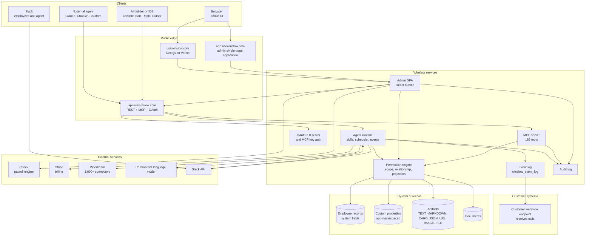
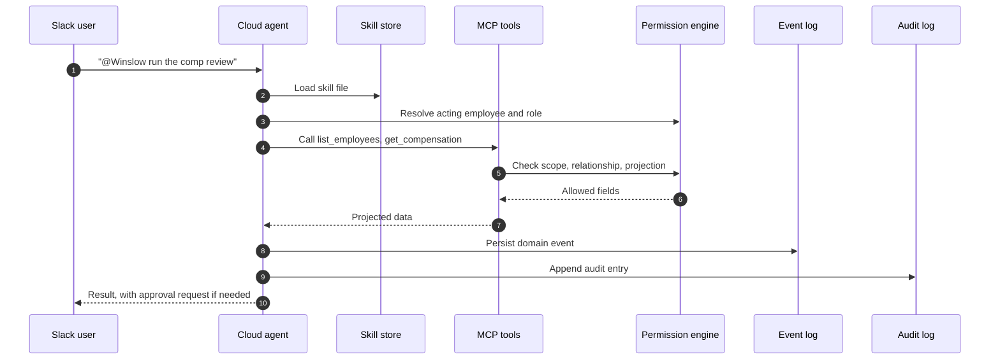
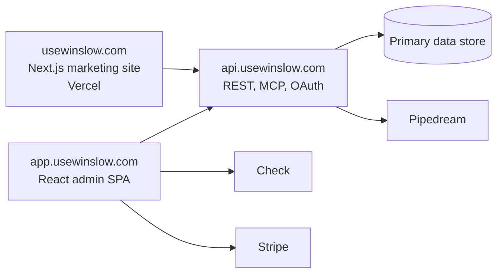

# Architecture

Winslow is an artificial-intelligence (AI) native Human Resources (HR) platform. It sells payroll, benefits, a Human Resources Information System (HRIS), and a Slack-based AI co-worker as one product. "Vibe coding" means building software by describing it to an AI builder instead of writing the code by hand. The "Vibe Code Ready" claim says that a customer can build an application and install it into Winslow's navigation.

Citations such as `winslow.md:19` refer to text captures of the public Winslow pages, made on 2026-11-06. `winslow.md` is the site's own machine-readable product file. A **tool** is one callable Model Context Protocol (MCP) action. An **artifact** is a typed record that an application attaches to one employee. A **scope** is a named permission string. A **projection** is the field set that the server returns: `FULL`, `SELF`, `DIRECT_REPORT`, or `PUBLIC`. An **Aha** marks this exploration's own key insight, not a Winslow term.

Winslow has three product surfaces over one writable system of record. The surfaces are an admin React single-page application (SPA), a public MCP server, and a cloud agent runtime. This page describes each layer, the shared core, and the external services behind them.

The architecture matters because the Vibe Code Ready claim depends on it. If the three surfaces did not share one record and one permission engine, a third-party application could not "inherit" anything. The shared core is the mechanism behind the promise.

## The whole system



The diagram is reconstructed from public evidence: the marketing pages, the MCP reference, the admin bundle, and the response headers. Winslow does not publish an architecture diagram or a service list. Every box is a documented surface or a named vendor. The grouping into "services" is a reader's model, not a Winslow statement. No box is dashed, because the evidence does not label any component as inferred; the inference is in the grouping, not in the names.

## Surface 1: the admin single-page application

The admin application is a React 18.3.1 single-page application, served from `app.usewinslow.com`. React is a JavaScript library for building interfaces, and a single-page application loads once and then changes its own content. The public login page loads `/static/js/main.26e32ed8.js` and `/static/css/main.98ac55f1.css`, with a `manifest.json` and a `favicon`. The bundle contains 242 route strings, including 144 beginning with `/app`. The counts come from a text search of the bundle for quoted strings that begin with `/`. They are a lower bound, because some routes are built at runtime. The routes reveal the product's internal shape better than the marketing pages do.

| Route family | What it suggests | Example routes |
|---|---|---|
| `/app/payroll/*` | Payroll runs, approvals, reports, contractors | `/app/payroll`, `/app/payroll/history`, `/app/payroll/reports` |
| `/app/benefits/*` | Benefits administration and enrollment | `/app/benefits`, `/app/benefits/enrollment` |
| `/app/employee-records/*` | Employee record and self-service | `/app/employee-records/:employeeId` |
| `/app/company/*` | Company settings, policies, events | `/app/company`, `/app/company/events` |
| `/app/agents/*` | Agent, skills, schedules, personas | `/app/agents`, `/app/agents/skills` |
| `/app/admin/*` | Workspace administration | `/app/admin`, `/app/admin/members` |
| `/app/custom/:appId` | A custom application mounted by identifier | `/app/custom/:appId` |
| `/app/hris-vibe-apps` | The vibe-application catalogue | `/app/hris-vibe-apps` |
| `/app/workflow/vibes/` | Workflow builder for "vibes" | `/app/workflow/vibes/` |
| `/ai-coworker/*` | Conversational surface | `/ai-coworker/*` |
| `/waz/*` | Unclear internal surface | `/waz/*` |
| `/policystudio` | Policy authoring | `/policystudio` |
| `/extension/landing` | Browser extension landing page | `/extension/landing` |
| `/oauth/*` | OAuth authorization and consent | `/oauth/authorize`, `/oauth/callback` |
| `/signup`, `/invite/:inviteId`, `/join/:token` | Onboarding and invitations | `/join/:token` |

The presence of `/app/custom/:appId` and `/app/hris-vibe-apps` is direct evidence that the admin application has a mount point for customer-built applications. `:appId` is a route parameter: the identifier of one installed application. The sidebar entry for an installed application opens `/app/custom/{id}`, and the route loads the application's URL in an iframe. The marketing page describes the sidebar install. The route table shows where it lands.

A person logs in through the public login page. The page calls the API, stores a session, and then loads the application shell. The bundle contains `/oauth/authorize` and `/oauth/callback` routes, so the same application also serves the OAuth consent step. The exact token store is not public.

The admin bundle also loads third-party components. The login page includes a Check component and a Stripe pricing table. Check is the payroll infrastructure provider. Stripe is the billing provider. The bundle reports to Google Analytics property `G-G0MXJ4R053`.

```javascript
// Route strings extracted from main.26e32ed8.js (observed, abridged)
const routes = [
  "/app/payroll",
  "/app/payroll/history",
  "/app/payroll/reports",
  "/app/benefits",
  "/app/employee",
  "/app/company/events",
  "/app/agents",
  "/app/admin",
  "/app/custom/:appId",
  "/app/hris-vibe-apps",
  "/app/workflow/vibes/",
  "/oauth/authorize",
  "/join/:token"
];
```

The sample contains `/app/employee`, while the table lists `/app/employee-records/:employeeId`. Both strings exist in the bundle; the first is probably an older route that still resolves. The route list is not a public contract. It is compiled code, and it can change without notice. It is still the best public evidence of what the admin UI contains.

## Surface 2: the MCP server

The MCP server is the public product interface. It lives at `POST https://api.usewinslow.com/api/mcp` and speaks Streamable HTTP. That transport sends a JSON-RPC request as an HTTP POST, and the server may reply with one JSON body or with a stream of events. It exposes 185 tools in 31 sections. A section is a named group in the reference, such as "Payroll" or "Benefits"; it is documentation structure, not a runtime namespace. The tools cover payroll, benefits, HRIS, documents, time off, artifacts, OAuth application management, and the agent runtime's own controls.

The server has two authentication paths:

1. **MCP API key.** A workspace key with the prefix `wns_`, sent in `x-mcp-api-key`. The key acts as a workspace member. It is the fast path for a builder.
2. **OAuth 2.0 bearer token.** A token issued after a user authorizes an application. The token carries one or more of seven scopes: `read:employees`, `write:employees`, `read:company`, `read:profile`, `read:time-off`, `write:time-off`, and `manage:artifacts`.

A workspace is one customer tenant: its employees, keys, applications, and settings. A workspace member is one user account inside it.

The key path and the OAuth path are not interchangeable with the REST API. Winslow states that `wns_` keys are rejected on REST. It also states that REST needs an OAuth bearer token plus an `x-client-token` header with a Universally Unique Identifier version 4 (UUID v4) value (`winslow.md:498`).

```http
POST /api/mcp HTTP/1.1
Host: api.usewinslow.com
Content-Type: application/json
Accept: application/json, text/event-stream
x-mcp-api-key: wns_...

{"jsonrpc":"2.0","id":1,"method":"initialize",
 "params":{"protocolVersion":"2025-06-18","capabilities":{},
           "clientInfo":{"name":"my-vibe-app","version":"1.0.0"}}}
```

The server returns a session identifier. Later requests echo it:

```http
POST /api/mcp HTTP/1.1
Host: api.usewinslow.com
mcp-session-id: 5f2c...
x-mcp-api-key: wns_...
Content-Type: application/json
```

`2025-06-18` is the revision date of the MCP specification that the client requests. The `Accept` header names `text/event-stream`, the Server-Sent Events format, because a server may stream a long response. The session identifier ties later calls to the initialized session; the documentation does not state its lifetime.

A tool call is a JSON-RPC request with the tool name and its arguments:

```json
{"jsonrpc":"2.0","id":2,"method":"tools/call",
 "params":{"name":"list_managed_employees","arguments":{}}}
```

The full authorization model is in [the MCP server](06-the-mcp-server.md). The tool list is in [the tool catalog](07-the-tool-catalog.md).

## Surface 3: the agent runtime

Every Winslow customer gets a dedicated cloud agent (`winslow.md:6`). The runtime is not a chat wrapper around the MCP server. It has its own primitives. It calls MCP tools to read and write data, and a separate group of MCP tools configures the runtime itself.

The primitives are:

| Primitive | Function | Evidence |
|---|---|---|
| Skill files | Markdown playbooks the agent follows; saved, versioned, shared | `winslow.md:19` |
| Scheduler | Five-field cron tasks with an Internet Assigned Numbers Authority (IANA) time zone; pause, resume, run now, cancel | `winslow.md:20` |
| Event subscriptions | Business moments such as hire, termination, compensation change, manager change | `winslow.md:21` |
| Sequences | Durable state for multi-step outreach that crosses sessions and events; statuses NEW, AWAITING, NUDGED, ESCALATED, COMPLETED, CANCELLED | MCP tools `upsert_sequence`, `list_sequences` |
| Personas | Identities scoped to one collection, with their own knowledge base, tone, and behaviour | `winslow.md:25` |
| Memory | Personal and company memory, exportable as Markdown | `winslow.md:27` |
| Connectors | Customer-managed OAuth or keys; 1,000+ Pipedream-backed integrations | `winslow.md:22-24` |

A **collection** is one named group of records that a persona answers for, such as a policy library or a recruiting pipeline.

The runtime can act as the employee. Winslow says the Slack identity maps to the employee record, and the scopes, field filters, and audit identity are the acting human's, "not a god-mode service account" (`winslow.md:26`). This is the same design principle as the MCP projection model, applied to the agent.



The runtime is the part of the product that most resembles an agent framework. It is also the part with the least public documentation. The MCP reference documents the tools that control it, but not the runtime's internal execution model, model provider, context window, or failure handling.

## The shared core

Three mechanisms are shared by all surfaces.

### The employee record

The record holds system fields and custom fields. Custom fields are called custom properties. They are namespaced by application identifier, and their labels are prefixed with `{appId}-` (`builders_mcp.txt:1145`). This is how a vibe application stores its own structured data on the employee record without a second database.

### The permission engine

Every request from a surface passes three checks, in order. The surface may be the admin interface, an MCP tool call, or a runtime action.

1. **Scope.** Does the caller hold the required scope?
2. **Relationship.** Is the caller the subject, the subject's manager, or an administrator?
3. **Projection.** Which fields may this actor see, and at what level:

| Projection | Who receives it | What it contains |
|---|---|---|
| `FULL` | An administrator | The whole record |
| `SELF` | The subject | The subject's own employee-visible fields |
| `DIRECT_REPORT` | The subject's direct manager | The manager-visible fields of a report |
| `PUBLIC` | Any other workspace member | Directory fields only |

The same checks gate writes. The tool scope decides whether the action is allowed, and the relationship decides which record it may change.

The result is returned with a `fieldVisibility` map. The map names the projection that was applied, such as `"fieldVisibility": "PUBLIC"`. A non-report read, which is a read of someone who is not the caller's direct report, does not fail. It returns the PUBLIC directory view and a `fieldVisibilityNote`. The in-app interface does not open a non-report profile at all. MCP intentionally returns the directory-equivalent view instead.

### The event log and audit log

Domain actions persist to `winslow_event_log` and fan out to agent subscriptions and outbound webhooks (`winslow.md:501`). Separately, every field write is recorded in the audit log, with the actor (human or agent) and the before and after values (`product_hris.txt:78-83`). The HRIS page says the audit log can reconstruct the company at any point in time. It can also export to a Security Information and Event Management (SIEM) system (`product_hris.txt:80-83`).

## External dependencies

| Dependency | Role | Evidence |
|---|---|---|
| Check | Payroll engine: tax calculation, filings, payments | Check component in the admin bundle; `complete_onboarding` "configure Check payroll" (`winslow.md:487`) |
| Stripe | Subscription billing; plan `Winslow Starter`, price `winslow-starter-monthly`, $40 per month | `winslow.md:8`, `winslow.md:208` |
| Pipedream | Connector directory behind the 1,000+ integrations | `winslow.md:24` |
| Slack | Employee surface and agent surface | `winslow.md:216`; `product_ai-co-worker.txt:72` |
| Commercial language model | The agent's reasoning model | `winslow.md:18` ("commercial LLM underneath") |
| Vercel | Hosting for the marketing site | Response headers show Vercel and Next.js prerender |
| Google Analytics | Product analytics | Property `G-G0MXJ4R053` in the admin bundle |
| Ahrefs | Marketing analytics | Script on the marketing site |

The dependency on Check is the most consequential. Winslow is the interface, the record, and the agent layer. Check is the regulated payroll infrastructure. That division is normal for a modern payroll company, but it means a buyer's payroll accuracy questions ultimately reach two vendors.

## Deployment shape

The public evidence supports a three-domain shape: a marketing site, an admin application, and an API.



The diagram omits the agent runtime's own infrastructure, because the public record does not describe it. The data store is drawn as one box: the public table name `winslow_event_log` is known, but the database product and schema are not. The browser calls Check and Stripe directly, which is why those edges leave the application and not the API. The MCP server and the agent runtime are drawn together under the API because their deployment boundary is not public.

## Design insights

**Aha: the permission engine is the product boundary.** A normal software-as-a-service (SaaS) product protects its data with an application-specific authorization layer, and every integration builds a second one. Winslow moves authorization below the interface. The MCP server, the admin UI, and the agent runtime all ask the same engine. That is why a third-party app can inherit permissions without writing permission code, and why the same app can be safe for a manager and an administrator without two builds.

**Aha: custom properties turn a record into a platform.** A fixed schema cannot support arbitrary customer applications. Winslow lets an application register a namespace and add typed properties to the employee record. The label prefix `{appId}-` prevents collisions. The result is a multi-tenant extension model that does not require a separate database per app.

**Aha: the agent is an employee, not a service account.** Most agent products run as a super-user and filter later. Winslow binds the agent to the acting human's identity and permissions (`winslow.md:26`). This is harder to build, because every tool call needs an actor context. It is also the only way the audit log can answer "who did this?" for an agent action.

## What is not public

- The backend language, framework, database product, schema, and region of the primary data store.
- The agent runtime's model provider and context management.
- The queue and scheduling infrastructure.
- The exact relationship between the admin SPA's API calls and the public REST API.
- Whether the MCP server and REST API share one implementation or two.
- The multi-region and disaster-recovery design.

These gaps do not block an understanding of the product. They do block a technical due diligence of reliability and data protection. [The critical assessment](16-critical-assessment.md) records them as questions to ask.

## Where to go next

Read [the Vibe Code promise](04-the-vibe-code-promise.md) to see how these layers are presented to a builder, or [the MCP server](06-the-mcp-server.md) for the protocol and authorization details.
