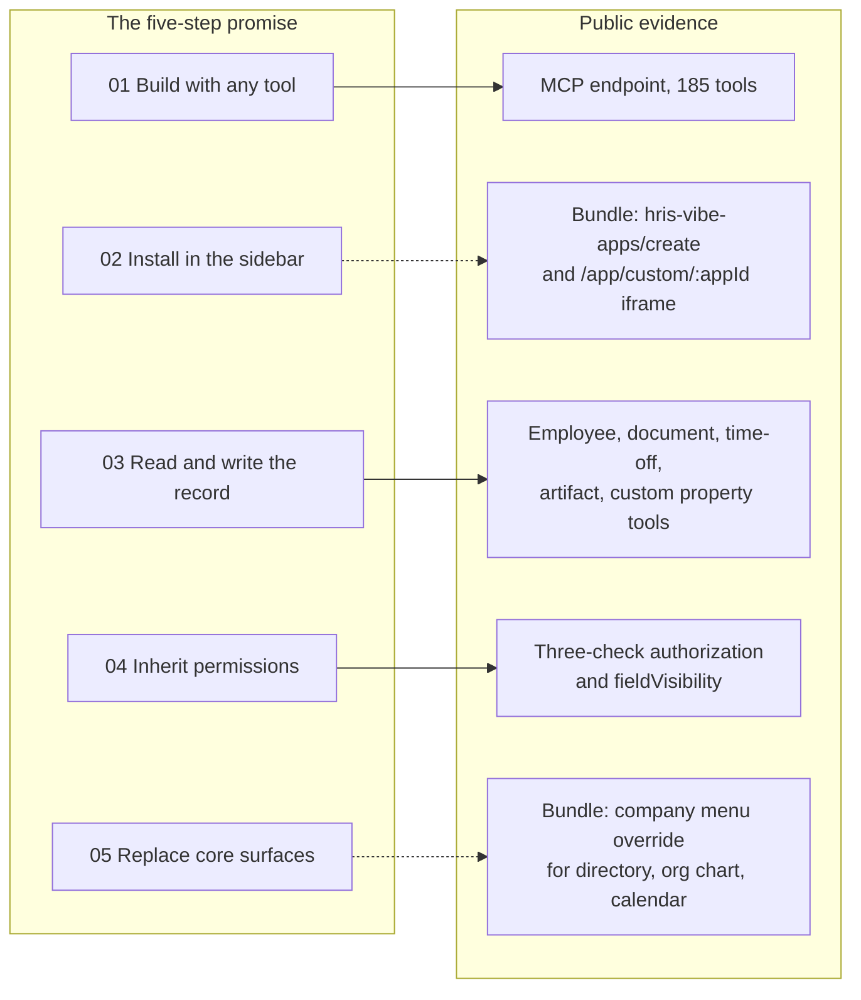
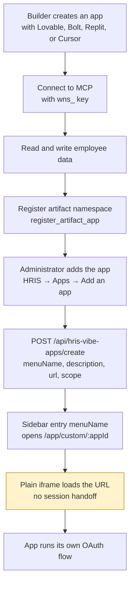

# The Vibe Code Promise

Winslow is an artificial-intelligence (AI) native Human Resources (HR) platform. It sells payroll, benefits, a Human Resources Information System (HRIS), and a Slack-based AI co-worker as one product. "Vibe coding" means building software by describing it to an AI builder instead of writing the code by hand. Winslow's Vibe Code page claims that a customer can vibe code an HR tool and install it into the product.

Three terms recur in this page. The Model Context Protocol (MCP) is an open protocol that lets an AI application call external tools. Winslow runs a public MCP server with 185 tools. An artifact is a typed record that an application attaches to one employee record. A scope is a named permission string attached to a credential.

Citations in the form `file.txt:line` refer to text captures of the public Winslow pages, made on 2026-11-06. `winslow.md` is the site's own machine-readable product file. Code marked "observed" comes from `main.26e32ed8.js`, the 10,006,564-byte JavaScript bundle of the admin application.

The page `/builders/vibe-code/` makes the largest claim on the Winslow website. It says any HR tool a company wishes it had "is a weekend away" (`builders_vibe-code.txt:37`). A customer builds the tool in an artificial-intelligence builder and installs it into Winslow. The tool reads and writes the same employee record under the same permissions as the rest of the product.

This page states the claim exactly, then checks each part against the public evidence. The result is uneven. The data and permission promises are strongly supported. The installation and replacement promises are absent from the public documentation. The compiled admin bundle shows a partial mechanism for both, but compiled code is not a contract.

## The claim, verbatim

The headline is "Vibe code it. Then ship it into Winslow." The opening paragraph says:

> Every HR tool your company wishes it had is a weekend away. Build it in Lovable, Bolt, Replit or Cursor, install it straight into Winslow, and let it read and write the same employee record — under the same permissions — as the rest of the app. (`builders_vibe-code.txt:37`)

The page then gives five numbered steps (`builders_vibe-code.txt:41-61`):

| Step | Heading | Body |
|---|---|---|
| 01 | Build it with the tools you already use | "Lovable · Bolt · Replit · Cursor · anything that speaks HTTP" |
| 02 | Install it right into the app | "Your app, in Winslow's navigation" |
| 03 | Use the employee record as your source of truth | "Read and write, system and custom fields" |
| 04 | Inherit Winslow's permissions | "Server-side, per actor, per field" |
| 05 | Replace parts of Winslow with your own | "Override, don't work around" |

Each step has a supporting paragraph. The most important sentences are:

- **Step 01:** "Winslow's MCP server is the whole product — there is nothing the admin UI can do that your code can't." (`builders_vibe-code.txt:44`)
- **Step 02:** "Register what you built as a Winslow app and it shows up in the sidebar next to payroll and benefits. Same session, same login, same look." (`builders_vibe-code.txt:48`)
- **Step 03:** "Stop syncing spreadsheets. Read employees, comp, departments, documents and time off straight out of Winslow, add your own custom properties, and write back." (`builders_vibe-code.txt:52`)
- **Step 04:** "You don't build an auth system. Your app asks Winslow, and Winslow answers with only the rows and fields that actor is allowed to see — the same layer cake that governs the admin UI and every MCP tool." The step adds: "A manager's view of your app is a manager's view by construction." (`builders_vibe-code.txt:56`)
- **Step 05:** "Don't like our onboarding checklist? Our org chart? Our expense screen? Build yours and swap it in. Winslow's surfaces are replaceable by design." (`builders_vibe-code.txt:61`)

The page also makes a database argument. Internal tools rot because each one starts a copy of the employee list and the copies drift. Winslow is the system of record instead. "Delete the app next quarter and the data is still where it belongs" (`builders_vibe-code.txt:64`).

## The evidence map



A solid arrow means the evidence supports the claim. A dotted arrow means the evidence is partial. The two dotted arrows rest on compiled code, not on published documentation.

| Claim | Status | What the evidence shows |
|---|---|---|
| Build with any HTTP-capable tool | Supported | The MCP endpoint is public, JSON-RPC over Streamable HTTP, with two credential types |
| The MCP server is the whole product | Contradicted | Six operations are REST or interface only, and no admin tool writes a qualifying life event (QLE) election |
| Register an app and it appears in the sidebar | Bundle only | The admin bundle has an "Add an app" form and calls `POST /api/hris-vibe-apps/create`; no public page or MCP tool describes it |
| Same session, same login, same look | Not supported | The bundle loads the app in a plain iframe with no token, session, or `postMessage` handoff |
| Read and write employees, compensation, documents, time off | Supported | Tools exist for each area, with relationship gates |
| Add custom properties | Supported, app-scoped | `create_app_property` requires an administrator and an `appId`; it is not a general schema tool |
| Inherit server-side per-field permissions | Supported | Three ordered checks and four projections, documented per tool |
| Replace onboarding, org chart, or expense screens | Partly supported | The bundle can replace the directory, org chart, and calendar with an external URL; it has no override for onboarding or expenses |
| No permission logic in the app | Supported | The server projects rows and fields; the client cannot widen them |

The exclusions are specific. The MCP reference lists five operations that are REST or interface only (`builders_mcp.txt:1403-1411`). They are Summary Plan Description (SPD) and plan-document attachment upload, plan-document ingest, census and election comma-separated values (CSV) export, broker import, and broker create and update. Termination-payroll deletion, which is the final pay for a departing employee, is a sixth (`builders_mcp.txt:755`). Separately, the catalog states that QLE elections are never written by any tool; they stay employee-attested (`builders_mcp.txt:1411`). Six REST-or-interface exclusions and one rule about QLE elections make seven limits on the "the MCP server is the whole product" claim.

## Step 01: build with anything that speaks HTTP

The transport is real. The endpoint is `POST https://api.usewinslow.com/api/mcp`. It uses Streamable HTTP. That transport sends a JSON-RPC request over an HTTP POST, and the server may answer with a single JSON body or with an event stream. An unauthenticated call returns HTTP 401 with JSON-RPC error code `-32001` and the message "Authentication required to call Winslow MCP tools."

A builder needs a credential first. An administrator creates a key in the workspace settings, or calls `POST /api/mcp-api-keys/{workspaceId}` with a name. The response contains the key once, and the prefix is `wns_`. The admin bundle shows this call, so the screen exists in the product.

A builder connects with an MCP configuration. The exact shape depends on the client, but the essential fields are the URL and a credential header:

```json
{
  "mcpServers": {
    "winslow": {
      "type": "streamable-http",
      "url": "https://api.usewinslow.com/api/mcp",
      "headers": {
        "x-mcp-api-key": "wns_..."
      }
    }
  }
}
```

The server exposes 185 tools in 31 sections. A tool call is ordinary JSON-RPC:

```json
{
  "jsonrpc": "2.0",
  "id": 7,
  "method": "tools/call",
  "params": {
    "name": "get_me",
    "arguments": {}
  }
}
```

`get_me` returns the user behind the key and the linked `employeeRecordId` (`builders_mcp.txt:145-146`). That response tells a builder which person the key acts as. If the field is null, the key is not linked to an employee record, and the builder should find the record with `list_employees`.

The phrase "anything that speaks HTTP" is accurate at the protocol level. A tool does not need a Winslow software development kit. It needs to send JSON-RPC over HTTP and hold a credential. The phrase is less accurate at the product level, because the credential grants a fixed set of scopes and the tool list is fixed.

## Step 02: install it into the sidebar

This is the weakest step, and it is the step that turns an integration into a platform.

Winslow describes the result clearly. The application appears "in the sidebar next to payroll and benefits," with "same session, same login, same look" (`builders_vibe-code.txt:48`). The HRIS page repeats it: "Install it into Winslow so it shows up next to payroll and benefits" (`product_hris.txt:44`). The product file adds "Custom menu items in admin UI — Tools you build externally register as menu items inside Winslow" (`winslow.md:121`).

The public pages do not describe the install. The compiled admin bundle does. The findings below come from `main.26e32ed8.js`, the 10,006,564-byte application bundle. They are evidence of behaviour, not a published contract.

| Piece | Evidence in the bundle |
|---|---|
| Sidebar entry | Each entry renders `e.menuName` and opens `/app/custom/${e.id}` |
| List endpoint | `GET /api/hris-vibe-apps/list` with a workspace identifier |
| Create endpoint | `POST /api/hris-vibe-apps/create` with `{workspaceId, menuName, description, url, scope}` |
| Update endpoint | `POST /api/hris-vibe-apps/update` with `{id, menuName, description, url, scope}` |
| Field limits | Menu name 1 to 20 characters; description at most 200 characters; the URL must resolve to HTTP or HTTPS |
| Visibility | `PERSONAL`, `EVERYONE`, or `ADMIN`; `ADMIN` is available only to an administrator |
| Permission gate | The `apps:manage-apps` scope controls the Apps section and the "Add an app" item |
| Rendering | `/app/custom/:appId` renders `<iframe class="company-menu-custom-frame-iframe" src="{url}" title="{menuName}">` |

The install is therefore a registration of a URL, not a deployment of code. Winslow does not host the application. The customer hosts it, and Winslow adds a sidebar entry that points at it. The entry appears under Human Resources Information System (HRIS) and opens in the main content area.

The iframe is the weak part. It receives a URL and a title, and nothing else. The bundle shows no `sandbox` attribute, no token parameter, no signed URL, and no `postMessage` handshake. A frame from another origin cannot read Winslow's cookies or session. Therefore "same session, same login" cannot be true in the browser sense. The application must run its own OAuth flow and obtain its own token. The phrase can only mean that the entry sits in the same navigation and the frame fills the same content area.

The registration tool `register_artifact_app` is a separate action. It registers a data namespace on the employee record. It is not the sidebar install, although an application normally needs both. The word "app" is overloaded: an artifact app is a namespace, and a vibe app is an external application with a sidebar entry. The public documentation does not connect the two.



The public gap is now narrow. The mechanism exists in the product, and a builder can find it in the bundle. But no public page, MCP tool, or endpoint reference describes it. A builder who follows only the marketing page and the MCP reference cannot complete step 02. A builder who reads the compiled code can.

## Step 03: the employee record as the source of truth

This step is well supported. System fields are the built-in columns such as name, title, department, and salary. Custom fields are typed properties that an application adds to every employee record.

The MCP catalog has a full employee management section:

- `get_employee` returns one record, projected to FULL, SELF, DIRECT_REPORT, or PUBLIC (`builders_mcp.txt:155-161`).
- `list_employees` returns the company directory with PUBLIC fields only (`builders_mcp.txt:162-169`).
- `list_managed_employees` returns the caller plus direct reports with richer relationship-scoped fields (`builders_mcp.txt:170-177`).
- `create_employee`, `update_employee`, and termination tools write to the record.
- Compensation, documents, time off, and custom properties have their own tool groups.

The page says the app can "add your own custom properties." The tool is `create_app_property`. It requires the `admin:manage-customization` scope, an administrator, and an `appId`. The label is prefixed with `{appId}-` (`builders_mcp.txt:1145-1149`). So a vibe app can add typed fields, but only an administrator can create them. A non-administrator builder cannot extend the schema at runtime.

Artifacts are the more natural store for application data. `create_artifact` attaches a record to an employee under an `appId`. The supported types are TEXT, MARKDOWN, IMAGE, FILE, JSON, CARD, and URL (`builders_mcp.txt:1157-1163`). TEXT holds plain text, MARKDOWN holds formatted text, IMAGE and FILE hold uploaded media, JSON holds structured data, CARD holds a small structured display record, and URL holds a link. `content` is the human-readable text of the artifact. `payload` is the structured data that the application reads back. A non-administrator can write only to a namespace that is already registered. The registration rule changed on 2026-07-14: automatic registration was removed, and an unregistered namespace now requires the `admin:manage-artifacts` scope (`builders_mcp.txt:1161-1162`).

```json
{
  "jsonrpc": "2.0",
  "id": 12,
  "method": "tools/call",
  "params": {
    "name": "create_artifact",
    "arguments": {
      "employeeRecordId": "er_...",
      "appId": "equipment-tracker",
      "type": "JSON",
      "content": "Laptop and monitor assignment",
      "payload": {
        "laptop": "MacBook Pro 14",
        "serial": "C02X...",
        "assignedOn": "2026-11-06"
      }
    }
  }
}
```

The "one employee record" argument is real. An app reads the canonical record and attaches its own artifacts. It does not copy the employee list. The claim "delete the app next quarter and the data is still where it belongs" is only partly supported. Artifacts belong to the employee, but there is no documented application-deletion path or retention policy for app-created properties.

One detail weakens the paragraph. The step lists "departments" among the things an app can read and write (`builders_vibe-code.txt:52`). The catalog has `list_departments`, but department writes are not part of the employee tool set. A builder should treat departments as read-only unless a separate tool is found.

## Step 04: inherit permissions

This is the strongest technical claim, and the documentation supports it in detail. Every MCP request passes three checks in order:

1. **Scope.** The credential must hold a scope that the tool lists. A scope is a named permission string, such as `payroll:approve` or `benefits:manage-oe`. The catalog uses 25 of them.
2. **Relationship.** The actor must be the subject, the subject's direct manager, or an administrator. The subject is the employee whose record is read.
3. **Projection.** The response is reduced to one of four field sets:

| Projection | Who receives it | What it contains |
|---|---|---|
| `FULL` | An administrator | The whole record |
| `SELF` | The employee | The fields that an employee may see on their own record |
| `DIRECT_REPORT` | The direct manager | The manager-visible fields of a report |
| `PUBLIC` | Any other workspace member | Directory fields only |

The response carries a `fieldVisibility` field that names the projection applied. A non-report read, which is a read of someone who is not the actor's direct report, does not return an error. It returns the PUBLIC directory view with a `fieldVisibilityNote` (`builders_mcp.txt:160`). The in-app interface does not open non-report profiles; MCP intentionally returns the directory-equivalent view instead.

The "layer cake" is the security page's model of five filtered layers: menu, tab, field, API route, and MCP tool (`builders_security.txt:36-43`). The three checks above run inside the route and tool layers.

The OAuth scope `manage:artifacts` and the MCP scope `admin:manage-artifacts` are two different permissions. The first belongs to the OAuth vocabulary; the second belongs to the tool catalog. Winslow does not publish the mapping between the two vocabularies.

This design gives the promise its force. The client does not receive a full record and then hide fields. The server removes the fields before the response leaves. A bug in the application cannot expose data the application never received.

The permission story has two credential models, and they are not equal:

| Model | Acts as | Scope granularity | Best for |
|---|---|---|---|
| MCP API key (`wns_`) | The workspace member who owns the key | Per-tool scopes listed in the catalog | A trusted internal tool or a builder session |
| OAuth 2.0 token | The user who authorized the app | Seven coarse scopes | An application with a user interface that many people use |

A multi-user application sends each user through `/oauth/authorize`, stores one token for that user, and makes calls with that user's token. The token, not the application, carries the identity.

The OAuth scopes are `read:employees`, `write:employees`, `read:company`, `read:profile`, `read:time-off`, `write:time-off`, and `manage:artifacts`. They are much coarser than the MCP tool scopes. A manager's view still depends on the relationship check, so a coarse scope does not grant access to every record. But the seven scopes cannot express fine distinctions such as "read compensation but not medical benefits."

**Aha:** The promise "a manager's view of your app is a manager's view by construction" is true because the app is not the security boundary. The server is. The same property makes the app less powerful than it looks: it can only do what the acting user could do through MCP. It cannot implement a legitimate workflow that needs cross-record access the user does not have. That is a safety feature and a product constraint at the same time.

## Step 05: replace parts of Winslow

The page names three surfaces to replace: the onboarding checklist, the organization chart, and the expense screen (`builders_vibe-code.txt:61`). It says Winslow's surfaces "are replaceable by design."

The bundle supports a narrower version of the claim. It defines one settings object with three keys:

```javascript
// main.26e32ed8.js (observed, abridged)
COMPANY_MENU_KEYS = ["directory", "orgChart", "calendar"];
// Each key holds { useCustom: boolean, customUrl: string | null }
```

Saving the setting calls `POST /api/workspaces/{workspaceId}/update-company-menus` with a `companyMenuSettings` body. A custom URL must use HTTPS. The page then renders that URL in the custom-frame iframe component.

The replaceable surfaces are therefore the directory, the organization chart, and the calendar. The organization chart is one of the three surfaces that the marketing page names. The onboarding checklist and the expense screen have no matching route, settings key, or bundle string.

"Replace" here means "point a built-in menu destination at an external URL". It does not mean "override a component" or "substitute a route inside the admin application". The built-in screen is bypassed, not modified.

No MCP tool exposes this setting. An administrator must use the interface. A third-party application cannot move its own entry or replace a core screen through the API.

The distinction matters. A custom menu item adds a new surface. A menu override swaps the destination of an existing one. A component override changes how an existing screen works. The bundle supports the first two for three destinations. It supports neither for the onboarding checklist or the expense screen.

The claim is therefore half true. One of the three named surfaces is replaceable, and the mechanism is an iframe, not a component registry. The page presents the capability in the present tense, alongside four other steps that are largely real. That phrasing overstates what the product does today.

## The request path, checked

The page shows a four-step request:

> 01 Your app `GET /employees?department=eng` → 02 Winslow auth resolves the actor behind the key → 03 Permissions drops rows and fields they can't see → 04 Response only what that actor is allowed to read. (`builders_vibe-code.txt:66-79`)

Steps 02 through 04 are accurate. Step 01 is not a documented endpoint. The documented REST base is `/api/employee-records/*`. REST calls need an OAuth bearer token plus an `x-client-token` header with a Universally Unique Identifier version 4 (UUID v4) value. Winslow does not publish the reason for that second header, and the bundle gives no clue. MCP keys are rejected on REST (`winslow.md:498`). The MCP equivalent is a `tools/call`, but the closest documented tool is `list_managed_employees`, not `list_employees`. It returns the caller and direct reports, so it does not reproduce a department listing.

The example is marketing shorthand, not an API contract. A builder who copies it will receive a 404, because the route does not exist, or a 401, because the credential is wrong. The correct path is one of these:

```http
# REST path
GET /api/employee-records/workspace/{workspaceId}?department=eng HTTP/1.1
Host: api.usewinslow.com
Authorization: Bearer <oauth-access-token>
x-client-token: 3f1c9a2e-8b7d-4c6a-9e0f-2d5b8a1c7e44
```

```json
{"jsonrpc":"2.0","id":3,"method":"tools/call",
 "params":{"name":"list_managed_employees",
           "arguments":{"employeeTypes":["US_FULL_TIME"]}}}
```

The second call does not filter by department. The catalog's employee list tools filter by employee type, future start, inactive, and terminated status. The REST example keeps the marketing page's department filter, but Winslow does not publish whether the route accepts it. A department filter may exist on another tool, but it is not in the documented parameter list. This is a small example of a larger pattern: the marketing page describes an intuitive API, and the real API is more constrained.

## What would make the promise true

The gap is narrow and specific. Winslow could close it with four public artifacts:

1. **Public documentation of the install.** The `hris-vibe-apps` endpoints already exist. Winslow could publish them, or add an MCP tool that wraps them.
2. **A session and authentication contract.** The iframe receives only a URL. Winslow could define how the app learns the acting user, for example with a signed frame token or a documented `postMessage` handshake.
3. **A published list of replaceable surfaces.** The company menu setting covers three destinations. Winslow could state that list and expose the setting through the API.
4. **A public example.** One working repository that a builder can clone, point at a workspace, and install.

Without these, the promise rests on reverse engineering. With them, it would be one of the most distinctive platform offerings in HR software.

## The honest summary

| Part of the promise | Verdict |
|---|---|
| Any HTTP-capable builder can connect | True |
| The whole product is available over MCP | False as written; six documented exclusions |
| An app can read and write the employee record | True, within scopes and relationship gates |
| An app inherits permissions server-side | True, and well designed |
| An app can add custom fields | True, but only an administrator can create them |
| An app can be installed in the sidebar | True in the product; not publicly documented |
| An app can replace core Winslow screens | Partly true: directory, org chart, and calendar only |
| An app needs no database of its own | Mostly true; artifacts cover per-employee data. A cross-employee entity, such as an equipment inventory, needs one artifact per employee or a store of its own |

## Where to go next

Read [Building and installing a vibe app](05-building-and-installing-a-vibe-app.md) for a practical recipe and the exact point where public instructions stop. Read [the MCP server](06-the-mcp-server.md) for the authorization model in full.
