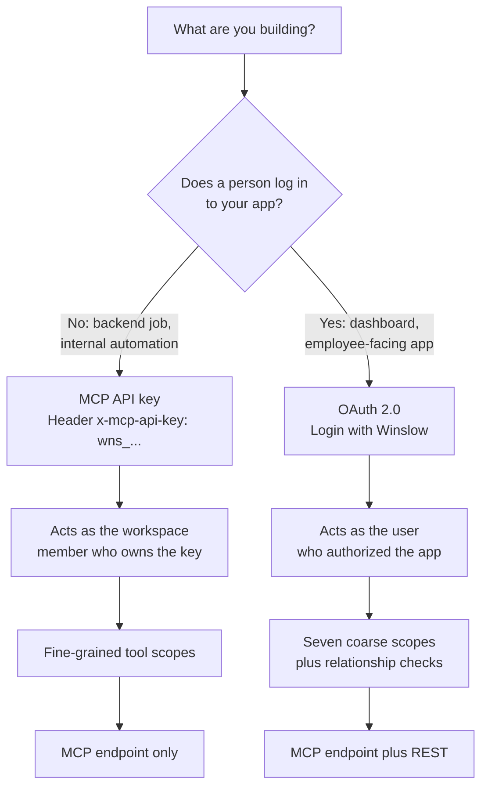
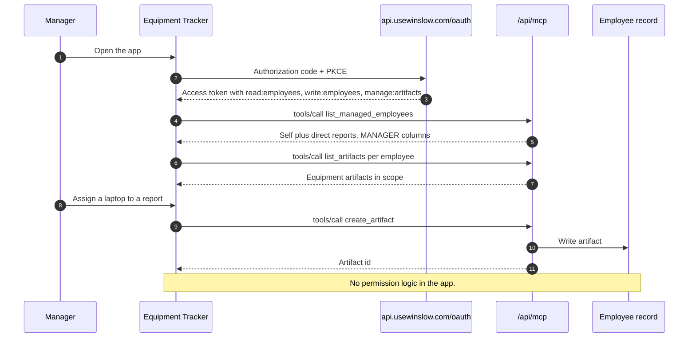

# Building and Installing a Vibe App

Winslow is an artificial-intelligence (AI) native Human Resources (HR) platform. It sells payroll, benefits, a Human Resources Information System (HRIS), and a Slack-based AI co-worker as one product. A **vibe app** is an application that a customer builds with an AI builder and installs into Winslow's navigation.

Five terms recur. The **Model Context Protocol (MCP)** is an open protocol that lets an AI application call external tools; Winslow's MCP server exposes 185 tools. A **tool** is one callable action with a name, arguments, and a required **scope**, which is a named permission string. A **workspace** is one customer tenant. An **artifact** is a typed record that an application attaches to one employee. A **projection** is the response field set: `FULL`, `SELF`, `DIRECT_REPORT`, or `PUBLIC`.

Citations such as `builders_mcp.txt:46` refer to text captures of the public Winslow pages, made on 2026-11-06. Code marked "observed" comes from `main.26e32ed8.js`, the JavaScript bundle of the admin application.

This page is a practical guide. It shows what a builder can do today, in the order the work happens. It also marks the exact point where the public instructions stop: the install section is reconstructed from the bundle, not from a published guide.

The example application is an equipment tracker. It records the laptop, monitor, and accessories assigned to each employee, and it shows a manager what their direct reports hold. It is small enough to build in an afternoon and realistic enough to exercise the permission model.

## Prerequisites

A builder needs four things:

1. A Winslow workspace. The free plan gives $100 of co-worker credits and needs no credit card (`pricing.txt:40-50`).
2. An MCP API key with the prefix `wns_`, or an OAuth application registration.
3. An MCP-capable client: Cursor, Claude, ChatGPT with a custom connector, Lovable, Bolt, Replit, or a program that sends HTTP. Cursor is an AI code editor, Claude and ChatGPT are AI assistants, and Lovable, Bolt, and Replit are AI application builders.
4. A place to host the application's user interface, if it has one.

Winslow does not publish the key-creation screen in the pages reviewed here. The admin bundle shows the calls behind it: `GET /api/mcp-api-keys/{workspaceId}` lists the keys, and `POST /api/mcp-api-keys/{workspaceId}` with `{name}` creates one. The create response contains a `rawKey` field, which the interface shows once. The key is workspace-scoped: it resolves the workspace automatically (`builders_mcp.txt:46`). Treat the precise menu path as an interface detail, not a contract.

## Choose the credential model

The two credential models serve different products.



| Question | MCP API key | OAuth 2.0 |
|---|---|---|
| Who is the actor? | The workspace member who owns the key | The user who authorized the app |
| Header | `x-mcp-api-key: wns_...` | `Authorization: Bearer <token>` |
| Works on REST? | No, rejected by design | Yes, with `x-client-token` |
| Scope style | Per-tool scopes in the catalog | Seven coarse scopes |
| Good for | A trusted backend, a builder session, an internal scheduled job | A user-facing application with many users |
| Revocation | Delete the key | Revoke the token or deactivate the app |

Winslow recommends OAuth for "anything user-facing" and calls it "the recommended default for third-party apps" (`builders_mcp.txt:56`). The recommendation is sound. A key is a shared secret with a fixed identity. An OAuth token carries the identity of the person who consented.

## Connect the builder

Most MCP clients accept a JSON configuration file. The exact key name differs by client, but the fields are the same:

```json
{
  "mcpServers": {
    "winslow": {
      "type": "streamable-http",
      "url": "https://api.usewinslow.com/api/mcp",
      "headers": {
        "x-mcp-api-key": "wns_REPLACE_ME"
      }
    }
  }
}
```

For a raw HTTP client, send the initialization request first. It returns a session identifier in the `mcp-session-id` response header. Echo that header on later requests.

```http
POST /api/mcp HTTP/1.1
Host: api.usewinslow.com
Content-Type: application/json
Accept: application/json, text/event-stream
x-mcp-api-key: wns_REPLACE_ME

{"jsonrpc":"2.0","id":1,"method":"initialize",
 "params":{"protocolVersion":"2025-06-18","capabilities":{},
           "clientInfo":{"name":"equipment-tracker","version":"0.1.0"}}}
```

## Discover the workspace and the caller

Three tools should run before any other call.

| Order | Tool | Purpose |
|---|---|---|
| 1 | `get_workspace` | Confirm the workspace tied to the key |
| 2 | `get_me` | Resolve the caller's `employeeRecordId` |
| 3 | `get_api_docs` | Read the current API guide or the tool matrix |

`get_me` is the important one. If it returns a null `employeeRecordId`, the key's owner is not linked to an employee record (`builders_mcp.txt:145-146`). Most employee-scoped tools then fail the relationship check. The builder must either link the key owner to a record or use an administrator key.

`get_api_docs({ section: "matrix" })` returns the per-tool reference as JSON. Winslow says the documentation page is checked against that matrix on every build (`builders_mcp.txt:71`). A builder should prefer the live matrix over any cached page.

```json
{"jsonrpc":"2.0","id":2,"method":"tools/call",
 "params":{"name":"get_me","arguments":{}}}
```

```json
{"jsonrpc":"2.0","id":2,"result":{
  "employeeRecordId":"er_01H...",
  "workspaceId":"ws_01H...",
  "role":"ADMIN"
}}
```

The response fields above are illustrative. The real response includes the user and record identifiers; the exact key names are not published in the pages reviewed.

## Read the employee record

Winslow has three employee read tools, and they return different amounts of data.

| Tool | Rows returned | Field projection | Use it for |
|---|---|---|---|
| `get_employee` | One record | FULL, SELF, DIRECT_REPORT, or PUBLIC | A detail page for one person |
| `list_employees` | Every record in the workspace | PUBLIC fields only | A company directory |
| `list_managed_employees` | The caller plus direct reports; administrators see everyone | Relationship-scoped per row | A manager dashboard |

The difference is the whole permission model in one table. `list_employees` returns every row, including non-reports, but only the columns that the company directory shows (`builders_mcp.txt:168`). `list_managed_employees` returns fewer rows but richer columns (`builders_mcp.txt:176`). An application that needs compensation must use the managed list, not the directory list.

```json
{"jsonrpc":"2.0","id":3,"method":"tools/call",
 "params":{"name":"list_managed_employees",
           "arguments":{"employeeTypes":["US_FULL_TIME"],
                        "includeInactive":false}}}
```

The documented filters are employee type, future start, inactive, terminated, and workspace. A department filter is not in the parameter list. The marketing page's example, `GET /employees?department=eng`, does not match the documented tools (`builders_vibe-code.txt:69`). A builder who needs a department filter should fetch the managed list and filter in the application, or check the live matrix for a newer parameter.

## Write to the record

The equipment tracker needs one write per assignment. A system field update uses `update_employee`. An app-specific record uses `create_artifact`. A new structured field uses `create_app_property`.

### Option A: an artifact (recommended)

Artifacts are app-scoped records attached to an employee. They accept seven types: TEXT, MARKDOWN, IMAGE, FILE, JSON, CARD, and URL (`builders_mcp.txt:1157-1163`). A JSON artifact can hold the equipment assignment without changing the employee schema.

```json
{"jsonrpc":"2.0","id":4,"method":"tools/call",
 "params":{"name":"create_artifact",
           "arguments":{
             "employeeRecordId":"er_01H...",
             "appId":"equipment-tracker",
             "type":"JSON",
             "content":"Laptop and monitor assignment",
             "payload":{"laptop":"MacBook Pro 14","serial":"C02X...",
                        "monitor":"Dell U2723QE","assignedOn":"2026-11-06"}
           }}}
```

Before a non-administrator can write to `equipment-tracker`, an administrator must register the namespace:

```json
{"jsonrpc":"2.0","id":5,"method":"tools/call",
 "params":{"name":"register_artifact_app",
           "arguments":{"appId":"equipment-tracker",
                        "name":"Equipment Tracker",
                        "description":"Laptop and monitor assignments"}}}
```

The registration tool requires the `admin:manage-artifacts` scope and is limited to administrators (`builders_mcp.txt:1180-1185`). Automatic registration was removed on 2026-07-14. This is a required setup step, not an optional one. A builder who skips it receives a refusal when a non-administrator writes.

### Option B: a custom property

A custom property is a typed field on every employee record. The supported types are SHORT, LONG, RICH, PHONE, NUMBER, CURRENCY, EMAIL, DATE, CHECKBOX_SINGLE, CHECKBOX_MULTIPLE, DROPDOWN, RADIO, FILE, and ADDRESS (`builders_mcp.txt:1148`). The label is prefixed with `{appId}-`, and creation requires the `admin:manage-customization` scope.

Custom properties are better for data that the rest of the product should see, such as a security clearance or a shirt size. Artifacts are better for application-private data that should not widen the core schema.

## Build the application

The application has three screens:

1. **My equipment** shows the artifacts attached to the signed-in employee.
2. **My team** shows the equipment of direct reports.
3. **Assign** creates or updates an artifact for a chosen employee.

The permission model does most of the work. The application does not filter by role. It calls the tools with the user's token, and the server returns only what that user may see.



### The OAuth flow

Winslow supports OAuth 2.0 discovery, public clients with Proof Key for Code Exchange (PKCE), and dynamic client registration under RFC 7591. The flow is standard:

1. Register the client at `/oauth/register`, or use the MCP tool `register_oauth_app`.
2. Send the user to `/oauth/authorize` with a code challenge.
3. Receive a code at the redirect Uniform Resource Identifier (URI).
4. Exchange the code at `/oauth/token` with the code verifier.
5. Call MCP or REST with the access token.

```http
POST /oauth/token HTTP/1.1
Host: api.usewinslow.com
Content-Type: application/x-www-form-urlencoded

grant_type=authorization_code
&code=AUTH_CODE
&redirect_uri=https%3A%2F%2Fequipment.example.com%2Fcallback
&client_id=CLIENT_ID
&code_verifier=VERIFIER
```

The redirect URI must include every runtime origin: local development, preview, and production. Winslow says to derive the redirect URI from `window.location.origin`, never from a build-time value (`winslow.md:499`). This is a practical instruction that prevents a common failure.

### Calling REST instead of MCP

REST is useful when the application needs a plain HTTP interface rather than JSON-RPC. JSON-RPC is the message format that MCP uses: a JSON body with a method name, an identifier, and parameters. The base paths are `/api/employee-records/*`, `/api/employee-artifacts/*`, and `/api/artifact-apps/*`. Every call needs two headers:

```http
GET /api/employee-records/workspace/ws_01H... HTTP/1.1
Host: api.usewinslow.com
Authorization: Bearer <oauth-access-token>
x-client-token: 3f1c9a2e-8b7d-4c6a-9e0f-2d5b8a1c7e44
```

The `x-client-token` is a UUID v4 generated by the client. MCP keys are rejected on REST by design (`winslow.md:498`). REST responses are wrapped in a `{"data": ...}` object.

## Install the application

The public pages do not explain this step. The compiled admin bundle does explain it. The evidence below comes from `main.26e32ed8.js`. It shows how the product behaves today, but it is not a published contract.

An administrator opens HRIS, then Apps, then "Add an app". The form collects four values:

| Field | Rule |
|---|---|
| Menu name | 1 to 20 characters; this text appears in the sidebar |
| Description | At most 200 characters |
| URL | HTTP or HTTPS; a missing scheme becomes `https://` |
| Scope | `PERSONAL`, `EVERYONE`, or `ADMIN`; `ADMIN` is available only to an administrator |

The form calls `POST /api/hris-vibe-apps/create` with `{workspaceId, menuName, description, url, scope}`. An edit calls `POST /api/hris-vibe-apps/update` with `{id, menuName, description, url, scope}`. The Apps section and the "Add an app" item are both gated by the `apps:manage-apps` scope.

The sidebar renders each entry with its `menuName`. A click navigates to `/app/custom/{id}`, which loads the application in an iframe:

```javascript
// main.26e32ed8.js (observed, abridged)
<iframe className="company-menu-custom-frame-iframe"
        title={title} src={src} />
```

The iframe receives a URL and a title, and nothing else. The bundle shows no `sandbox` attribute, no token parameter, no signed URL, and no `postMessage` handshake. A frame from another origin cannot read Winslow's cookies. Therefore the application must run its own OAuth flow with Proof Key for Code Exchange (PKCE), as described above. "Same look" is achievable with styling. "Same session" is not.

Five questions remain open:

1. Is the `hris-vibe-apps` endpoint public and stable, or internal to the admin application?
2. Does the server enforce the same field limits as the form?
3. How are `PERSONAL` and `EVERYONE` enforced for a viewer who does not hold `apps:manage-apps`?
4. Is there a content security policy or frame allowlist on the Winslow side?
5. What happens to artifacts and custom properties when an app entry is deleted?

A builder has three practical options:

1. **Use the interface.** An administrator registers the app through HRIS → Apps. This is the only supported path today.
2. **Ask Winslow.** The company can confirm the endpoint, the limits, and the visibility rules. A written answer would turn this section from inference into fact.
3. **Ship outside the sidebar.** A standalone web application that uses OAuth still delivers most of the value. It reads and writes the same record under the same permissions. It does not get the single navigation.

The honest conclusion is that the data plane is real and well designed. The presentation plane exists but is undocumented. A builder can complete the install from the interface, but not from the public instructions.

## Test checklist

Before trusting the application, test these cases:

| # | Test | Expected result |
|---|---|---|
| 1 | Call `get_me` with a non-employee key | `employeeRecordId` is null |
| 2 | Call `get_employee` for a stranger | PUBLIC projection with `fieldVisibilityNote` |
| 3 | Call `list_employees` | Every row, PUBLIC columns only |
| 4 | Call `list_managed_employees` as a manager | Self and direct reports, MANAGER columns |
| 5 | Write an artifact to an unregistered `appId` as a non-admin | Refusal; register the namespace first |
| 6 | Write an artifact to a registered `appId` as a manager | Success if the target is a direct report |
| 7 | Call a payroll tool without its scope | `AUTH_DENIED` with `kind: 'scope'` |
| 8 | Call a REST route with a `wns_` key | Rejected; REST needs OAuth |
| 9 | Use an access token belonging to a non-report | No sensitive fields in the response |

## Security rules for the builder

1. **Never ship a `wns_` key in a browser.** It is a workspace secret. Put it in a backend, or use OAuth.
2. **Request the smallest scope set.** The seven OAuth scopes are coarse, but a read-only application should not request `write:employees`.
3. **Do not cache employee data longer than needed.** The server enforces access at request time. A local cache outlives a permission change.
4. **Treat the `fieldVisibility` value as data.** Log it, and show a restricted view when the projection is PUBLIC.
5. **Use the audit log.** Agent and application writes are first-class events. A write that cannot be attributed is a design smell.
6. **Register the namespace before launch.** The 2026-07-14 change removed the automatic path.

**Aha:** The most important part of the builder experience is invisible. The application does not implement roles, field filters, or audit. It calls tools and renders what comes back. That is why the promise is credible even though the install step is undocumented: the hard part, authorization, is already solved. The easy part, a sidebar entry, exists in the product but not in the public instructions.

## Where to go next

Read [the MCP server](06-the-mcp-server.md) for the protocol and the authorization checks in full, or [the tool catalog](07-the-tool-catalog.md) for the exact tool signatures this recipe uses.
