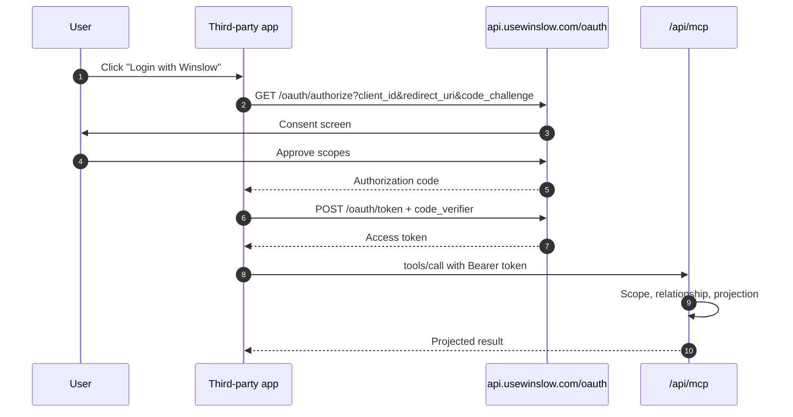
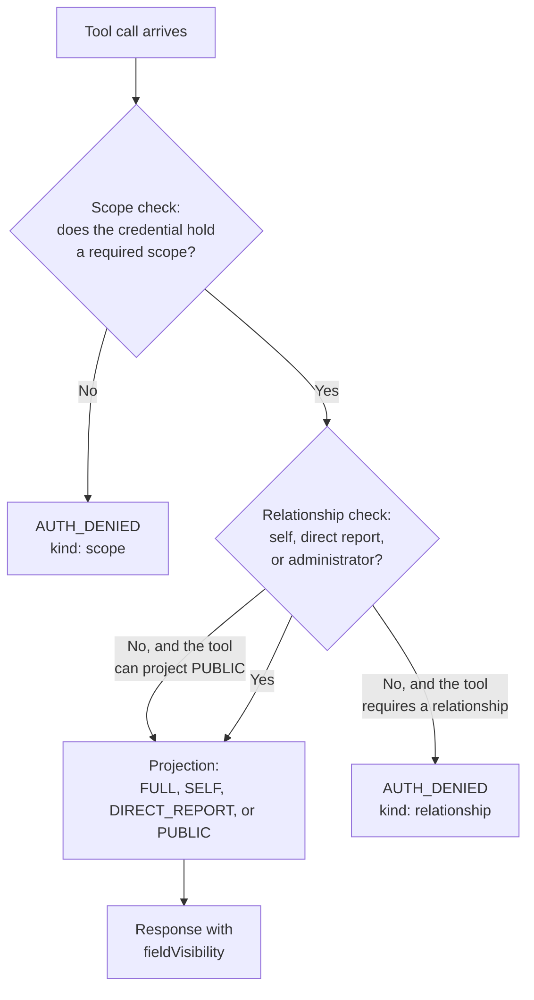

# The MCP Server

Winslow is an artificial-intelligence (AI) native Human Resources (HR) platform. It sells payroll, benefits, a Human Resources Information System (HRIS), and a Slack-based AI co-worker as one product. The **Model Context Protocol (MCP)** server is Winslow's public product interface. It exposes 185 tools in 31 sections over a single endpoint. This page explains the protocol, the two authentication paths, the three authorization checks, the four projections, and the error model. It also separates what is documented from what is merely implied; the marker **INFERRED** labels a claim this exploration draws rather than one Winslow states.

Terms used on this page. A **tool** is one callable action with a name, arguments, and a required **scope** (a named permission string). A **section** is a named group in the reference, such as "Payroll" or "Benefits"; it is documentation structure, not a runtime namespace. The **catalog** means the tool list in the public reference. A **workspace** is one customer tenant: its employees, keys, applications, and settings. A **workspace member** is one user account inside it. An **administrator** is a member with the administrative role in that workspace. The **subject** is the employee record that a call targets. A **direct report** is an employee whose manager field names the caller. An **artifact** is a typed record that an application attaches to one employee. A **builder** is the developer who writes the third-party application. **Open enrollment (OE)** is the annual window when employees choose benefits; a **qualifying life event (QLE)** is an allowed change outside that window, such as a marriage. A **Summary Plan Description (SPD)** is the document that describes an insurance plan. A **census** is the employee roster that a carrier or broker uses. A **broker** is the licensed intermediary that sells and administers insurance plans.

Citations such as `builders_mcp.txt:46` refer to text captures of the public Winslow pages, made on 2026-11-06. `winslow.md` is the site's own machine-readable product file, also captured on that date.

## What MCP is

MCP is an open protocol for connecting an artificial-intelligence (AI) application to external tools and data. A client, such as Claude, ChatGPT, Cursor, or an AI application builder, connects to a server. The server advertises tools. The client calls a tool with arguments. The server returns a result. "AI application builder" means a tool such as Lovable, Bolt, or Replit that generates an application from a description.

Winslow implements the server side. Its tools are not a thin read-only wrapper. The catalog marks 102 tools as writes and 83 as reads. The writes include payroll approval, employee termination, benefits enrollment, and document upload.

## Endpoint and transport

| Property | Value |
|---|---|
| Endpoint | `https://api.usewinslow.com/api/mcp` |
| Transport | Streamable HTTP |
| Protocol | JSON-RPC 2.0 |
| Session header | `mcp-session-id`, returned on initialize, echoed later |
| Response types | `application/json` or `text/event-stream` |
| Authentication | MCP API key or OAuth 2.0 bearer token |

An unauthenticated request receives a JSON-RPC error with HTTP status 401. This is the first proof that the endpoint is a real protocol server, not an HTML application behind a login page.

```http
POST /api/mcp HTTP/1.1
Host: api.usewinslow.com
Content-Type: application/json
Accept: application/json, text/event-stream

{"jsonrpc":"2.0","id":1,"method":"initialize",
 "params":{"protocolVersion":"2025-06-18","capabilities":{},
           "clientInfo":{"name":"probe","version":"0.0.1"}}}
```

```json
{"jsonrpc":"2.0","id":1,
 "error":{"code":-32001,
          "message":"Authentication required to call Winslow MCP tools."}}
```

The server uses the standard MCP lifecycle: `initialize`, then `notifications/initialized`, then `tools/list` and `tools/call`. The public documentation does not state which protocol versions the server accepts. A client should send a recent version and fall back if the server rejects it.

## The two authentication paths

### Path 1: the MCP API key

An API key has the prefix `wns_`. It is workspace-scoped: the key resolves the workspace automatically (`builders_mcp.txt:46`). The key acts as the workspace member who owns it, with that member's scopes (`builders_mcp.txt:55`).

The documentation gives two header forms:

- `x-mcp-api-key: wns_...` in `/winslow.md` and the quick-connect block;
- `Authorization: Bearer <api-key>` in the human MCP page (`builders_mcp.txt:53`).

Both are published. The exact precedence when both are present is not documented. A builder should use one form consistently.

The key is suitable for a trusted backend, an internal automation, or a builder session. It is not suitable for a browser. A key shipped to a client is a workspace secret exposed to every user of that client.

### Path 2: OAuth 2.0 ("Login with Winslow")

OAuth is the recommended path for "anything user-facing" (`builders_mcp.txt:56`). It supports discovery, public clients with Proof Key for Code Exchange (PKCE), and dynamic client registration under RFC 7591.

| Endpoint | Purpose |
|---|---|
| `GET /.well-known/oauth-authorization-server` | Authorization server metadata |
| `GET /oauth/authorize` | User consent and authorization code |
| `POST /oauth/token` | Code exchange and token refresh |
| `GET /oauth/userinfo` | User identity |
| `POST /oauth/register` | Dynamic client registration |
| `GET /.well-known/jwks.json` | Public keys for token verification |

The metadata document observed on 2026-11-06 advertises these values:

```json
{
  "issuer": "https://api.usewinslow.com",
  "authorization_endpoint": "https://api.usewinslow.com/oauth/authorize",
  "token_endpoint": "https://api.usewinslow.com/oauth/token",
  "userinfo_endpoint": "https://api.usewinslow.com/oauth/userinfo",
  "registration_endpoint": "https://api.usewinslow.com/oauth/register",
  "scopes_supported": [
    "read:employees", "write:employees", "read:company",
    "read:profile", "read:time-off", "write:time-off",
    "manage:artifacts"
  ],
  "code_challenge_methods_supported": ["S256"]
}
```

The seven OAuth scopes are coarse. They describe broad areas: employees, company, profile, time off, and artifacts. The MCP catalog uses a different and much larger scope set, with names such as `payroll:approve`, `benefits:manage-oe`, and `admin:manage-artifacts`. The catalog contains 25 distinct MCP scopes. Winslow does not publish the mapping from the seven OAuth scopes to the 25 MCP scopes.

This is a significant gap. A third-party application requests `write:employees`. Which MCP tools does that token unlock? The relationship check still applies, so the token cannot read a stranger's record. But the scope boundary is unclear. A builder cannot reason about least privilege from the public documentation alone.



### Dynamic registration

An application can register itself at `/oauth/register`, or an administrator can use the MCP tool `register_oauth_app`. The tool returns credentials, environment variables, the authorize Uniform Resource Locator (URL), and ready-to-paste code. The client secret is shown once and cannot be retrieved later (`winslow.md:470`).

Redirect Uniform Resource Identifiers (URIs) must include every runtime origin: local development, preview, and production. Winslow recommends deriving the redirect URI from `window.location.origin`, never from a build-time value. The update tool supports a loopback wildcard such as `http://localhost:*/callback` for development.

Deleting an OAuth application deactivates it. Existing tokens continue to work for no more than 30 days after the deletion, and no new tokens are issued (`winslow.md:473`). The 30 days is a ceiling on the post-deletion window. It is not a stated access-token lifetime, which the documentation does not give.

## The three authorization checks

Every tool call runs the same three checks in the same order (`builders_mcp.txt:59-65`). A tool can record a documented exception. Some tools bypass the relationship check, and a read of a record outside the caller's relationships degrades to the PUBLIC view instead of failing. Those two exceptions are described below.



### Check 1: scope

A tool lists one or more required scopes. If the tool lists several, the caller needs any one of them (`builders_mcp.txt:65`). A failure returns `AUTH_DENIED` with `kind: 'scope'`.

### Check 2: relationship

The target record must be the caller's own, a direct report's, or visible to an administrator. The reference states two outcomes that appear to conflict, and the reader must hold both:

- a relationship miss returns `AUTH_DENIED` with `kind: 'relationship'` (`builders_mcp.txt:61`);
- "Reading an employee who isn't you or your report returns the PUBLIC directory view, not an error" (`builders_mcp.txt:64`).

The consistent reading, which is **INFERRED**, is that the two rules apply to different tool classes. A write, and a read whose target is a single owned object such as a payroll run, needs the relationship and fails without it. A read of an employee record can always fall back to the directory projection, so it returns PUBLIC. The documentation does not publish the class of each tool. A builder should read the `Who` row for the specific tool in [the tool catalog](07-the-tool-catalog.md).

Some tools deliberately bypass this check when the caller holds a powerful scope. For example, `payroll:manage-payrolls` allows `list_payroll_paystubs` for a whole payroll run, and `benefits:manage-oe` allows `admin_update_election` with no ownership check at all. The catalog documents these cases per tool. They are the main exception to the per-actor rule: the acting user is still named in the audit log, but the target need not be that user's record.

### Check 3: projection

The projection decides which columns return. It is not a separate authorization decision; it is the shape of an allowed response.

| Projection | Who receives it | What it contains |
|---|---|---|
| `FULL` | An administrator | The full record |
| `SELF` | The subject | The employee-visible columns for their own record |
| `DIRECT_REPORT` | The subject's direct manager | The manager-visible columns |
| `PUBLIC` | Any other workspace member | Directory columns only, with sensitive fields removed |

The column sets are names in the documentation, not published lists. The pages reviewed do not enumerate which fields belong to SELF, DIRECT_REPORT, or PUBLIC; they name the levels and show one PUBLIC example. A builder who needs a specific field must test it under the target user's token.

A non-report read returns the PUBLIC directory view with a `fieldVisibilityNote` that marks the record as restricted (`builders_mcp.txt:64`). The in-app interface does not open a non-report profile at all. Winslow makes MCP return the directory-equivalent view instead. The security reason is **INFERRED**. A directory view is already visible to every member inside the product, so the same view adds no exposure to a tool call, while a denial would break directory-style applications.

The response names the projection in a `fieldVisibility` field. That field is the application's signal that it is showing a restricted view. The documentation shows `fieldVisibility` and `fieldVisibilityNote` only in a PUBLIC response. It does not say whether the other three projections also carry them, so a client should treat the field as optional.

```json
{
  "employeeRecordId": "er_01H...",
  "firstName": "Priya",
  "lastName": "Raman",
  "department": "Engineering",
  "fieldVisibility": "PUBLIC",
  "fieldVisibilityNote": "Restricted directory view. Sensitive fields are omitted."
}
```

The values in the example are illustrative. The field names `fieldVisibility` and `fieldVisibilityNote` are documented.

## Reading versus listing

The projection model produces a subtle distinction that builders must understand:

- `list_employees` returns every record in the workspace, but every row uses PUBLIC columns. It is a directory.
- `list_managed_employees` returns the caller plus direct reports, with richer SELF and DIRECT_REPORT columns. It is the "Manage Employees" view.
- `get_employee` returns one record, projected to the caller's relationship.

A builder who uses `list_employees` and expects compensation will receive a directory. A builder who uses `list_managed_employees` and expects the whole company will receive only their own span of control. Neither tool is wrong. They answer different questions.

## Scopes in the catalog

The 25 MCP scopes fall into families:

| Family | Scopes |
|---|---|
| Employee data | `employee:manage-data`, `self:manage-data`, `employee:add` |
| Employee documents | `employee:manage-documents`, `self:manage-documents`, `employee:manage-payroll`, `self:manage-payroll`, `employee:manage-benefits`, `self:manage-benefits` |
| Benefits | `benefits:manage-plans`, `benefits:manage-oe`, `benefits:manage-qle` |
| Payroll | `payroll:manage-payrolls`, `payroll:approve`, `payroll:manage-adjustments`, `payroll:manage-invoices` |
| Invoices | `employee:manage-invoices`, `self:manage-invoices` |
| Time off | `time-off:manage-requests`, `self:manage-requests` |
| Termination | `employee:terminate` |
| Administration | `admin:manage-artifacts`, `admin:manage-customization` |
| Automation | `agents:automate`, `agents:manage` |

The naming convention is `resource:action`. The `self:` prefix marks a scope that works only on the caller's own record. The `admin:` prefix marks workspace-level configuration.

## Tool discovery

A client discovers tools in three ways:

1. The MCP `tools/list` method returns the server's current tool list.
2. The MCP tool `get_api_docs({ section: "matrix" })` returns the per-tool reference as JSON.
3. The human page at `/builders/mcp/` lists all 185 tools with scopes and rules.

Winslow says the documentation page is checked against the live matrix on every build (`builders_mcp.txt:71`). `/winslow.md` says the catalog was verified against the production server on 2026-09-10 (`winslow.md:256`). The two dates differ, so a reader cannot tell whether the counts are current. A builder should treat the live `get_api_docs` output as the source of truth, not a cached page.

```json
{"jsonrpc":"2.0","id":2,"method":"tools/list","params":{}}
```

```json
{"jsonrpc":"2.0","id":3,"method":"tools/call",
 "params":{"name":"get_api_docs","arguments":{"section":"authz"}}}
```

## The error model

The documentation names four error codes (`builders_mcp.txt:64`):

| Code | Meaning | Typical cause |
|---|---|---|
| `AUTH_DENIED` | Authorization failed | Missing scope or relationship |
| `VALIDATION_ERROR` | Input failed validation | Bad date, missing field, invalid state transition |
| `ENTITY_NOT_FOUND` | The target does not exist in this workspace | Wrong identifier, or a record that does not resolve under this credential. A record that exists but is outside the caller's relationship returns PUBLIC on a read tool, not this error |
| `BAD_REQUEST` | The request is malformed | Invalid JSON-RPC, unknown tool, bad parameter type |

`AUTH_DENIED` carries a `kind` field with the value `scope` or `relationship`. The distinction is useful for debugging. A scope error means the credential is wrong. A relationship error means the actor is wrong.

The catalog adds many state-specific rules that surface as `VALIDATION_ERROR`. Examples include a coverage effective date that is not the first or fifteenth of the month. They also include a payroll approval after the Check deadline, or an election update after the enrollment period closes. [The tool catalog](07-the-tool-catalog.md) lists the major rules.

## MCP versus REST

Winslow exposes two HTTP interfaces, and they are not interchangeable.

| Property | MCP | REST |
|---|---|---|
| Path | `/api/mcp` | `/api/employee-records/*`, `/api/employee-artifacts/*`, `/api/artifact-apps/*` |
| Protocol | JSON-RPC 2.0 | Representational State Transfer (REST) |
| Credential | `wns_` key or OAuth bearer | OAuth bearer only |
| Extra header | `mcp-session-id` | `x-client-token: <UUID v4>` |
| Response shape | Tool-specific JSON | Wrapped in `{"data": ...}` |
| Key support | Yes | No; `wns_` keys are rejected |

The `x-client-token` is a Universally Unique Identifier version 4 (UUID v4) generated by the client. Its purpose is not documented beyond the header requirement. It may support request tracing or idempotency; that is **INFERRED**.

REST has capabilities that MCP does not. The MCP reference lists six deliberate exclusions (`builders_mcp.txt:1403-1411`). They are SPD and plan-document attachment upload, plan document ingest, census and election comma-separated values (CSV) export, broker import, broker create and update, and QLE elections. Termination-payroll deletion is also REST or interface only (`builders_mcp.txt:755`). "Interface" means the admin web application.

The Vibe Code page claims that "there is nothing the admin UI can do that your code can't" (`builders_vibe-code.txt`). The exclusions do not contradict that sentence, because a REST client can still perform them. They do contradict a stronger claim that the page also implies: that every capability is available through MCP. The correct statement is narrower. MCP covers the data plane except for those exclusions; REST and the interface cover the rest.

## Events and webhooks

Domain actions persist to `winslow_event_log` and fan out through two subscription channels (`winslow.md:501`):

1. **Agent subscriptions.** The MCP tool `subscribe_event` registers a prompt that runs when an event fires. Preferred keys are business moments such as `employee.compensation_changed`, `employee.manager_changed`, `employee.department_changed`, and `employee.terminated`. A subscriber can also use an `(objectType, eventKey)` pair or `*`.
2. **Outbound webhooks.** An administrator configures a trigger in the interface, or calls `POST /api/workspaces/{workspaceId}/events/triggers/create`. Winslow sends a JSON POST to an HTTPS URL with the header `User-Agent: Winslow-Events/1.0`.

A third delivery path, the notification registry, sends email and Slack messages, but it is not an event API. [Integrations, events, and artifacts](13-integrations-events-and-artifacts.md) covers it.

`/winslow.md` lists eight object types: `employee-record`, `employee-document`, `invoice`, `termination`, `time-off-request`, `benefit-election`, `life-event-request`, and `payroll-run`. The human MCP page lists 23, adding types such as `paystub`, `plan`, `dependent`, `company-holiday`, and `tax-document`. The difference is probably an omission in `/winslow.md`, not a contradiction in the protocol; that reading is **INFERRED**, because neither page states which list is authoritative. A subscriber should treat the larger list as the working one.

## Operational limits

The public documentation does not state:

- request rate limits;
- maximum request size for MCP;
- token lifetime for OAuth access tokens;
- concurrent session limits;
- server-side timeouts;
- idempotency guarantees for write tools.

The catalog does state many operation-specific limits. They include a 15-minute signed upload URL, a 100-megabyte multipart cap, and a 256-kilobyte base64 cap. They also include a 50-megabyte cap on a stored document resource, 25 pay stubs per page, and a three-business-day direct-deposit lead time. A final limit is a 30-day ceiling on token use after an application is deleted. A document resource is a stored file that MCP exposes by a resource reference. Those limits are in [the tool catalog](07-the-tool-catalog.md).

## Aha: two scope systems, one authorization engine

The most important design fact is that Winslow has two scope vocabularies. OAuth uses seven broad scopes. MCP uses 25 fine-grained scopes. A single authorization engine sits behind both.

The good part is that the relationship and projection checks are independent of the scope system. A token with `read:employees` still cannot read a stranger's compensation, because the relationship check runs after the scope check. The scope says what kind of action is allowed. The relationship says which records. The projection says which fields.

The weak part is the mapping. Without a published table from the seven OAuth scopes to the 25 MCP scopes, a security reviewer cannot verify least privilege. The engine is sound; the documentation of its inputs is incomplete.

## Where to go next

Read [the tool catalog](07-the-tool-catalog.md) for every tool and its rules, or [Permissions, security, and audit](14-permissions-security-and-audit.md) for the security model as a whole.
