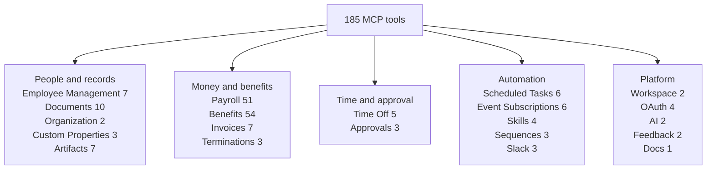
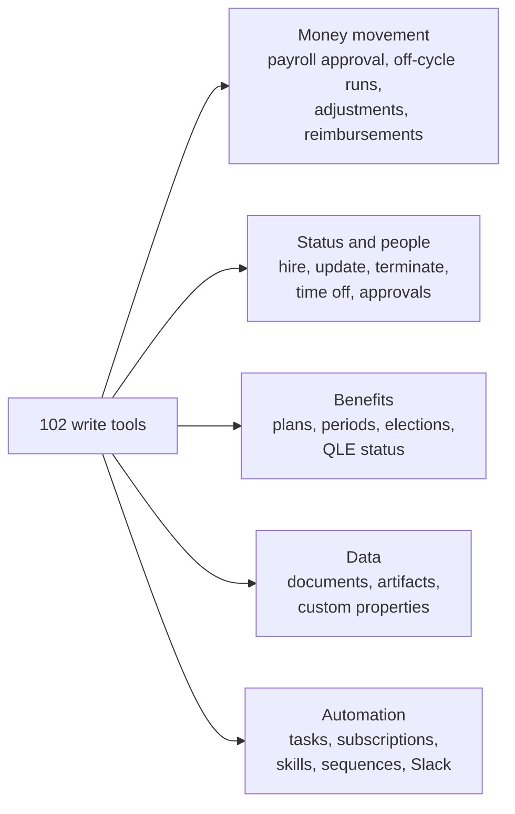

# The Tool Catalog

Winslow is an artificial-intelligence (AI) native Human Resources (HR) platform. It sells payroll, benefits, a Human Resources Information System (HRIS), and a Slack-based AI co-worker as one product. **Check** is the third-party payroll engine that calculates tax, files returns, and moves money. Winslow is the record and the interface above Check.

The Winslow **Model Context Protocol (MCP)** server exposes 185 tools in 31 sections. MCP is an open protocol that lets an AI application call tools. A **tool** is one callable action with a name, arguments, and a required **scope**, which is a named permission string. An **agent** is an AI program that can call tools. This page lists every tool, grouped by section, with its access mode and its most important rule. It then covers the write surface, the validation limits, and the tools that are deliberately absent.

The catalog was verified against two sources: the human reference at `/builders/mcp/` and the generated `/winslow.md`. Both are captures of the public Winslow site, made on 2026-11-06; `/winslow.md` is the site's own machine-readable product file. Citations such as `builders_mcp.txt:46` refer to the plain-text captures. A **verification date** of 2026-09-10 appears inside `/winslow.md`; it is Winslow's own stamp, older than the capture. The names, counts, scopes, and parameters agree between the two public sources. Where a single source contradicts itself, the disagreement is recorded under "Catalog inconsistencies to know".

Terms in the tables. **Read** means the tool does not change stored data; **Write** means it does. The **Who** column states the relationship rule. **Self** means the caller is the employee record in question. **Direct manager** means the caller is that employee's manager. **Administrator** means a workspace administrator. **Scope only** means the only gate is the scope, so any workspace member holding it can call the tool. **Bypass scope** means a scope that skips the relationship check. A **projection** is the field set that the server returns: `FULL`, `SELF`, `DIRECT_REPORT`, or `PUBLIC`. An **app namespace** is the identifier that an application registers before it can write custom properties or artifacts. **Interface-only** means the action exists in the admin web interface and not in MCP. **REST** is Representational State Transfer, the plain Hypertext Transfer Protocol (HTTP) interface that sits next to MCP. A **workspace member** is one user account inside a workspace, which is one customer tenant.

Benefits and payroll terms used in the tables. **Open enrollment (OE)** is the annual window when employees choose plans. A **qualifying life event (QLE)** is an allowed change outside that window, such as a marriage or a birth. A **plan offering** is one insurance plan bound to one coverage period with its rates. An **election** is one employee's choice of plan and coverage tier. **Waived** means the employee declined the plan. A **coverage period** is the date range in which a plan applies. A **Summary Plan Description (SPD)** describes a plan; a **Summary of Benefits and Coverage (SBC)** is the shorter standard summary. A **census** is the employee roster that a carrier or broker needs. A **broker** is the licensed intermediary that sells and administers plans. A **carrier** is the insurance company. A **premium** is the amount paid for coverage, and a **contribution** is the part the employer pays. A **payroll item** is one line on a run: the earnings, deductions, and taxes for one person. A **shell row** is an item that stays after the person has nothing payable. **Check** is the payroll engine.

## The shape of the catalog

| Measure | Value |
|---|---|
| Production tools | 185 |
| Sections | 31 |
| Write tools | 102 |
| Read tools | 83 |
| Separate onboarding server tools | 4 (excluded from 185) |
| Distinct MCP scopes | 25 |
| Verification date stated inside `/winslow.md` | 2026-09-10 |



The payroll group in the diagram is the sum of seven payroll sections. The sections are runs and lifecycle 13, off-cycle and termination 5, expenses 7, pay stubs 4, configuration 10, employee status 2, and adjustments 10. The benefits group is the sum of plan catalog 20, coverage and elections 19, qualifying life events 7, benefit adjustments 5, and employee benefits 3.

## Section 1: Workspace and identity (2 tools)

Scopes: none. Any workspace member can call these.

| Tool | Access | What it does |
|---|---|---|
| `get_workspace` | Read | Returns the workspace tied to the key: identifier and name |
| `get_me` | Read | Returns the user behind the key and the linked `employeeRecordId`; null means no linked record |

These two tools should run first. `get_workspace` confirms the credential is pointed at the right workspace. `get_me` establishes the actor context that every relationship check depends on.

## Section 2: Employee management (7 tools)

Scopes: `employee:add`, `employee:manage-data`, `self:manage-data`.

| Tool | Access | Who | What it does |
|---|---|---|---|
| `get_employee` | Read | Self, direct manager, administrator | One record, projected to FULL, SELF, DIRECT_REPORT, or PUBLIC |
| `list_employees` | Read | Scope only, every record | Company directory with PUBLIC columns only |
| `list_managed_employees` | Read | Self, direct manager, administrator | Self plus direct reports, with relationship-scoped columns |
| `create_employee` | Write | Direct manager or administrator | Creates a record with a linked Winslow user; the only tool that sets `isTrial` |
| `update_employee` | Write | Self, direct manager, administrator | Updates fields, custom properties, employee type, work email; the response does not echo the updated record |
| `invite_employee_to_winslow` | Write | Direct manager or administrator | Replaces a pending invite and sends a fresh email |
| `get_employee_invite_link` | Write | Direct manager or administrator | Returns an invite link; creates a pending invite if absent, sends no email |

`create_employee` requires an essentials object that includes `workEmail`. A non-administrator can create only a direct report. `update_employee` respects field-level editability; salary and compensation changes need a manager or administrator.

A call uses the JSON-RPC envelope that the MCP server expects. This one reads one employee as the caller:

```json
{"jsonrpc":"2.0","id":1,"method":"tools/call",
 "params":{"name":"get_employee",
           "arguments":{"employeeRecordId":"er_01H..."}}}
```

The result is a content array. The documentation shows the projected fields and the `fieldVisibility` marker, but it does not publish a complete success envelope. A client should read the live `get_api_docs` matrix before it parses the response.

## Section 3: Employee documents (10 tools)

Scopes: `employee:manage-documents`, `self:manage-documents`, `employee:manage-payroll`, `self:manage-payroll`, `employee:manage-benefits`, `self:manage-benefits`.

| Tool | Access | Who | What it does |
|---|---|---|---|
| `list_employee_documents` | Read | Self, direct manager, administrator | Documents with an optional type filter: TERMINATION, LEAVE, OTHER |
| `get_employee_document` | Read | Self, direct manager, administrator | Metadata plus a public download link |
| `find_employee_documents` | Read | Self, direct manager, administrator | Ranked search by file name or by the agent-extracted text of the document |
| `begin_employee_document_upload` | Write | Self, direct manager, administrator | Creates a 15-minute signed upload URL; 100-megabyte multipart cap |
| `upload_employee_document` | Write | Self, direct manager, administrator | Base64 upload capped at 256 kilobytes decoded |
| `get_employee_document_resource` | Read | Direct manager or administrator | Embedded base64 resource, 50 megabytes maximum |
| `get_employee_document_content` | Read | Self, direct manager, administrator | Extracted text or PNG images, 10 pages maximum |
| `set_employee_document_validation` | Write | Self, direct manager, administrator | Sets validation to valid, invalid, or null; replaces the agent-extracted text wholesale |
| `get_employee_documents` | Read | Self, direct manager, administrator | Unified tax, filing, Summary Plan Description (SPD), and Winslow documents |
| `get_employee_payroll_document` | Read | Self or administrator, no manager path | Tax form (W-2 or 1099) or filing form |

The document section is where the "no manager path" rule starts to matter. A manager can read many documents for a direct report, but not payroll tax documents. The payroll scope bypasses ownership for `get_employee_payroll_document`; the manager path does not.

## Section 4: Employee benefits (3 tools)

Scopes: `employee:manage-benefits`, `self:manage-benefits`.

| Tool | Access | Who | What it does |
|---|---|---|---|
| `get_employee_benefits` | Read | Self, direct manager, administrator | Current medical, dental, and vision status, plan, carrier, tier, dependents |
| `list_employee_benefit_spds` | Read | Self, direct manager, administrator | SPDs for enrolled plans, with attachment reference and recommended flag |
| `get_employee_benefit_spd_document` | Read | Self, direct manager, administrator | Extracted SPD text, paginated by offset and character count |

`get_employee_benefit_spd_document` handles scanned PDFs by returning `scan_or_image_pdf` as a hint. A caller should then retrieve the file resource and use optical character recognition, or ask the employee for a different copy.

## Section 5: Benefits administration — plan catalog (20 tools)

Scopes: `benefits:manage-plans`, `self:manage-benefits`.

This is the largest section. It manages the plan catalogue and the plan-selection lifecycle.

| Tool | Access | What it does |
|---|---|---|
| `list_benefit_plans` | Read | Every plan in any status |
| `get_benefit_plan` | Read | One plan by identifier |
| `create_benefit_plan` | Write | Adds a PENDING plan; SBC and SPD files are interface-only |
| `update_benefit_plan` | Write | Updates plan fields and status; ACTIVE and PRE_ACTIVE need group and policy numbers |
| `delete_benefit_plan` | Write | Deletes a PENDING or NOT_SELECTED plan with no elections or offerings |
| `finalize_plan_selection` | Write | Marks VERIFIED plans SELECTED or NOT_SELECTED; auto-closes an open selection |
| `list_plan_offerings` | Read | Offerings by plan or coverage period, exactly one filter |
| `get_plan_offering` | Read | One offering by identifier |
| `create_plan_offering` | Write | Rates and contributions; attaching a period needs PRE_ACTIVE or ACTIVE |
| `update_plan_offering` | Write | Blocked while the coverage period is OPEN |
| `delete_plan_offering` | Write | Blocked once elections exist or the period is past DRAFT |
| `copy_plan_offerings_from_previous` | Write | Rolls the latest offering into a new period |
| `get_plan_selection_status` | Read | DRAFT, OPEN, CLOSED, or null |
| `create_plan_selection` | Write | Needs a VERIFIED plan and no active period |
| `open_plan_selection` | Write | DRAFT to OPEN for stakeholder review |
| `close_plan_selection` | Write | OPEN to CLOSED |
| `reset_plan_selection` | Write | Returns to DRAFT; close an OPEN period first |
| `get_benefits_configuration` | Read | Step zero; creates the configuration on first read |
| `update_benefits_configuration` | Write | Sets `hasFullCensus`, which affects eligibility |
| `list_brokers` | Read | Winslow-managed and cross-workspace brokers; read-only |

The plan status machine is `PENDING → VERIFIED → SELECTED | NOT_SELECTED → PRE_ACTIVE → ACTIVE → INACTIVE`. A plan cannot become ACTIVE or PRE_ACTIVE until the group number and policy number are set.

## Section 6: Benefits administration — coverage and elections (19 tools)

Scopes: `benefits:manage-oe`, `benefits:manage-qle`, `employee:manage-benefits`, `self:manage-benefits`.

| Tool | Access | What it does |
|---|---|---|
| `list_coverage_periods` | Read | Every coverage and open-enrollment period |
| `get_coverage_period` | Read | Period plus enrollment counts by plan type and status |
| `create_coverage_period` | Write | `coverageEffectiveDate` must be the 1st or 15th of a month, and strictly after the enrollment window's `endDate`; no overlap with another period |
| `update_coverage_period` | Write | DRAFT or OPEN only; once OPEN, only end dates can move later |
| `delete_coverage_period` | Write | Blocked if any eligible election is FINALIZED |
| `activate_open_enrollment` | Write | Creates PENDING elections for every employee and offered plan type |
| `close_open_enrollment` | Write | OPEN to CLOSED; precedes broker import and verification |
| `get_enrollment_tracking` | Read | Per-employee submission status and projected costs |
| `send_enrollment_reminders` | Write | Emails selected employees; returns sent and failed lists |
| `get_employee_enrollment` | Read | Plans, elections, dependents, progress; defaults to the current period |
| `get_election_history` | Read | Full history grouped by coverage period |
| `update_employee_election` | Write | PENDING or ELECTED only while the period is OPEN |
| `waive_employee_election` | Write | Declines coverage for a plan type while the period is OPEN |
| `clear_employee_election` | Write | Resets to PENDING and clears plan, tier, dependents |
| `submit_employee_enrollment` | Write | Every plan type must be ELECTED or WAIVED; requires a base64 PNG signature |
| `list_period_elections` | Read | All elections in a period |
| `finalize_open_enrollment` | Write | Requires `acknowledged: true`; returns blockers as an error payload |
| `admin_update_election` | Write | No ownership check; premiums recalculate unless supplied |
| `set_election_status` | Write | Status enum; WAIVED to ELECTED needs a plan; CONFIRMED needs a carrier member identifier |

The election statuses are `PENDING`, `ELECTED`, `IN_REVIEW`, `WAIVED`, `CONFIRMED`, and `FINALIZED`. `CONFIRMED` elections synchronize to Check on finalization.

Two rules need a gloss. The `submit_employee_enrollment` signature is a bitmap image of the employee's signature, sent as base64 text, which the product stores with the enrollment as the employee's confirmation. A **blocker** is a required condition that is still unmet, such as an employee with no election or an unacknowledged form. `finalize_open_enrollment` returns the list instead of finalizing.

## Section 7: Qualifying life events (7 tools)

Scopes: `benefits:manage-oe`, `benefits:manage-qle`, `employee:manage-benefits`, `self:manage-benefits`.

**Stateless**, in the first row, means the call reads the rules and returns them without saving anything.

| Tool | Access | Who | What it does |
|---|---|---|---|
| `preview_life_event_requirements` | Read | Any workspace member | Stateless list of documents, data, attestations, and filing window for an event |
| `file_life_event_request` | Write | Self or administrator; no manager path | Files a request; supporting documents are interface-only |
| `list_life_event_requests` | Read | Administrators | Every request in the workspace |
| `list_employee_life_event_requests` | Read | Self or administrator; no manager path | One employee's requests |
| `get_life_event_request` | Read | Self or administrator; no manager path | One request, private to the filer and qualifying-life-event administrators |
| `update_life_event_request_status` | Write | Administrators | APPROVED opens a seven-day window and drafts elections |
| `get_qle_enrollment` | Read | Self or a bypass scope | Plans, elections, dependents, and progress after approval |

Event types include MARRIAGE, DIVORCE, BIRTH_ADOPTION, DEATH_OF_DEPENDENT, LOSS_OF_COVERAGE, GAIN_OF_COVERAGE, EMPLOYMENT_STATUS_CHANGE, RELOCATION, AGING_OUT, COURT_ORDER, and OTHER. Change actions include ADD_DEPENDENT, REMOVE_DEPENDENT, ENROLL_IN_COVERAGE, CANCEL_COVERAGE, CHANGE_PLAN, and CHANGE_COVERAGE_LEVEL.

## Section 8: Benefit adjustments (5 tools)

Scopes: `employee:manage-benefits`, `payroll:manage-payrolls`.

| Tool | Access | What it does |
|---|---|---|
| `list_benefit_adjustments` | Read | Workspace-wide or one-time on a payroll |
| `get_benefit_adjustment` | Read | Employee fields, election and payroll summaries, delete permission |
| `create_benefit_adjustment` | Write | ONGOING standing deduction or ONE_TIME adjustment on one payroll |
| `update_benefit_adjustment` | Write | Changes election, amounts, or payroll; type cannot change |
| `delete_benefit_adjustment` | Write | ONGOING restores the election premium; ONE_TIME only while draft or pending |

A one-time adjustment must name a payroll and the employee must be on it. An ongoing adjustment must not name a payroll. One ongoing adjustment is allowed per employee and election.

## Section 9: Payroll runs and lifecycle (13 tools)

Scopes: `payroll:manage-payrolls`, `payroll:approve`.

| Tool | Access | What it does |
|---|---|---|
| `list_payrolls` | Read | Summaries, filtered by payday bounds or timeframe |
| `get_payroll` | Read | Curated payroll view; refreshes stale drafts before returning |
| `create_next_regular_payroll` | Write | Fails with six or more upcoming payrolls or no future payday |
| `rename_payroll` | Write | Sets the display name in Check metadata |
| `calculate_payroll` | Write | Forces a Check preview calculation; no money moves |
| `refresh_payroll` | Write | Rebuilds all items; the heaviest call |
| `refresh_payroll_items` | Write | Rebuilds selected employees or contractors; zero-pay rows stay in Winslow |
| `get_payroll_refresh_status` | Read | Whether a refresh is needed before the caller treats the run as final or approves it |
| `get_payroll_comparison` | Read | Deltas against the last paid regular payroll |
| `get_payroll_taxes` | Read | Employee and company tax lines with totals |
| `approve_payroll` | Write | Moves money; separate `payroll:approve` scope; Check enforces the deadline |
| `reopen_payroll` | Write | Returns an approved payroll to draft before the Check reopen deadline |
| `set_payroll_employee_exclusion` | Write | Excludes or includes one employee in one run; idempotent |

`approve_payroll` is the highest-risk tool in the catalog. It has its own scope, it checks the Check deadline and payroll status, and it is blocked when billing is pre-billing or past its grace window. It emits a `payroll-run.approve` event.

## Section 10: Off-cycle and termination pay (5 tools)

Scopes: `employee:terminate`, `payroll:manage-payrolls`.

| Tool | Access | Who | What it does |
|---|---|---|---|
| `get_offcycle_payroll_payment_constraints` | Read | Scope only | Three-business-day direct-deposit lead time, drop-dead date, allowed methods |
| `create_offcycle_payroll` | Write | Scope only | Bonus, correction, or spot run; choose all employees or a list |
| `update_offcycle_payroll` | Write | Scope only | Draft general off-cycle only; not termination runs |
| `delete_offcycle_payroll` | Write | Scope only | Draft general off-cycle only; clears detail and invoice links first |
| `create_termination_payroll` | Write | Direct manager or administrator | Final pay for a termination that lacks one; deletion stays REST or interface |

Payment methods are DIRECT_DEPOSIT, CHECK, and BANK_TRANSFER. When `employeeMode` is `select`, everyone not listed is recorded as excluded.

## Section 11: Expenses and reimbursements (7 tools)

Scopes: `payroll:manage-adjustments`, `payroll:manage-payrolls`.

| Tool | Access | What it does |
|---|---|---|
| `list_payroll_expenses` | Read | Filter by payroll, then employee, then workspace |
| `add_payroll_expense` | Write | Marks the payroll dirty; lands on items at the next refresh |
| `remove_payroll_expense` | Write | Marks the payroll dirty; refresh updates items |
| `list_payroll_reimbursements` | Read | Winslow is the source of truth even before the Check line exists |
| `create_payroll_reimbursement` | Write | Writes the Winslow record, then rebuilds items; works for zero-salary employees |
| `update_payroll_reimbursement` | Write | Rebuilds items so the new amount reaches Check |
| `delete_payroll_reimbursement` | Write | Rebuilds; an employee with nothing payable returns to a shell row |

The split matters: expenses use `payroll:manage-adjustments`, while reimbursements use `payroll:manage-payrolls`. A caller with only one scope can use only one half of the section.

## Section 12: Pay stubs (4 tools)

Scopes: `payroll:manage-payrolls`, `employee:manage-payroll`, `self:manage-payroll`.

| Tool | Access | Who | What it does |
|---|---|---|---|
| `get_pay_stubs` | Read | Self or administrator; no manager path | Paginated stubs, 25 per page; contractors refused |
| `get_pay_stub` | Read | Self or administrator; no manager path | One stub by payroll; strips void links |
| `search_pay_stubs` | Read | Self or administrator; no manager path | Admin search over one employee's stubs |
| `list_payroll_paystubs` | Read | Scope only | Whole-payroll run surface; one Check call per employee |

The first three tools are among the most restricted in the catalog. A manager cannot read a direct report's pay stubs, even though a manager can read many other documents. The bypass is the payroll scope, not the management relationship.

## Section 13: Payroll configuration (10 tools)

Scopes: `employee:manage-payroll`, `payroll:approve`, `payroll:manage-payrolls`, `self:manage-payroll`.

| Tool | Access | Who | What it does |
|---|---|---|---|
| `get_payroll_config` | Read | Scope only | Check company status, start date, pay schedules |
| `get_payroll_signatory` | Read | Scope only | People authorized to sign filings |
| `list_workplaces` | Read | Scope only | Registered work locations used for tax jurisdiction |
| `get_company_tax_parameters` | Read | Scope only | Federal identifier, state accounts, deposit schedules, unemployment rates |
| `get_employee_tax_parameters` | Read | Self or administrator; no manager path | Filing status, allowances, additional withholding |
| `get_payroll_approval_settings` | Read | Scope only | Regular, termination, and off-cycle settings plus the comparison gate |
| `update_payroll_approval_settings` | Write | Scope only | Only supplied fields change; null clears a deviation |
| `get_payroll_auto_approve` | Read | Scope only | Whether regular payrolls auto-approve |
| `set_payroll_auto_approve` | Write | Scope only | Turns auto-approve on or off; money moves without a human |
| `set_payroll_auto_approve_override` | Write | Scope only | Per-payroll override, draft only |

The auto-approve modes are INVOICES_MUST_MATCH, SALARIES_ONLY, PERCENT_DEVIATION, DOLLAR_DEVIATION, and ALWAYS_APPROVE. A daily 2:00 a.m. job performs auto-approval. Enabling any auto-approve toggle is blocked during pre-billing.

## Section 14: Payroll employee status (2 tools)

Scopes: `employee:manage-payroll`, `self:manage-payroll`.

| Tool | Access | Who | What it does |
|---|---|---|---|
| `get_employee_payroll_status` | Read | Self, direct manager, administrator | Last-four Social Security number and enrollment state |
| `get_employee_upcoming_payroll` | Read | Self or administrator; no manager path | Nearest upcoming draft or pending item, with compensation |

`get_employee_payroll_status` is the only per-employee payroll tool with a manager path.

## Section 15: Payroll adjustments (10 tools)

Scopes: `payroll:manage-adjustments`.

| Tool | Access | What it does |
|---|---|---|
| `list_payroll_adjustment_templates` | Read | Recurring rules: who gets paid what, on which runs |
| `get_payroll_adjustment_template` | Read | One template |
| `create_payroll_adjustment_template` | Write | Target, recurrence, amount type, Check earning type |
| `update_payroll_adjustment_template` | Write | Changes any template field |
| `delete_payroll_adjustment_template` | Write | Deletes a template |
| `list_payroll_adjustments` | Read | Instances, filtered by payroll or employee |
| `get_payroll_adjustment` | Read | One instance |
| `create_payroll_adjustment` | Write | One employee's adjustment, optionally linked to a template or payroll |
| `update_payroll_adjustment` | Write | Amount, payroll, earning type, note, status |
| `delete_payroll_adjustment` | Write | Removes linked one-off Check earnings |

Template recurrence types are ONE_TIME, MONTHLY, FIRST_HALF, and SECOND_HALF. Amount types are FIXED_ALL, ASSIGNED_PER_PERSON, and CUSTOM_REQUIRED. Target types are EMPLOYEE_TYPE, EMPLOYEE_LIST, and DEPARTMENT. A ONE_TIME template needs `oneTimeOnPayroll ≥ 1`.

A working example from the documentation is a $150 gym supplement on the first payroll of each month for United States full-time employees:

```json
{
  "name": "Gym supplement",
  "recurrenceType": "FIRST_HALF",
  "amountType": "FIXED_ALL",
  "fixedAmount": 150,
  "targetType": "EMPLOYEE_TYPE",
  "targetEmployeeTypes": ["US_FULL_TIME"],
  "checkPayrollItemType": "bonus",
  "active": true
}
```

## Section 16: Time off and holidays (5 tools)

Scopes: `time-off:manage-requests`, `self:manage-requests`.

| Tool | Access | Who | What it does |
|---|---|---|---|
| `list_time_off` | Read | Self, direct manager, administrator | PENDING and APPROVED requests overlapping the current month by default |
| `create_time_off_request` | Write | Self or administrator; no manager path | Validates policy, overlap, and maximum days |
| `cancel_time_off_request` | Write | Requester, direct manager, administrator | Cancels a request; ownership is enforced in the service |
| `approve_request` | Write | Direct manager or administrator | Approves or rejects; status APPROVED or REJECTED |
| `list_company_holidays` | Read | Not stated | Concrete dates for a year, including floating holidays |

Managers cannot submit a time-off request for a direct report. The employee must submit it. A manager can approve or cancel it.

## Section 17: Invoices (7 tools)

Scopes: `self:manage-invoices`, `employee:manage-invoices`, `payroll:manage-invoices`.

| Tool | Access | Who | What it does |
|---|---|---|---|
| `create_invoice` | Write | Self, direct manager, administrator | Invoice from supplied fields plus a stored document |
| `submit_invoice` | Write | Self or a bypass scope | Artificial-intelligence extraction; attachment or base64, 50 megabytes maximum |
| `list_invoices` | Read | Self or a bypass scope | Newest first; status SUBMITTED, APPROVED, REJECTED, or PAID |
| `approve_invoice` | Write | Direct manager or administrator | Approves; payroll scope can approve any |
| `reject_invoice` | Write | Direct manager or administrator | Rejects a submitted or approved invoice not on a payroll |
| `unapprove_invoice` | Write | Direct manager or administrator | Returns an approved invoice to SUBMITTED when not on a payroll |
| `cancel_invoice` | Write | Self, direct manager, administrator | Hard-deletes a submitted or approved invoice not on a payroll |

Trial self-submissions auto-approve. That is a behaviour of the trial plan, not a general rule.

## Section 18: Terminations (3 tools)

Scopes: `employee:terminate`.

| Tool | Access | Who | What it does |
|---|---|---|---|
| `list_terminations` | Read | Scope only | Every termination in any state |
| `get_termination_payment_date_info` | Read | Scope only | State final-pay constraints; defaults to involuntary |
| `terminate_employee` | Write | Direct manager or administrator | UI-equivalent validation; severance involuntary only; final-pay run by default |

The termination tool rejects an already terminated employee, a date outside state rules, a missed direct-deposit lead time, or a holiday. It uses eight hours per accrued paid-time-off day.

## Section 19: Approvals (3 tools)

Scopes: `time-off:manage-requests`; `get_approval_state` requires no scope.

| Tool | Access | Who | What it does |
|---|---|---|---|
| `get_approval_state` | Read | Self, direct manager, administrator | PENDING, ACCEPTED, REJECTED, or CANCELLED |
| `cancel_approval` | Write | Direct manager or administrator | Terminal tasks cannot be cancelled |
| `update_approval` | Write | Direct manager or administrator | Changes name, description, or status; terminal tasks cannot change |

## Section 20: Organization (2 tools)

Scopes: `employee:manage-data`; `list_departments` has no stated scope.

| Tool | Access | What it does |
|---|---|---|
| `list_departments` | Read | System department choices for dropdowns |
| `list_org_chart` | Read | Active employees nested by manager; rows are not relationship-filtered |

`list_org_chart` is a read that returns the whole organization structure. Invisible custom columns are blanked, but the reporting lines are visible. This is a deliberate exception to row filtering.

## Section 21: Custom properties (3 tools)

Scopes: `admin:manage-customization`, `employee:manage-data`.

| Tool | Access | Who | What it does |
|---|---|---|---|
| `list_custom_properties` | Read | Scope only | Definitions, not values; excludes app and internal properties |
| `list_app_properties` | Read | Scope only | Properties for one app namespace |
| `create_app_property` | Write | Administrators | Adds a typed property; label prefixed `{appId}-`; returns null if it exists |

The 14 property types are SHORT, LONG, RICH, PHONE, NUMBER, CURRENCY, EMAIL, DATE, CHECKBOX_SINGLE, CHECKBOX_MULTIPLE, DROPDOWN, RADIO, FILE, and ADDRESS.

## Section 22: Artifacts (7 tools)

Scopes: `admin:manage-artifacts`, `employee:manage-data`.

| Tool | Access | Who | What it does |
|---|---|---|---|
| `create_artifact` | Write | Direct manager or administrator | Attaches TEXT, MARKDOWN, IMAGE, FILE, JSON, CARD, or URL data to an employee |
| `update_artifact` | Write | Direct manager or administrator | Supplied fields merge with existing data |
| `get_artifact` | Read | Self, direct manager, administrator | One artifact |
| `list_artifacts` | Read | Self, direct manager, administrator | One employee's artifacts; all-app listing needs the admin scope |
| `delete_artifact` | Write | Direct manager or administrator | Removes an artifact |
| `register_artifact_app` | Write | Administrators | Required namespace setup; MCP-registered apps are auto-approved |
| `list_artifact_apps` | Read | Any workspace member | Every registered data application |

The artifact data shapes are strict:

- TEXT and MARKDOWN require `content`; the value sits at `artifact.data.content`.
- CARD and JSON require `payload`; the value sits at `artifact.data.payload`.
- URL, IMAGE, and FILE require `url`; FILE also requires `fileName`.
- Rendering hints are TEXT, MARKDOWN, IMAGE_URL, FILE_URL, URL, PROGRESS, CURRENCY, and TABLE.

## Section 23: Scheduled tasks (6 tools)

Scopes: `agents:automate`. Every tool acts only on the caller's own tasks.

| Tool | Access | What it does |
|---|---|---|
| `list_tasks` | Read | Prompt, cron, time zone, destination, enabled state |
| `schedule_task` | Write | Five-field cron, IANA time zone, destination |
| `run_task` | Write | Runs the caller's task now |
| `pause_task` | Write | Pauses until unpaused |
| `unpause_task` | Write | Re-enables a paused task |
| `cancel_task` | Write | Permanently deletes a task |

Destination types are `dm`, `channel`, and `employee`. Omitting the destination sends a self-direct-message, which is the result sent to the caller's own direct message. The five cron fields are minute, hour, day of month, month, and day of week. A task runs its prompt through the same cloud agent that serves Slack. Winslow does not state which actor identity, scopes, or connector tokens an unattended run uses.

## Section 24: Event subscriptions (6 tools)

Scopes: `agents:automate`. Every tool acts only on the caller's subscriptions.

| Tool | Access | What it does |
|---|---|---|
| `list_subscriptions` | Read | Object type, event key, prompt, destination, enabled state |
| `subscribe_event` | Write | Business moment, `(objectType, eventKey)`, or `*` |
| `update_subscription` | Write | Destination, event key, field filters, prompt |
| `enable_subscription` | Write | Re-enables a paused subscription |
| `pause_subscription` | Write | Pauses until re-enabled |
| `cancel_subscription` | Write | Permanently deletes a subscription |

Preferred event keys are `employee.compensation_changed`, `employee.manager_changed`, `employee.department_changed`, and `employee.terminated`. A **business moment** is one of these named business events. The full object list includes employee records, documents, invoices, terminations, time-off requests, benefit elections, life-event requests, payroll runs, and more. A **field filter** is the rule that decides which fields of the event are passed into the prompt. A subscription runs its prompt when a matching event fires; Winslow does not document the prompt runner or the delivery path in this section.

## Section 25: Workspace skills (4 tools)

Scopes: `admin:manage-customization`. All four are administrator-only.

| Tool | Access | What it does |
|---|---|---|
| `list_skills` | Read | Name, description, creator, date |
| `save_skill` | Write | Creates a skill; name 1–64 lowercase letters, numbers, or hyphens |
| `update_skill` | Write | Replaces description and body; creates a version for the next session |
| `cancel_skill` | Write | Deletes a skill and detaches it from the agent |

A **skill** is a Markdown playbook that the cloud agent follows. A **version** is a saved copy; the agent uses the newest version at its next session, and a **session** is one conversation or one scheduled run. A skill description is limited to 1,024 characters. Skill names must be unique in the workspace.

## Section 26: Agent sequences (3 tools)

Scopes: `agents:manage`. All three are administrator-only.

| Tool | Access | What it does |
|---|---|---|
| `list_open_sequences` | Read | Open sequences for a workflow key |
| `upsert_sequence` | Write | Idempotent per key, object type, and object identifier |
| `update_sequence` | Write | Sets status or merges state |

Sequence statuses are NEW, AWAITING, NUDGED, ESCALATED, COMPLETED, and CANCELLED. A **sequence** is durable state for multi-step work that crosses sessions and events. A **workflow key** is the name that groups the sequence, and an **object identifier** is the record the sequence is about. Winslow does not document what moves a sequence from one status to the next.

## Section 27: Slack (3 tools)

Scopes: `agents:automate`, `agents:manage`.

| Tool | Access | Who | What it does |
|---|---|---|---|
| `resolve_slack_channel` | Read | Any workspace member | Channel name to identifier; the bot must be a member to post |
| `send_slack_dm` | Write | Administrators | Direct message to an employee or manager; `delivered: false` when no Slack identity |
| `check_employee_reply` | Read | Administrators | Reports whether the employee replied since a timestamp |

The **bot** is the Winslow Slack application that the workspace installs. It must be a member of a channel before it can post there. A reply means a message from the employee after the given timestamp; the reference does not say whether the message must be in a thread.

## Section 28: AI and knowledge base (2 tools)

Scopes: none for `ask_policy_question`; `employee:manage-data` for `ask_reporting_question`.

| Tool | Access | Who | What it does |
|---|---|---|---|
| `ask_policy_question` | Read | Any workspace member | Retrieval over uploaded policies; no employee data; no cross-workspace knowledge |
| `ask_reporting_question` | Read | Self, direct manager, administrator | Explanation plus a table; actor scoping at data load |

**Retrieval** means that the tool searches the uploaded policy documents and inserts the matching text into the model's context before it answers. `ask_policy_question` reads no employee data and cannot see another workspace. **Actor scoping at data load** means that the rows are filtered for the acting user before the model receives them, not after the answer is written.

## Section 29: OAuth application management (4 tools)

Scopes: `admin:manage-customization`. All four are administrator-only.

| Tool | Access | What it does |
|---|---|---|
| `register_oauth_app` | Write | Registers an app; returns credentials, environment variables, authorize URL, and code |
| `list_oauth_apps` | Read | OAuth apps in the workspace; secrets never returned |
| `update_oauth_app` | Write | Redirect URIs, name, description, scopes, icon |
| `delete_oauth_app` | Write | Deactivates; existing tokens work until they expire, up to 30 days |

The `register_oauth_app` frameworks are `react`, `next`, `express`, and `generic`. The client secret is shown once. **OAuth 2.0** is the standard that lets a user authorize an application to act for them without sharing a password. The "scopes" in the `update_oauth_app` row are the seven coarse OAuth scopes, not the 25 MCP scopes used elsewhere on this page. The two scope systems are separate; Winslow does not publish the mapping between them.

## Section 30: Feedback (2 tools)

Scopes: none.

| Tool | Access | What it does |
|---|---|---|
| `report_bug` | Write | Reports an error, misbehavior, or wrong result |
| `suggest_improvement` | Write | Suggests an improvement or a new capability |

## Section 31: Documentation (1 tool)

Scopes: none.

| Tool | Access | What it does |
|---|---|---|
| `get_api_docs` | Read | Returns the API guide, or the per-tool matrix as JSON when `section=matrix` |

The **matrix** is the machine-readable per-tool reference: one row per tool, with its name, section, scopes, parameters, access mode, and notes. It is the same content as the human page, in JSON. The valid values of `section` are not listed in the reference.

```json
{"jsonrpc":"2.0","id":30,"method":"tools/call",
 "params":{"name":"get_api_docs",
           "arguments":{"section":"matrix"}}}
```

## The write surface

The catalog is not a reporting API. It is an operating surface.



The highest-risk group is payroll. `approve_payroll` moves money and has its own scope. `set_payroll_auto_approve` can approve future payrolls without a human. `update_payroll_approval_settings` can lower the gates that would otherwise stop a bad run.

The second-risk group is employment status. `terminate_employee` can end employment and create a final-pay run. `create_employee` can create a record and a user account. `update_employee` can change compensation.

A builder should request the narrowest scope set and should not expose these tools to an untrusted agent without an approval step. An **approval step** here means a human confirmation before the write executes, not the payroll approval tool.

## The separate onboarding server

Winslow Onboarding is a different MCP server with four tools:

| Tool | Purpose |
|---|---|
| `start_onboarding` | Begins self-serve payroll onboarding; returns a session and field checklist |
| `update_onboarding` | Merges company, signatory, bank, and onboarder fields |
| `complete_onboarding` | Validates, creates the workspace, configures Check, provisions an administrator |
| `get_onboarding_status` | Collected masked data, missing fields, readiness |

Its endpoint and keys are not interchangeable with the main server. The four tools are not part of the 185. A **session** here is an onboarding conversation that keeps partial company data between calls. The **onboarder** is the person at Winslow or at the customer who completes the checklist.

## Deliberately not in MCP

The reference lists six capabilities that are REST or interface only, on purpose (`builders_mcp.txt:1403-1411`). "Interface only" means the admin web application. The capture `builders_mcp.txt` is the plain-text copy of `/builders/mcp/`, made on 2026-11-06.

1. SPD and plan-document attachment upload.
2. Plan document ingest.
3. Census and election CSV export.
4. Broker import (carrier file reconciliation). Reconciliation means matching the carrier's file of enrolled members against the Winslow records.
5. Broker create and update; brokers are read-only through `list_brokers`.
6. Qualifying life event elections; they stay employee-attested. **Attested** means the employee states the facts and the system records the statement without deciding whether it is true.

Two more appear in tool notes:

- Deleting a termination payroll is REST or interface only.
- Qualifying-life-event supporting documents are uploaded only in the interface.

These eight items are the factual basis for rejecting the phrase "every Winslow capability ships through an MCP server."

## Catalog inconsistencies to know

The documentation is largely consistent across the two public sources. These edges are disagreements inside one source, so the reader cannot tell which side is correct:

- `preview_life_event_requirements` says "any workspace member" but requires `self:manage-benefits` or `benefits:manage-qle`.
- `list_artifact_apps` requires the `admin:manage-artifacts` scope but says "any workspace member."
- `get_approval_state` and `ask_policy_question` require no scope, while their section scope lines list one.
- `list_company_holidays` and `list_departments` have no scope or `Who` line.
- `list_time_off` accepts only `time-off:manage-requests`; the section's `self:manage-requests` scope does not open the list.
- `get_employee_documents` says "self, direct manager, or administrator," but its own note says the tax and payroll sections have no manager path.
- `update_artifact` and `delete_artifact` are manager-or-administrator only, while read access allows self. Self-service artifact editing is deliberately absent but not called out.
- `upsert_sequence` is called idempotent per a "4-tuple" while naming three fields.

**Aha:** The catalog's most important number is not 185. It is 102. A tool count suggests breadth. A write-tool count of 102 says the MCP server is a full operating interface for payroll, benefits, and employment. That is unusual, and it is the technical foundation of the builder story. The story claims that a customer can build and install its own application without asking Winslow for a new endpoint. It is also why the permission model matters more than the tool list. A read-only integration with a wrong permission is an information leak, and a write integration with a wrong permission is a payroll error.

## Where to go next

Read [the AI co-worker](08-the-ai-co-worker.md) for the runtime that uses these tools, or [Permissions, security, and audit](14-permissions-security-and-audit.md) for the controls around them.
