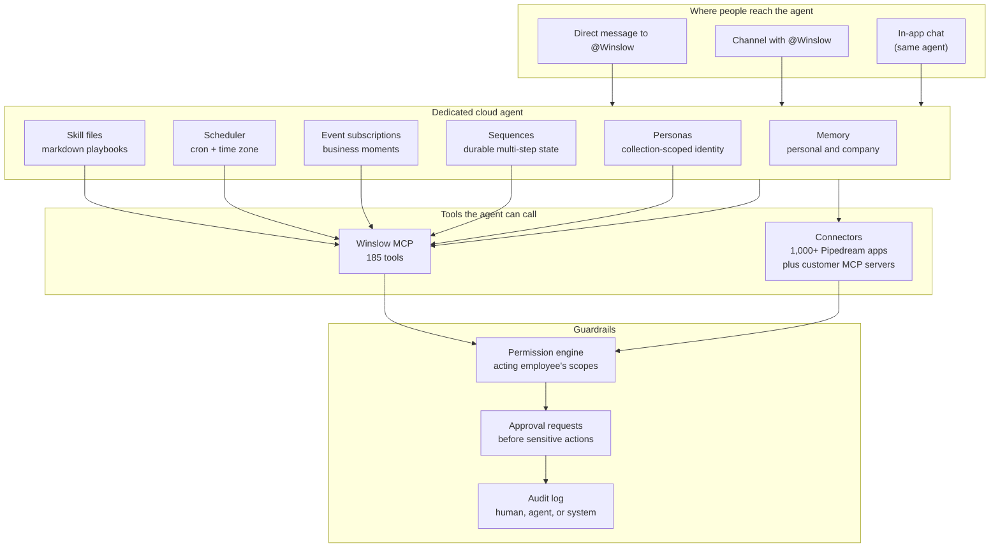
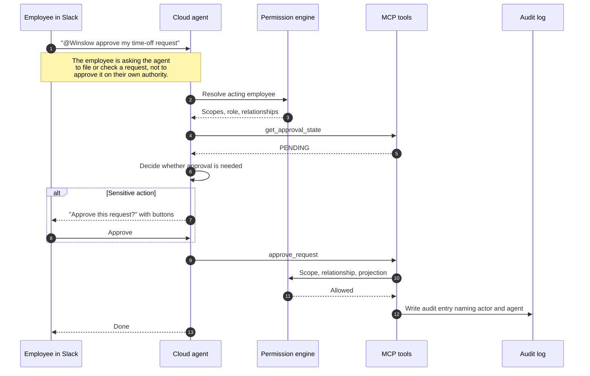

# The AI Co-worker

Winslow is an artificial-intelligence (AI) native Human Resources (HR) platform. It sells payroll, benefits, a Human Resources Information System (HRIS), and a Slack-based AI co-worker as one product.

Winslow sells two names for one thing. The product page calls it the "AI co-worker." The builder page calls it the "Winslow Agent." Both describe a dedicated cloud agent that a customer talks to in Slack. The employee-facing story is about getting work done. The builder-facing story is about infrastructure that the customer does not have to assemble.

Terms used on this page. An **agent** is an AI program that can call tools and take actions, not only answer. The **Model Context Protocol (MCP)** is an open protocol that lets an agent call tools; a **tool** is one callable action with a required **scope**, a named permission string. A **workspace** is one customer tenant. An **employee record** is the Winslow row that holds one person's data; a **Slack identity** is a person's Slack account. A **skill file** is a Markdown playbook that the agent follows. A **connector** is an integration to a third-party application. **Pipedream** is the third-party platform that hosts the connector directory. Slack is the messaging application. **Cron** is the five-field schedule format: minute, hour, day of month, month, day of week. An **IANA time zone** is a named zone from the Internet Assigned Numbers Authority database, such as `America/New_York`. **Linear** is a software issue tracker. **Ahrefs** is a search-marketing analytics service. A Slack **canvas** is a shared document inside a channel.

The public record is strong on capabilities and thin on mechanism. "The public record" means the captures of the Winslow website made on 2026-11-06. Citations such as `winslow.md:10` refer to line numbers in the captured Markdown product file. Citations such as `/product/ai-co-worker/` refer to a page of the website. This page separates the two.

## The two framings

| Framing | Audience | Promise | Source |
|---|---|---|---|
| AI co-worker | Every employee | "Don't just ask questions, get real work done." | `/product/ai-co-worker/` |
| Winslow Agent | Builders and administrators | "Every Winslow customer gets a dedicated cloud agent." | `/builders/winslow-agent/` |

The AI co-worker page is consumer-shaped. It shows a Slack channel with a team, a request in plain language, and a result. The agent page is infrastructure-shaped. It lists the stack that the agent replaces: a frontier language model, a tool layer, a scheduler, a memory store, connectors, observability, and a user interface. **Frontier language model** means a leading general-purpose AI model. The claim is that a customer would otherwise assemble those pieces separately; the page does not show the assembly cost.

The product says one dedicated agent serves both audiences. The builder page says: "You talk to it from Slack or the in-app chat; both are streaming pipes to the same agent in the cloud" (`builders_winslow-agent.txt:46`). "Streaming pipes" means that both interfaces send messages to the same agent and receive its output as it is produced. The scope of "the same agent" is one agent per workspace. Winslow does not publish a per-user or per-channel agent count, so a reader should not assume one.

## What the agent does

The marketing examples are the clearest description of scope. They cover work outside the People function:

- Turn a Slack thread about a login bug into a Linear ticket, with reproduction steps and a stack trace. A stack trace is the list of program calls that led to an error.
- Pull to-dos from a meeting transcript and create a shared canvas in a channel.
- Put last quarter's headcount cost into a board spreadsheet and link it in a channel. "The board" means the company's board of directors.
- Schedule a weekly analytics report from Ahrefs for Monday at 7:00 a.m.
- Welcome a new hire, open benefits enrollment, and send a calendar link.

They also cover People-team work:

- Answer policy questions from uploaded documents.
- Run payroll reports and send the file.
- Notice a duplicate gym adjustment and ask before removing one.
- Answer "what did we settle on for the contractor review cycle?" from memory.
- Tell a requester that a colleague is on paid time off and offer to route the request elsewhere.



In the diagram, an arrow into the runtime means "sends a message to". An arrow from a primitive to `MCP` means "uses the MCP tool surface". `Runtime --> MCP` and `Runtime --> CONN` are the agent's own calls. `MCP --> PERM` and `CONN --> PERM` mean "is checked by". The chain `PERM --> APPROVE --> AUDIT` means that a sensitive action reaches an approval request, and every action reaches the audit log. It does not mean that every call needs approval; Winslow lists which actions need a human as a fact it does not publish.

**Customer MCP servers** are MCP servers that the customer hosts and registers, so the agent can call the customer's own tools next to Winslow's and Pipedream's. The connector section below describes the tool sources.

## The runtime primitives

Winslow documents seven primitives: skill files, the scheduler, event subscriptions, sequences, connectors, personas, and memory. They appear under six headings below, because event subscriptions and sequences share one section. Each primitive has a control surface in the MCP catalog, which means a builder can create and manage the same objects through a tool call. The catalog does not show a tool for every one; the gaps are marked.

### Skill files

A skill is a Markdown playbook. The workspace saves it, versions it, and shares it. The agent uses the latest version on its next session (`winslow.md:10`).

The payload is simple: a name, a description of at most 1,024 characters, and a body. The name must be 1–64 characters of lowercase letters, numbers, or hyphens and must be unique in the workspace.

```json
{
  "jsonrpc": "2.0",
  "id": 10,
  "method": "tools/call",
  "params": {
    "name": "save_skill",
    "arguments": {
      "name": "payroll-anomaly-review",
      "description": "Review payroll changes above 10 percent before approval.",
      "body": "When a payroll is ready for approval, compare each employee's net pay with the previous regular run. If any change is above 10 percent and is not explained by a bonus, a new hire, or a termination, list it. Ask the approver to confirm before calling approve_payroll."
    }
  }
}
```

Skills are the documented extension point for the approval workflow. Winslow says approving a payroll "kicks off an agent process" with notifications, exports, and anomaly review, and that the process is customizable with a skill file (`winslow.md:36`).

### Scheduler

The scheduler runs a prompt on a five-field cron expression in an IANA time zone. The natural-language examples in the marketing map to cron: "first payroll of the month," "first Monday," "quarterly."

A task has a destination. `dm` sends a direct message, `channel` posts to a Slack channel, and `employee` targets an employee record. If the destination is omitted, the result goes to the caller as a self-direct-message.

```json
{
  "name": "schedule_task",
  "arguments": {
    "prompt": "Post the work anniversaries for this month in #people, with years of service.",
    "cron": "0 9 1 * *",
    "timezone": "America/New_York",
    "destination": { "type": "channel", "channelId": "C0123456789" }
  }
}
```

Tasks are per-user. Every scheduler tool acts only on the caller's own tasks (`winslow.md:426`). There is no tool to list another person's schedule.

The scheduler has a failure policy. Tasks "pause themselves on repeated failures or stuck runs, and say why — Active, Paused, or Blocked at a glance" (`winslow.md:11`). The exact failure threshold is not published.

### Event subscriptions and sequences

An event subscription runs a prompt when a Winslow event fires. An **event** is a recorded business change, such as a hire or a termination. The reference calls the named event keys "preferred", which means they are the short, stable names; it does not say who prefers them. The preferred keys are business moments:

- `employee.compensation_changed`
- `employee.manager_changed`
- `employee.department_changed`
- `employee.terminated`

A subscriber can also name an `(objectType, eventKey)` pair. In that pair, `objectType` is the kind of record and `eventKey` is the dotted event name. The subscriber can use `*` as the event key instead. The pair form in the example is `objectType: "employee-record"` with `eventKey: "employee.terminated"`. The `*` matches every event key for that object type. The supported object types include employee records, documents, invoices, terminations, time-off requests, benefit elections, life-event requests, payroll runs, pay stubs, plans, dependents, holidays, and tax documents. A **plan** here means an insurance plan, and a **life-event request** is an employee's claim of a qualifying life event.

A **sequence** is durable state for multi-step work that crosses sessions and events. It has three fields. A **workflow key** is the name that groups the sequence, such as `onboarding-follow-up`. An **anchor time** is the reference time that the sequence measures from. An **object reference** is the record the sequence is about, such as one employee record. Its status moves through NEW, AWAITING, NUDGED, ESCALATED, COMPLETED, or CANCELLED. Winslow does not publish which component checks the reply or the date and moves the status, so the transitions are documented as names, not as rules.

The onboarding follow-up is the example the documentation uses most; the page gives no citation for it. A hire event starts a sequence. The agent messages the new employee. If no reply arrives, the sequence becomes NUDGED. If the start date passes without completion, it becomes ESCALATED. No tool in the catalog starts or advances a sequence automatically; the catalog has `upsert_sequence` and `list_sequences`, which create and read them.

```json
{
  "name": "subscribe_event",
  "arguments": {
    "objectType": "employee-record",
    "eventKey": "employee.terminated",
    "prompt": "Start an offboarding sequence: confirm the last day, list the systems the employee used, and ask the manager to confirm equipment return.",
    "destination": { "type": "dm", "employeeRecordId": "er_01H..." }
  }
}
```

The destination `type: "dm"` with an `employeeRecordId` sends a direct message to the named employee. The scheduler uses the same `dm` type, but its `employee` type targets a record without sending a direct message. Winslow does not state whether the two schemas are identical, so the example above is the safe form.

### Connectors

Winslow connects the agent to three tool sources: native Winslow MCP tools, external connectors, and customer-managed MCP servers. The external connectors are a directory hosted by Pipedream, a third-party integration platform, with more than 1,000 applications. The customer authorizes each one, and Winslow says it "never holds the vendor password" (`winslow.md:13`). A customer-managed MCP server is an MCP server that the customer runs and registers, so the agent can call the customer's own tools. The mechanism is **INFERRED**: the connector platform stores an OAuth token or an API credential for each application, and Winslow calls the platform rather than the vendor.

The distinction is important for security review. A native tool call runs against Winslow data with Winslow permissions. A connector call runs against a third-party system with the token that the person who connected the application authorized. The documentation does not say whether that is always the administrator who connected it, or the employee the agent is acting for. The agent can chain connectors and native tools. This is how "pull from payroll and write to the board sheet" works: the model passes one result into the next call within one turn.

### Personas

A persona is an identity scoped to one collection, with its own knowledge base, tone, and behaviour (`winslow.md:16`). A **collection** is one named group of records, such as a policy library or a recruiting pipeline. A **knowledge base** is the set of documents that the persona can read. The public record gives one sentence. It does not say how a persona is created, how it is scoped to a collection, or how it differs from a skill. Treat this as a documented concept with no documented mechanism. The Slack "Winslow Agent" is the default identity; whether it is built from a persona is not stated.

### Memory

The agent keeps personal memory and company memory across Slack conversations and scheduled tasks. A user can view, add, edit, delete, and export memories as Markdown (`winslow.md:18`). The interface for those actions is not stated: the page does not say whether they happen in chat, in a settings screen, or through a tool. The documentation also does not say whether memory is written automatically from conversations or only on request, or how personal memory is separated from company memory.

The marketing example is a decision: "You set it to quarterly back in the March thread, with Marcus approving." The sentence has no citation. "It" is probably the quarterly analytics report from the earlier example, but the page does not say so.

Memory is a product feature and a risk. A company memory that records a policy decision becomes a source of truth. The documentation does not say who can read company memory, whether it is included in the audit log, or how it is redacted when an employee leaves.

## The employee surface

The employee surface is Slack only. Winslow states plainly: "We do not have a Microsoft Teams employee experience. Slack only" (`winslow.md:169`). `/winslow.md` also marks Teams, Gmail, and Outlook employee chat as deprecated (`winslow.md:194`). "Deprecated" means the entry is kept for compatibility and is not the current path. The two statements agree on the present: there is no Teams employee experience today. They differ on the history, because "deprecated" suggests an earlier support that the product statement does not mention.

The earlier builder sentence names an in-app chat as a second window. The two statements are not a contradiction if the in-app chat is the administrator's own interface at `app.usewinslow.com`, and the employee experience is Slack. Winslow does not state that separation. A reader should treat Slack as the employee surface and the in-app chat as a surface for people who already work in the admin application.

Slack integration goes deeper than messages. The agent works with canvases, Slack Lists, scheduled messages, cross-channel messages, rich text, and private channels. "Cross-channel messages" means a message posted into more than one channel. A user can reply in a thread the agent started without an @-mention (`winslow.md:23`).

Two features widen access:

- **Agent-admin role.** A dedicated role lets Slack members without an employee record use skills, tasks, and Slack tools. This lets contractors and collaborators use the agent without a payroll record. It is a deliberate exception to the claim that the Slack identity maps to the employee record. Winslow does not say which actor identity, scope set, and audit name the agent uses for such a member.
- **Magic join links.** One shareable link signs a person up and joins the workspace in one step. A workspace here is the Winslow tenant, not the Slack workspace. Personal email and Google sign-up are accepted. An administrator can turn the link off or replace it.

The magic link is convenient and deserves scrutiny. It is a self-service path into a workspace that holds payroll and benefits data. Winslow does not publish the default state, the expiry, or the approval step.

## The control model

Winslow repeats one control claim: the agent acts as the employee, not as a super-user.

> Slack identity maps to the employee record. Scopes, field filters, and audit identity are the acting human's — not a god-mode service account. (`winslow.md:17`)

This is the same design as the MCP projection model. A **projection** is the field set that the server returns: `FULL`, `SELF`, `DIRECT_REPORT`, or `PUBLIC`. [The MCP server](06-the-mcp-server.md) describes the three checks that produce it. The agent's tool call resolves to an actor. The actor's scopes and relationships decide what the call can do. A **relationship** is the link between the actor and the target record: the caller is the subject, the subject's manager, or an administrator. The audit entry names the person the agent acted for, the application, and the tool (`winslow.md:127`). "The application" here is the Winslow application identity that made the call, not the Slack app or a third-party connector.

The product also adds a human approval step. The AI co-worker page says: "Winslow will always ask your team to approve actions and even individual use of tools" (`product_ai-co-worker.txt:124`). The example is a duplicate adjustment: the agent asks whether to remove one, with Approve and Not now buttons.

There is a tension between the two claims. If the agent always asks before acting, then a scheduled task at 2:00 a.m. cannot complete without a human. The documentation does not define which actions require approval and which do not. The builder page says the agent "asks before doing anything complex" (`winslow.md:19`), which is a softer rule. "Complex" is not defined.



`get_approval_state` and `approve_request` are the tool names that the approval section of the catalog exposes; they are not illustrative placeholders. The diagram shows the agent deciding whether approval is needed. Winslow does not publish that rule. The diagram places approval after the permission check because the action cannot proceed without a permitted actor. It does not show the approval step as a check inside the permission engine.

## What the agent cannot do

The public record names several limits:

- It is not available in Microsoft Teams, Gmail, or Outlook.
- It does not decide benefits. It "suggests, doesn't decide" (`winslow.md:65`).
- It cannot act outside the acting user's permissions.
- It cannot use a connector the user has not authorized.
- It cannot install itself into new surfaces; the Slack install is a separate step.
- It cannot see another workspace's knowledge base (`winslow.md:465`, `ask_policy_question`). `ask_policy_question` is the tool that answers a policy question from the uploaded documents.
- It has no documented model choice, context window, or retention period. A **context window** is the amount of text that the model can hold in one session. A **retention period** is how long the provider keeps the data after a session ends.

The last limit is the most important for a buyer. The agent is sold as infrastructure that is "run for you," and the customer does not pick the model (`builders_winslow-agent.txt:42`). That is a reasonable product decision. It also means the customer cannot audit model behaviour, data retention, or subprocessors from the public documentation. A **subprocessor** is a third party that handles customer data on the vendor's behalf.

## The economics of the agent

Winslow says seats cost $0 and usage is metered. A **seat** is one named user that a per-user licence would charge for. A **co-worker credit** is a prepaid unit of the agent's usage. The agent is the main consumer of usage; that is the product argument, and the pages do not publish a measurement. The pricing page lists $100 of free credits, and the Team plan costs $40 per month. It does not say whether $40 is per workspace or per user, nor whether the $100 is one-time or recurring. It does not publish a per-action price, a token price, or a credit-to-action conversion. A **token** is the unit of text that a language model reads and writes, and a token price is the charge for a number of tokens.

`/winslow.md` mentions "usage questions." A user can ask the agent about personal usage, team usage, and credit balance (`winslow.md:20`). That is a good transparency feature. It is not a published rate card.

The practical consequence: a customer cannot forecast agent cost from the public site. The free credits and the $40 plan set a floor, not a ceiling. [Pricing and packaging](15-pricing-and-packaging.md) collects the conflicting numbers.

**Aha:** Winslow's real product is not the chatbot. It is the runtime underneath it. A chatbot is easy to copy. A runtime that combines a scheduler, event subscriptions, durable sequences, per-actor permissions, and 185 tools, 102 of them writes, is hard to copy. It is hard because every part must agree on who is acting. The "builder in an editor" is a person who connects an AI editor such as Cursor to the same MCP server. The agent is the Slack surface, and the editor is a second client of the same tools. Both ask the same permission engine for the same record. The chatbot is the demo; the runtime is the moat.

## What is not public

- Which commercial language model the agent uses, and whether it changes per task.
- The context window, retrieval strategy, and memory store. A **retrieval strategy** is the rule that decides which stored documents are fetched and inserted into the model's context.
- The failure threshold that pauses a scheduled task, and what counts as a stuck run.
- Which actions require human approval and which run unattended.
- How a skill is selected for a given request.
- What advances a sequence from one status to the next.
- Persona creation and scope.
- Company memory access control and retention.
- The credit-to-action conversion rate.
- Whether the agent runtime and the MCP server share one process or two. The **agent runtime** is the service that runs skills, schedules, and events; the **MCP server** is the service that exposes the 185 tools. The two appear as separate boxes in [the architecture](03-architecture.md), but the deployment boundary is not public.

These gaps matter because the agent holds write access to payroll and benefits. A buyer should ask for them in a security review. [The critical assessment](16-critical-assessment.md) records them with the other open questions.

## Where to go next

Read [Payroll](09-payroll.md) for the domain the agent operates, or [Permissions, security, and audit](14-permissions-security-and-audit.md) for the control model in full.
