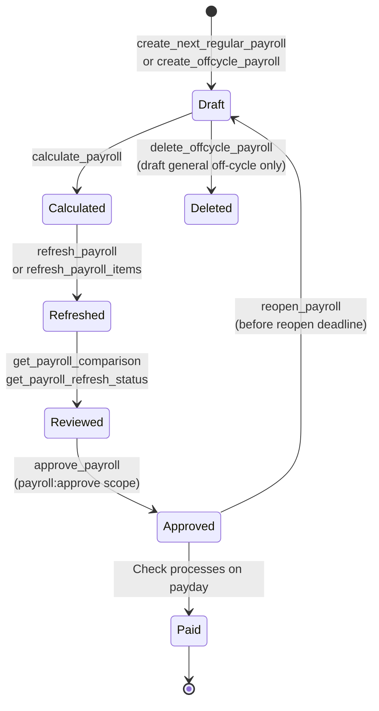
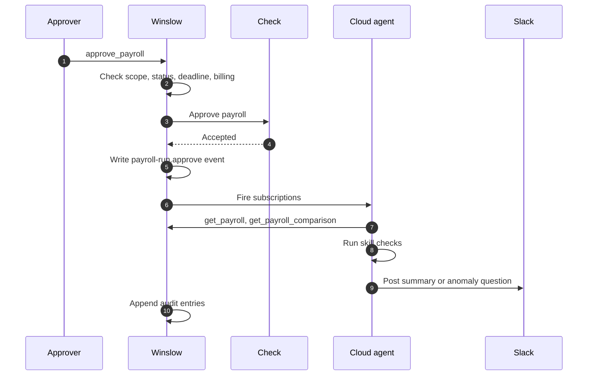

# Payroll

Winslow is an artificial-intelligence (AI) native Human Resources (HR) platform that sells payroll, benefits, a Human Resources Information System (HRIS), and a Slack-based AI co-worker as one product. **Check** is the third-party payroll engine that calculates tax, files returns, and moves money. Winslow is the layer above it.

Terms used on this page. **MCP** is the Model Context Protocol, an open protocol that lets an AI application call tools. A **tool** is one callable action, and a **scope** is a named permission string. The **tool catalog** is Winslow's published reference of 185 MCP tools. A **skill file** is a Markdown playbook that the customer's cloud agent follows. An **off-cycle payroll** is a run outside the regular schedule. **Pre-billing** is the period before a customer's first successful payment, when some actions are blocked. **ACH** means Automated Clearing House, the United States bank transfer network. A **1099 contractor** is a self-employed worker who receives a 1099 tax form. **Employer of Record (EOR)** means that Winslow or a partner is the legal employer in a country where the customer has no entity. **REST** is Representational State Transfer, the plain Hypertext Transfer Protocol (HTTP) interface that Winslow exposes next to MCP. An **item** is one payroll line: the earnings, deductions, and taxes for one person on one run. A **shell row** is an item row that stays on the run after the person has nothing payable, so the record still exists. The **comparison gate** is the rule that decides whether the current run is close enough to the prior run to approve on its own. **Calibration** is Winslow's name for a flagged pay change that a manager should review. The **page mock** is the screenshot-style illustration on the payroll marketing page. **FSA** means a Flexible Spending Account, and **HSA** means a Health Savings Account; both are pre-tax health accounts.

Citations such as `winslow.md:43` refer to text captures of the public Winslow pages, made on 2026-11-06. The capture of the MCP reference is `builders_mcp.txt`.

Payroll is the centre of Winslow's product. It is also the least experimental part. The interesting design is not the tax engine; Winslow uses Check for that. The interesting design is the layer above it. That layer has approval as a programmable workflow, off-cycle runs with no per-run fee, and an MCP interface that can do almost everything the interface can do.

This page covers the payroll domain: who it serves, how a run moves, what the approval workflow does, and where the tool catalog matches the marketing.

## Who payroll serves

Winslow is explicit about its payroll scope, and the scope is narrower than the product pages suggest:

> **We do not support hourly workers at this time** — We manage payroll for salaried employees in the United States only at this time. (`winslow.md:43`)

That single bullet removes a large part of the market. Restaurants, retail, hospitality, and most shift work need hourly payroll. Winslow's target is the salaried startup, which matches its founder story and its $40 price point.

The global offering is separate. Winslow says it provides "payments and Employer of Record (EOR) in over 100 countries" (`product_payroll.txt:106`). The payroll page says "over 100 countries"; other pages say "150+ countries." [Pricing and packaging](15-pricing-and-packaging.md) records the conflict.

| Dimension | Supported | Source |
|---|---|---|
| Worker type | Salaried employees in the United States; 1099 contractors | `winslow.md:43`, `winslow.md:28` |
| Hourly workers | Not supported | `winslow.md:43` |
| Domestic coverage | All 50 states, more than 10,000 jurisdictions | `product_payroll.txt:45` |
| Global | Over 100 countries, including EOR | `product_payroll.txt:107` |
| Payment method | ACH direct deposit by default | `winslow.md:34` |
| Payroll engine | Check | Admin bundle; `complete_onboarding` |

## The run lifecycle

A payroll is a Check object with a Winslow view on top. An object here means one payroll record in Check's system. The catalog does not publish a single status list. It names states through the rules on individual tools: draft, pending, approved, paid, voided, and closed. The Winslow side adds refresh state, comparison state, and approval deadlines. The diagram below mixes two vocabularies: process states that Winslow computes (Calculated, Refreshed, Reviewed) and persisted run states (Draft, Approved, Paid, Deleted). The read-only calls in the diagram mark the checks that move the process forward; they do not themselves change the stored state.



The order matters. `get_payroll` refreshes a stale draft before returning it; a draft is stale when Winslow data changed since the last refresh. `get_payroll_refresh_status` tells the caller whether a refresh is needed before treating the run as final or approving it. A builder that skips the refresh check can approve a payroll with stale items.

`refresh_payroll` rebuilds every item on the payroll. `refresh_payroll_items` rebuilds selected employees or contractors. Both are expensive, and both are the point where Winslow data synchronizes to Check. An employee with zero payable items stays in Winslow as a shell row so that the record still exists.

### Creating a run

`create_next_regular_payroll` follows the pay schedule. It fails in two documented cases:

1. Six or more upcoming payrolls already exist.
2. There is no future payday available.

That six-run cap is a guardrail against runaway schedules. It also means a builder cannot pre-create a year of payrolls.

```json
{"jsonrpc":"2.0","id":20,"method":"tools/call",
 "params":{"name":"create_next_regular_payroll",
           "arguments":{"workspaceId":"ws_01H..."}}}
```

The call returns a created run. If the later refresh or tax calculation fails, the tool returns `refreshError` or `calculationError` instead of failing. A builder must read both fields before it treats the run as ready.

### Approving a run

`approve_payroll` is the only tool with its own scope, `payroll:approve`. It is separate from `payroll:manage-payrolls` on purpose. A builder can prepare a payroll without being able to approve it.

Approval has four documented preconditions:

- The caller holds `payroll:approve`.
- The payroll is in a state that Check will accept.
- The approval deadline has not passed.
- Billing is not pre-billing or past its grace window.

The last one is unusual. A payroll cannot be approved if the subscription is unpaid. Winslow gives a 30-day grace period before the approval gate closes. The marketing page does not mention that a billing problem blocks payroll; the pricing page explains the grace period.

Approval emits a `payroll-run.approve` event. That event is what starts the agent process described below.

```json
{"jsonrpc":"2.0","id":21,"method":"tools/call",
 "params":{"name":"approve_payroll",
           "arguments":{"payrollId":"pr_01H...",
                        "workspaceId":"ws_01H..."}}}
```

The call returns a payroll view. It does not return a payment confirmation, because the money moves later, on the payday that Check processes.

### Reopening a run

`reopen_payroll` returns an approved payroll to draft. It works only before the Check reopen deadline. After that deadline, the correction path is an off-cycle run, not a reopened regular run.

### Excluding a person

`set_payroll_employee_exclusion` includes or excludes one employee in one run. It is idempotent. This is the correct tool for "pay everyone except this person this month." It is not a termination and does not change the employee record.

## The approval workflow

Winslow's claim is that approval is not a click. It is a workflow the customer owns:

> When you approve a payroll run, Winslow kicks off an extensible agent process. Standard out-of-the-box checks. Custom checks via skill files. You shape the runtime — we just execute. (`product_payroll.txt:60`)

The out-of-the-box checks are:

- anomaly detection on net-pay deltas;
- missing approvals;
- unfamiliar deductions;
- manager notifications for direct reports flagged at calibration;
- an audit entry on every change, by agent or human.

The custom part is a skill file. The implementation is an event subscription on `payroll-run.approve`, a prompt, and an MCP tool call. The agent can read the payroll, compare it with the prior run, produce an export, and message a person.



The workflow is powerful and under-specified. The documentation does not say whether the agent runs before or after Check accepts the approval. It also does not say whether a failed check can block the run, or whether the approver sees the check results before the money moves. The phrase "kicks off" suggests after. "Pre-approval checks" in the page mock suggests before. Both appear on the same page.

## Auto-approval

Winslow can approve regular payrolls without a human. The catalog exposes the settings:

| Mode | Behaviour |
|---|---|
| `INVOICES_MUST_MATCH` | Auto-approve only when invoices match the run |
| `SALARIES_ONLY` | Auto-approve when the run contains salaries only |
| `PERCENT_DEVIATION` | Auto-approve inside a percentage band against the prior run |
| `DOLLAR_DEVIATION` | Auto-approve inside a dollar band against the prior run |
| `ALWAYS_APPROVE` | Skip the comparison gate and approve |

A daily job at 2:00 a.m. performs the auto-approval. `set_payroll_auto_approve` turns the feature on or off for the workspace. `set_payroll_auto_approve_override` sets a per-payroll decision, and only on a draft.

Three controls surround the feature:

- Enabling auto-approval is blocked during pre-billing.
- The approval settings include a comparison gate; `update_payroll_approval_settings` changes it, and a null value clears a deviation.
- D-3, D-1, and D-0 reminders still go to whoever can approve. D-3 means three days before payday; D-0 is the payday itself.

Auto-approval is the point where the "humans stay in control" message meets the "never think about payroll again" message. The product supports both, and the customer chooses. A security reviewer should note that `set_payroll_auto_approve` is a write tool: an agent with the payroll scope can turn off the human step.

## Off-cycle payroll

Winslow says off-cycle runs are free, "every time" (`winslow.md:27`). The catalog supports two kinds of off-cycle run. The table also lists the regular run, so the reader can see which tool is not off-cycle:

| Kind | Tool | Use |
|---|---|---|
| Bonus, correction, spot | `create_offcycle_payroll` | Any extra payment |
| Termination | `create_termination_payroll` | Final pay for a termination |
| Regular (not off-cycle) | `create_next_regular_payroll` | The scheduled run |

An off-cycle run can include all employees or a named list. When the mode is `select`, everyone not named is recorded as excluded, not silently dropped.

```json
{"jsonrpc":"2.0","id":22,"method":"tools/call",
 "params":{"name":"create_offcycle_payroll",
           "arguments":{
             "name":"Q4 spot bonus",
             "payday":"2026-11-20",
             "paymentMethod":"DIRECT_DEPOSIT",
             "employeeMode":"select",
             "employeeRecordIds":["er_01H...","er_02H..."],
             "workspaceId":"ws_01H..."
           }}}
```

The constraints tool is `get_offcycle_payroll_payment_constraints`. It returns:

- the three-business-day direct-deposit lead time;
- the drop-dead date, which is the last date on which the run can still pay on the intended day;
- the allowed payment methods, as enumeration values: `DIRECT_DEPOSIT`, `CHECK` (a paper check), and `BANK_TRANSFER`.

A builder should call it before creating a run. A run requested inside the lead time will either miss the date or fall back to another method.

General off-cycle runs can be updated and deleted while draft. Termination runs cannot be deleted through MCP; that action is REST or interface only.

## Termination pay

Final pay is its own off-cycle run. `terminate_employee` creates it by default. The tool enforces state rules:

- the final-pay deadline for the state;
- the direct-deposit lead time;
- holiday exclusions;
- the employment status (an already terminated employee is rejected).

Severance is allowed only for involuntary terminations. Paid-time-off payout uses eight hours per accrued day.

`get_termination_payment_date_info` returns the state constraints before a termination is submitted. It defaults to involuntary. A builder should call it first, because the rules differ by state and a wrong date is a compliance error, not a user-interface error.

## Contractors and invoices

Contractors are 1099 workers on the same schedule and dashboard as employees (`winslow.md:28`). Two features matter:

- **Contractor invoices.** A contractor submits an invoice, including from Slack. A manager approves it, and the approved invoice flows into the next payroll. The MCP section has seven invoice tools.
- **Contractor payments without an invoice.** An off-cycle run can pay a contractor directly, which is useful for a spot payment.

The invoice statuses are SUBMITTED, APPROVED, REJECTED, and PAID. A submitted or approved invoice that is not on a payroll can be rejected, unapproved, or cancelled. Once it is on a payroll, those paths close.

Trial workspaces auto-approve self-submitted invoices. That is a trial behaviour and should not be assumed in production.

## Adjustments and reimbursements

Payroll has three separate adjustment concepts, and the catalog keeps them apart:

| Concept | Scope | Tools | Use |
|---|---|---|---|
| Recurring template | `payroll:manage-adjustments` | 5 tools | A rule: who gets what, on which runs |
| One-off adjustment | `payroll:manage-adjustments` | 5 tools | A single payment or deduction |
| Expense | `payroll:manage-adjustments` | 3 tools | A reimbursement claim |
| Reimbursement | `payroll:manage-payrolls` | 4 tools | A payable line on a run |

The split is a trap for builders. Expenses and reimbursements look similar and use different scopes. A caller with only `payroll:manage-payrolls` can create a reimbursement but not an expense.

A recurring template has four recurrence types: ONE_TIME, MONTHLY, FIRST_HALF, and SECOND_HALF. It has three amount types: FIXED_ALL, ASSIGNED_PER_PERSON, and CUSTOM_REQUIRED. It has three target types: EMPLOYEE_TYPE, EMPLOYEE_LIST, and DEPARTMENT.

The documented example is a $150 gym supplement for United States full-time employees on the first payroll of each month. That single template replaces a spreadsheet column and a manual check.

## Deductions and garnishments

Winslow handles four deduction layers:

- **Pre-tax.** FSA, HSA, commuter, parking, dependent care.
- **Post-tax.** Custom withholdings and charitable matching.
- **Garnishments.** Child support, levies, and defaulted-loan orders, withheld and routed to the agency.
- **Benefits.** Medical, dental, and vision premiums, from the benefits module.

The catalog exposes benefits adjustments separately from payroll adjustments, because a benefit deduction must reconcile with an election. `create_benefit_adjustment` creates an ONGOING standing deduction or a ONE_TIME adjustment on one payroll. An ONGOING adjustment must not name a payroll. A ONE_TIME adjustment must.

## Time off and unpaid leave

Time-off accruals appear on every paystub. Unpaid leave produces a payroll adjustment. The payroll tools do not manage accrual policy; the HRIS does. The join is the paystub and the run.

## Global payroll and EOR

The global offering is a different product with a different supply chain. Winslow says it provides:

- onboarding for a contractor or employee in minutes;
- no entity required, because Winslow is the employer of record;
- local contracts and tax forms;
- payment in local currency on local rails;
- compliance, filings, and statutory benefits;
- one invoice.

The public record does not name the EOR partner or partners, the countries served, or the pricing. The number of countries is inconsistent across pages. A buyer should treat global payroll as a separately contracted service and ask for the partner list.

**Aha:** Winslow's payroll innovation is not tax calculation. Check does that. The innovation is that every payroll action is a tool call with an actor, a scope, and an audit entry. That design makes three otherwise contradictory claims true at once: a human can approve, an agent can approve, and a skill file can add a check. The same primitive supports all three because the approval is an event, not a screen. The weakness is that the documentation does not say where the human check ends and the agent check begins.

## What is not public

- The exact Check contract, fees, and service-level agreement.
- The list of supported states for each tax type and the registration lead time.
- The reopen deadline value.
- The auto-approval job's time zone and failure handling; the catalog states only a daily 2:00 a.m. job.
- The EOR partner list and country coverage.
- Whether approval checks can block a run or only report after it.
- Payroll data retention and deletion.

## Where to go next

Read [Payroll reporting and compliance](10-payroll-reporting-and-compliance.md) for the reports, the tax centre, and the filing workflow.
