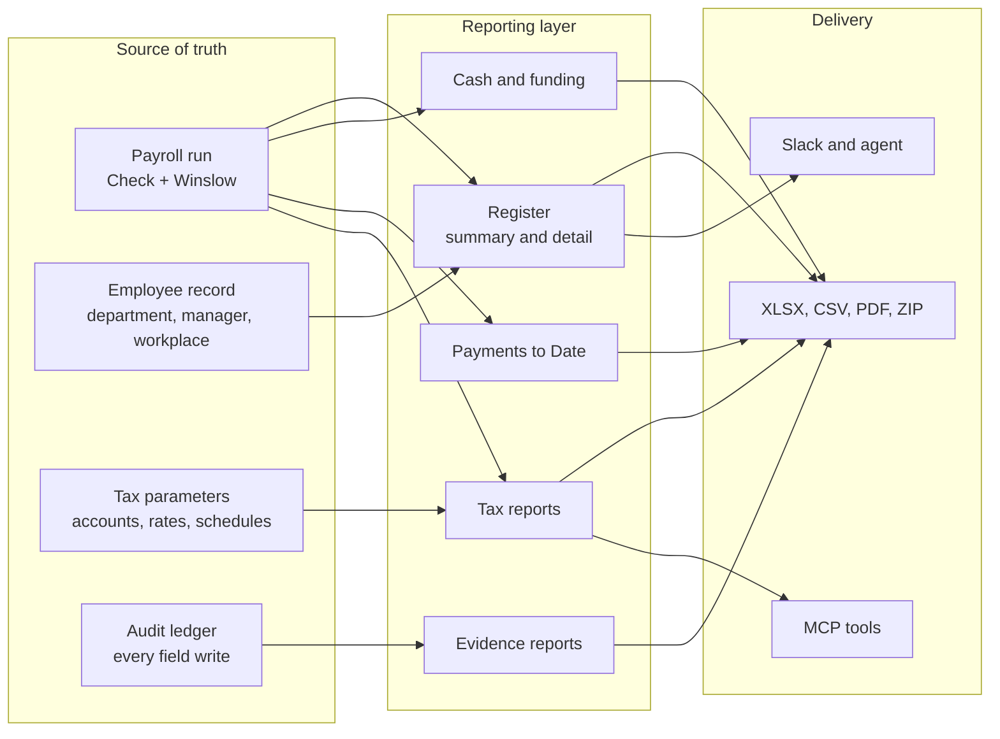
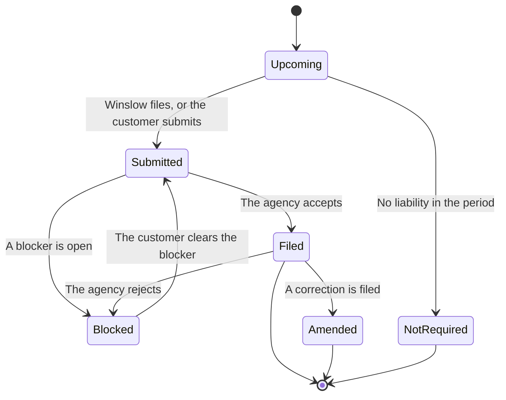

# Payroll Reporting and Compliance

Winslow is an artificial-intelligence (AI) native Human Resources (HR) platform from NFTCo, Inc. It runs United States salaried payroll and produces the tax filings that follow it.

Terms used on this page. A **payroll run** is one processing of pay for a group of workers for one pay period. A **register** is the report of one run: who was paid, how much gross, which deductions and taxes applied, and what the net was. A **grain** is the unit that one row of a report represents. A report with one row per worker per run has a finer grain than one with one row per run. A **funding date** is the day the money must reach the payroll account so that pay can be debited. **Check** is the payroll engine that Winslow uses to calculate, debit, and file; Winslow is the layer above it. A **Social Security number (SSN)** is the nine-digit United States tax identifier for a person. **Model Context Protocol (MCP)** is the open protocol that lets an AI application call tools. **XLSX** is the Microsoft Excel workbook format; **CSV** is comma-separated values, a plain-text table; **PDF** is Portable Document Format.

Payroll produces two kinds of output. One is money. The other is evidence: registers, tax filings, notices, and audit reports. Winslow treats the second as a product surface, not a back-office chore. The pages are unusually specific about columns, file formats, and statuses.

This page covers the reporting family, the tax centre, the filing lifecycle, year-end, and the compliance features around them. It also checks the claim that every report is available through the MCP.

## The reporting family

The payroll section of the feature list names eight report products (`winslow.md:45-57`):

| Report | Grain | Formats | What it answers |
|---|---|---|---|
| Payroll register — Summary | One row per payroll | XLSX, CSV, PDF | What did each run cost? |
| Payroll register — Detail | One row per worker per run | XLSX, ZIP of CSV, PDF | Where did every dollar go? |
| Cash and funding | One row per funding date | Not stated | What leaves the bank, and when? |
| Payments to Date | One row per payment | Not stated | What has every person been paid this year? |
| Employer and Employee Taxes | One row per tax per employee | Not stated | What tax applied, by jurisdiction? |
| Payroll taxes by employee or payroll | One row per employee, or one row per payroll | CSV, PDF, Excel | What did one person or one run pay? |
| Pay stub finder | One row per stub | PDF, ZIP | Where is the pay stub? |
| Evidence reports | Several fixed reports | CSV, Excel, PDF | Can an auditor verify a change? |

The detail register is the accountant-grade artifact. It includes:

- every worker's gross-to-net;
- employer cost;
- tax liability by agency;
- funding and cash requirements;
- third-party remittances;
- contractors;
- exceptions.

It supports subtotals and a grand total. That is the shape a financial controller expects, where a **financial controller** is the accountant who owns the ledger and the close. It is the report most likely to replace a spreadsheet.



### Grouping and history

The register can group by department, location, workplace, pay schedule, or manager. The grouping values are "as of each pay date," so a person who moved departments keeps the old department on old runs (`winslow.md:50`). That is the correct behaviour for history, and it is a detail that many payroll products get wrong.

### Export shape

The XLSX export has fixed tabs and live `SUM` formulas. Where a report offers CSV, the download is a ZIP archive that holds UTF-8 text files, not one plain CSV file. The detail register is the report that needs the archive, because it has several tables; a reader who expects one file must unpack it first. The PDF export is landscape. Social Security numbers are masked to the last four digits, and contractors are flagged at the 1099-NEC threshold. **1099-NEC** is the United States form for non-employee compensation, and the filing threshold is 600 dollars (`winslow.md:52`).

Live formulas are a small but meaningful choice. A controller can change a filter or add a row and the totals still work. A static export forces a rebuild.

## The tax centre

The Tax Center is the compliance dashboard. It answers four questions for a chosen quarter or year:

1. What tax liability did each payroll create?
2. What has been paid to the agencies?
3. What is scheduled now or still pending?
4. What has been filed?

The page shows three tiles: tax liabilities, paid to agencies, and scheduled or pending. The third tile answers both the second and the third question: what has been paid, and what is still scheduled. The fourth question, what has been filed, is answered in the filings list below the tiles. The first list has the same name as the first tile; it is the detail behind that tile. The headline is binary: "All filings and payments are on track," or an Action needed banner (`winslow.md:101`).

Beneath the tiles are four lists:

| View | Contents | States |
|---|---|---|
| Tax liabilities | One row per payroll, expandable to each tax line | Remitted by Winslow, or Your responsibility |
| Tax payments and deposits | Past and scheduled payments to each agency | Paid, Scheduled, Awaiting funds, Payment failed |
| Tax filings | 941, 940, state withholding, state unemployment, and more | Upcoming, Submitted, Filed, Blocked, Not required |
| Blocked-filing guidance | A plain-English reason and the next step | Admin alert on appearance, and 7 days before due |

The "Remitted by Winslow or Your responsibility" label is important. It tells the customer which obligations Winslow handles and which remain the company's. That is a liability boundary, and it should be read carefully in the contract.

The filings list includes a status timeline, amendment links, and the filed document. A quarter or year can be downloaded as a ZIP tax package. Unfiled returns appear in the package as drafts.

## The filing lifecycle

A filing is not a single action. It moves through a sequence, and each state has a different owner.



The owner changes along the path. **Winslow** owns a filing that it prepares and sends and owns the tracking of it. The **customer** owns every action that clears a blocker, because the blockers are a missing tax account, missing funds, a missing signature, or missing company data. The **agency** owns the decision to accept or reject. A rejected filing returns to `Blocked`.

The four blocking causes named in the product are not listed in one place. The documentation implies them: a missing tax account, a missing deposit or insufficient funds, a missing signature, and missing company data. These are the same four causes in every section of this page. A blocked filing always carries a reason and a next step, and an administrator is notified when the blocker appears and again seven days before the due date.

The filing types named are:

- Form 941, the federal quarterly payroll tax return;
- Form 940, the federal annual unemployment return;
- state withholding returns;
- state unemployment returns;
- Forms W-2 and W-3;
- local returns, handled at the locality level.

The product also says federal, state, and local filings are handled "on time, every cycle" (`winslow.md:109`). That is a service claim, not a technical guarantee. The contract and the service-level agreement decide what happens when a filing is late.

## State registration

Winslow opens state accounts when a company hires in a new state. The State Accounts view is a United States map with a status per state. Registration details are entered once and reused, with dropdowns and conditional questions. An agent can fill them in (`winslow.md:100`).

The claim is that the account opens "before payday" (`winslow.md:26`). The practical risk is the registration lead time. Some states take days or weeks, and a new hire in a new state can reach the first pay date before the account exists. The public record does not publish a per-state lead time or a list of states where registration is not automatic. A company that hires across state lines should start the registration before the hire date, not at the first payroll.

## Year-end

Year-end is the W-2 and 1099 cycle. Winslow says forms are "generated, distributed, and e-filed" and that "year-end is a non-event" (`winslow.md:27`).

The supporting features are:

- Payments to Date, built for W-2 reconciliation;
- year-to-date (YTD) and wage-base tracking, with wage-base-met flags for Social Security, the Federal Unemployment Tax Act (FUTA), the State Unemployment Tax Act (SUTA), and 401(k) plans. A **wage base** is the annual pay ceiling above which a tax stops. A **wage-base-met flag** marks a person who has passed that ceiling. The engine then stops the tax for the rest of the year;
- the pay stub finder, for reissues;
- tax packages, for the accountant.

The `get_employee_payroll_document` tool returns a W-2 or 1099 for one employee. It has no manager path; only the employee or an administrator can read it.

## Evidence and audit reports

The audit chapter adds reports that are not payroll reports but support payroll review:

- payroll change register per pay period;
- compensation change report;
- access review, showing who had which role on a given date;
- paid-time-off balances and liability as of any date.

An outside accountant or auditor can receive read-only access to the audit trail and evidence reports, without the ability to edit employees or approve payroll (`winslow.md:535`). That is a good procurement feature. It lets an auditor do the work without a temporary administrator account.

## I-9 and workers' compensation

Two compliance products sit beside payroll:

- **I-9 verification.** An E-Verify-compatible workflow with document collection and an audit trail (`winslow.md:111`). **Form I-9** is the United States form that proves a worker may work in the country, and **E-Verify** is the federal service that checks it. The document tools can upload, extract text, and validate a document. The `find_employee_documents` tool can search for "I9."
- **Workers' compensation.** Pay-as-you-go where available, carrier reporting otherwise (`winslow.md:112`). The public record does not name carriers, states, or rates.

Both are claims without published depth. A buyer should ask which states support pay-as-you-go workers' compensation and whether I-9 verification is actually integrated with E-Verify or only stores the documents.

## Local compliance

Winslow names three locality rules:

- San Francisco Health Care Security Ordinance (HCSO);
- Seattle paid time off;
- New York City salary disclosure.

The claim is that these are handled "at the locality level, not just the state" (`winslow.md:113`). That is a meaningful distinction. A payroll engine that stops at the state misses city taxes and city ordinances.

The list is short. It does not say how many localities are covered, whether the rules update automatically, or which version of each ordinance applies.

## What the MCP actually exposes

The marketing claim is broad:

> Every register and tax report is available through Slack and the MCP — ask for last quarter's detail register grouped by department and get the file. (`winslow.md:57`)

The 185-tool catalog does not contain a tool named for the register, the cash report, Payments to Date, or the tax package. The payroll reporting tools it does contain are:

| Tool | What it returns |
|---|---|
| `get_payroll` | A summary payroll view |
| `get_payroll_comparison` | Deltas against the last paid regular payroll |
| `get_payroll_taxes` | Employee and company tax lines with totals |
| `list_payroll_paystubs` | Stubs for one payroll run |
| `get_pay_stubs`, `get_pay_stub`, `search_pay_stubs` | Stubs for one employee |
| `get_employee_payroll_document` | A W-2 or 1099 |
| `get_company_tax_parameters` | Federal identifier, state accounts, rates |
| `get_employee_tax_parameters` | One employee's withholding setup |
| `ask_reporting_question` | An explanation plus a table |

So the claim may be true through the agent rather than through a dedicated tool. An agent could call `ask_reporting_question` or assemble a file from several reads. The documentation does not show that path, and it does not name a tool that produces a register file.

This is a concrete gap between the marketing sentence and the API reference. It belongs with the other gaps in the **Vibe Code promise**. That promise is Winslow's claim that a customer can build software outside the product and still use the whole product through the API. The critical assessment lists the rest.

```json
{
  "jsonrpc": "2.0",
  "id": 21,
  "method": "tools/call",
  "params": {
    "name": "get_payroll_taxes",
    "arguments": {
      "payrollId": "pr_01H...",
      "workspaceId": "ws_01H..."
    }
  }
}
```

The tool takes only a payroll identifier and an optional workspace identifier. The catalog documents those parameters and no grouping option, so the "grouped by department" sentence in the marketing claim has no direct tool argument.

The closest path to the marketing claim is the natural-language reporting tool. It takes one question and returns an explanation with a table:

```json
{"jsonrpc":"2.0","id":22,"method":"tools/call",
 "params":{"name":"ask_reporting_question",
           "arguments":{"question":"Total employer payroll tax by state for Q3 2026"}}}
```

`ask_reporting_question` needs `employee:manage-data`, and it filters rows at the **data-load layer**, the step where the tool reads the rows before it sends them to the model. The model therefore cannot report a field that the caller could not read directly. That design makes the report safe, but it also means the report cannot exceed the caller's own view.

Tax forms use the same `get_employee_payroll_document` tool with a different `type` value. A W-2 or 1099 is a document download, and a filing document is a different type:

```json
{"jsonrpc":"2.0","id":23,"method":"tools/call",
 "params":{"name":"get_employee_payroll_document",
           "arguments":{"employeeRecordId":"er_01H...",
                        "documentId":"doc_01H...",
                        "type":"tax"}}}
```

The tool has no manager path. Only the employee or an administrator can download a tax form, because the form contains sensitive personal data. `type: "tax"` returns a W-2 or 1099 for the employee. `type: "filing"` returns a state or federal withholding form. It needs a **Check-enrolled W-2 employee**. That is an employee that the Check payroll engine has set up for W-2 pay rather than 1099 contractor pay.

## Data protection in reports

The reports handle the most sensitive data in the product: pay, tax identifiers, bank details, and Social Security numbers. The documented protections are:

- SSN masking to the last four digits in spreadsheet exports;
- a payroll scope for pay stubs, separate from the general employee scope;
- no manager path for pay stubs, W-2s, and tax parameters;
- audit logging on every view and download of tax data (`winslow.md:107`).

The last one is stronger than it sounds. A read-only tax answer is still a logged event. That makes an internal leak investigable.

The documentation does not state:

- the retention period for reports;
- whether download links expire;
- whether a report can be generated for a terminated employee by a former manager;
- whether the audit log records the report contents or only the action.

**Aha:** Winslow's compliance story is not "we file your taxes." Many payroll providers file taxes. The unusual part is that the evidence is a first-class product: a detail register with live formulas, a tax package, an access review, and a read-only auditor seat. That is what a company needs at a funding round, an acquisition, or a tax notice. It is also what makes the product credible to a chief financial officer who will never use the Slack agent.

## Where to go next

Read [Benefits](11-benefits.md) for the second regulated domain, or [Permissions, security, and audit](14-permissions-security-and-audit.md) for how access to these reports is controlled.
