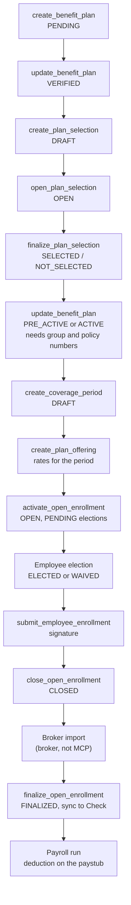
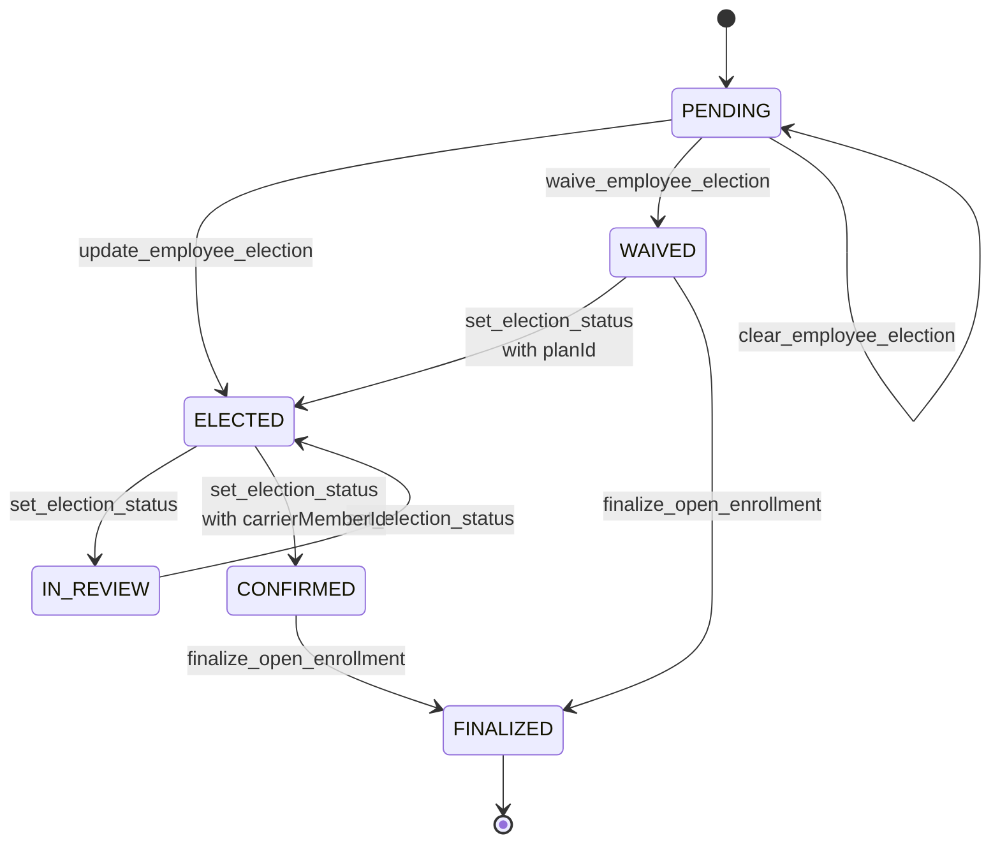
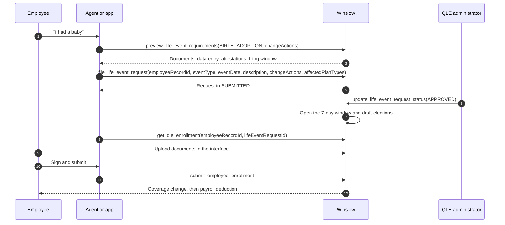

# Benefits

Winslow is an artificial-intelligence (AI) native Human Resources (HR) platform from NFTCo, Inc. It sells payroll, benefits, a Human Resources Information System (HRIS), and a Slack-based AI co-worker as one product.

Terms used on this page. A **regulated domain** is a product area whose work the law controls. The software must keep evidence of each action. Payroll is the first of Winslow's two, and benefits is the second. A **workspace** is one customer account, which holds the employees, the plans, and the settings of one company. An **Application Programming Interface (API)** is a contract that lets one program call another. The **Model Context Protocol (MCP)** is the open protocol that Winslow exposes at `https://api.usewinslow.com/api/mcp`. A **tool** is one callable action on that server. The **tool catalog** is the list of all 185 tools. **REST** means Representational State Transfer, the plain Hypertext Transfer Protocol (HTTP) interface that Winslow exposes beside MCP. The **interface** is the browser application at `app.usewinslow.com`, and **Slack** is the chat product where the employee talks to the agent. **Check** is the payroll engine that Winslow calls to calculate, debit, and file. A **carrier** is the insurance company that bears the insurance risk. A **broker** is the licensed intermediary who places a plan with a carrier for the employer. An **administrator** is a workspace member with a benefits scope; the product does not define a separate legal role for that person. A **system of record** is the one place where the authoritative copy of a fact lives.

Sources. `product_benefits.txt` is the text capture of the public benefits page. `winslow.md` is the product's own machine-readable product file. `builders_mcp.txt` is the reference catalog of MCP tools. All three were captured on 2026-11-06. Citations such as `winslow.md:62` refer to those captures.

The marketing promise is simple: employees compare plans and enrol in Slack, and deductions reach payroll without a second system. The API reveals a larger machine underneath: a plan catalogue, a coverage-period calendar, an election state machine, a broker import step, and a qualifying-life-event process with its own evidence rules. This page follows that machine from plan setup to payroll deduction, and marks each part that the public record leaves open.

## The object model

Six objects hold the benefits domain. The table gives each one and the object it belongs to:

| Object | What it is | Belongs to |
|---|---|---|
| Benefit plan | One insurance product from one carrier, with a carrier, a plan code, and a group and policy number | A workspace |
| Plan offering | The rates and employer contribution for one plan in one coverage period, or a standalone quote | A plan, and usually a coverage period |
| Plan selection | A workspace-level decision cycle that marks plans SELECTED or NOT_SELECTED | A workspace |
| Coverage period | Two date pairs: the open-enrollment window and the coverage window that follows | A workspace |
| Election | One employee's choice for one plan type in one coverage period | One employee, one plan type, one coverage period |
| Benefit adjustment | A payroll line that a finalized election produces | One election; an ONGOING adjustment repeats on each run, a ONE_TIME adjustment applies to one run |

A **plan type** is the category of cover: MEDICAL, DENTAL, or VISION. An **offering** is a plan priced for a period. An **election** is one employee's decision about one plan type.

The roles are separate from the objects. Winslow is not the carrier. It acts as the broker-facing plan administrator and is the system of record for the election and the deduction. Here "administrator" is a product role, not a person; the person in the role is the workspace administrator defined above. The table makes the division of responsibility explicit:

| Party | Owns |
|---|---|
| Carrier | The insurance risk, the policy, and the member identifier |
| Employer | The plan sponsorship, the contribution, and the choice of plan |
| Broker | The placement with the carrier, the rate negotiation, and the carrier reconciliation |
| Winslow | The catalogue, the enrollment workflow, the election record, the evidence, and the deduction hand-off |
| Check | The payroll calculation, the debit, and the tax filing |
| Employee | The election, the dependents, and the signature |
| Dependent | A person covered by an employee's election |

## What Winslow sells

The benefits page makes six claims (`product_benefits.txt:86-105`):

| Claim | Detail | Terms the claim needs |
|---|---|---|
| Plan sourcing | A broker network; small group, level-funded, and large group | **Small group** is the employer-size band with simplified rating rules, usually 50 or fewer workers. **Large group** is the band above it, usually more than 50. **Level-funded** is a self-funded arrangement with a fixed monthly payment and a possible refund. |
| Five-minute enrolment | Plan cards in Slack; pick, confirm dependents, done | A **plan card** is the Slack message that shows a plan and its price. A **dependent** is a family member covered by the employee's election. |
| AI-supported recommendations | Suggested plan from usage, dependents, and projected needs; recommends, does not decide | **Usage** here probably means past claims, but the page does not say. |
| Life events | New dependent, address change, qualifying event; no ticket | **No ticket** means no support ticket is opened. A **qualifying life event (QLE)** is a change such as marriage or birth that opens a special enrollment window. An address change is one kind of QLE, not a separate category. |
| Compliance | "Winslow has your back in all 50 states" (`product_benefits.txt:102`) | The claim names no form and no filing. |
| Payroll integration | Deductions applied to the next run | A **run** is one payroll processing for one pay period. |

The plan types are medical, dental, and vision. The feature list adds "standard ancillary lines, sourced and administered" (`winslow.md:62`). **Ancillary** means cover that is secondary to medical, such as life, disability, and accident. The public record does not name the ancillary lines. The page marks this as an open question, not as a settled product fact.

## The open-enrollment lifecycle

Winslow describes one flow (`winslow.md:62`):

> Plan catalog → selection → open enrollment → elections → broker import → finalize → payroll deductions. One flow, not six tools.

"Six tools" in that sentence is marketing shorthand for the product areas in the flow; it is not a count of MCP tools. The tool catalog is the list that matters, and it exposes most of the flow. It documents five exclusions in one list (`builders_mcp.txt:1403-1411`):

- Summary Plan Description (SPD) and plan-document attachment upload;
- plan document ingest;
- census and election comma-separated values (CSV) export;
- broker import;
- broker create and update. Brokers are read-only through `list_brokers`.

Termination-payroll deletion is a sixth REST-or-interface exclusion (`builders_mcp.txt:755`). A seventh rule applies to the election: no admin tool writes a QLE election. QLE elections stay employee-attested. The diagram below follows the main flow. External steps carry an owner label:



The order is enforced by the tools in three places. `update_benefit_plan` refuses ACTIVE or PRE_ACTIVE without a group number and a policy number. `create_plan_offering` refuses to attach a coverage period unless the plan is PRE_ACTIVE or ACTIVE. `finalize_open_enrollment` refuses to run unless `acknowledged` is true. The rest of the order is a recommended recipe, not a hard gate. `activate_open_enrollment` can run on a DRAFT or a CLOSED period, so a closed window can be reopened.

### Step 1: plan catalogue

A plan starts as PENDING. It moves to VERIFIED, then to SELECTED or NOT_SELECTED, then to PRE_ACTIVE, ACTIVE, and finally INACTIVE. Only a SELECTED plan should move to PRE_ACTIVE; a NOT_SELECTED plan stays in the catalogue as the record of a rejected choice.

| Status | Meaning | What changes it |
|---|---|---|
| PENDING | Added but not reviewed | `create_benefit_plan` |
| VERIFIED | Reviewed and valid | `update_benefit_plan` with `status` |
| SELECTED | Chosen for the year | `finalize_plan_selection` |
| NOT_SELECTED | Rejected for the year | `finalize_plan_selection` |
| PRE_ACTIVE | Set up, not yet in force | `update_benefit_plan` with `status: PRE_ACTIVE` and a group number and a policy number |
| ACTIVE | In force | `update_benefit_plan` with `status: ACTIVE` and a group number and a policy number |
| INACTIVE | Ended | `update_benefit_plan` with `status: INACTIVE` |

PRE_ACTIVE and ACTIVE share one unlock condition: a group number and a policy number. The status is a manual choice, not an effect of the coverage date. An administrator sets ACTIVE when the carrier confirms the policy is in force. An ACTIVE plan cannot be deleted; it can only be made INACTIVE. `delete_benefit_plan` removes only a PENDING or NOT_SELECTED plan that has no elections and no offerings.

`create_benefit_plan` takes a plan type, a carrier, a broker, a name, and optional group and policy numbers. The Summary of Benefits and Coverage (SBC) and Summary Plan Description (SPD) files are uploaded in the interface, not by the tool. The reference says "SBC/SPD files are uploaded in the UI" (`builders_mcp.txt:331`). The fields on the tool are references, not file bodies.

A **priced offering** binds one plan to one coverage period. The pricing data is either composite, meaning one blended rate for each coverage tier, or age-banded, meaning a rate that changes with the age of each covered person. The sample below uses the composite form. The workspace comes from `planId`, not from a separate argument. Omit `coveragePeriodId` to create a standalone quote that is not attached to a period:

```json
{"jsonrpc":"2.0","id":40,"method":"tools/call",
 "params":{"name":"create_plan_offering",
           "arguments":{
             "planId":"plan_01H...",
             "coveragePeriodId":"cp_01H...",
             "employerContribution":"450.00",
             "quotingData":{
               "employeeOnly":"600.00",
               "employeeSpouse":"1,250.00",
               "employeeChildren":"1,100.00",
               "family":"1,800.00"
             }
           }}}
```

`update_plan_offering` is blocked while its coverage period is OPEN. `delete_plan_offering` is blocked once the offering has an election or its period is past DRAFT. The rates on an existing offering are therefore fixed during an open window. A new offering can still be created, so the set of rates can grow but not change. That is the correct behaviour for an audit.

### Step 2: plan selection

The plan selection is a workspace-level status: DRAFT, OPEN, or CLOSED. It controls when plans can be marked SELECTED. It is one cycle per workspace, not one per plan, so the diagram above places it before the plans become final.

The sequence is:

1. `create_plan_selection` starts a DRAFT cycle. It needs at least one VERIFIED plan and no other active cycle.
2. `open_plan_selection` moves DRAFT to OPEN for stakeholder review. A **stakeholder** here is any person the employer asks to review the plan set, usually an owner or a finance lead.
3. `close_plan_selection` moves OPEN to CLOSED.
4. `finalize_plan_selection` takes `selectedPlanIds`, optional `contributions` keyed by plan identifier, and optional `waivedTypes`, then marks each VERIFIED plan SELECTED or NOT_SELECTED. It also closes an OPEN cycle automatically.
5. `reset_plan_selection` returns to DRAFT. An OPEN cycle must be closed first. The documentation does not say what happens to plans that were already marked.

There are two status machines, and they are easy to conflate. The **plan lifecycle** is the status of one plan: PENDING, VERIFIED, SELECTED, NOT_SELECTED, PRE_ACTIVE, ACTIVE, or INACTIVE. The **selection cycle** is the status of the workspace decision: DRAFT, OPEN, or CLOSED. `finalize_plan_selection` moves the cycle and writes SELECTED or NOT_SELECTED onto each plan. The two-level model lets an administrator prepare plans without exposing them, then publish the set as one decision. `waivedTypes` is the deliberate escape: a plan type with no chosen plan is recorded as waived rather than left open.

### Step 3: coverage period

A coverage period holds two date pairs: the open-enrollment window (`startDate` and `endDate`) and the coverage window that follows it (`coverageEffectiveDate` and `coverageEndDate`). The period is workspace-level; the plans attach to it through their offerings.

The rules are strict:

- The coverage effective date must be the 1st or the 15th of a month.
- The coverage effective date must be strictly after the open-enrollment end date in the same request.
- The period cannot overlap an existing period's enrollment window or coverage window.
- A DRAFT or OPEN period can be updated. Once OPEN, only `endDate` and `coverageEndDate` can move, and only later. The date cannot be shortened, because elections may already rely on the length.
- A period with any FINALIZED election cannot be deleted. CONFIRMED elections are not in that guard, so a period can be deleted after a carrier has a member identifier. That is a gap a buyer should raise.

```json
{
  "name": "create_coverage_period",
  "arguments": {
    "startDate": "2026-11-01",
    "endDate": "2026-11-14",
    "coverageEffectiveDate": "2026-12-01",
    "coverageEndDate": "2027-11-30"
  }
}
```

The field names above are documented. The values are illustrative. The tool does not state whether the dates are inclusive or which time zone applies.

The 1st-or-15th rule is a carrier convention, not a Winslow invention. It narrows the integration surface, because a carrier can accept a first-of-month or fifteenth-of-month effective date and Winslow does not need per-carrier date logic. The claim that every carrier accepts both dates is an assumption, not a published fact.

### Step 4: activation and tracking

`activate_open_enrollment` moves a DRAFT or CLOSED period to OPEN. It creates PENDING elections for every eligible employee and every offered plan type. **Eligible** means the employee passes the workspace eligibility rules. The `hasFullCensus` flag is a workspace setting that says whether Winslow holds a complete employee census. `update_benefits_configuration` sets it, and it affects those eligibility calculations (`builders_mcp.txt:406`). The call is bulk and large. The documentation does not state whether it is idempotent; a second call on an OPEN period is not described.

The employee sees plan cards in Slack after activation. The public record does not show the message, so the exact timing is an observation from the marketing page, not a documented event.

`get_enrollment_tracking` reports, per employee, the submission status and the projected cost. The cost basis is not stated: per month, per pay period, or per year.

`send_enrollment_reminders` takes `coveragePeriodId`, a list of `employeeRecordIds`, a subject, and a body. It sends email and returns `{ sent, failed }`. One failed send does not fail the call. Notices are opt-in per channel, and the notice types are open, close, and finalize (`winslow.md:74`). The reminder tool itself sends only email; the other channels belong to the notification registry, which the documentation does not list.

### Step 5: elections

An election belongs to one employee, one plan type, and one coverage period. Its statuses are:

| Status | Meaning | Who sets it |
|---|---|---|
| PENDING | Not yet decided | `activate_open_enrollment`, or `clear_employee_election` |
| ELECTED | Employee chose a plan and a tier | `update_employee_election` |
| IN_REVIEW | Under review | `set_election_status` |
| WAIVED | Employee declined coverage | `waive_employee_election` |
| CONFIRMED | Carrier confirmed, with a member identifier | `set_election_status`, or `admin_update_election` |
| FINALIZED | Locked and synchronized to Check | `finalize_open_enrollment`; `set_election_status` can also set it as a manual override |



The graph shows what the prose names. Three gaps are visible. The tool does not allow a direct ELECTED to FINALIZED move, so an election without a carrier member identifier blocks finalization. The graph does not show the `reset_plan_selection` effect on an election, because the documentation does not describe one. And `clear_employee_election` resets an ELECTED or CONFIRMED election to PENDING, which the graph shows as a loop for clarity.

The rules for changing an election are narrow:

- `update_employee_election` works only on PENDING or ELECTED, and only while the coverage period is OPEN. It sets `planId`, `coverageTier`, and `dependentIds`. The tier values are `EMPLOYEE_ONLY`, `EMPLOYEE_SPOUSE`, `EMPLOYEE_CHILDREN`, and `FAMILY`.
- `waive_employee_election` works only while the period is OPEN. The allowed source statuses are not stated.
- `clear_employee_election` resets to PENDING and clears the plan, the tier, and the dependents. It also works only while the period is OPEN. A CONFIRMED election can exist while the period is open, because a carrier can confirm early; in that case the clear still works.
- `set_election_status` is the admin override. It accepts PENDING, ELECTED, IN_REVIEW, WAIVED, CONFIRMED, and FINALIZED. WAIVED to ELECTED needs a `planId`. CONFIRMED needs a `planId` and a `carrierMemberId`, or a `waiveReason` when the carrier waives cover. A manual FINALIZED is an override; the normal path is `finalize_open_enrollment`.
- `admin_update_election` has no per-employee ownership check; scope alone gates it. It can set a carrier member identifier, premiums, plan, tier, dependents, coverage dates, and carrier data.

The employee tools have no manager path. A manager cannot read or change a report's election. Only the employee, an administrator, or a QLE administrator can act.

`submit_employee_enrollment` requires every plan type to be ELECTED or WAIVED. It also requires a base64 PNG signature, where **base64** is a text encoding of binary data and **PNG** is Portable Network Graphics, a lossless image format. The decoded image may not exceed 2 megabytes. The signature is audit-logged with the elections it covers (`winslow.md:68`). The public record says "the election" in the singular while the submission covers several elections. The audit entry probably stores one signature for the whole submission, but the page does not say.

One election change names the period, the election, and the chosen plan and tier:

```json
{"jsonrpc":"2.0","id":41,"method":"tools/call",
 "params":{"name":"update_employee_election",
           "arguments":{"coveragePeriodId":"cp_01H...",
                        "electionId":"el_01H...",
                        "planId":"plan_01H...",
                        "coverageTier":"EMPLOYEE_ONLY",
                        "dependentIds":[]}}}
```

The call fails with `VALIDATION_ERROR` when the period is not OPEN or the election is in any state other than PENDING or ELECTED, including FINALIZED. `admin_update_election` takes the same fields and adds `employeePremium` and `employerContribution`; when they are omitted, the server recalculates them from the offering.

The e-signature has a compliance purpose: it gives the employer evidence that the employee chose the plan. The public record does not cite the Electronic Signatures in Global and National Commerce Act (ESIGN) or the Uniform Electronic Transactions Act (UETA). It also does not describe consent to electronic signature, identity verification, or retention. A buyer should ask for those three before treating the signature as legal evidence.

### Step 6: broker import and finalization

After open enrollment closes, the broker imports the elections into the carrier systems and reconciles the results. The working set for that step is `list_period_elections`, which returns every election in the period across all eligible employees. Broker import itself is REST or interface only, and it is one of the five documented MCP exclusions. The broker is the party that performs it; Winslow supplies the data and records the result.

`close_open_enrollment` moves the period from OPEN to CLOSED. It is the step before broker import.

`finalize_open_enrollment` runs on a CLOSED period. It requires `acknowledged: true`. The catalog also says to call it once first to preview the blockers. Those two instructions conflict: a preview call cannot both acknowledge and preview. The practical reading is a dry run with `acknowledged` false, then a second call with `true`. The public record gives no example. The blockers return as an error payload instead of finalizing. The documented blockers are:

- an election that is neither CONFIRMED nor WAIVED;
- an unaccepted broker-import difference;
- a missing carrier member identifier;
- a carrier decline.

A missing signature is not in the documented list. An employee who chose a plan but never submitted leaves an election ELECTED; an employee who never chose leaves it PENDING. Neither is CONFIRMED, so both block. `IN_REVIEW` is not named, so the page cannot say whether a review blocks finalization.

Finalization is the hand-off point. CONFIRMED elections become FINALIZED, and coverage syncs to Check. A WAIVED election also becomes FINALIZED and produces no deduction. The deduction appears on the next payroll run that applies benefits.

## Qualifying life events

A QLE opens a special enrollment window outside the annual open-enrollment period. Winslow supports eleven event types: MARRIAGE, DIVORCE, BIRTH_ADOPTION, DEATH_OF_DEPENDENT, LOSS_OF_COVERAGE, GAIN_OF_COVERAGE, EMPLOYMENT_STATUS_CHANGE, RELOCATION, AGING_OUT, COURT_ORDER, and OTHER.

The change actions are ADD_DEPENDENT, REMOVE_DEPENDENT, ENROLL_IN_COVERAGE, CANCEL_COVERAGE, CHANGE_PLAN, and CHANGE_COVERAGE_LEVEL. **Change coverage level** means a change of tier, such as employee only to family.

The public record does not give the event-to-action mapping. A marriage can plausibly allow ADD_DEPENDENT and CHANGE_PLAN; a divorce can plausibly allow REMOVE_DEPENDENT and CANCEL_COVERAGE. The page marks this as a gap, because that matrix is the core of QLE compliance.



The rules are strict in a different way from open enrollment:

- `preview_life_event_requirements` is stateless. It takes an event type and the change actions, and returns the documents, the data entry, the attestations, and the filing window. It creates nothing.
- `file_life_event_request` takes the employee, the event type, the event date, a description, the change actions, and the affected plan types. It has no manager path. The employee or a QLE administrator files it.
- Supporting documents are uploaded only in the interface.
- Approval moves the request from SUBMITTED to APPROVED. It opens a seven-day window and drafts elections for the affected plan types.
- QLE elections stay employee-attested. No admin tool creates or completes one; the employee does that with the same election tools used in open enrollment. `set_election_status` remains an admin override on an existing election, so the boundary is about who writes the election, not about who may correct a status.

The seven-day window starts at approval, not at the event date. Many legal QLE windows start at the event, so the product adds a filing rule on top of the legal rule. The public record does not cite the legal basis for seven days. It is a product rule until a source says otherwise. What the system enforces when the window expires is not documented.

## Plan documents

Employees, their direct manager, and an administrator can read the SPD for a plan the employee is enrolled in. **SPD** means Summary Plan Description, the document that describes what a plan covers. **SBC** means Summary of Benefits and Coverage, the short standard summary that the law requires. Two tools cover the SPD:

- `list_employee_benefit_spds` returns the SPDs for the employee's enrolled plans. Each entry has an `attachmentRef` and a recommended flag. An **attachment reference** is an opaque identifier that the next tool takes. Omit `planTypes` to get all three.
- `get_employee_benefit_spd_document` returns the extracted text of one SPD, by `attachmentRef`. Set `maxChars` (alias `limit`) to page it; the response is `{ totalChars, offset, returnedChars, hasMore, text }`. Advance `offset` by `returnedChars` until `hasMore` is false. A scanned PDF returns the hint `scan_or_image_pdf`, and the caller must run optical character recognition.

The call shape is:

```json
{"jsonrpc":"2.0","id":42,"method":"tools/call",
 "params":{"name":"get_employee_benefit_spd_document",
           "arguments":{"employeeRecordId":"er_01H...",
                        "attachmentRef":"att_01H...",
                        "maxChars":20000}}}
```

The SPD is the document that answers "is this covered?" The product's Slack example asks that question and gets an answer from the text. The retrieval path is real only for a digital PDF; a scan needs the caller's own recognition step, and the tool does not say how good the result will be.

The upload path is the interface. `create_benefit_plan` records the references; the files themselves go in through the browser. That is why the MCP exclusion for document upload does not break the read path.

## Recommendations

The recommendation is the most sensitive feature in benefits, because a wrong one can cost an employee thousands of dollars. The guardrail is explicit: "Recommends, doesn't decide" (`product_benefits.txt:96`). The agent compares plans and explains the difference; the employee chooses.

The marketing example compares three plans:

- Aetna PPO Gold at $612 per month, with $20 copays and a $1,500 deductible;
- Blue Shield PPO Preferred at $498 per month, with $35 copays and a $3,000 deductible;
- Blue Shield HDHP/HSA at $291 per month, with a $6,000 deductible and an $8,550 HSA limit.

**PPO** means Preferred Provider Organization, a plan that pays more when the member uses its network. A **copay** is a fixed charge for one visit or one prescription. A **deductible** is the amount the member pays before the plan pays. **HDHP** means High-Deductible Health Plan, and **HSA** means Health Savings Account, a pre-tax account that pairs with it. The "HSA limit" is the annual contribution limit; the page does not say whether it is the employee limit or the combined limit.

The agent concludes that the Gold plan is about $900 ahead on last year's usage, and offers to enrol or show the math. The page does not show the usage figures, so the arithmetic cannot be checked. The design choice is the last clause, "show the math": a recommendation that cannot show its arithmetic is not auditable. The public record does not say whether the math is shown by default, what data it uses, or how consent is captured. It also does not say whether claims data is protected health information under the Health Insurance Portability and Accountability Act (HIPAA). Those are the first questions for a benefits buyer.

## Payroll integration

A benefit election becomes a payroll deduction. The path has four parts:

1. The election is FINALIZED. Finalization is the only trigger.
2. The deduction is created as an ONGOING benefit adjustment, linked to the election. An **ONGOING adjustment** repeats on each payroll; a **ONE_TIME adjustment** applies to one run.
3. The payroll refresh pulls the adjustment onto the run. A **refresh** recalculates the run and reports its status.
4. The paystub shows the employee deduction and the employer contribution.

The election is the source record. The adjustment is the link that payroll reads; it is not the same object. That distinction matters when an election is changed: the adjustment must be updated, and it is the adjustment that the payroll engine sees.

The payroll page's example shows the result for one pay period. Gross salary is $7,500, medical is −$284, dental is −$31, and vision is −$9. Taxes are −$2,063.23, net is $5,112.77, and the employer benefits cost is $1,046. The example does not state the pay period (monthly, biweekly, or other), so the figures are illustrative.

Mid-cycle changes are prorated. The public record does not state the proration basis: calendar days, pay periods, or effective dates. The adjustment tools support the change: an ONGOING adjustment can be updated, and the election premium is restored if the adjustment is deleted. A ONE_TIME adjustment handles a single correction.

The public record does not say whether the deductions are pre-tax or post-tax, whether Section 125 cafeteria-plan rules apply, how deductions are ordered, or how arrears are handled. Those are core payroll questions and are listed under "What is not public".

## Compliance claims

Winslow says it has "your back in all 50 states" (`product_benefits.txt:102`). The feature list says "Compliance and Filings" without naming a form or a filing (`winslow.md:72`).

The benefits compliance surface differs from the payroll surface. It includes:

- plan document retention (SPDs and SBCs);
- open-enrollment notices;
- Employee Retirement Income Security Act (ERISA) and Consolidated Omnibus Budget Reconciliation Act (COBRA) obligations, depending on employer size. Winslow does not state its thresholds; COBRA generally applies at 20 or more employees.
- state-specific mandates;
- carrier and broker licensing. The page does not say whose licence is meant.

These are obligations that the employer must satisfy. The public record does not show Winslow administering them: it does not mention COBRA notices, ERISA Form 5500 (the annual plan return), or state mandates. A buyer should treat "compliance" here as a claim to verify, not a documented capability.

The same caution applies to carrier integrations. Winslow says it has "direct connections to the major carriers" and that changes sync "without EDI tickets" (`winslow.md:70`). **EDI** means Electronic Data Interchange, the structured file exchange that carriers use; an "EDI ticket" is the manual work item that such a file error creates. No carrier is named, and no integration method is described. The broker import step suggests that at least some carriers still work through a file exchange. The named plans in the recommendation example show what a customer might buy; they are not a statement that Winslow integrates with those carriers.

**Aha:** Benefits is where the single-record design proves its value. In a common company, an election lives in a broker portal, a deduction lives in payroll, and a document lives in a shared drive. A life event is entered three times, and the reconciliation is a monthly spreadsheet. Winslow makes one election record the source for the deduction and for the SPD link. The agent can therefore answer "is this covered?" and "what will it cost?" in one thread. The limit is the perimeter: the carrier and the broker still sit outside the record, so the last step is an import, not a live application programming interface call.

## What is not public

- The carrier list and the integration method for each.
- The broker network and how brokers are appointed.
- The ancillary product lines.
- The event-to-action matrix for QLEs.
- COBRA, ERISA, and state-mandate handling.
- The recommendation model, its data inputs, its consent model, and its HIPAA position.
- The QLE document requirements per event type; the preview tool returns them at runtime.
- Benefits pricing and who pays the broker.
- The payroll treatment of deductions: pre-tax, post-tax, ordering, and arrears.
- The effect of a retroactive termination on an election.

## Where to go next

Read [HRIS](12-hris.md) for the employee record that benefits reads and writes, or [Payroll](09-payroll.md) for the run that consumes the deduction.
