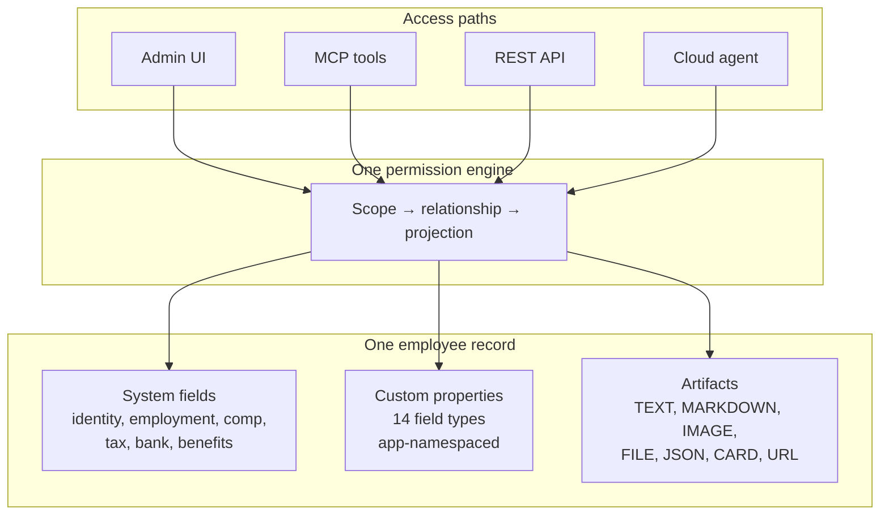
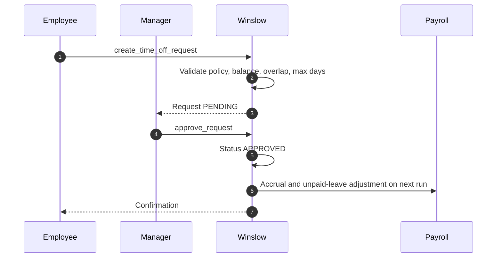

# HRIS

Winslow is an artificial-intelligence (AI) native Human Resources (HR) platform from NFTCo, Inc. It sells payroll, benefits, the Human Resources Information System (HRIS) described here, and a Slack-based AI co-worker as one product.

Terms used on this page. A **workspace** is one customer account, which holds the employees, the settings, and the data of one company. An **employee record** is the object that holds the system fields, the custom properties, and the artifacts of one worker. A **custom property** is a typed field added to that record by an administrator or an application. An **artifact** is a named data object attached to a record, with a type and a payload. The **admin interface** is the browser application at `app.usewinslow.com`. The **cloud agent** is Winslow's hosted artificial-intelligence co-worker, which reads and writes the record through the same tools as any other client. A **scope** is a named permission such as `employee:manage-data`. A **relationship** is the caller's link to the target record: self, direct manager, or administrator. A **projection** is the field set that a response contains, decided by that relationship. The **relationship gate** is the check that applies the relationship rule. The **Model Context Protocol (MCP)** is the open protocol that Winslow exposes at `https://api.usewinslow.com/api/mcp`; a **tool** is one callable action on that server. **Representational State Transfer (REST)** is the plain Hypertext Transfer Protocol (HTTP) interface that runs beside MCP.

The HRIS is the part of Winslow that existed before the artificial-intelligence layer. It is the employee record, the documents, the organization chart, the time off, and the audit log. Winslow's differentiator is that this record is writable from outside the product, through MCP, under the same permissions as the admin interface. The word "writable" needs a limit: six operations are REST or interface only, and a qualifying life event (QLE) election is never written by an admin tool. This page names each limit where it appears.

This page describes the record model, the core HR features, and the extension points that make the record a platform.

## The record model

An employee record has three layers:

| Layer | Contents | Who defines it |
|---|---|---|
| System fields | Name, work email, department, manager, compensation, employment type, start date, status, tax and bank data | Winslow |
| Custom properties | Typed fields added by an administrator or an application | The customer or an application |
| Artifacts | Structured or unstructured objects attached to the record: notes, checklists, reviews, files, cards | Any application, subject to permission |

The system fields are the payroll and benefits substrate. The custom properties are the customer's schema. The artifacts are the application's data. The `appId` on a custom property and the `appId` on a registered artifact app are the same namespace key. `register_artifact_app` registers the key once, and both the property prefix and the artifact grouping use it.



### Custom properties

Custom properties are the documented way to add a field. The MCP tool `create_app_property` creates one, and its label is prefixed with `{appId}-`. That prefix is the namespace. Two applications cannot collide, and the admin interface can group fields by application.

The 14 property types are:

| Type group | Types |
|---|---|
| Text | SHORT, LONG, RICH |
| Contact | PHONE, EMAIL |
| Numeric | NUMBER, CURRENCY |
| Date | DATE |
| Boolean | CHECKBOX_SINGLE, CHECKBOX_MULTIPLE |
| Choice | DROPDOWN, RADIO |
| File | FILE |
| Address | ADDRESS |

```json
{
  "name": "create_app_property",
  "arguments": {
    "appId": "performance-review",
    "label": "review-cycle",
    "type": "DROPDOWN",
    "options": ["Q1", "Q2", "Q3", "Q4"],
    "description": "The review cycle this record belongs to."
  }
}
```

The exact parameter names above are illustrative. The label prefix, the type list, and the administrator-only rule are documented: `create_app_property` has the scope `admin:manage-customization` and the catalog marks it "Admins only". A non-administrator can read app properties with `employee:manage-data`, but cannot create one.

The feature list says a customer can "add fields, custom views, formulas" (`winslow.md:80`). The MCP catalog documents fields. It does not document custom views or formulas. Those are interface features.

### Employee types

Winslow supports custom employee types: W-2 employee, 1099 contractor, intern, foreign contractor, and advisor, plus customer-defined types. A **W-2 employee** is a worker on the payroll, and a **1099 contractor** is a self-employed worker who invoices the company. A person can switch type without a new record (`winslow.md:82`). That matters for a contractor who becomes an employee: the history, documents, and custom data stay attached.

### Artifacts

An artifact is a named data object attached to an employee. The seven types and their payload rules are:

| Type | Required field | Stored at |
|---|---|---|
| TEXT | `content` | `artifact.data.content` |
| MARKDOWN | `content` | `artifact.data.content` |
| IMAGE | `url` | `artifact.data.url` |
| FILE | `url` and `fileName` | `artifact.data.url`; the file name is metadata beside it |
| URL | `url` | `artifact.data.url` |
| JSON | `payload` | `artifact.data.payload` |
| CARD | `payload` | `artifact.data.payload` |

A rendering hint tells the client how to display the artifact. The hints are TEXT, MARKDOWN, IMAGE_URL, FILE_URL, URL, PROGRESS, CURRENCY, or TABLE. **PROGRESS** draws a value as a bar against a target, and **CURRENCY** draws a number as money. The catalog does not map each hint to a type, so a client must accept an unknown hint without failing.

```json
{
  "name": "create_artifact",
  "arguments": {
    "employeeRecordId": "er_01H...",
    "appId": "performance-review",
    "type": "CARD",
    "title": "2026 Q3 review",
    "data": {
      "payload": {
        "rating": "exceeds",
        "summary": "Shipped the payroll migration.",
        "reviewer": "Nadia Farrell"
      }
    },
    "renderHint": "TABLE"
  }
}
```

The artifacts are how the "CRM jump" is implemented. A **CRM jump** is Winslow's term for using the HRIS record as the place where non-HR applications keep their own data. It works the way a customer relationship management (CRM) system keeps customer data. A customer can store performance reports, manager one-to-one notes, survey results, and agent-generated summaries on the record without asking Winslow to add a column (`product_hris.txt:49-52`).

The application must be registered first. `register_artifact_app` creates the namespace. Writing to an already-registered namespace needs only `employee:manage-data` and the relationship gate. Writing to an unregistered namespace needs `admin:manage-artifacts`, or a call to `register_artifact_app` first. Auto-registration by the first artifact write was removed on 2026-07-14 (`builders_mcp.txt:1153`).

## Core HR features

The feature list calls these "the basics, done right" (`product_hris.txt:114`):

- organization chart, with reporting lines, dotted lines, and multiple managers;
- onboarding and offboarding workflows;
- paid time off and leave;
- documents and e-signature;
- the audit log.

Each has a page or a tool group. The following sections cover the parts with distinctive behaviour.

### Organisation structure

The org chart supports a direct manager, dotted lines, and multiple managers. `list_org_chart` returns active employees nested by manager, with the whole structure visible. The nesting follows the **primary manager**, which is the one manager that places a person in the tree. A second manager or a dotted line is a relationship that the tool reports but does not nest under. That tool is a deliberate exception to row filtering: invisible custom columns are blanked, but the reporting lines are not (`builders_mcp.txt` section 20). **Row filtering** means removing whole records from a response; **invisible** means a field that the caller may not read.

The reason is practical. A company directory is not a secret. Hiding the org chart would break every onboarding page and every "who reports to whom" question. Winslow chooses transparency for structure and projection for fields.

### Onboarding and offboarding

Onboarding workflows are "written in plain English" and scale from 10 to 500 employees (`winslow.md:84`). Offboarding covers equipment return, access revocation, final pay, and Consolidated Omnibus Budget Reconciliation Act (COBRA) continuation cover, and starts when the termination lands (`winslow.md:85`).

The runtime implements this with events and sequences:

- `employee.start_date` fires on the start date.
- `employee.terminated` fires on termination.
- A **sequence** is durable state for multi-step work. It tracks the checklist and **escalates** when a step stalls, meaning it raises the step to an administrator after a delay.

The `terminate_employee` tool creates the final-pay run, which is the off-cycle payroll that pays a departing person for the last days, unused leave, and any severance. The workflow handles the rest: messages, checklists, and access steps. The agent's actual ability to revoke access in a third-party system depends on a connector, not on Winslow itself.

### Paid time off

Time off has four parts:

1. **Policies.** Accruals, balances, and custom leave types. Winslow names parental, grandparental, caregiving, bereavement, and sabbatical, and says a customer can define a type "in a sentence" (`winslow.md:91`).
2. **Requests.** An employee submits; a manager approves or rejects; the employee or a manager can cancel.
3. **Balances.** A balance card per policy on the employee profile. Requests over the available balance are blocked. Time off counts working days only (`winslow.md:88`). A **maximum-days** rule caps one request at a number of days that the policy sets.
4. **Reporting.** A balance grid or line-by-line view, a PTO Transactions ledger, a PTO Liability report, and a forecast of future balances. Export to CSV, Excel, or PDF (`winslow.md:89`).



Two asymmetries are deliberate:

- A manager can approve or cancel a request but cannot create one for a direct report. The employee must submit it.
- `list_time_off` needs `time-off:manage-requests`. The section header lists `self:manage-requests` or `time-off:manage-requests`, but the tool entry lists only the second (`builders_mcp.txt:975`). A self-scoped token therefore cannot list its own requests through that tool. The catalog contradicts itself.

The diagram's Payroll participant is the Check payroll engine. An approved unpaid leave produces an unpaid-leave adjustment on the next run; an approved paid leave draws down the accrual with no payroll line.

The PTO Liability report is the feature a finance team cares about. Accrued but unused leave is a balance-sheet liability. Most small companies track it in a spreadsheet. A per-policy valuation with an as-of date is a real accounting feature.

### Documents

Winslow stores offer letters, handbooks, I-9s, and visa documents. Documents are versioned, audit-logged, and searchable. Agents can upload, extract text, and validate (`winslow.md:92`).

The document tools have five access rules worth knowing:

| Rule | Effect |
|---|---|
| Upload URL | 15-minute signed URL; 100-megabyte multipart cap |
| Direct upload | Base64, capped at 256 kilobytes decoded |
| Resource read | 50-megabyte maximum |
| Text extraction | 10 pages maximum; PDF, DOCX, DOC, MD, TXT |
| Payroll documents | No manager path; self or administrator only |

The extraction limit is the practical constraint. A 40-page handbook will not extract in one call. The catalog documents no pagination parameter for extraction. A caller must fetch the document as a **resource**, meaning the file itself through the document resource read, and run its own parser. The resource read is capped at 50 megabytes.

```json
{"jsonrpc":"2.0","id":50,"method":"tools/call",
 "params":{"name":"upload_employee_document",
           "arguments":{"employeeRecordId":"er_01H...",
                        "fileName":"offer-letter.pdf",
                        "fileBase64":"JVBERi0xLjQK...",
                        "type":"OTHER"}}}
```

The base64 form suits a small file up to 256 kilobytes decoded. A larger file uses `begin_employee_document_upload` instead. That call returns a signed `uploadUrl` that expires in 15 minutes; the client sends a multipart POST with one part named `file`, up to 100 megabytes. The URL is already signed, so that upload needs no MCP authentication header.

`set_employee_document_validation` sets a document to valid or invalid and replaces `agentData` wholesale. **`agentData`** is the structured result that the agent wrote about the document, such as extracted fields and the validation decision. That "replace, not merge" rule is stated twice in the reference. A builder that sends a partial object will erase fields.

### E-signature

E-signature is native, audit-logged, and described by Winslow as "court-admissible" (`winslow.md:93`). That is a vendor claim, not a legal certification. The public record does not cite the Electronic Signatures in Global and National Commerce Act (ESIGN) or the Uniform Electronic Transactions Act (UETA). It also does not describe consent, identity verification, or retention. The benefits tool `submit_employee_enrollment` requires a base64 Portable Network Graphics (PNG) signature on enrolment. The HR document signature path is not documented in the MCP catalog; it is probably interface-only.

### Policy knowledge base

The public HRIS marketing page describes a "context-aware policy knowledgebase." It says policies are answered inline in Slack. The answer uses the plan the employee is on and the state they live in (`product_hris.txt:101-102`). The MCP tool is `ask_policy_question(question)`. Its catalog entry says only that it asks the uploaded handbooks and policies a question and returns a Markdown answer with its sources (`winslow.md:465`).

The two sources disagree in scope. The marketing page says the answer depends on the employee's plan and state. The tool entry names no employee input and no state input. One resolution is that the server reads the caller's own record to choose the policy set; if so, the tool does use employee data. The other is that the marketing sentence describes the chat agent, which wraps the tool and adds context. The public record does not say which is true, and it does not describe the retrieval filter.

## Reporting and census

Winslow offers four reporting surfaces:

- real-time reporting on headcount, compensation distribution, retention, and attrition, asked in natural language and returned as a table (`winslow.md:94`);
- employee census, with a full-time-only or contractor filter and custom fields, as CSV, PDF, or Excel, with per-user saved columns (`winslow.md:95`);
- PTO reporting;
- evidence reports.

The natural-language reporting tool is `ask_reporting_question`. It returns an explanation plus a table, and it applies **actor scoping** when it loads data, meaning it removes the rows and fields that the calling user may not read.

The census export is the simplest way to get data out. It is also one of the six REST-or-interface exclusions. The six are SPD and plan-document upload, plan document ingest, census and election CSV export, broker import, broker create and update, and termination-payroll deletion. The citations are `builders_mcp.txt:1403-1411` and `builders_mcp.txt:755`. An **election** here is an employee's benefit choice for one plan type in one coverage period.

## Headcount planning

Headcount planning tracks open requisitions, projected starts, and replacement versus incremental hires. It links to **compensation bands**, which are the pay ranges set for each role and level (`winslow.md:96`). The public record does not document a tool for requisitions. This is an interface feature with no published API.

## The audit log

Every field write is recorded, not only the large events. The log gives a point-in-time view of one employee or the whole organization. Human and agent writes share one timeline, and the log exports to a Security Information and Event Management (SIEM) system (`product_hris.txt:77-83`).

The controls page adds more:

- a tamper-evident, append-only, **hash-chained** ledger, meaning each entry stores a hash of the entry before it, so a changed entry breaks every later hash;
- masking of Social Security numbers, employer identification numbers, and bank details to the last four digits;
- logging of every bank-account change with channel, Internet Protocol (IP) address, and device;
- logging of the payroll provider's changes alongside the Winslow change that caused them. The payroll provider is Check;
- a read-only auditor role;
- logging of exports, unmasked bank reads, and opened documents.

[Permissions, security, and audit](14-permissions-security-and-audit.md) covers the mechanism. For this page, the important point is that the audit log is a product surface with its own reports, not a developer debugging tool.

**Aha:** The HRIS is the part of Winslow that is easiest to underestimate and hardest to replace. Payroll can be swapped; benefits can be re-brokered. The record cannot be swapped without losing the history, the custom properties, and the artifacts that applications wrote. Winslow's "no vendor lock on your data" claim is true at the export boundary and false at the runtime boundary. A customer can export the data, but a custom application that uses custom properties and artifacts has no equivalent home anywhere else. That is the real lock-in, and it is the strongest argument for the Vibe Code strategy, which is Winslow's plan to let customers build their own applications on that record.

## What is not public

- The database engine, schema, and limits on custom properties per workspace.
- Whether the audit log hash chain is independently verifiable.
- The retention period for documents, artifacts, and audit entries.
- The exact onboarding workflow language and its execution model.
- How many custom employee types can exist.
- Whether e-signature meets the Electronic Signatures in Global and National Commerce Act (ESIGN) and the Uniform Electronic Transactions Act (UETA) requirements in every state.
- The interface path for HR document signature.

## Where to go next

Read [Integrations, events, and artifacts](13-integrations-events-and-artifacts.md) for how external systems write to the record, or [Permissions, security, and audit](14-permissions-security-and-audit.md) for the controls around it.
