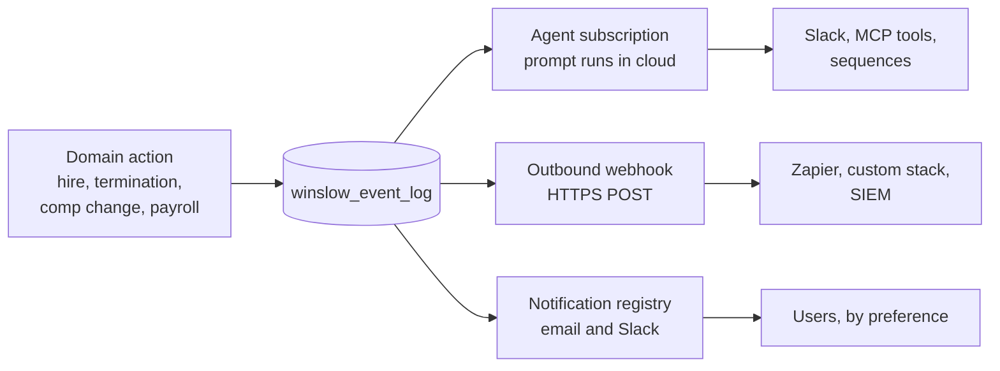
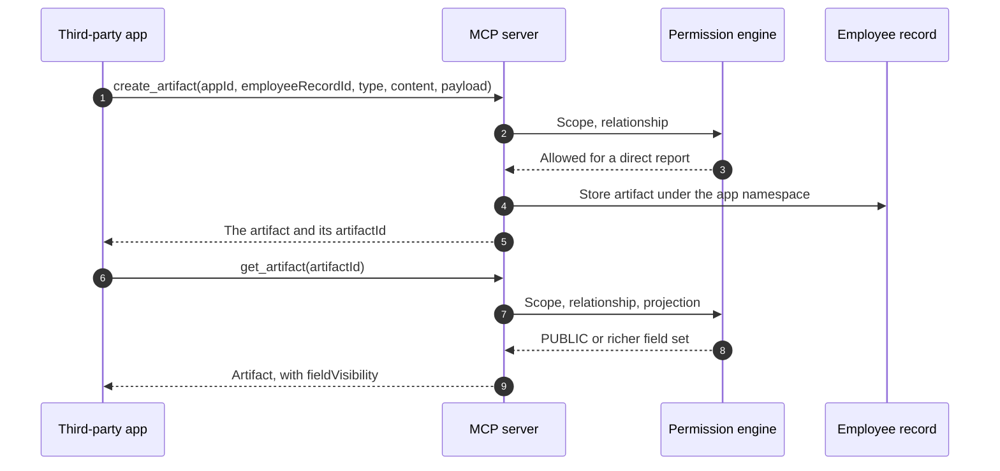

# Integrations, Events, and Artifacts

Winslow is an artificial-intelligence (AI) native Human Resources (HR) platform. It sells payroll, benefits, a Human Resources Information System (HRIS), and a Slack-based AI co-worker as one product.

Terms used on this page. The **Model Context Protocol (MCP)** is an open protocol that lets an AI application call tools. A **tool** is one callable action. The **tool catalog** is the list of the 185 tools that Winslow exposes. A **connector** is an integration that lets the agent act in a third-party system. An **artifact** is a typed record that an application attaches to one employee. A **custom property** is a typed field on the employee record, namespaced by application. A **projection** is the field set that the server returns. `FULL` is for an administrator, `SELF` for the subject, `DIRECT_REPORT` for the subject's manager, and `PUBLIC` for any other workspace member. The PUBLIC projection returns directory fields only. **`fieldVisibility`** is the response field that names which projection was applied. **OAuth 2.0** is the standard that lets a user authorize an application to act for them without sharing a password. **PKCE** means Proof Key for Code Exchange, the extension that protects a public client, and **S256** means the SHA-256 challenge method, where **SHA-256** is a cryptographic hash function. **REST** is Representational State Transfer, the plain Hypertext Transfer Protocol (HTTP) interface. **Pipedream** is the third-party integration platform behind the connector directory. **Zapier** is a no-code automation service that can receive a webhook. **SIEM** means Security Information and Event Management, a system that collects audit and log data. A **webhook** is an HTTP request that Winslow sends to a customer URL when an event happens. A **catch hook** is a Zapier trigger that accepts any incoming request and passes its body to the next step.

Citations such as `winslow.md:15` refer to the captured Markdown product file, taken on 2026-11-06. Citations such as `integrations.txt:36` refer to the text capture of a website page from the same date.

Winslow has four integration paths, and they do different jobs:

1. **Connectors**, so the agent can act in other systems.
2. **OAuth 2.0**, so a third-party application can act as a Winslow user.
3. **REST and MCP**, so a program can read and write Winslow.
4. **Events and webhooks**, so other systems know when Winslow changes.

Artifacts sit across all four. They are the data shape an application stores on the employee record, and they are the reason an integration can keep its own state without a second database. The **Vibe Code promise** is Winslow's claim that a customer can build an application outside the product and still use the whole product through these interfaces. This page tests that claim at the artifact boundary.

This page covers each path, the contradictions in the public record, and the practical limits.

## The connector directory

The integrations page says "1000+ integrations" and shows 53 apps plus an "Any MCP" tile (`integrations.txt:36`, `integrations.txt:47`). The 53 fall into ten categories:

| Category | Examples |
|---|---|
| Communication | Slack, Zoom, Discord, Intercom, Loom, Calendly |
| Google Workspace | Gmail, Drive, Calendar, Sheets, Docs, Meet, Analytics |
| Microsoft | Outlook, Teams, Excel |
| Customer relationship management | Salesforce, HubSpot, Pipedrive, Zoho |
| Marketing | Mailchimp, ActiveCampaign, Ahrefs, Semrush, Mixpanel |
| Web and commerce | Webflow, Shopify |
| Project management | Linear, Jira, Asana, Notion, ClickUp, Trello, Monday, Basecamp, Todoist, Airtable |
| Finance | Stripe |
| Developer | GitHub, Docker, Supabase, Cloudflare, Retool, Zapier, Make, OpenAI |
| Design and documents | Figma, Miro, Canva, Coda, Dropbox, Evernote, Grammarly |

The directory is Pipedream-backed (`winslow.md:15`). Pipedream is an integration platform with its own connector catalogue. Winslow uses it to reach the long tail rather than building each connector.

The "Any MCP" tile is the widest one. A customer can add any Model Context Protocol (MCP) server, not only the 53 shown. Winslow becomes an MCP client as well as an MCP server. The tile widens reach; it does not make the connector list the most valuable part of the integration surface. The events layer is, and the Aha at the end of this page explains why.

### What a connector is not

A connector is not a two-way sync of records. It is a tool the agent can call. The distinction matters:

- A Slack connector lets the agent post a message. It does not mirror Winslow employees into Slack.
- A Google Sheets connector lets the agent write a row. It does not keep the sheet in sync on every payroll.
- A Salesforce connector lets the agent look up an account. It does not create a bidirectional customer record.

Winslow's "What we don't do" list confirms the boundary: "We do not run a marketplace of third-party apps" (`winslow.md:170`). The directory is a connector list for the agent, not an app store with installable partner products.

That sentence also contradicts the integrations page's framing, which presents the apps as integrations a customer "connects." A reader should understand the difference. The apps are available to the agent, not embedded in the product's navigation.

## Customer-managed connectors

Winslow says authentication for a connector belongs to the customer: "Auth is yours; Winslow never holds the vendor password" (`winslow.md:13`).

In practice, an OAuth connector still stores a token. The claim is about the password, not the credential. The documentation does not describe the token store, the encryption, the scopes requested, or how a token is revoked when an employee leaves.

A customer-managed MCP server is a similar arrangement. The customer supplies the endpoint and the credential, and Winslow calls it as a tool source. A security review should ask:

- Where is the customer MCP credential stored?
- Which agent sessions can use it?
- Is the credential scoped to a user or to the workspace?
- Are calls logged with the credential owner?

The public record answers none of these.

## OAuth: "Login with Winslow"

OAuth is for applications that act on behalf of a person. The documentation is direct about the use case: "For apps with a UI that users revisit. Do not pull data via MCP at build time and embed it statically" (`winslow.md:490`).

That sentence is a design instruction to vibe coders. It rules out the common shortcut of fetching data once during a build and shipping it as a static file. The reason is that permissions and data change; a static copy is both stale and a leak.

The endpoints are:

| Endpoint | Purpose |
|---|---|
| `GET /.well-known/oauth-authorization-server` | Discovery metadata |
| `GET /oauth/authorize` | Consent and code |
| `POST /oauth/token` | Code exchange and refresh |
| `GET /oauth/userinfo` | User identity |
| `POST /oauth/register` | Dynamic registration |

The flow uses Proof Key for Code Exchange (PKCE) with S256, which is required for public clients such as a browser application. The seven scopes are coarse: `read:employees`, `write:employees`, `read:company`, `read:profile`, `read:time-off`, `write:time-off`, and `manage:artifacts`. The client first sends the challenge, then proves it at the token exchange:

```http
GET /oauth/authorize?response_type=code
  &client_id=client_...
  &redirect_uri=https%3A%2F%2Fapp.example.com%2Fcallback
  &scope=read%3Aemployees+manage%3Aartifacts
  &code_challenge=<sha256-of-verifier>
  &code_challenge_method=S256
  &state=<random>

```

```http
POST /oauth/token HTTP/1.1
Host: api.usewinslow.com
Content-Type: application/x-www-form-urlencoded

grant_type=authorization_code
&code=ac_...
&client_id=client_...
&redirect_uri=https%3A%2F%2Fapp.example.com%2Fcallback
&code_verifier=...
```

The token is then sent as a bearer token to the MCP endpoint or the REST API. [The MCP server](06-the-mcp-server.md) covers the mapping gap between the seven OAuth scopes and the 25 MCP scopes. The MCP scopes are named per capability such as `payroll:approve`, and described in [the tool catalog](07-the-tool-catalog.md).

## REST

REST is the second HTTP interface. Its path list is shorter than the MCP catalog, and the catalog is where most work happens:

- `/api/employee-records/*`
- `/api/employee-artifacts/*`
- `/api/artifact-apps/*`
- `/api/workspaces/{workspaceId}/events/triggers/*` for webhook triggers

Those four groups are the documented paths. The first three are narrower than the 185 MCP tools; the fourth is the only documented way to create an event trigger. A path list is not a capability list: REST also holds six operations that MCP does not, listed below.

Every REST call needs two headers:

- `Authorization: Bearer <oauth-token>`
- `x-client-token: <uuid-v4>`

MCP keys are rejected on REST by design (`winslow.md:498`). An **MCP key** is the workspace credential with the `wns_` prefix, created in workspace settings and used on the MCP endpoint. That is a deliberate separation: a workspace key is for a trusted backend, and a user token is for a user-facing application.

REST responses are wrapped in `{"data": ...}`. MCP responses are tool-specific. A builder that switches between the two must change the response parsing, not only the URL.

REST has six operations that MCP does not:

- SPD and plan-document attachment upload;
- plan document ingest;
- census and election comma-separated values (CSV) export;
- broker import;
- broker create and update;
- termination-payroll deletion.

Those exclusions are documented in the MCP reference (`builders_mcp.txt:1403-1411`, `builders_mcp.txt:755`). They matter for the Vibe Code promise, because the promise says there is nothing the admin interface can do that the code cannot.

## Events and webhooks

Every domain action persists to `winslow_event_log`. Three consumers can subscribe:

1. **Agent subscriptions.** The MCP tool `subscribe_event` runs a prompt when an event fires.
2. **Outbound webhooks.** An administrator creates a trigger, and Winslow sends a JSON POST to an HTTPS URL.
3. **Notifications.** The notification registry sends email and Slack messages for a fixed set of events.



The documented object types are:

- `employee-record`
- `employee-document`
- `invoice`
- `termination`
- `time-off-request`
- `benefit-election`
- `life-event-request`
- `payroll-run`

The MCP reference lists more object types than the product file does, including `paystub`, `plan`, `dependent`, `company-holiday`, and `tax-document`. `winslow.md` is incomplete, not contradictory.

The preferred event keys are business moments, not raw database changes:

- `employee.compensation_changed`
- `employee.manager_changed`
- `employee.department_changed`
- `employee.terminated`

A subscription can also use an `(objectType, eventKey)` pair or `*`. The wildcard `*` matches every event in the workspace, on every object type and every event key. It is powerful and expensive: every event runs the prompt, and the prompt consumes credits.

### Webhook mechanics

A trigger is created in the interface, under Admin, Events, Triggers. The API equivalent is:

```http
POST /api/workspaces/{workspaceId}/events/triggers/create
Authorization: Bearer <oauth-token>
x-client-token: <uuid-v4>
Content-Type: application/json

{
  "url": "https://example.com/hooks/winslow",
  "objectType": "employee-record",
  "eventKey": "employee.terminated"
}
```

The body shape is illustrative. The path and the header are documented.

Winslow sends the POST with `User-Agent: Winslow-Events/1.0`. It names Zapier as a working receiver, which means a catch hook is enough to start.

The documentation does not state:

- the retry policy;
- the timeout;
- whether events are ordered;
- whether a delivery is signed;
- how a failed delivery is replayed;
- whether the payload contains full records or references.

Those are the questions an integration engineer asks first. Their absence is a real gap for anyone building a production webhook consumer.

### Notifications

Notifications are separate from webhooks. They are registry-driven, delivered by email and Slack, and controlled by user preferences (`winslow.md:506`). The **notification registry** is the fixed list of event keys that can produce a notification, with a default channel and a user preference for each. It is not an API that a customer subscribes to; the two subscription channels above are.

The groups are payroll, invoices, time off, employees, personal, and benefits administration. Some keys are mandatory: payroll failed, you got paid, billing failures, and enrolment open. A user can manage preferences in the app or by asking the agent.

The mandatory list is sensible. A person cannot opt out of "you got paid" or "payroll failed." That prevents a silent failure.

## Artifacts as an integration surface

An artifact is the integration's own data on the employee record. It has three properties that make it useful to an external application:

1. **Namespacing.** Artifacts belong to an application identifier. Two apps cannot collide.
2. **A typed payload.** TEXT, MARKDOWN, IMAGE, FILE, URL, JSON, or CARD.
3. **Permission inheritance.** The same projection rules decide who can read the artifact.

The application must be registered with `register_artifact_app`, which is an administrator action. The approval is automatic at registration: "MCP-registered apps are auto-approved" means there is no second review step, not that any caller may register. Since 2026-07-14, the first artifact write no longer registers an application. A write to an unregistered namespace is refused unless the caller holds `admin:manage-artifacts`.

An application can also add a custom property to the employee record. The tool is `create_app_property`, which needs `admin:manage-customization` and is admin-only. A custom property is the right choice for a value the customer wants to filter, report, or display in the admin interface. An artifact is the right choice for a document, a card, or a JSON blob.

| Need | Use | Why |
|---|---|---|
| A filterable field | Custom property | Appears in views and exports |
| A document | Artifact, FILE or IMAGE | Stores a URL and a file name |
| A dashboard card | Artifact, CARD | Has a rendering hint |
| App state | Artifact, JSON | Flexible payload |
| A note | Artifact, MARKDOWN | Readable in the interface |

The artifact model is the least glamorous part of the Vibe Code story and the most important for persistence. Without it, a vibe application would have to bring its own database, and the "one record" promise would break.

```json
{"jsonrpc":"2.0","id":60,"method":"tools/call",
 "params":{"name":"create_artifact",
           "arguments":{
             "employeeRecordId":"er_01H...",
             "appId":"equipment-tracker",
             "type":"JSON",
             "content":"Laptop assignment",
             "payload":{"laptop":"MacBook Pro 14","serial":"C02X..."}
           }}}
```

The same record is read back through a projection. This diagram shows the path from the application to the record and back. The projection is not an argument: the server computes it from the caller's relationship:



The create call returns the new artifact, including the `artifactId` that the read call needs. A different caller sees a different result from the same row. A manager receives the artifact for a direct report. An administrator receives it for anyone. Another workspace member receives the PUBLIC projection. The projection is a field set, so an artifact that is not in that set does not appear at all. The application writes no permission code; the engine runs the same three checks on every call, and it applies the projection at read time.

**Aha:** Winslow's integration strategy is the inverse of the usual one. Most HR platforms build connectors so that data can be copied between systems. Winslow builds connectors so that an agent can act in another system, and it builds MCP so that another system can act in Winslow. The unit of integration is an action, not a sync. That is why the same directory can list Slack, Stripe, and Supabase without a data-mapping screen for each. It is also why the events layer matters more than the connector list: an action without an event is a one-way door.

## Contradictions in the public record

Three contradictions are worth recording:

1. **Microsoft Teams.** The integrations page lists Teams and says "Work in Teams channels the way it works in Slack" (`integrations.txt:76-77`). The product file says "We do not have a Microsoft Teams employee experience. Slack only" (`winslow.md:169`). The likely reading is that the agent can post to Teams as a connector, but the employee experience is Slack. The pages do not say that.
2. **Marketplace.** The integrations page presents 53 apps as integrations. The "What we don't do" list says Winslow does not run a marketplace of third-party apps. The likely reading is that the directory is for the agent, not installable partner software. Again, the pages do not reconcile it.
3. **Count.** The page says "Showing 53 of 1000+," but the grid contains 54 tiles. The 54th is "Any MCP," which is not an app. The count of 53 apps is correct.

## What is not public

- The Pipedream contract and the per-connector limits.
- The connector authentication scopes requested for each app.
- The webhook retry, signing, and ordering behaviour.
- The event payload schema.
- Rate limits on event delivery.
- Whether a connector action is attributed to the user or to the workspace.
- The data processing agreement for each connector vendor.

## Where to go next

Read [Permissions, security, and audit](14-permissions-security-and-audit.md) for how these paths are controlled, or [Pricing and packaging](15-pricing-and-packaging.md) for what the connectors cost.
