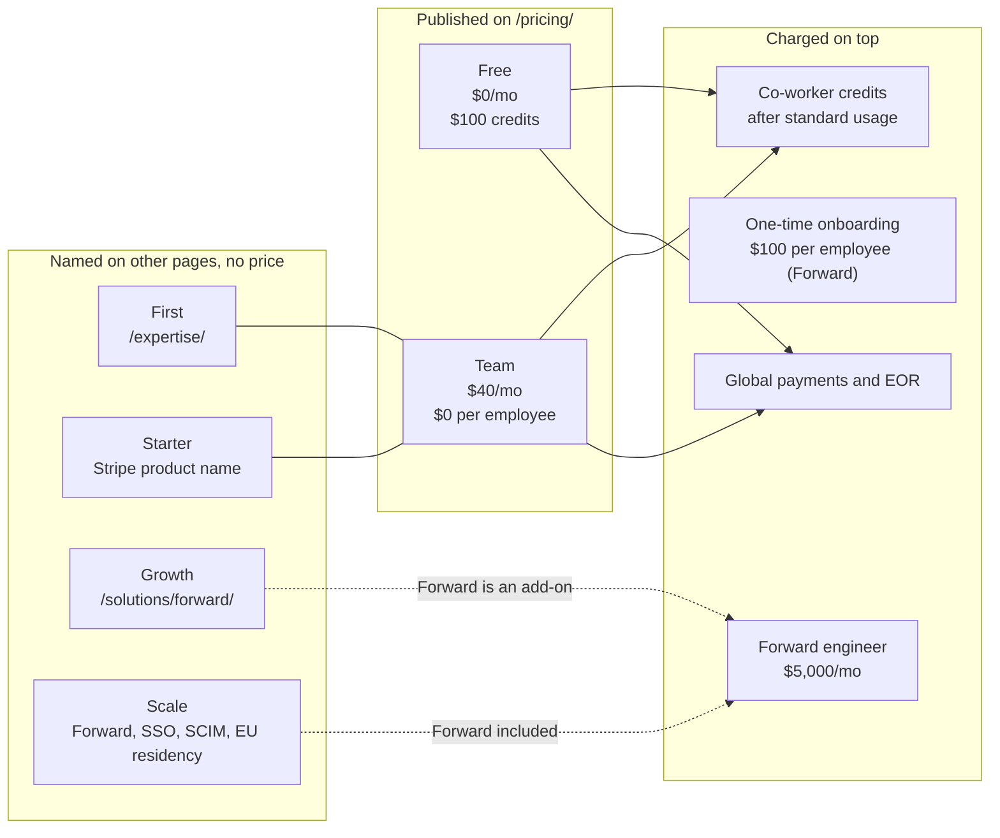
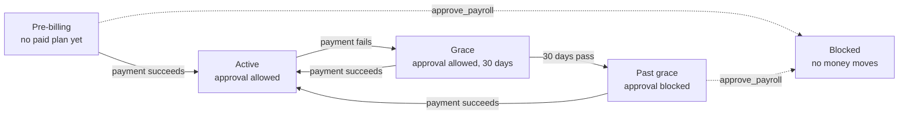

# Pricing and Packaging

Winslow is an artificial-intelligence (AI) native Human Resources (HR) platform from NFTCo, Inc. It sells payroll, benefits, a Human Resources Information System (HRIS), and a Slack-based AI co-worker as one product.

Winslow's pricing is simple in the headline and complicated in the record. The headline is "$40 per month, seats are $0, 100 percent usage-based." The record contains six plan names. It also contains an onboarding fee that appears on one page and is denied on another. It has a usage meter with no published rate card.

Terms used on this page. A **seat** is one user account. **Per-employee-per-month (PEPM)** is the usual payroll pricing unit: a charge for each worker on the payroll each month. A **credit** is the unit that the AI co-worker spends. **Usage-based** means the bill follows consumption, not headcount. **Onboarding** here means the one-time setup charge that a customer pays; it is not the employee onboarding workflow. **Employer of Record (EOR)** is a service that employs a worker on the customer's behalf in a country where the customer has no legal entity. **Forward** is Winslow's forward-deployed engineering service. **Growth** and **Scale** are plan names that appear outside the pricing page.

Sources. `pricing.txt`, `expertise.txt`, and `solutions_forward.txt` are text captures of the public pages, taken on 2026-11-06. `winslow.md` is the site's own machine-readable product file, captured on the same date. All currency is United States dollars. All periods are months unless stated.

This page lists what the public sources say, separates the conflicts from the consistent parts, and models what a buyer actually pays.

## The published offer

| Plan | Price | What it includes | Source |
|---|---|---|---|
| Free | $0 per month | Up to $100 in co-worker credits; no credit card; credits never expire; 1,000+ integrations; no limit on Slack users | `/pricing/` |
| Team | $40 per month | Standard usage regardless of headcount; $0 per employee per month; payroll, benefits, and HRIS; tax registrations, filings, and notices; global employees and contractors; 50 hours of expertise | `/pricing/` |
| Winslow First | $0 per month extra | The 50-hour HR expert, described as included | `/expertise/` |
| Winslow Starter | $40 per month list | The self-serve Stripe plan, product identifier `winslow-starter-monthly` | `winslow.md:164` |
| Winslow Growth | Not published | A tier at which Forward is an add-on | `/solutions/forward/` |
| Winslow Scale | Not published | A tier that includes Forward, single sign-on, SCIM, and European Union data residency | `/solutions/forward/`, `/builders/security/` |

The names are not a ladder. They are fragments of different packaging generations, so a ladder diagram would be false. The diagram below shows which page each name comes from, and which are priced:



Read the diagram from left to right as "where the name is published", not as "what you buy next". First and Starter refer to the same paid product as Team. Growth and Scale sit above it. Forward attaches to Growth and Scale. Credits and onboarding attach to the paid plans. Global payments and EOR attach to every plan.

## What "100 percent usage-based" means

The pricing page says "100% usage-based pricing" and "Seats are $0" (`pricing.txt:36`, `pricing.txt:75`). The Team plan is $40 per month "standard usage, regardless of headcount" (`pricing.txt:57`).

Those two statements are compatible if the $40 is a platform fee and the usage meter is separate. They are not compatible if a reader hears "usage-based" and expects a bill that scales only with use.

The usage meter is the AI co-worker. The Free plan gives $100 of credits. The Team plan includes "standard usage." The FAQ says "Usage will change depending on how many team members use the AI co-worker" (`pricing.txt:74`).

What is missing:

- a price per credit;
- a credit-to-action conversion;
- the definition of "standard usage";
- what happens when standard usage is exceeded;
- whether payroll runs consume credits;
- whether an agent tool call and a chat message cost the same.

The site offers one comparison: usage-based pricing "consistently see usage-based pricing come in at 25% of the cost of legacy payroll and HRIS vendors" (`pricing.txt:76`). The method behind that number is not published. It may compare a specific headcount and usage level. A buyer cannot reproduce it.

## A worked total cost

A buyer needs a number, not a model. The table below builds one for a 40-person company that stays inside standard usage. It is a model, not a quote; every cell marked "assumption" is this page's estimate.

| Line | Basis | Monthly | First year |
|---|---|---|---|
| Platform | Team plan | $40 | $480 |
| Seats | $0 per employee | $0 | $0 |
| Credits | Inside standard usage | $0 | $0 |
| Onboarding | $100 per employee, if it applies | — | $4,000 |
| Global payroll | None | $0 | $0 |
| Forward | None | $0 | $0 |
| **Total** | | **$40** | **$4,480** |

Two other cases change the answer by an order of magnitude:

| Case | Monthly | First year | Note |
|---|---|---|---|
| 40 people, Forward engineer on Scale | $5,040 | $64,480 | $5,000 Forward plus $40 platform |
| 40 people, credits at double standard | Not computable | Not computable | The credit rate is unpublished |

The first-year cost therefore ranges from $480 (Free plan, no onboarding fee) to $64,480 (Team plus Forward). The spread is a fact of the published record, not an error in the model.

The same facts as a machine-readable file, as stated by the sources:

```yaml
# Published pricing facts, as stated
pricing_model: usage-based
platform_fee: 40 USD per month
per_employee_per_month: 0 USD
free_credits: 100 USD
onboarding_fee: 0 USD (winslow.md) or 100 USD per employee (Forward page)
included_expertise: 50 hours per year
forward_engineer: 5000 USD per month
global_payments: extra
eor: extra
grace_period_before_payroll_gate: 30 days
captured: 2026-11-06
currency: USD
```

## The onboarding fee conflict

Two pages make opposite claims:

> There is no per-employee-per-month subscription and no one-time onboarding fee. (`winslow.md:157`)

> +$5,000 per month · per dedicated engineer. On top of $40/mo AI usage and $100/EE one-time onboarding. (`solutions_forward.txt:81`)

The first is in the machine-readable product file, which tells agents to trust it over older listings. The second is on a live page for the Forward service. The amounts differ by the factor that matters: $0 against $100 per employee.

Possible explanations:

1. The onboarding fee is new, and the product file is stale.
2. The onboarding fee applies only to Forward or Scale customers.
3. The fee was removed, and the Forward page is stale.
4. The fee is charged by a partner, not by Winslow.

The public record does not say. A buyer should ask for a written quote. An agent that reads `/winslow.md` will quote $0 and be wrong if the Forward page is current.

## The billing gate

Winslow bills through Stripe. The self-serve plan is `Winslow Starter`, product identifier `winslow-starter-monthly`, list $40 per month (`winslow.md:164`).

If a payment fails, Winslow gives a 30-day grace window. Inside the window, approval still works. After the window, the approval gate closes. The catalog states that `approve_payroll` is "blocked while billing is pre-billing or past its grace window". A blocked approval "never moves money". Enabling auto-approval is also blocked while the billing status is pre-billing.



The diagram shows the two states that close the gate and the one action that reopens it. Payment is the only exit from either blocked state.

The gate is a sensible control. It is also a risk. A company whose card expires can find itself unable to approve payroll, and the product's own marketing says employees should never miss payday. The grace period mitigates this, but the failure mode deserves a clear runbook.

The approval settings show the state that the gate protects:

```json
{"jsonrpc":"2.0","id":10,"method":"tools/call",
 "params":{"name":"get_payroll_approval_settings",
           "arguments":{"workspaceId":"ws_01H..."}}}
```

An approval call is the one the gate blocks:

```json
{"jsonrpc":"2.0","id":11,"method":"tools/call",
 "params":{"name":"approve_payroll",
           "arguments":{"payrollId":"pr_01H..."}}}
```

The documentation does not state what happens to an already approved payroll. It also does not say whether a customer can pay by another method during the grace period, or whether support can extend the window.

## Included expertise

The 50-hour expert is the clearest value in the package. Two pages describe it:

- the pricing page lists "50 hrs a year of payroll and HR expertise included" in Team;
- the expertise page describes a dedicated person, reachable by Slack, email, and SMS, covering tax accounts, plan choices, termination payroll, multi-state compliance, and I-9 verification. It says "Included with Winslow First · $0/mo extra" (`expertise.txt:47`).

The word "free" appears often. It means included in the subscription, not free of a subscription. A reader should not confuse the two.

Three details are unpublished:

- what happens after 50 hours;
- whether unused hours roll over;
- the response-time service level. The page says "We're always on Slack" (`expertise.txt:45`), which is a sentiment, not a service-level agreement.

## Global payroll and EOR

Global payments and Employer of Record cost extra on every plan. The product file says "Global payments and EOR cost extra. Everything else is in the $40" (`winslow.md:163`).

No global price is published. The country coverage is inconsistent: over 100 countries on the payroll page, and 150+ countries elsewhere. A buyer should request a country list and a per-country quote.

## Forward

Winslow Forward is a forward-deployed People Operations engineer. The offer:

- platform setup around the customer's organization, policies, compensation philosophy, and onboarding rhythm;
- the first agentic workflows, built by the engineer;
- training so the customer's team can write its own skill files;
- quarterly business reviews and ongoing custom work.

The price is $5,000 per month per dedicated engineer, on top of $40 per month and the onboarding fee. It is included with Scale and an add-on at Growth, so a Scale customer does not pay twice for it. The commitment is 30 days' notice, with no multi-year lock.

The economics are transparent for a services offer. One engineer serves two or three customers at a time, so the effective cost to Winslow is a fraction of $5,000. That is a normal services margin, and the page does not pretend otherwise.

## What the price compares to

Winslow compares its model with per-employee-per-month pricing. The claim is that legacy vendors charge per seat and per module, and that Winslow charges once.

The claim is true at the list-price level. For a 50-person company, $40 per month is $0.80 per employee per month, against a typical $8–$30 PEPM for payroll and HRIS. That is a real difference.

The comparison is incomplete in three ways:

1. **Usage.** The $40 is not the whole bill. Credits are metered.
2. **Onboarding.** The Forward page says $100 per employee, which changes the first-year cost.
3. **Services.** Global payroll, EOR, and Forward are extra.

A fair comparison needs a usage estimate, an onboarding quote, and a global quote. The site provides none of the three.

## The plan-name problem

The six names are fragments of different packaging generations:

- **Free** and **Team** are on the pricing page.
- **Starter** is the Stripe product behind the $40 plan. It is a billing identifier, not a customer-facing tier.
- **First** appears only on the expertise page, and seems to be an older name for the entry paid plan.
- **Growth** and **Scale** appear only in the Forward and security pages.

A customer cannot see the full set, the feature differences between Growth and Scale, or the price of either. The security page puts single sign-on, SCIM, and European Union data residency at Scale. Those are enterprise requirements. They are not on the pricing page at all.

This is the clearest packaging defect in the public record. It is not a contradiction about a number; it is a missing page.

## Aha: the $40 is a floor, not a ceiling

Winslow markets a $40 product because $40 is memorable and it defeats the per-seat comparison. The real price is a function of four variables: platform fee, credits, onboarding, and services. Only the platform fee is published. Credits are metered, onboarding is disputed, and services are quoted.

Free is the true floor at $0. The $40 is the price of leaving the credit allowance behind. That is not dishonest; usage-based pricing is legitimate and often cheaper for a small company. But a buyer who budgets $480 a year has not read the model. The honest summary is as follows. The platform fee is $40, and the onboarding fee may be $100 per employee. The maximum depends on how much the team talks to the agent. Any global or forward-deployed work is a separate line.

## What is not public

- The credit price and the credit-to-action conversion.
- The definition of "standard usage."
- The Growth and Scale prices and feature matrices.
- The onboarding fee's current state and scope.
- The 50-hour overage rate.
- The global and EOR country list and prices.
- The service-level agreement for the expert and for payroll filings.
- The refund and cancellation terms beyond the Forward 30-day notice.

## Where to go next

Read [the critical assessment](16-critical-assessment.md) for how the pricing conflicts affect a buying decision, or [the glossary](17-glossary.md) for the terms used across this set.
