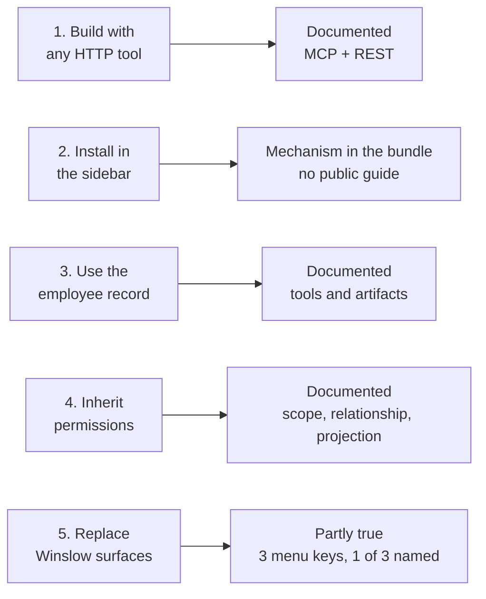
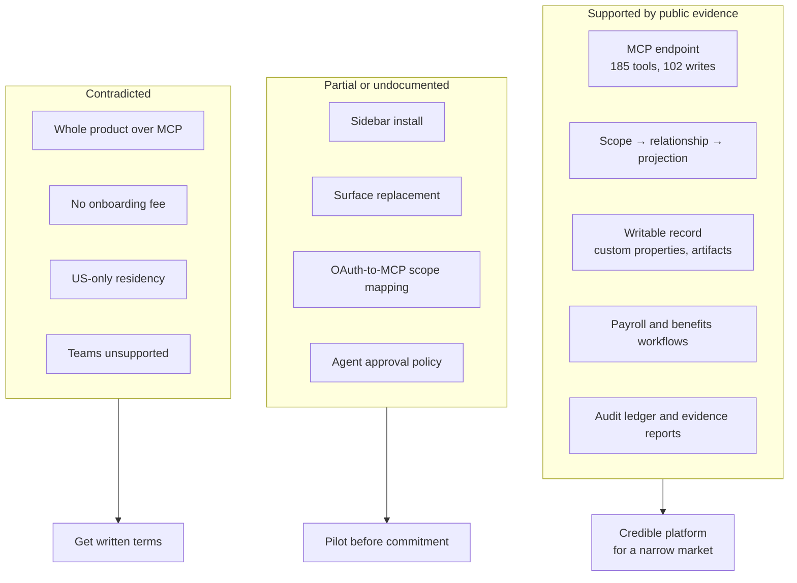

# Critical Assessment

Winslow is an artificial-intelligence (AI) native Human Resources (HR) platform from NFTCo, Inc. It sells payroll, benefits, a Human Resources Information System (HRIS), and a Slack-based AI co-worker as one product. This page weighs Winslow as a product, a platform, and a company. It uses only the public record. Where the record is silent, it says so rather than filling the gap.

Terms used on this page. The **Model Context Protocol (MCP)** is an open protocol that lets an AI application call tools; a **tool** is one callable action. **REST** is Representational State Transfer, the plain Hypertext Transfer Protocol (HTTP) interface. An **agent** is an AI program that calls tools. A **vibe code application** is an application that a customer builds with an AI builder and installs inside Winslow. A **record** is one employee's data. **Scope**, **relationship**, and **projection** are the three authorization checks: a permission string, a link to the record, and a field filter. **Check** is the payroll and tax vendor behind Winslow's payroll engine. **Credits** are the unit that the AI co-worker spends.

Sources. `winslow.md` is the site's own machine-readable product file. `pricing.txt`, `builders_vibe-code.txt`, `solutions_forward.txt`, `builders_security.txt`, and `builders_mcp.txt` are text captures of the public pages, taken on 2026-11-06. Line citations refer to those captures. "The bundle" is the compiled JavaScript file `main.26e32ed8.js` from the application, inspected on the same date.

This page is one of a numbered series. [The glossary](17-glossary.md) defines every term.

## The short verdict

Winslow has a real and unusual technical core, a credible product for a narrow market, and a marketing story that is ahead of its documented capabilities. The gap is not in the data model or the permissions. It is in the installation layer, the pricing record, and the governance of an agent that can move money.

## The scorecard

Ratings are this page's judgement. They use two axes: strength, from Weak to Very strong, and evidence, from documented to inferred. "Early" on the company row means maturity, not strength.

| Area | Rating | Basis |
|---|---|---|
| Payroll depth | Strong | Full run lifecycle, tax, filings, reports, off-cycle runs, termination |
| Benefits depth | Strong | Plan catalogue, coverage periods, elections, qualifying life events, payroll link |
| HRIS flexibility | Very strong | Writable record, custom properties, artifacts, custom worker types |
| MCP breadth | Very strong | 185 tools, 102 of them write tools, 31 sections, public reference |
| Permission model | Very strong | Scope, relationship, projection; per field; server side |
| Agent runtime | Strong but opaque | Skills, scheduler, events, sequences; model and governance unpublished |
| Install and surface replacement | Weak but present | Install exists in the bundle; no public guide; menu override covers three surfaces |
| Pricing clarity | Weak | Six plan names, a conflicting onboarding fee, an unpublished meter |
| Security documentation | Mixed | Good controls; missing scope mapping, subprocessors, and injection defence |
| Company maturity | Early | Small team, young site, broken agent files, rapid change |

The pattern is consistent. The parts that touch data are well designed and mostly well documented. The parts that touch packaging, installation, and operations are thin.

## The company

The public record is thin here. The about page names two people: Niel Robertson as chief executive officer and Dalton Wais as chief technology officer. It lists five investors — Village Global, Link Ventures, Progression, Hannah Grey, and individuals — and an HR advisory board of eight named practitioners. The site carries a 2026 copyright for NFTCo, Inc. It publishes no headcount, funding total, founding date, or customer list.

That is normal for an early company, but it matters for this assessment. A buyer depends on a small team for payroll that must run every cycle. The mitigation is contractual, not technical: a service-level agreement, a named support contact, and a tested contingency plan.

## What is genuinely strong

### 1. Authorization is below the interface

This is the best idea in the product. The same permission engine answers for the admin interface, REST, MCP, and the agent. The order is explicit: scope, then relationship, then projection. The result is explicit: `FULL`, `SELF`, `DIRECT_REPORT`, or `PUBLIC`, with `fieldVisibility` on the response.

The practical effect is that a third-party application does not need to build an authorization layer. A manager using the app sees manager data because the server sends manager data; the application never holds the other rows. A bug in the application cannot expose a field that the application never received.

Most "API-first" products expose an interface and leave authorization to the integrator. Winslow moves the boundary. That is a genuine architectural difference, not a marketing phrase. The model is documented in [the MCP server](06-the-mcp-server.md) and [permissions](14-permissions-security-and-audit.md).

### 2. The record is a platform, not a schema

Custom properties and artifacts let an application store its own data on the employee record without a second database. A custom property label is prefixed with the application identifier, so two applications cannot collide. The 14 property types cover text, contact, number, date, boolean, choice, file, and address. The seven artifact types cover documents, cards, and JSON state.

The result is that a vibe code application can be removed without deleting its data. The employee record remains, and the custom properties and artifacts stay attached to it. That is the correct ownership model for HR data. The qualification is that removal and data retention are different acts: an application that is deleted keeps its data only if Winslow keeps the namespace. Winslow does not publish the deletion rule, which is why question 4 in the due-diligence list asks for it.

### 3. The MCP server is an operating interface

A 185-tool server with 102 write tools is not a read-only reporting API. It can hire (`create_employee`), terminate (`terminate_employee`), enrol (`submit_employee_enrollment`), approve payroll (`approve_payroll`), and run an off-cycle payment (`create_offcycle_payroll`). That breadth is what makes the Vibe Code promise plausible.

The reference is also unusually honest. It names the operations that MCP cannot perform. It names the tools where the relationship check is bypassed. It documents validation rules per tool. That level of disclosure is rare in a commercial API reference.

A builder should still check the state of a payroll before acting on it. The refresh guard is the pattern:

```json
{"jsonrpc":"2.0","id":1,"method":"tools/call",
 "params":{"name":"get_payroll_refresh_status",
           "arguments":{"payrollId":"pr_01H..."}}}
```

The call returns whether the payroll needs `refresh_payroll` before it can be trusted or approved. The tool needs `payroll:manage-payrolls`.

### 4. The audit ledger is a product

The ledger records every field write. Each entry is written as a sentence, such as "Dana Lee approved the Oct 16–31 payroll." Entries are append-only and hash-chained, so a direct edit breaks the chain. Sensitive values are masked to the last four digits. An agent entry names the person it acted for, the application, and the tool. An outside accountant can hold a read-only auditor role, and any filtered view exports to CSV or to a Security Information and Event Management (SIEM) system.

This is what a chief financial officer needs at an audit or an acquisition. It is also the control that makes an agent safe to deploy, because the agent's actions land in the same ledger as a person's.

### 5. The compliance surface is concrete

The detail payroll register has named columns, live spreadsheet formulas, and contractor flags at the 1099-NEC threshold. The tax centre has named filing states — Upcoming, Submitted, Filed, Blocked, and Not required — and a named alert schedule for a blocked filing. The alert comes on appearance and seven days before the due date. The evidence reports are named: payroll change register, compensation change report, access review, and paid-time-off liability.

These are the details that separate a real payroll product from a demo. [Payroll reporting and compliance](10-payroll-reporting-and-compliance.md) covers them.

## What is weak or unproven

### 1. The install step is undocumented

The Vibe Code page makes five promises:

1. Build the application with any tool that speaks HTTP.
2. Install it into Winslow's navigation, with the same session, login, and look.
3. Use the employee record as the source of truth.
4. Inherit Winslow's permissions, server-side and per field.
5. Replace parts of Winslow with your own.

Step 2 is the problem. The product contains the mechanism. The bundle has an "Add an app" form, the endpoints `POST /api/hris-vibe-apps/create` and `/update`, the gate `apps:manage-apps`, and the route `/app/custom/:appId`. The form takes a menu name of 1 to 20 characters, a description of up to 200 characters, a URL, and a scope of `PERSONAL`, `EVERYONE`, or `ADMIN`. The public documentation describes none of this.

The install is also weaker than the promise. The route renders the application URL in a plain iframe. The iframe has no sandbox attribute and receives no token or session. An application on another origin therefore does not share Winslow's session. "Same session, same login" cannot hold across origins; the application must run its own OAuth flow. A builder who follows the page will discover this only at test time.

Step 5 is partly true. The bundle sets `COMPANY_MENU_KEYS = ["directory", "orgChart", "calendar"]` and can replace those three menu entries with an external URL through `POST /api/workspaces/{workspaceId}/update-company-menus`. The page names three surfaces it wants to replace: the onboarding checklist, the org chart, and the expense screen. Only the org chart is in the override list. The onboarding checklist and the expense screen cannot be replaced.

Steps 1, 3, and 4 are documented. Step 2 exists but is undocumented. Step 5 is partly true for one of its three named surfaces. This is the largest gap between the promise and the public evidence, and a buyer should ask for a working example before believing the platform story.

The five steps and their evidence sit like this:



An application registration call looks like this. The endpoint, the gate, and the field limits are from the bundle; the body shape is illustrative:

```http
POST /api/hris-vibe-apps/create HTTP/1.1
Host: app.usewinslow.com
Content-Type: application/json

{
  "menuName": "Equipment tracker",
  "description": "Laptops and phones assigned to each person.",
  "url": "https://tools.example.com/equipment",
  "scope": "EVERYONE"
}
```

### 2. "The whole product" is false as written

The page says "there is nothing the admin UI can do that your code can't." Winslow's own reference lists operations that MCP cannot perform:

1. SPD and plan-document attachment upload;
2. plan document ingest;
3. census and election CSV export;
4. broker import;
5. broker create and update;
6. qualifying life event elections, which no tool writes; and
7. termination-payroll deletion.

That is seven operations, not six. The reference groups the first five and the sixth as exclusions and records the seventh separately. A builder can reach all seven through REST or the interface, so the promise holds only if "your code" includes REST. A builder who connects to MCP alone cannot upload a plan document or import a broker file.

The claim could be softened to "almost everything, through MCP or REST." As written, it is contradicted by Winslow's own reference. [The critical gap](04-the-vibe-code-promise.md) records the promise in full.

### 3. Pricing does not reconcile

The public record contains six plan names: Free, Team, First, Starter, Growth, and Scale. Only Free and Team are on the pricing page. First appears on the expertise page as the plan that includes 50 expert hours. Starter is the Stripe plan identifier for the $40 subscription. Growth and Scale appear on the Forward page but have no price and no feature page.

The onboarding fee also conflicts. The product file says there is "no one-time onboarding fee" (`winslow.md:159`). The Forward page says a Forward engineer costs "$5,000 per month · per dedicated engineer, on top of $40/mo AI usage and $100/EE one-time onboarding" (`solutions_forward.txt`). The $100 per employee figure is published; the "no fee" statement is therefore wrong for at least one plan.

The usage meter has no published rate. The pricing page says the Free plan gives "$100 in free co-worker credits" and the Team plan gives "standard usage". It does not define standard usage, the credit price, or the overage rate.

A buyer cannot compute a first-year cost from the public site. A worked total for one case shows the shape, not the price:

| Line | Source | Amount |
|---|---|---|
| Subscription | Team plan | $40 per month |
| Per employee | Team plan | $0 |
| Credits beyond standard usage | Not published | Unknown |
| One-time onboarding | Forward page | $100 per employee |
| Forward engineer | Forward page | $5,000 per month per engineer |
| Global payments and employer of record | Pricing page footnote | Additional cost, not published |

A 20-person company on Team, with no Forward engineer and no usage beyond standard, can compute a subscription of $40 per month. Every other line depends on a commercial conversation. That is a sales friction, not a deception, but it is a real problem for a self-serve product.

### 4. The agent's governance is unpublished

The agent can call 102 write tools. It can approve payroll, terminate an employee, and change a benefit election. The public record does not say:

- which actions need human approval;
- how prompt injection is defended against;
- which language model is used and how data is retained;
- how company memory is access-controlled;
- what the failure threshold is for a scheduled task.

"Always ask before actions" and "runs on schedule at 2:00 a.m." cannot both be literally true. A scheduled task runs when no person is present, so it cannot obtain an approval at the moment of the action. The policy that reconciles them is either a pre-approved rule, a delegation, or a bypass. Winslow does not publish which.

The public record also does not say what the agent can do without a person. That is the more serious gap. A read-only assistant that drafts a message and a write-capable agent that approves a payroll run need different controls, and the pages do not separate them.

### 5. The security record has conflicts and gaps

The security page says data residency is "US by default; EU at Scale." The product file says "US-only" (`winslow.md:145`). Single sign-on and System for Cross-domain Identity Management (SCIM) are Scale-tier features, but Scale has no published price or page.

The record does not name subprocessors, publish a data processing agreement, or state a Health Insurance Portability and Accountability Act (HIPAA) position or a General Data Protection Regulation (GDPR) position. It also does not describe a vulnerability disclosure programme. For a product that holds payroll, bank, and health data, those are significant omissions.

### 6. The public site is unfinished in visible ways

The marketing site has solution pages that no navigation link reaches. It has a product page that carries a search-engine exclusion directive, and a staging host in a share-preview image. It also has a broken `/llms.txt`, a broken `/AGENTS.md` on the marketing host, and a 404 page with contradictory robots rules. The legal pages contain support links whose targets end with a period, which makes the link invalid.

None of these is a product defect. Together they signal a company moving faster than its polish. A buyer should price that into the risk.

## Claim-by-claim record

Each claim is checked against the other public sources. "Contradicted" means one source says the opposite of another. "Not documented" means no source shows it. "Not supported" means a source implies it but no named tool or page delivers it.

| Claim | Source | Status |
|---|---|---|
| Seats are $0 | Pricing page | Consistent with the Team plan |
| 100 percent usage-based | Pricing page | Partly consistent: a flat $40 platform fee and a $0 per-employee rate |
| No one-time onboarding fee | `winslow.md:159` | Contradicted by the Forward page ($100 per employee) |
| Every report available through MCP | `winslow.md:57` | Not supported: no tool produces a register file |
| The MCP server is the whole product | Vibe Code page | Contradicted by seven REST-only operations |
| An app installs in the sidebar | Vibe Code page | Not documented for builders; the mechanism exists in the bundle |
| Core screens are replaceable | Vibe Code page | Partly true: one of the three named surfaces is covered |
| Data residency US-only | `winslow.md:145` | Contradicted by the security page (EU at Scale) |
| Slack only for employees | `winslow.md:169` | Contradicted by the Teams tile on the integrations page |
| No marketplace of third-party apps | `winslow.md:170` | In tension with the integrations page |
| Over 100 countries | Payroll page | Understated: another page says 150+ |
| 53 integrations shown | Integrations page | Correct: 53 apps plus an "Any MCP" tile |
| An agent acts as the employee | Multiple pages | Supported by the permission model, not by a public audit |
| SOC 2 Type II | Security page | Claimed; the report is behind a request form |
| 50 hours of expertise included | Pricing page | Stated; overage and service level unpublished |

The "over 100 countries" row is not a contradiction. A claim of 150 or more satisfies a claim of more than 100. It is an inconsistency in precision, and it does not affect a buying decision.

The Teams row needs care. The integrations page offers Teams as a connector, so the agent can post there. The product file denies a Teams employee experience. Both can be true: a connector is a tool, not a workplace.



The diagram groups the findings. An edge means "leads to". It does not add new evidence.

## Risk register

Likelihood and impact are this page's judgement. The columns give the reasoning, so a reader can disagree with the rating.

| Risk | Likelihood | Impact | Mitigation |
|---|---|---|---|
| Install layer does not exist as imagined | Medium | High | Ask for a live demonstration of a third-party application in the sidebar |
| Agent takes an unsafe action | Medium | High | Turn off auto-approval; restrict scopes; review skill files |
| Pricing changes or overage is expensive | Medium | Medium | Get a written quote with a usage cap |
| Data residency requirement unmet | Medium | High | Confirm the Scale tier and the European Union region in writing |
| Payroll error from a stale refresh | Low | High | Call `get_payroll_refresh_status` and refresh before approval |
| Vendor concentration in Check | Low | High | Ask for the Check contract and the contingency plan |
| Small-team key-person risk | Medium | Medium | Ask for the support model and the escalation path |
| Prompt injection through documents | Medium | High | Limit connectors; review agent output; use approval gates |
| Regulatory gap (HIPAA, GDPR) | Medium | High | Request the compliance package before signing |
| Service outage during payroll | Low | High | Ask for the status page, the recovery point, and the recovery time |

The payroll-refresh risk deserves a note. The reference says `get_payroll` refreshes a stale draft before returning it, but the approval path does not state that it forces a refresh. A builder that caches a payroll view and later approves it may approve stale items. The safe pattern is explicit: check `get_payroll_refresh_status`, refresh, compare the refreshed view with the cached view, then approve.

```json
{"jsonrpc":"2.0","id":5,"method":"tools/call",
 "params":{"name":"refresh_payroll",
           "arguments":{"payrollId":"pr_01H..."}}}
```

`refresh_payroll` is the heaviest payroll call. It rebuilds the line items from the current roster, then recalculates. Termination off-cycle runs are left untouched, because they are built by hand.

## Who should consider Winslow

**A good fit:**

- A United States startup with salaried employees, roughly 10–200 people.
- A company whose People team is comfortable in Slack and curious about agents.
- A company with an internal tools backlog and at least one person who can build.
- A company that values an auditable record and a low per-employee price.
- A company willing to pilot before it moves payroll.

The 10–200 range is an inference from the product's own claims. The onboarding workflow is said to scale from 10 to 500 employees, and the pricing is flat, so the economics improve with headcount. The record does not name a target segment.

**A poor fit:**

- A company with hourly or shift workers. The record describes salaried United States payroll only.
- A company that needs Microsoft Teams for employees. The product file names Slack as the employee surface.
- A company that needs a mature enterprise compliance package on day one.
- A company that wants a marketplace of prebuilt HR applications.
- A company that cannot accept an unpublished usage meter.
- A company outside the United States that needs local payroll and local data residency now.

## Scenarios

### A 20-person startup

Winslow is a strong fit. The flat $40 Team plan, the included expert hours, and the Slack surface match the stage. The startup should start on the Free plan and run one payroll cycle in parallel with its current provider. It should also confirm the state registration lead time before the first hire in a new state.

The risk is the onboarding fee. The buyer should confirm whether the $100 per employee charge applies to a Team subscription, because the Forward page states it in the Forward context.

### A 150-person company

Winslow is a plausible fit if the company is salaried and United States-based. The benefits module and the audit ledger become more valuable at this size. The buyer should test the broker import, the carrier connections, and the report exports before switching.

The risk is operational depth. A 150-person company needs a named support contact, a service-level agreement, and a tested disaster recovery plan. The public record does not show them.

### A regulated or health-data company

Winslow is a weak fit today. The record does not show a HIPAA business associate agreement, a GDPR data processing agreement, or a subprocessor list. The audit ledger is strong, but the compliance perimeter is not documented. A regulated buyer should stop at the security review.

### An enterprise

Winslow is not an enterprise product yet. Single sign-on and SCIM are limited to an unpublished Scale tier. There is no published role editor, no multi-entity structure for more than one legal company, and no documented global data residency beyond one line. An enterprise should wait or treat Winslow as a departmental pilot.

## Due diligence questions

Ask these in writing. A vague answer is itself information.

**Platform**

1. Show a third-party application installed in the Winslow sidebar, with its hosting and authentication model.
2. Confirm whether surface replacement exists, and if so, which surfaces.
3. Provide the OAuth-to-MCP scope mapping.
4. Explain how a vibe code application is deleted and what happens to its data.

**Agent**

5. Which actions require human approval, and can an administrator change the list?
6. What defends against prompt injection in documents, email, and Slack?
7. Which model is used, where does it run, and what is the retention policy?
8. Who can read company memory, and how is it removed when an employee leaves?

**Payroll and benefits**

9. Provide the Check contract, the service-level agreement, and the contingency plan.
10. Confirm the state registration lead times and the states where registration is not automatic.
11. Provide the carrier list and the integration method for each.
12. Explain COBRA, ERISA, and state-mandate handling.

**Security and compliance**

13. Provide the SOC 2 Type II report and the subprocessor list.
14. Confirm the data residency options, the regions, and the price.
15. Provide the GDPR data processing agreement and the HIPAA position.
16. Explain the audit hash chain and how a customer verifies it.

**Commercial**

17. Provide a written quote covering the platform fee, credits, onboarding, global payroll, and services.
18. Define standard usage and the overage rate.
19. Publish the Growth and Scale feature matrices and prices.
20. State what happens if the customer's payment to Winslow fails during a payroll cycle.

## What would change the verdict

The verdict would move up sharply with four deliverables:

1. A public install guide with a working example application.
2. A published scope mapping and an agent approval policy.
3. A reconciled price sheet with the credit rate and the onboarding fee.
4. A compliance package with subprocessors and data residency.

Three are documentation. The fourth is partly a commercial decision. The install guide also requires an engineering act: a working sample application that a reader can run. That is why the install gap is the hardest one to close.

**Aha:** Winslow is making the same bet it sells to its customers. It asks a company to build on a platform whose installation layer is not yet public. It also asks a buyer to trust a product whose pricing and governance are still being written. The bet may be right; the technical core is stronger than most competitors'. But a buyer should apply the same rule Winslow applies to vibe code applications: do not trust the demonstration, test the interface. The permission engine is real. The install path is the thing to ask for.

## Where to go next

Read [the glossary](17-glossary.md) for the terms used in this assessment. Return to [the Vibe Code promise](04-the-vibe-code-promise.md) for the promise in full, or to [the MCP server](06-the-mcp-server.md) for the documented tool surface.
