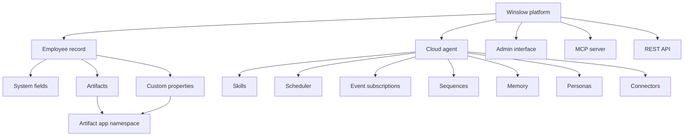
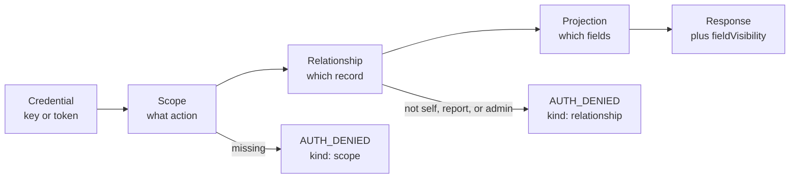
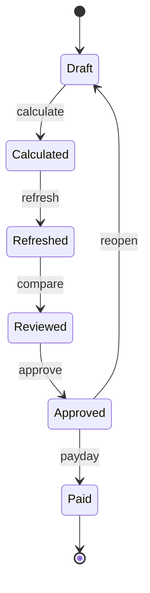
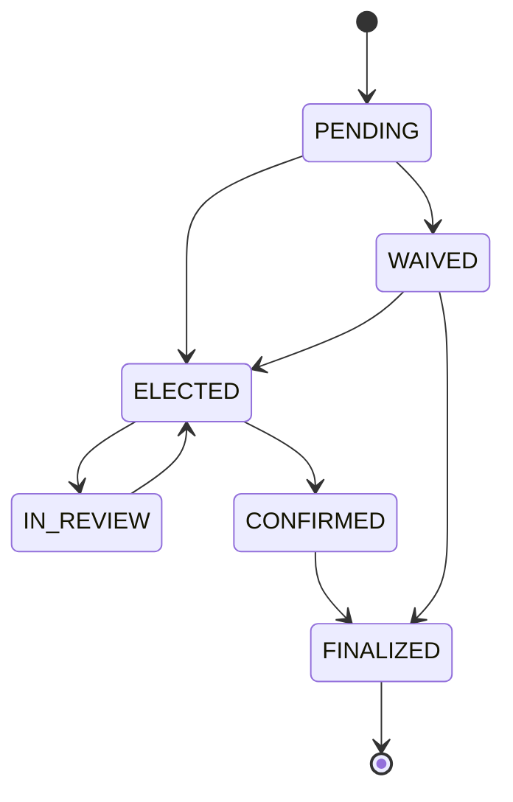

# Glossary

This glossary defines the terms used across this documentation set. Terms are grouped by domain, not alphabetically, because the meaning of a term depends on the system it belongs to. Each entry gives the shortest accurate definition and, where useful, the place to read more.

Abbreviations are spelled out at first use. Some words carry more than one meaning in this product, so the domain is stated where it matters. "plan" is an insurance product in benefits and a pricing package in commercial terms. "tier" is a coverage level in benefits and a plan level in pricing.

**The public record** means the publicly reachable Winslow web pages, the product's own `/winslow.md` file, and the compiled application bundle, captured on 2026-11-06. A citation such as `winslow.md:57` refers to that capture.

## Core terms

| Term | Definition |
|---|---|
| **Winslow** | An artificial-intelligence (AI) native Human Resources (HR) platform from NFTCo, Inc. It sells payroll, benefits, a Human Resources Information System (HRIS), and a Slack-based AI co-worker as one product. |
| **Workspace** | One customer tenant: the company account that holds employees, payroll, plans, and settings. |
| **Customer** | The company that buys Winslow. A customer owns one or more workspaces. |
| **Workspace member** | One user account in a workspace. A member may or may not have an employee record. |
| **Employee** | A worker on the payroll. Each employee has one employee record. |
| **Employer** | The customer, in its role as the payer of wages and the sponsor of benefit plans. |
| **Plan** | Two senses. In benefits, an insurance product that a carrier sells, with a plan type, a tier, and rates. In commercial terms, a pricing package such as Free, Team, or Scale. This page writes "plan" alone only where the sense is clear, and writes "benefit plan" or "pricing plan" where it is not. |
| **Tier** | Two senses. In benefits, a coverage level such as employee only or family. In commercial terms, a level of the pricing package. The page writes "coverage tier" or "plan level" to separate them. |

The **agent** is the AI co-worker. The **AI co-worker** is the employee-facing name; the **Winslow Agent** is the builder-facing name. All three names refer to one cloud runtime. The name shown to a reader depends on the page.

## Platform terms

| Term | Definition |
|---|---|
| **Admin interface** | The browser application at `app.usewinslow.com`. It is one client of the employee record, not the record itself. The other clients are the agent, the Model Context Protocol (MCP) server, and the REST interface. |
| **Agent** | The dedicated cloud runtime that a customer and its employees talk to in Slack. It has skills, a scheduler, event subscriptions, memory, personas, and connectors. |
| **AI co-worker** | The employee-facing name for the agent. |
| **Artifact** | A named data object attached to an employee record. Every artifact has an employee record identifier, an application identifier, a type, and a typed payload. The seven types are TEXT, MARKDOWN, IMAGE, FILE, JSON, CARD, and URL. |
| **Artifact app** | A registered namespace for artifacts and custom properties. It is not an installed application, although the documentation uses the word "app" for both. |
| **Connector** | An external tool that the agent can call. Connectors come from the Pipedream directory or from a customer-managed MCP server. A connector is not a Winslow tool; it is a tool that the agent reaches outward to use. |
| **Custom property** | A typed field added to the employee record. Its label is prefixed with the application identifier and a hyphen, so an application named `performance-review` with the label `review-cycle` stores the label `performance-review-review-cycle`. There are 14 types, listed in [the HRIS](12-hris.md). |
| **Employee record** | The object that holds system fields, custom properties, and artifacts for one employee. It is the system of record for employment data. |
| **Event subscription** | A saved instruction that runs an agent prompt when a Winslow event fires. |
| **HRIS** | Human Resources Information System. The product category for software that holds the employee record. Winslow's HRIS covers the record, documents, the organization chart, time off, and the audit log. |
| **Memory** | Facts the agent keeps for a person or a company across conversations and tasks. Markdown is a plain-text format with light markup. Memory can be exported as Markdown. |
| **Persona** | A scoped agent identity with its own knowledge base, tone, and behaviour. A **knowledge base** is the set of documents that the agent searches. |
| **Scheduler** | The part of the agent that runs tasks on a time rule, such as "first payroll of the month" or "first Monday". |
| **Sequence** | Durable state for multi-step agent work. Statuses are NEW, AWAITING, NUDGED, ESCALATED, COMPLETED, and CANCELLED. NUDGED means a reminder was sent; ESCALATED means the work was raised to a person. |
| **Skill** | A Markdown playbook that the agent follows. Skills are versioned, so an older version can be kept or replaced, and they are shared across a workspace. |
| **Vibe app** | An application that a customer builds outside Winslow and mounts inside it. It appears in the sidebar and calls Winslow through MCP or REST. |
| **Winslow Forward** | A forward-deployed People Operations engineer, sold at $5,000 per month per engineer. "Forward-deployed" means the engineer works inside the customer's team rather than in a support queue. |



## Protocol and API terms

| Term | Definition |
|---|---|
| **API** | Application Programming Interface. A contract that lets one program call another. |
| **API key** | A workspace credential with the prefix `wns_`. It acts as the member who owns it. It is accepted on the MCP endpoint and rejected on REST. |
| **AUTH_DENIED** | The error code for a failed scope or relationship check. The `data.kind` field says `scope` or `relationship`. |
| **Bearer token** | An OAuth access token sent in the `Authorization` header. REST requires it. |
| **Field visibility** | The value of the `fieldVisibility` field on a response. It names the projection that was applied. |
| **JSON-RPC** | JavaScript Object Notation Remote Procedure Call. The message format for MCP. |
| **MCP** | Model Context Protocol. An open protocol that connects an artificial-intelligence application to tools and data. |
| **MCP server** | The Winslow-hosted server at `https://api.usewinslow.com/api/mcp`. External clients call it to use Winslow tools. A **customer-managed MCP server** is the opposite direction: an endpoint that the customer hosts and the Winslow agent calls as a connector. |
| **OAuth 2.0** | The authorization framework behind "Login with Winslow." It issues user-scoped access tokens. |
| **Pipedream** | The integration platform behind Winslow's connector directory. Winslow reaches long-tail applications through it instead of building each connector. |
| **PKCE** | Proof Key for Code Exchange. A security extension for public OAuth clients, meaning clients that cannot keep a secret, such as a browser application. The server supports S256, the SHA-256 challenge method. |
| **Projection** | The field set that a response contains, decided by the caller's relationship to the subject. The four values are: `FULL` for an administrator; `SELF` for the subject; `DIRECT_REPORT` for the subject's manager; and `PUBLIC` for any other workspace member, which returns directory fields only. |
| **Relationship** | The link between the caller and the target record. The allowed values are self, direct manager, and administrator. |
| **REST** | Representational State Transfer. The plain Hypertext Transfer Protocol (HTTP) interface at `api.usewinslow.com`, under `/api/employee-records/*`, `/api/employee-artifacts/*`, and `/api/artifact-apps/*`, plus workspace paths such as the event-trigger route. |
| **Scope** | A named permission such as `payroll:approve`. There are 25 MCP scopes and 7 OAuth scopes. The two sets use different naming conventions and the mapping is not published. |
| **Streamable HTTP** | The MCP transport, meaning the way messages travel between client and server. It supports JSON responses and server-sent events. |
| **Tool** | One callable operation on the Winslow MCP server. The catalog has 185. A connector is a separate object: it is an external tool that the agent calls. |
| **`x-client-token`** | A Universally Unique Identifier version 4 (UUID v4) header required on REST calls. The reason for it is not documented, and the source of the value is not documented. |

The block below is part of the OAuth authorization-server metadata that the discovery endpoint returns. `scopes_supported` lists the scopes a client may request, and `code_challenge_methods_supported` lists the accepted PKCE methods:

```json
{
  "scopes_supported": [
    "read:employees",
    "write:employees",
    "read:company",
    "read:profile",
    "read:time-off",
    "write:time-off",
    "manage:artifacts"
  ],
  "code_challenge_methods_supported": ["S256"]
}
```

The seven OAuth scopes above are not the 25 MCP scopes. The mapping between the two is not published. Read [the MCP server](06-the-mcp-server.md) for the authorization model.

### The authorization chain

Three terms are easy to confuse:

- A **scope** says what kind of action is allowed.
- A **relationship** says which record the action may touch.
- A **projection** says which fields may return.



## Payroll terms

| Term | Definition |
|---|---|
| **ACH** | Automated Clearing House. The United States bank network used for direct deposit. It is the default payment method. |
| **Additional withholding** | Extra tax an employee asks the employer to withhold beyond the calculated amount. |
| **Deduction** | Money removed from gross pay. It can be pre-tax or post-tax. |
| **Direct deposit** | Payment into an employee's bank account by ACH. |
| **EIN** | Employer Identification Number. The federal tax identifier for a company. |
| **FUTA** | Federal Unemployment Tax Act. The federal unemployment tax. |
| **Garnishment** | A court or agency order to withhold pay, such as child support or a levy. |
| **Gross pay** | Pay before deductions and taxes. |
| **Net pay** | Pay after deductions and taxes. |
| **Off-cycle payroll** | A run outside the regular schedule: bonus, correction, termination, or spot payment. Winslow says these are free. |
| **Payroll run** | One processing of pay for a group of workers for one pay period. A regular run follows the pay schedule; an off-cycle run does not. |
| **Pay schedule** | The calendar that sets pay dates, such as weekly, biweekly, semimonthly, or monthly. It is not a run. |
| **Paystub** | The statement of one person's pay for one run. |
| **PEPM** | Per Employee Per Month. The usual payroll pricing unit. Winslow compares its usage-based model against PEPM and claims a lower cost; Winslow's own platform fee is per workspace, not per employee. |
| **Pre-tax deduction** | A deduction taken before tax, such as a traditional 401(k) retirement plan or a health premium. |
| **Reimbursement** | A payment that repays an employee for a cost. It is not taxed like wages. |
| **Spot payment** | A one-time off-cycle payment, such as a bonus or a correction. |
| **SUI** | State Unemployment Insurance. The state unemployment tax. |
| **Withholding** | Tax that the employer removes from pay and sends to an agency. It can be federal, state, or local, and it is calculated each pay period. |
| **W-2** | The annual wage statement for an employee. |
| **W-3** | The transmittal form that summarizes all W-2s. |
| **1099-NEC** | The annual form for non-employee compensation. Contractors receive it. |
| **YTD** | Year to date. The cumulative amount for the current calendar year. |
| **Form 940** | The annual federal unemployment return. |
| **Form 941** | The quarterly federal payroll tax return. |

### The payroll run

A payroll moves through draft, calculation, refresh, review, approval, and payment. Approval is the only step that starts payment, and it has its own scope. The debit leaves the company bank account on the funding date, which falls before the pay date. A **refresh** recalculates a run and reports its status; a **compare** shows what changed between two refreshes; a **review** is the check a person makes before approval.



```json
{
  "jsonrpc": "2.0",
  "id": 31,
  "method": "tools/call",
  "params": {
    "name": "get_payroll_refresh_status",
    "arguments": { "payrollId": "pr_01H..." }
  }
}
```

Read [Payroll](09-payroll.md) for the lifecycle and [Payroll reporting and compliance](10-payroll-reporting-and-compliance.md) for the tax terms.

## Benefits terms

| Term | Definition |
|---|---|
| **Carrier** | The insurance company that bears the risk. Winslow is not the carrier. |
| **COBRA** | Consolidated Omnibus Budget Reconciliation Act. The United States law that lets a former employee keep group coverage for a limited time. |
| **Coverage period** | The date range in which a plan applies. Effective dates are the 1st or 15th of a month. |
| **Election** | An employee's choice of plan, tier, and dependents for a coverage period. |
| **ERISA** | Employee Retirement Income Security Act. The United States law that governs employer benefit plans. |
| **FSA** | Flexible Spending Account. A pre-tax account for eligible expenses. |
| **HSA** | Health Savings Account. A pre-tax account paired with a high-deductible health plan. |
| **HDHP** | High-Deductible Health Plan. A plan with a lower premium and a higher deductible. |
| **Open enrollment** | The annual period when an employee can change benefits. |
| **Plan offering** | The rates and contributions for one plan in one coverage period. |
| **Plan selection** | The workspace-level decision that marks plans SELECTED or NOT_SELECTED. |
| **Premium** | The monthly cost of a plan, split between employer and employee. |
| **QLE** | Qualifying Life Event. A change such as marriage or birth that opens a special enrollment window. |
| **SBC** | Summary of Benefits and Coverage. A standard plan summary. |
| **SPD** | Summary Plan Description. The document that describes what a plan covers. |
| **Tier** | The coverage level: employee only, employee plus spouse, family, and similar. |

### The benefits election

An election starts as PENDING. It becomes ELECTED or WAIVED. An ELECTED election can go to IN_REVIEW and back to ELECTED. It becomes CONFIRMED when the carrier returns a member identifier. A CONFIRMED election or a WAIVED election becomes FINALIZED at the end of open enrollment. Finalization is what sends the deduction to payroll; a waived election sends nothing.



Read [Benefits](11-benefits.md) for the full lifecycle.

## Business and compliance terms

| Term | Definition |
|---|---|
| **EOR** | Employer of Record. A service that employs a worker on the customer's behalf in a country where the customer has no entity. |
| **PEO** | Professional Employer Organization. A co-employment model. Winslow says it is not a PEO. |
| **SOC 2 Type II** | A report on controls over security, availability, and confidentiality, audited over a period. Winslow claims one and offers it on request. |
| **SIEM** | Security Information and Event Management. A system that collects and analyses audit logs. |
| **RBAC** | Role-Based Access Control. Permissions granted by role. |
| **SSO** | Single Sign-On. Login through an identity provider. Winslow offers SAML and OIDC at the Scale tier. |
| **SCIM** | System for Cross-domain Identity Management. A standard for syncing users and groups. |
| **SAML** | Security Assertion Markup Language. An SSO standard. |
| **OIDC** | OpenID Connect. An identity layer on OAuth 2.0. |
| **TLS** | Transport Layer Security. The encryption protocol for data in transit. Winslow uses version 1.3. |
| **AES-256** | Advanced Encryption Standard with a 256-bit key. The encryption for data at rest. |
| **HIPAA** | Health Insurance Portability and Accountability Act. The United States health-data law. Winslow does not document a business associate agreement. |
| **GDPR** | General Data Protection Regulation. The European Union data law. |

The block below is one artifact as the API represents it. It shows the application namespace (`appId`), the type, the typed `payload`, and the rendering hint that the interface uses for a CARD:

```json
{
  "employeeRecordId": "er_01H...",
  "appId": "performance-review",
  "type": "CARD",
  "data": {
    "payload": {
      "rating": "exceeds",
      "cycle": "2026-Q3"
    }
  },
  "renderHint": "TABLE"
}
```

The payload above shows the `{appId}` namespace and a typed `payload`. Read [Integrations, events, and artifacts](13-integrations-events-and-artifacts.md) for the type rules.

## Plan names

The public record uses six plan names. Only two appear on the pricing page.

| Name | Where it appears | Price |
|---|---|---|
| Free | Pricing page | $0 |
| Team | Pricing page | $40 per month |
| Winslow First | Expertise page | $0 extra |
| Winslow Starter | Product file and Stripe | $40 per month list |
| Winslow Growth | Forward page | Not published |
| Winslow Scale | Forward and security pages | Not published |

Read [Pricing and packaging](15-pricing-and-packaging.md) for the conflicts between these names.

**Aha:** The vocabulary itself shows where the product is unfinished. The data terms are precise. A reader can look up `fieldVisibility`, `DIRECT_REPORT`, `FINALIZED`, and `AUTH_DENIED` and find one exact meaning for each. The commercial terms are not precise. One word, "app," means an artifact app namespace and also an installed vibe app. Six plan names, described on four different pages, describe what is probably three pricing plans. A reader can trust the data terms and must check the commercial terms against a written quote. That split is the clearest signal of which parts of Winslow are engineered and which parts are still being marketed.

## Where to go next

Return to [the overview](00-overview.md) for the whole picture, or read [the critical assessment](16-critical-assessment.md) for the verdict.
