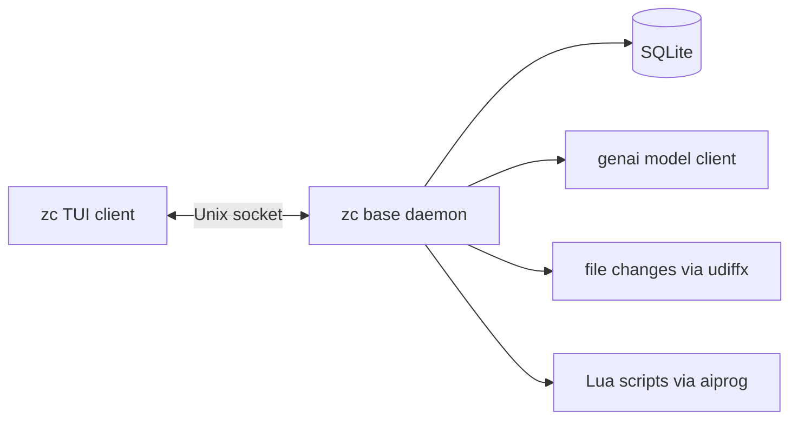
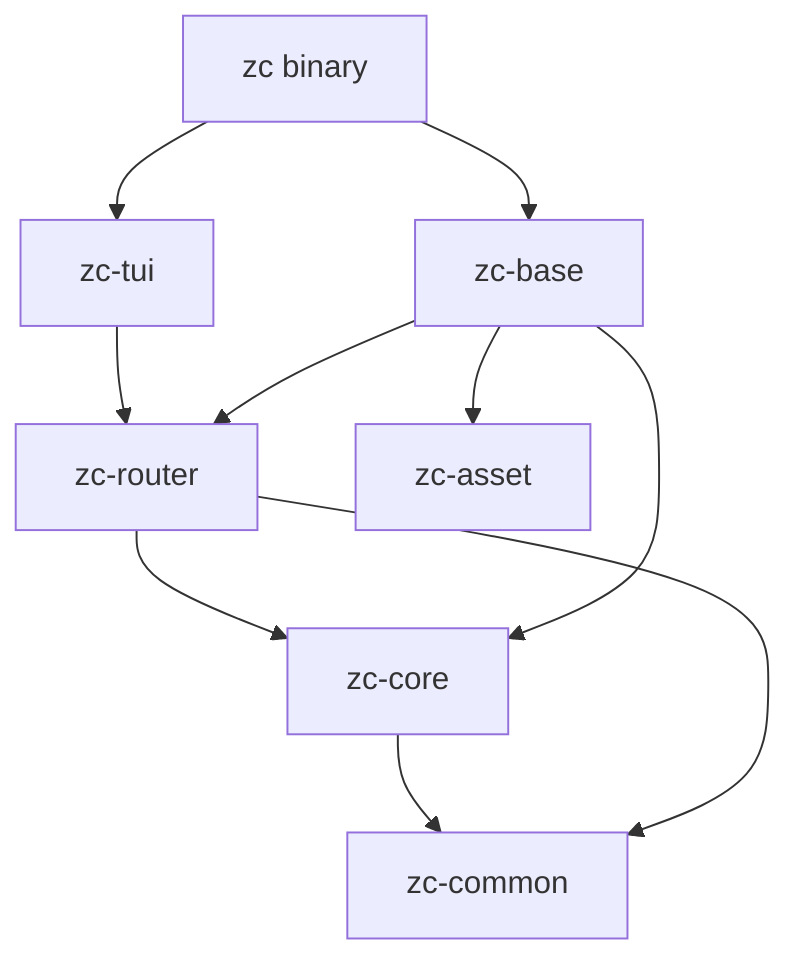
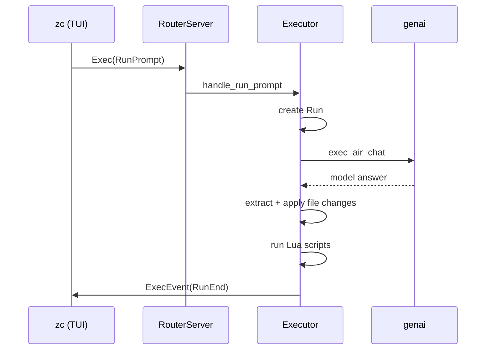

# 00 -- Overview

zcoder is an early-stage, parallel-first AI coding harness. One binary, `zc`, plays two
roles. Run as `zc`, it opens a terminal UI. Run as `zc base`, it becomes a background
daemon. The client and daemon talk over a Unix domain socket. The daemon owns all state
and drives all AI model calls. This document gives the shape of the whole system before
the deep dives.

## The Problem

A normal AI coding tool runs the model loop inside the CLI process. The CLI owns the
database, the model client, and the terminal. That design forces one process to do three
jobs. It also loses your session state when the terminal closes.

zcoder splits these jobs. The daemon (`zc base`) owns the database and the model client.
The client (`zc`) owns only the terminal. The client can quit, reconnect, and start new
prompts. The daemon keeps running.

Think of it as a client/server pair, like a database server and its client. The client
sends a prompt. The daemon stores a `Run`, runs model calls, applies file changes, and
runs scripts. The client shows the result.



## The Six Crates at a Glance

The workspace has six crates plus the `zc` binary at the root.

| Crate | Role | Key idea |
|-------|------|----------|
| `zc-asset` | Bundled files | Embeds config + prompt templates into the binary |
| `zc-core` | Domain types | `Air`, `Run`, `Wks` plus `Id` and `EpochUs` |
| `zc-common` | Shared plumbing | Channels, time, dirs, clipboard, cache |
| `zc-tui` | Terminal UI | Renders prompts and answers |
| `zc-router` | Transport | postcard frames over a Unix socket |
| `zc-base` | Daemon | SQLite persistence + model execution |

The dependency order matters. `zc-core` and `zc-common` are the foundation. They depend on
nothing else in the workspace. `zc-router` builds transport on top of `zc-core`.
`zc-base` builds the server on `zc-router`. `zc-tui` and the root binary sit at the top.



A later document, [01-architecture.md](./01-architecture.md), maps every dependency.

## The Domain Model in One Paragraph

The daemon stores three kinds of record. A `Wks` is a workspace: one directory on disk. A
`Run` is one user prompt and its outcome. An `Air` is one AI request inside a run. A run
can hold many AI requests, because the agent may loop.

```rust
// crates/zc-core/src/model/entities/run.rs:10
pub struct Run {
    pub id: Id,
    pub wspace_id: Option<Id>,
    pub ctime: EpochUs,
    pub mtime: EpochUs,
    pub prompt: Option<String>,
    pub answer: Option<String>,
    pub error: Option<String>,
    pub end: Option<EpochUs>,
    pub end_state: Option<String>,
    pub total_cost: Option<f64>,
    pub air_idx_seq: i64,
}
```

There is a naming mismatch worth knowing early. The Rust struct `Air` maps to the SQL table
`aixc`. The Rust struct `Wks` maps to the table `wspace`. The enum `EntityType` uses
`Aixc` and `Wks`, not `Air` and `Wks`. [02-domain-model.md](./02-domain-model.md) explains
why this exists and how the code bridges it.

## The Execution Shape

A prompt travels one direction, and results travel back. The client sends an `Exec` message.
The daemon's executor creates a `Run`, then loops over `Air` requests. Each `Air` call asks
a model for text. The text may contain unified-diff file changes and Lua scripts. The
executor applies both.



The full path, with every step and error branch, is in [05-executor.md](./05-executor.md)
and [11-data-flow.md](./11-data-flow.md).

## What Makes It "Parallel First"

The README calls zcoder a "parallel first AI coding harness". The architecture supports
that claim in two ways. First, the daemon is separate from the client, so many clients can
connect to one daemon. Second, the router is a broadcast hub: model-change and exec events
fan out to every attached client that shares a workspace.

```rust
// crates/zc-router/src/client_filter.rs -- who receives a broadcast message
pub fn client_filter(client_wspace_id: Id, msg: &RouterMsg) -> bool {
    msg.wspace_id == client_wspace_id || msg.wspace_id == Id::default()
}
```

A message whose `wspace_id` matches a client, or whose `wspace_id` is the default nil UUID,
reaches that client. The nil default is the "everyone" channel. [06-router-transport.md](./06-router-transport.md)
documents the full broadcast path.

## The Aha Moment

**Aha:** The daemon is an application server, not a helper. Most CLI tools fork a child
process to do a job. zcoder instead daemonizes the *stateful* part and keeps the *view* as
a thin client. This inverts the usual CLI design. The client is disposable; the daemon is
durable. That single decision gives you reconnect, multi-client, and crash recovery almost
for free, because the database lives in a process the terminal cannot kill.

## Where This Is Headed

Later documents go deep. [02-domain-model.md](./02-domain-model.md) and
[04-persistence.md](./04-persistence.md) explain the data. [05-executor.md](./05-executor.md)
explains the loop. [06-router-transport.md](./06-router-transport.md) explains the wire.
[08-tui-core.md](./08-tui-core.md) and [09-tui-rendering.md](./09-tui-rendering.md)
explain the client. [12-cross-cutting.md](./12-cross-cutting.md) covers Rust idioms,
production hardening, and how to build a resilient storage system like this one.
