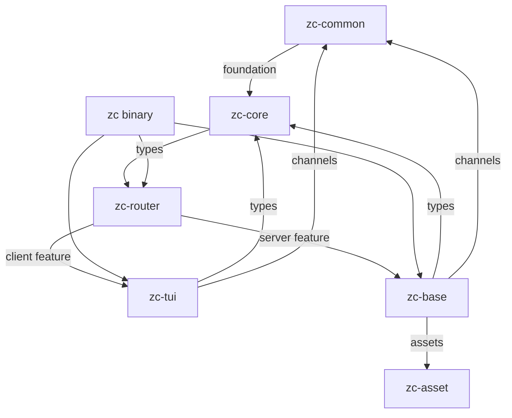
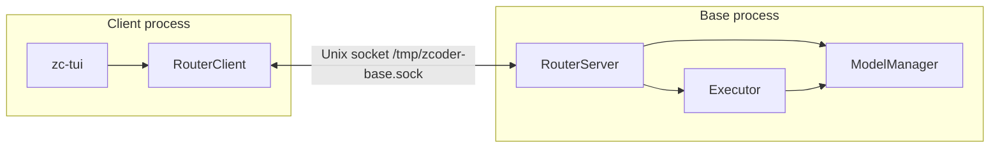

# 01 -- Architecture

zcoder is a layered client/server system in one binary. Six crates stack in a strict
dependency order. Two of them compile twice, once for the client and once for the server.
This document maps the crate graph, the layering, the socket boundary, and the two event
streams that keep every client in sync.

## The Crate Dependency Graph

Each crate declares its workspace siblings in its own `Cargo.toml`. The edges are exact.



The dependency declarations that produce this graph:

```toml
# crates/zc-core/Cargo.toml
zc-common = { workspace = true }

# crates/zc-router/Cargo.toml
zc-core   = { workspace = true }
zc-common = { workspace = true }

# crates/zc-tui/Cargo.toml
zc-core   = { workspace = true }
zc-common = { workspace = true }
zc-router = { workspace = true, features = ["client"] }

# crates/zc-base/Cargo.toml
zc-asset  = { workspace = true }
zc-common = { workspace = true }
zc-core   = { workspace = true }
zc-router = { workspace = true, features = ["server"] }
```

Three facts stand out. `zc-common` and `zc-asset` depend on nothing in the workspace. They
are leaves. `zc-router` has no runtime dependency on `zc-tui` or `zc-base`; it is compiled
with a `client` feature for the TUI and a `server` feature for the base. The root binary is
the only thing that links both the client and the server side.

## The Layering

The layers are ordered so that a lower layer never imports a higher one.

| Layer | Crates | Owns |
|-------|--------|------|
| 0 Foundation | `zc-common`, `zc-asset` | channels, time, dirs, bundled files |
| 1 Domain | `zc-core` | entity structs, scalar types, event types |
| 2 Transport | `zc-router` | message envelope, wire framing, server/client |
| 3 Application | `zc-tui`, `zc-base` | terminal UI; daemon + executor |
| 4 Entry | root `zc` binary | CLI parsing, spawn logic, tracing |

The reason for the split is compile-time isolation. `zc-core` has no idea that a socket
exists. `zc-router` has no idea that a model client exists. Each layer adds one concern.
This is the same discipline as [02-domain-model.md](./02-domain-model.md) uses for types:
contracts live in `zc-core`, implementation lives in `zc-base`.

## One Binary, Two Processes

The single binary switches behavior on its command line. The entry point reads `CliCmd`
and branches.

```rust
// src/main.rs:24
if cli_cmd.base || matches!(cli_cmd.command, Some(SubCmd::Base)) {
    return base_cmd::run_base_cmd().await;
}
```

`zc` (no flag) finds a workspace directory, connects to or spawns the daemon, then starts
the TUI. `zc base` runs the daemon directly. The daemon can also be spawned detached by the
client, which [10-bootstrap-lifecycle.md](./10-bootstrap-lifecycle.md) covers.

The two processes meet at a Unix socket. The path is a constant.

```rust
// crates/zc-common/src/consts.rs
pub const BASE_SOCK_PATH: &str = "/tmp/zcoder-base.sock";
```

The daemon binds this socket. The client connects. Everything else is postcard frames.



## The Message Envelope

Every message across the socket is a `RouterMsg`. It has three fields: an id, a workspace
id, and a payload.

```rust
// crates/zc-router/src/msg.rs:15
pub struct RouterMsg {
    pub msg_id: MsgId,
    pub wspace_id: Id,
    pub data: RouterMsgData,
}
```

The `data` is one of eight variants. Requests go one way. Replies, model changes, and exec
events come back. Attach messages open a session.

```rust
// crates/zc-router/src/msg.rs:24
pub enum RouterMsgData {
    ModelRpcReq(ModelRpcReq),
    ModelRpcRes(ModelRpcReply),
    ModelChange(ModelChangeEvent),
    Exec(ExecCmd),
    ExecEvent(ExecEvent),
    Attach(ClientInfo),
    AttachOk(Id),
    AttachErr(String),
}
```

`ModelRpcReq`/`ModelRpcRes` are a request/response pair for querying the database. `Exec`
is a one-way command to run a prompt. `ExecEvent` is a one-way notification of run
progress. `ModelChange` is a broadcast when a record changes. The full dispatch logic is in
[06-router-transport.md](./06-router-transport.md).

## Two Event Streams

The base publishes two independent event streams. Both reach the TUI through the router.

First, the model bus. When a record is created or updated, `zc-base` publishes a
`ModelChangeEvent` on a broadcast channel.

```rust
// crates/zc-base/src/model/bus.rs
pub const DEFAULT_MODEL_BUS_CAPACITY: usize = 1024;
```

Second, the exec event stream. The executor sends `ExecEvent` values on a bounded mpsc
channel. Each event marks a run start, end, or error.

```rust
// crates/zc-core/src/exec/exec_event.rs
pub enum ExecEvent {
    RunStart(Id),
    RunEnd(Id),
    RunError(Id),
}
```

Both streams are forwarded by the base into `RouterMsgData` variants, then broadcast by the
server to every matching client. The TUI merges them back into one UI event loop, which
[08-tui-core.md](./08-tui-core.md) explains.

## The Aha Moment

**Aha:** The router's `wspace_id` filter uses the nil UUID as a wildcard. A fresh
`RouterMsg` is built with `Id::default()`, which is `Uuid::nil()`. So a message created
before a workspace is known broadcasts to everyone. A message tied to a real workspace id
reaches only clients in that workspace. One field doubles as a routing key and a broadcast
flag, with no extra boolean. This is visible in `client_filter`:

```rust
// crates/zc-router/src/client_filter.rs
pub fn client_filter(client_wspace_id: Id, msg: &RouterMsg) -> bool {
    msg.wspace_id == client_wspace_id || msg.wspace_id == Id::default()
}
```

## Where This Is Headed

The next document, [02-domain-model.md](./02-domain-model.md), opens the lowest layer of
meaning: the entities, scalar types, and events that every other layer shares. Then
[03-config-system.md](./03-config-system.md) and [04-persistence.md](./04-persistence.md)
explain how the base uses those types.
